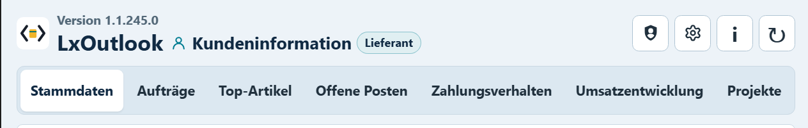
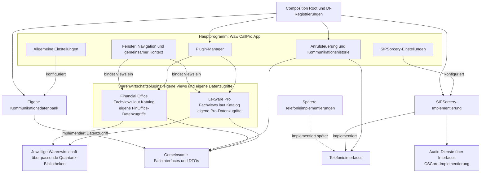

# WawiCallPro: Architektur

Stand: 04.11.2026. Verbindliches Zielbild nach den Nutzerfestlegungen zu Hauptprogramm,
Warenwirtschaftsplugins, Dependency Injection und austauschbarer Telefonie.
Der tatsächliche Umsetzungsstand steht am Dokumentende.

## Zuständigkeiten

| Hauptprogramm `WawiCallPro.App` | Jeweiliges Warenwirtschaftsplugin |
|---|---|
| Allgemeine Einstellungen | Kunden-/Lieferantenstammdaten |
| Plugin-Manager mit Oberfläche | Aufträge und Bestellungen |
| SIPSorcery-/SIP-Einstellungen | Kundenpreislisten-View |
| Gemeinsamer Fenster- und Navigationsrahmen | Top-Artikel und Artikel-zu-Aufträgen-/Bestellungen-Statistik |
| Gemeinsamer Mandanten- und Gesprächskontext | Offene Posten und Zahlungsverhalten |
| Anrufsteuerung, Anruferfenster und Kommunikationshistorie | Umsatzentwicklung und Projekte |
| Gemeinsame Datenbank-, Audio- und Betriebseinstellungen | Produktspezifische Datenzugriffe, Fachlogik und Verbindungs-/Fachoptionen |

Die Fachansichten des folgenden Katalogs gehören einschließlich ihrer konkreten Oberfläche in jedes unterstützte
Warenwirtschaftsplugin. Die App bindet sie in ihre Navigation ein und übergibt den aktuellen Kontext.
Allgemeine Einstellungen, Plugin-Manager und SIPSorcery-Einstellungen bleiben im Hauptprogramm.

Der Plugin-Manager verwendet die vorhandene Quantarix-Pluginlaufzeit. Seine Oberfläche verwaltet
zulässige Plugins, Produktlinie, Version, Fähigkeiten, Ladezustand und Konfiguration. Ein jeweiliger
Pro-/FinOffice-Build enthält ausschließlich die dazu passenden Warenwirtschaftsbibliotheken.

## Fachansichten nach LxOutlook-Vorlage

Zusätzliche fachliche Referenz ist `D:\Application-Development\OutlookBlazorAddin` mit LxOutlook.
Das Nutzerbild und `Home.razor` zeigen die Reiter Stammdaten, Aufträge, Top-Artikel, Offene Posten,
Zahlungsverhalten, Umsatzentwicklung und Projekte. Die ausdrücklich gewünschten Kundenpreislisten
und die Artikel-zu-Bestellungen-Statistik bleiben zusätzlich Bestandteil des Katalogs.

| Fachbereich im Wawi-Plugin | Inhalt/Zusammenhang |
|---|---|
| Stammdaten | Kunden/Lieferanten, Anschriften, Kontakte und Rufnummern im jeweiligen Mandanten |
| Aufträge / Bestellungen | Belege und Positionen; Verkaufs-/Einkaufssicht je Kunden-/Lieferantenkontext unterscheiden |
| Kundenpreislisten | Kundenspezifische Preise und Konditionen gemäß verfügbarer Wawi-API |
| Top-Artikel | Artikelbezogene Auswertung, Mengen und Werte aus den fachlich relevanten Belegen |
| Artikel-zu-Aufträgen-/Bestellungen-Statistik | Zugehörige Belege/Positionen zu einem Artikel; als Detailansicht aus Top-Artikeln nutzbar |
| Offene Posten | Offene Forderungen/Verbindlichkeiten mit Beträgen, Fälligkeiten und Status |
| Zahlungsverhalten | Nachvollziehbare Auswertung aus tatsächlich verfügbaren Zahlungs-/Beleginformationen |
| Umsatzentwicklung | Zeitbezogene Umsatzsicht; bei Lieferanten fachlich getrennte Einkaufsentwicklung |
| Projekte | Projekte und tatsächlich zugehörige Geschäftsdaten/Belege |

Die Umsetzung erfolgt als designerfähige DevExpress-/WinForms-Pluginansichten. Alle Bereiche werden
je Warenwirtschaftssystem, Produktlinie, Mandant und Kunden-/Lieferantenkontext in der Capability-Matrix
geprüft. Die Vorlage belegt keine automatische Funktionsparität der WawiCallPro-Adapter.

Die Referenz trennt beispielsweise `ArticleRevenueTab`, `SupplierArticlePurchasesTab`,
`SupplierPurchaseStatisticsTab`, `OpenItemsTab`, `SupplierPerformanceTab` und `ProjectsTab`.
Die Lieferantenzahlungssicht nennt ausdrücklich ihre belegbasierte Grenze ohne vollständige
Kreditorenbuchhaltung. Solche fachlichen Grenzen, getrennte Währungen sowie Gutschrift-/Stornoregeln
müssen die jeweiligen Wawi-Dienste korrekt abbilden.

Referenz-HEAD: `f2d9e17cb62684d6d2b2b9e641e115b98f45473c`. Die Arbeitskopie enthält lokale Änderungen;
gesichtet wurden die aktuellen Dateien. Einstieg:
[Home.razor](../../OutlookBlazorAddin/src/OutlookBlazorAddin.Web/Pages/Home.razor),
[Components](../../OutlookBlazorAddin/src/OutlookBlazorAddin.Web/Components).

## Zusammenspiel

Das Diagramm beschreibt das Zielbild. DI verbindet Verträge mit konkreten Implementierungen;
die Pfeile zu Datenbank und Warenwirtschaft stehen für Zugriffe über die jeweiligen Dienste.

## Dependency Injection

Alle Anwendungsdienste und ihre Abhängigkeiten werden über DI bereitgestellt. Jeder Hostprozess
besitzt einen Composition Root und einen Root-Container. App und Console verwenden dieselben
gemeinsamen Registrierungsmodule, haben als getrennte Prozesse aber eigene Instanzen.

- Klassen erhalten Dienste über ihre Konstruktoren. Geschäftslogik erzeugt keine versteckten
  Dienstinstanzen und greift nicht auf globale Service-Locators zu.
- Der Composition Root wählt die konkreten Implementierungen anhand der geprüften Konfiguration.
  Noch fehlende Module erhalten keine erfolgreich arbeitenden Leerimplementierungen.
- Für zur Laufzeit entstehende Views und Gesprächsobjekte werden typisierte Factories verwendet.
  Die Factory löst ihre Dienste im vorgesehenen Lebenszyklus auf.
- Plugins erhalten typisierte Hostdienste. Diese geliehenen Dienste werden vom Plugin nicht freigegeben.
  Plugininterne Dienste und Views erhalten einen begrenzten, vollständig freizugebenden Lebenszyklus.
- Der Laufzeitadapter verbindet Quantarix-Pluginaktivierung und DI. Zusätzliche Container dürfen
  gemeinsame Hostdienste nicht versehentlich duplizieren.
- Prozessweite Telefonie-, Konfigurations- und Hostdienste leben bis zum geordneten Shutdown.
  Views, Mandantenoperationen und Gesprächssitzungen haben ihren jeweils eigenen Lebenszyklus.

WinForms-Designerkonstruktoren bleiben parameterlos und rufen nur `InitializeComponent()` auf.
Der Laufzeitpfad erhält seine Dienste über einen DI-fähigen Konstruktor beziehungsweise die Factory.
Der Designer löst keine Laufzeitdienste auf und öffnet keine Datenbankverbindung.

## Quantarix-Pluginvertrag: Attribute, Build und Laufzeit

Geprüft wurde der aktuelle Quellcode unter `D:\Application-Development\Quantarix.Plugin.System`,
Stand `1e43c99068cd17bfa32586d86099c6e66fae4076`. Maßgeblich sind die tatsächlichen C#-/MSBuild-Dateien.
In diesem Stand liegen die Buildregeln in `Directory.Build.props`, `Directory.Build.targets` und im
TestHost-Projekt; eine `Solution.props` existiert dort nicht. WawiCallPro besitzt seine eigene
`Solution.props`, importiert dadurch aber noch keine Targets des Schwester-Repositories.

| Mechanismus | Konkrete Bedeutung für WawiCallPro |
|---|---|
| `[assembly: SharedAssembly]` | Markiert eigene gemeinsame Vertragsassemblies. `WawiCallPro.Interfaces` trägt das Attribut bereits; ein künftiger eigener UI-Vertrag benötigt dieselbe Behandlung. Die konkrete Pluginimplementierung wird dadurch nicht selbst zur Shared Assembly. |
| Shared-Erkennung beim Managerkonstruktor | `PluginManager` erfasst nur die zu diesem Zeitpunkt im Default-ALC geladenen markierten Assemblies. Alle gemeinsamen Verträge müssen vorher ausdrücklich geladen sein. |
| `IsPluginProject=true` | Aktiviert den Buildfilter für das jeweilige Pluginprojekt. |
| `SharedProjectAssembly` | Benennt die vom Host bereitgestellten Projekt-DLLs; Buildfilter entfernt deren `ReferenceCopyLocalPaths`-Einträge nach `ResolveReferences`. |
| `SharedPackage` | Entsprechende Paketliste, gefiltert über `NuGetPackageId`; gemeinsam verwendete Drittanbieterpakete bekommen kein eigenes SharedAssembly-Attribut. Der Host muss die passenden Pakete bereitstellen. |
| Host-Kopierziele | Stellen jedes Plugin samt `.deps.json` und privaten/native Abhängigkeiten unter `plugins/<AssemblyName>/` bereit und entfernen dort gemeinsame DLL-/PDB-Kopien. |
| Laufzeitauflösung | Pro Plugin ein sammelbarer `PluginLoadContext`; gemeinsame Typen aus dem Default-ALC, private/native Bibliotheken über `AssemblyDependencyResolver`. |
| Erkennung/Validierung | Erwartet `plugins/<AssemblyName>/<AssemblyName>.dll`, sucht konkrete `IPlugin`-Implementierungen und prüft den Strong-Name-Public-Key-Token gegen die Host-Allowlist. Eine leere Allowlist schaltet diese Prüfung im vorhandenen Code ab. |

Attribute, gemeinsame Buildlisten und Deployment müssen zusammenpassen: Das Attribut ersetzt die
Buildfilter nicht; Buildfilter ersetzen das rechtzeitige Laden gemeinsamer Verträge nicht. Die nötigen
Targets werden im WawiCallPro-Build ausdrücklich importiert/adaptiert. Produktlinien, reguläre Debug-
Ausgaben, Publish-Pakete und die finale Strip-/Signierreihenfolge bleiben dabei erhalten.

Der Loader verwendet aktuell `Activator.CreateInstance(type)` und ruft anschließend
`Initialize(this)` auf. `IPluginHost` stellt dabei ausschließlich den Quantarix-Logger bereit.
Unser `Configure(IWawiCallHostServices)` ist ein nachgelagerter typisierter Anschluss; er ist keine
bereits vorhandene Konstruktorinjektion. Für die verbindliche DI-Aktivierung auch der Einstiegsklasse
ist daher ein Factory-/Aktivierungshook im bestehenden Quantarix-Manager erforderlich. Dessen konkrete
API muss gesondert im Quantarix-Repository umgesetzt und geprüft werden. Es entsteht kein zweiter Loader
und keine globale Service-Locator-Lösung als Ersatz für DI.

Die vorhandene öffentliche Manager-API bietet LoadFromDirectory, ExecuteAll und UnloadAll. Ein
gezieltes Entladen einzelner Plugins oder ein asynchroner Stopvertrag ist damit noch nicht gegeben.
Entsprechende Bedienaktionen des Plugin-Managers müssen vor ihrer Implementierung auf diese
Laufzeitgrenzen abgestimmt werden.

Vor Entladen: Aufrufe stoppen und asynchrone Arbeit vollständig abwarten, Views/Ereignisbindungen
freigeben, im geordneten Shutdown die Plugin-DI-Ressourcen freigeben und anschließend den ALC entladen.
Der Manager ruft `Shutdown` synchron vor `Unload` auf. `Unload` fordert die Entladung an; verbleibende Referenzen
verhindern sie. Die Integration muss Typidentität, private/native Auflösung, fehlerhafte Plugins und
tatsächliche Freigabe prüfen. Strong Names/ALCs bilden keine Sicherheits-Sandbox.

MSBuild-Auswertung des Iststands: WawiCallPro-Pro-Plugin noch ohne IsPluginProject/Shared-Listen und
ohne Signierung; Quantarix-Sample mit gesetztem Pluginflag, Signierung und SharedProjectAssembly.
Diese Lücke bleibt Phase 4, nicht eine bereits erledigte Buildintegration.

Quellen:
[SharedAssemblyAttribute](../../Quantarix.Plugin.System/src/Quantarix.Plugin.Abstractions/SharedAssemblyAttribute.cs),
[PluginManager](../../Quantarix.Plugin.System/src/Quantarix.Plugin.Hosting/PluginManager.cs),
[PluginLoadContext](../../Quantarix.Plugin.System/src/Quantarix.Plugin.Hosting/PluginLoadContext.cs),
[Buildfilter](../../Quantarix.Plugin.System/Directory.Build.targets),
[TestHost-Deployment](../../Quantarix.Plugin.System/src/Quantarix.Plugin.TestHost/Quantarix.Plugin.TestHost.csproj).

## Telefonie hinter Interfaces

Unsere Telefonie-Dienstklassen erhalten immer ein Interface. App, Plugins, Gesprächsabläufe und Tests
verwenden diese Verträge und referenzieren keine konkrete SIP-Implementierung.

`ITelephonyService` ist bereits vorhanden. Der Vertrag beschreibt Wählen, Annehmen, Ablehnen,
Auflegen, Halten, Fortsetzen, Weiterleiten, DTMF und Statusereignisse. Gesprächs-IDs, Zustände,
Zeitstempel und Ereignisse bleiben eigene WawiCallPro-Typen. SIP-Dialoge, SIPSorcery-Klassen und
herstellerspezifische Gerätetypen bleiben im Adapter.

Auch unsere Dienste für Gesprächssitzungen, Zustandssteuerung, Geräte, Wiedergabe und Aufnahme
werden über passende Interfaces und gegebenenfalls Factories angesprochen. DTOs, Records, Enums
und reine Werte benötigen dadurch keine künstlichen Dienstinterfaces.

Der erste konkrete Telefonieadapter wird mit SIPSorcery umgesetzt. Windows-Audio verwendet die
vorgegebene `SIPSorceryMedia.Windows.CSCore`-Bibliothek mit CSCore. Die aktuellen Repository-Vorgaben
für diese Implementierung gelten weiter. Andere Technologien sind eine spätere Erweiterung;
zusätzliche Backends sind derzeit nicht zur Implementierung beauftragt.

Ein späterer Adapter implementiert die gemeinsamen Verträge und wird am Composition Root registriert.
Fähigkeiten und Einschränkungen werden ausdrücklich ausgewiesen. Nicht unterstützte Funktionen melden
einen klaren Status/Fehler. Einstellungen eines weiteren Adapters folgen erst mit dessen Implementierung.

### DTMF als Telefoniefunktion

DTMF bleibt Bestandteil eines vollständigen Telefonprogramms: Zifferntasten während eines Gesprächs
werden beispielsweise für Sprachmenüs, Vermittlungen und Konferenzzugänge benötigt. Reine
Gesprächsprotokollierung benötigt diese Funktion nicht, interaktive Telefonie und Telefonmenüs dagegen schon.

| Aufgabe | Vorgesehene Umsetzung |
|---|---|
| Ziffern im aufgebauten Gespräch senden | Über das vorhandene `ITelephonyService.SendDtmfAsync`; SIPSorcery-Adapter verwendet `SIPUserAgent.SendDtmf` |
| Empfangene Ziffern für eigene Telefonmenüs | RTP-Empfang über `OnDtmfTone` in ein technikunabhängiges, einem Gespräch zugeordnetes Ereignis übersetzen; der gemeinsame Empfangsvertrag fehlt noch |
| Tatsächliche DTMF-Töne im Audiosignal erkennen | Separater optionaler Audio-Detektor hinter Interface/DI, erst bei nachgewiesenem Bedarf für In-band-DTMF oder Dateianalyse |

Der SIP-Pfad verwendet ausgehandelte RTP-Telefonieereignisse gemäß RFC 4733, häufig weiterhin
„RFC 2833“ genannt. Empfangene RTP-Pakete sind nicht jeweils ein neuer Tastendruck; vollständige
Ereignisse müssen sauber zugeordnet und Mehrfachmeldungen vermieden werden. Andere DTMF-Verfahren
wie SIP INFO oder In-band werden nur für tatsächlich benötigte, geprüfte Anlagenprofile ergänzt.

In `D:\Application-Development\WawiCallPro_old\WawiCallPro.old.sln` stehen `DtmfDetection`,
`DtmfDetection.CSCore` und `DtmfDetector`. Die ersten beiden sind .NET-Framework-4.8-Bibliotheken für
Audio-Tonerkennung und ihre CSCore-Anbindung; `DtmfDetector` ist ein Demo-EXE. Der Kern verwendet
Goertzel-Analyse von Audiodaten. Sie werden für den normalen SIP-RTP-Ereignispfad nicht als weitere
Abhängigkeiten benötigt. Auch der alte `Audio/DtmfToneGenerator.cs` erzeugt Audiosignale und ersetzt
keine ausgehandelte RTP-DTMF-Übertragung.

Zunächst werden keine dieser alten Projekte eingebunden. DTMF-Senden gehört zu Phase 7; der
Empfangsvertrag wird für die Telefonmenüs in Phase 12 benötigt. Nutzdaten wie gewählte Ziffernfolgen
werden nicht in das bereinigte Betriebslog übernommen. Abnahme: Ziffern/`*`/`#`, Zuordnung zum richtigen
Gespräch, ausgehandelte Unterstützung, Wiederholungen, Abbruch und Gesprächsende; Audioerkennung
würde zusätzlich eigene Codec-/Rausch-/Fehlerkennungstests benötigen.

Quellen: [alte Solution](../../WawiCallPro_old/WawiCallPro.old.sln),
[Audio-Detektor](../../WawiCallPro_old/3rd/DtmfDetection-master/README.md),
[SIPSorcery-DTMF-API](https://sipsorcery-org.github.io/sipsorcery/api/SIPSorcery.SIP.App.SIPUserAgent.html),
[RFC 4733](https://www.rfc-editor.org/rfc/rfc4733).

### Erforderliche SIPSorcery-Einstellungen

Die [SIP-/Audioanalyse](SIP-Einstellungen.md) legt den anhand von PlaySounds und RecordIncomingCall
geprüften Einstellungsumfang fest: Registrar/Serverport, Transport, Konto/Authname/Kennwort, lokaler
SIP-Port und Bindung, Registrierungsdauer sowie Audioausgabe, Mikrofon, Klingelausgabe und Codecprofil.
Die Demos verwenden unterschiedliche Transporte und Codecfreigaben. Domain/Proxy, TLS, RTP-/NAT-
Optionen bleiben bedarfsabhängige Experteneinstellungen. Konfiguriert und tatsächlich registriert
werden getrennt dargestellt; reine Anzeige/Speicherung startet weder Anmeldung noch Audiohardware.

## Projektgrenzen

| Projekt/Bereich | Zuständigkeit |
|---|---|
| `WawiCallPro.App` | Hauptprogramm, allgemeine Einstellungen, Plugin-Manager-UI, SIPSorcery-Einstellungen und gemeinsame Anruf-/Historienoberfläche |
| `WawiCallPro.Console` | Diagnosehost mit denselben Fachverträgen und DI-Modulen; erzeugt keine Plugin-Views |
| `WawiCallPro.Interfaces` | UI- und technikunabhängige Fachverträge, DTOs und Hostdienste |
| `WawiCallPro.Core` | Gemeinsame Abläufe, Mandantenkontext und Dispatcher |
| `WawiCallPro.Telephony` | Gemeinsame Gesprächszustände und Abläufe hinter Telefonieinterfaces |
| `WawiCallPro.Telephony.Sip` | SIPSorcery-Adapter und SIP-spezifische Umsetzung |
| `WawiCallPro.Audio` | Eigene Audio-Dienstimplementierungen hinter Interfaces; vorgegebene CSCore-Anbindung |
| `WawiCallPro.Database` | Eigene Kommunikationsdatenbank, Migrationen und Repositories |
| `WawiCallPro.Plugins.Lexware.Pro` | Pro-Fachviews laut Katalog und zugehörige Zugriffe über Quantarix Lexware/APIService |
| `WawiCallPro.Plugins.Lexware.FinOffice` | FinOffice-Fachviews laut Katalog und zugehörige Zugriffe über Quantarix Pcfk |
| Windows-spezifischer Plugin-UI-Anschluss, noch festzulegen | Einbettung, Erzeugung und Freigabe der Plugin-Views ohne UI-Typen in den Fachinterfaces |

Die bestehenden Fachinterfaces bleiben frei von WinForms, DevExpress, SIPSorcery und konkreten
Datenbanktypen. Der UI-Anschluss benötigt deshalb eine eigene Windows-spezifische Vertragsgrenze.
Seine endgültige API und DI-Anbindung werden mit der Pluginlaufzeit umgesetzt.

## Telefonnummern, Suchfirmen und Anruferzuordnung

[libphonenumber-csharp](https://github.com/twcclegg/libphonenumber-csharp) übernimmt Parsing,
Normalisierung und Rufnummern-Metadaten hinter eigenen DI-Interfaces. Die Bibliothek kennt weder
Lexware-Geschäftspartner noch individuelle Telefonanlagen. Eine Rufnummernregion ist keine
Live-Ortsangabe. Für Stammnummern ist ein firmenbezogen aktivierbarer `StartWidth`-Abgleich geplant:
gleicher Ländercode, gleiche Orts-/Netzvorwahl und gleiche erste N Anschlussziffern ergeben einen
positiven Geschäftspartnertreffer. Die restlichen Ziffern gelten gemäß Einstellung als Apparatenummer,
ohne eine Kontaktperson zu bestätigen. `StartWidth` zählt weder Ländercode noch Vorwahl mit.

Das verbindliche Detailkonzept steht in [Telefonnummern-Cache.md](Telefonnummern-Cache.md).
Das Hauptprogramm bietet eine DevExpress-CheckedListBox für mehrere Suchfirmen. Die Haken bilden
eine Menge vollständiger `CompanyKey`-Werte; aktuelle Ansichtsfirma und bevorzugte Firma sind davon
getrennt. Der Telefon-Cache hält Stammdaten und Nummern je Firma, der gemeinsame Index liefert alle
passenden Firmen-/Geschäftspartnerkandidaten. Detaildaten laden die Plugin-Views anschließend nur
im ausdrücklich gewählten Firmenkontext nach.

| Suchergebnis | Auswahl der Fachansichten |
|---|---|
| Genau ein belastbarer Treffer bei vollständigem Suchstand | Firma und Geschäftspartner für den Anruf übernehmen |
| Mehrere Datensätze in einer Firma | Firma steht fest; Datensatzauswahl anbieten |
| Gleiche Nummer in mehreren Firmen | Treffer nach Firma gruppieren und ausdrücklich auswählen lassen |
| Eindeutiger positiver StartWidth-Match bei vollständigem Suchstand | Geschäftspartner-Views öffnen; abgeleitete Apparatenummer und Trefferart anzeigen |
| Nur Stammnummernheuristik oder unvollständiger Cache | Vorschläge beziehungsweise fehlenden Suchstand anzeigen; keine eindeutige Zuordnung behaupten |

Aktive/bevorzugte Firma und frühere Entscheidungen beeinflussen die Reihenfolge, verdrängen aber
keine gleichwertigen Treffer. Eine verlässlich konfigurierte angerufene Leitung kann ihre Firma
sichtbar bevorzugen, wenn dort genau ein belastbarer Datensatz passt; Alternativen bleiben erhalten.
Ein Anruferbereich erhält einen eigenen Firmen-/Viewkontext und wechselt keine Hauptansicht mit
offenen Änderungen. Späte Antworten benötigen Anruf-ID, vollständige Quellidentität und Revision.

Seit Migration 6 besitzen historische Kandidaten eigene Firmenidentität und optionale Matchnachweise;
Suchstände und versionierte Firmenregeln haben eigene Tabellen/Verträge. Die ausgewählte Partei ist
auch per SQL-FK an die Gesprächsfirma gebunden. Migrationen 1–5 bleiben unverändert. Der Offline-Parser ist seit Phase 6/Punkt 1
über `IPhoneNumberParser` in beiden Hosts registriert; seine DTOs behalten Original/Quelle,
E.164/Extension, Prüfstatus, Rufnummernregion und Parserversion ohne Bibliothekstypen im gemeinsamen
Vertrag. Seit Punkt 2 wendet `IPhoneNumberInterpreter` ausdrücklich getrennte Firmen-/Leitungskontexte,
lokale Ortsvorwahl und Präsentationszustände an. Firmenvorgaben werden nach vollständigem CompanyKey
gelesen; interne Nummern benötigen Anlagenbezug, unterdrückte Nummern werden nicht geparst.
Mehrfirmensuche, StartWidth-Abgleich, Auswahlkonfiguration und UI bleiben Zielbild.

## Gesprächsaufzeichnung, WAV-Mixer und MP3

Auf Nutzerwunsch ist die Aufnahme eingehender und ausgehender Gespräche verbindlicher Bestandteil.
Funktionale Vorlage ist [TestCSCoreRecording](../../WawiCallPro_old/TestCSCoreRecording/TestCSCoreRecording.csproj)
mit [WavMixer](../../WawiCallPro_old/TestCSCoreRecording/WavMixer.cs),
[SimpleMixer](../../WawiCallPro_old/TestCSCoreRecording/SampleMixer.cs),
[SoundRecorder](../../WawiCallPro_old/TestCSCoreRecording/SoundRecorder.cs) und
[WavToMp3Converter](../../WawiCallPro_old/TestCSCoreRecording/WavToMp3Converter.cs).
Das Projekt verwendet CSCore 1.2.1.5 und Media Foundation. Die eigene Windows-Medienanbindung
`SIPSorceryMedia.Windows.CSCore` und SIPSorcery bleiben vorgegeben. Diese Analyse führt noch keine Aufnahme aus.

Die Aufnahme bekommt die dekodierten Empfangsdaten und den wirksam gesendeten Audiostrom genau
dieses Gesprächs. Mikrofonstumm-/Halten-Zustände müssen zum tatsächlich übertragenen Ton passen.
Die Mikrofon-/Desktop-Loopback-Erfassung des Testprogramms wird dafür durch gesprächsgebundene
Medienabgriffe ersetzt: Sonst könnten Klingelton, andere Programme oder weitere Gespräche mit aufgezeichnet werden.
Der [RecordIncomingCall-Empfangspfad](../../sipsorcery-examples/RecordIncomingCall/Program.cs)
ist Referenz für den dekodierten Empfang, erfasst aber noch nicht beide Gesprächsrichtungen.

Geplanter Ablauf je Anruf und Aufnahmesegment:

1. Aufnahme-ID und Call-ID anlegen, Beginn/Status in der eigenen Kommunikationsdatenbank speichern.
2. Beide PCM-Ströme auf eine gemeinsame Zeitbasis bringen. Sampleformat, Kanäle und Abtastrate
   angleichen, Paketlücken zeitlich erhalten und verspätete Daten geordnet behandeln. Die tatsächliche
   Decoder-Abtastrate ist maßgeblich; insbesondere G.722 darf nicht pauschal als PCM mit 8 kHz behandelt werden.
3. Die Mixerlogik aus der Vorlage unter einem eigenen Interface aufbauen und eine gültige PCM-WAV-Datei
   schreiben. Aufnahme-/Encoderwarteschlangen blockieren keine RTP-Callbacks; ein Überlauf ist ein sichtbarer Fehler.
4. Bei Stop/Gesprächsende Quellen beenden, ausstehende Daten abarbeiten und WAV-Header/Datei finalisieren.
   Aufnahmedauer aus geschriebenen Frames bestimmen; Aufnahmebeginn/-ende getrennt von Gesprächszeiten halten.
5. Erst danach asynchron WAV nach MP3 konvertieren. Verfügbaren MP3-Encoder und unterstützte
   Abtastraten/Kanäle/Bitrate prüfen, in eine temporäre Zieldatei schreiben und nach Erfolg veröffentlichen.
6. Erst die finalisierte MP3 als verfügbar melden. WAV bis zum bestätigten Erfolg erhalten; bei
   Encoder-/Datei-/DB-Fehlern nutzbare WAV und Fehlerzustand für Wiederanlauf beziehungsweise erneute Konvertierung behalten.

Neue Anwendungsdienste, etwa Aufnahmeverwaltung, PCM-Mixer, Encoder und gesprächsgebundene
Aufnahmesitzung, erhalten eigene Interfaces und DI-/Factory-Anbindung. App und Console verwenden
dieselben Dienste. Manuelle und ausdrücklich konfigurierte automatische Aufnahme bleiben getrennte Startarten.

Bei der Portierung sind konkrete Vorlagenfehler zu beheben: `WavToMp3Converter` prüft
`WindowsMediaAudio`, erzeugt danach aber einen MP3-Encoder; dafür ist die MP3-Fähigkeitsprüfung nötig.
`Finished` wird nach abgefangenen Fehlern ebenfalls ausgelöst und darf deshalb kein Erfolgsnachweis sein.
Das aktuelle RecordIncomingCall-Beispiel verwendet einen WaveWriter mit `.mp3`-Dateiname; RIFF/WAV-Inhalt
wird dadurch nicht zu MP3. Produktdateiendung, Header und tatsächlicher Codec müssen übereinstimmen.

Die Gesprächshistorie wird unabhängig vom Erfolg einer Aufnahme gespeichert: eingehend/ausgehend,
Beginn, Annahme, Ende, Endgrund, Nummern, ausgewählter Firmen-/Geschäftspartnerkontext sowie PC/Windows-Nutzer.
Gesprächsdauer beginnt bei Annahme; Zeitbereichsabfragen verwenden UTC. Zu einem Gespräch können mehrere
Aufnahmesegmente gehören. Audio liegt als Datei im Aufnahmeverzeichnis, die DB enthält Metadaten und
relative Dateireferenzen mit Call-ID/Aufnahme-ID. Ausstehende Repositories und Host-/SIP-Anbindung bleiben erforderlich.

Die bestehende Recording-Struktur enthält Pfad, Format, Dauer und Verfügbarkeit, aber noch keinen
exakten Aufnahmebeginn/-ende oder belastbaren Konvertierungszustand. Diese Metadaten und WAV-/MP3-
Artefakte sind in zusätzlichen Migrationen ab Version 6 und den Verträgen auszuarbeiten; Versionen 1–5
bleiben unverändert. Wiederanlauf muss abgebrochene Jobs und verwaiste/fehlende Dateien mit den
Metadaten abgleichen. Dateierzeugung und DB-Commit sind keine gemeinsame atomare Transaktion.

## Daten und Lebenszyklus

Ein Plugin lädt seine Warenwirtschaftsdaten über den passenden Adapter und liefert gemeinsame DTOs.
Die Capability-Matrix weist alle Fachbereiche des Katalogs je Warenwirtschaftssystem gesondert nach.
Nicht verfügbare Quellfunktionen werden sichtbar ausgewiesen; Fachansichten erhalten keine Demo-/Leerdaten.

Rufnummernzuordnung und gemeinsame Gesprächsabläufe verwenden die Fachverträge. Die Telefonie sendet
Ereignisse über ihre Interfaces. Gespräch, Herkunft, Zuordnung, Notizen und Aufnahmemetadaten werden
über gemeinsame Repository-/Historiendienste in der eigenen Kommunikationsdatenbank gespeichert.
Das WawiCallPro-Schema wird nicht in einer Lexware-Quelldatenbank angelegt.

Jedes gespeicherte Gespräch enthält PC-Name und Windows-Benutzer als historische Momentaufnahmen.
Die zusätzliche Arbeitsplatz-ID ist eine eigene, dauerhaft vorgesehene GUID. Ihre einmalige Erzeugung
und gemeinsame Ablage für App/Console sowie die Windows-Erfassung sind noch umzusetzen.
Spätere PC-/Kontoumbenennungen ändern vorhandene Herkunftswerte nicht.

Beim Start gilt: Konfiguration prüfen → DI-Host aufbauen → zulässige Plugins laden und konfigurieren →
Mandantenkontext bereitstellen → Plugin-Views bei Bedarf erzeugen → Fachoperationen ausführen.
Mandantenwechsel brechen überholte Ladevorgänge ab; Ergebnisse erscheinen erst nach Kontextprüfung.

Beim Beenden werden Operationen, Gespräche und Aufnahmen geordnet abgeschlossen, Plugin-Views und
Ereignisbindungen freigegeben und anschließend Plugin-/Hostdienste beendet. Ein Plugin kann erst
entladen werden, wenn seine Views, Operationen und gebundenen Ressourcen beendet sind.

Alle App- und Plugin-Forms/-Controls bleiben als `.cs`, `.Designer.cs` und `.resx` designerfähig.
Layouts verwenden TableLayoutPanel und vorhandene DevExpress-Eingaben. Die betroffenen Ansichten
werden mit leeren/befüllten Daten, kleineren Fenstern und größerer Schrift visuell geprüft.

## Umsetzungsstand

Vorhanden sind die Hostprojekte mit Standard-.NET-Host/DI-Grundlage, gemeinsame Fachverträge
einschließlich `ITelephonyService`, Mandantenkontext/Dispatcher, Konfiguration und Gesprächszustandsautomat.
Die Datenbankmigrationen 1–6, Herkunftsfelder und prozessübergreifenden Migrationssperren/Rechteprüfungen
sind implementiert und auf allen vier Providern geprüft.
Hinzu kommen der offline arbeitende libphonenumber-Adapter und die Firmen-/Leitungskontextanwendung
hinter eigenen DI-Interfaces, einschließlich lokaler Vorwahl sowie interner/unterdrückter Nummern.

Noch offen sind insbesondere:

- Sicherung/Wiederherstellung und Hostanbindung; die sieben Dapper-Repositories sind seit Phase 3/Punkt 7 implementiert und auf allen vier Providern geprüft.
- Pluginlaufzeit im Host, DI-Aktivierungshook im Quantarix-Manager, Build-/Shared-/Signierintegration und Plugin-Manager-Oberfläche.
- Windows-spezifischer Plugin-UI-Vertrag und tatsächliche Fachviews laut erweitertem Katalog je Plugin.
- Erweiterte Fach-/Capability-Verträge insbesondere für Bestellungen und Kundenpreislisten.
- DI-Anbindung der fehlenden Module und Interfaces für die bisher konkrete Zustandssteuerung.
- SIPSorcery-/CSCore-Betrieb, Repository-/Hostpersistenz und Herkunftserfassung.

Dieses Dokument legt die Architektur fest; es meldet die offenen Teile nicht als implementiert.
Details: [Fachverträge](Vertraege.md), [Umsetzungsplan](Neuaufbau-Plan.md),
[Datenbankschema](Datenbankschema.md), [Quantarix-Zuordnung](Quantarix-Zuordnung.md).
