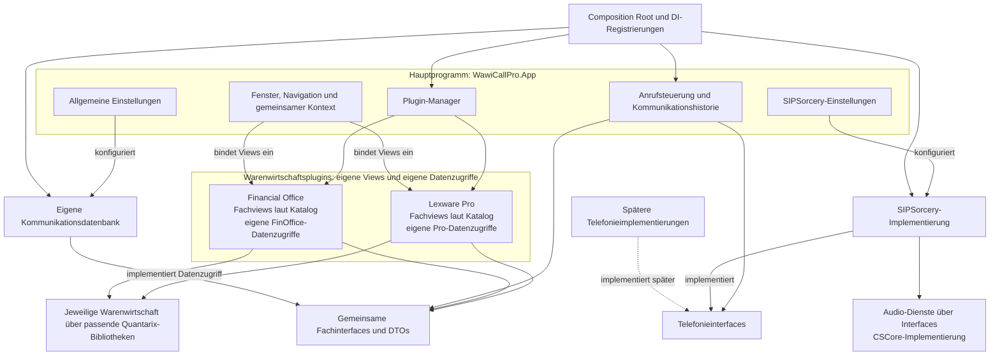

# WawiCallPro: Architektur

Stand: 09.11.2026. Verbindliches Zielbild nach den Nutzerfestlegungen zu Hauptprogramm,
Warenwirtschaftsplugins, Dependency Injection und austauschbarer Telefonie.
Der tatsächliche Umsetzungsstand steht am Dokumentende.

## Zuständigkeiten

| Hauptprogramm `WawiCallPro.App` | Jeweiliges Warenwirtschaftsplugin |
|---|---|
| Allgemeine Einstellungen | Kunden-/Lieferantenstammdaten |
| Plugin-Manager mit Oberfläche | Aufträge und Bestellungen |
| SIPSorcery-/SIP-Einstellungen | Kundenpreislisten-View |
| Gemeinsamer Fenster- und Navigationsrahmen | Top-Artikel und Artikel-zu-Aufträgen-/Bestellungen-Statistik |
| Gemeinsamer Mandanten- und Gesprächskontext | Offene Posten und Zahlungsverhalten |
| Anrufsteuerung, Anruferfenster und Kommunikationshistorie | Umsatzentwicklung und Projekte |
| Gemeinsame Datenbank-, Audio- und Betriebseinstellungen | Produktspezifische Datenzugriffe, Fachlogik und Verbindungs-/Fachoptionen |

Die Fachansichten des folgenden Katalogs gehören einschließlich ihrer konkreten Oberfläche in jedes unterstützte
Warenwirtschaftsplugin. Die App bindet sie in ihre Navigation ein und übergibt den aktuellen Kontext.
Allgemeine Einstellungen, Plugin-Manager und SIPSorcery-Einstellungen bleiben im Hauptprogramm.

Nutzerpräzisierung vom 06.11.2026: Der gemeinsame Fensterrahmen orientiert sich an LxTranslate.
Nutzerpräzisierung vom 07.11.2026: LxTranslate.App ist die direkte Vorlage für Ribbon, DockManager
mit Navigation/Ausgabe/Hilfe und DocumentManager/TabbedView. Im Hauptfenster wird kein Mandant
angezeigt oder ausgewählt. Mehrere Quellen für den Telefon-Cache werden ausschließlich in den
Einstellungen ausgewählt; sie sind unabhängig vom Kontext eines geöffneten Gesprächs oder einer Fachansicht.
Nach dem Laden des Warenwirtschaftsplugins erscheinen dessen individuelle Kunden-/Lieferantenansichten
als Tabs: insbesondere Stammdaten, Aufträge/Bestellungen, Projekte und Top-Artikel sowie die weiteren
fachlich unterstützten Bereiche. Die App stellt den Tabrahmen; konkrete Controls, Datenzugriffe und
Fähigkeiten kommen aus dem aktiven Plugin. Kunden- und Lieferantenkontext bleiben unterscheidbar.

Pro Hostprozess ist zu jeder Zeit höchstens ein Warenwirtschaftsplugin geladen. Vor einem Pluginwechsel
müssen laufende Aufrufe beendet und Views, Dienste sowie der bisherige Ladekontext freigegeben sein.
Erst danach darf das nächste Plugin geladen werden; bei fehlgeschlagener Freigabe bleibt der Wechsel
gesperrt. Ein paralleles zweites Start-/Ladekommando darf keine weitere Pluginsitzung erzeugen.
Getrennte Pro-/FinOffice-Anwendungsprozesse behalten ihre unabhängige Produktidentität.

Nutzerpräzisierung vom 09.11.2026: Alle Einstellungen folgen dem zentralen `FrmSettings`-Dialog
mit Tabs nach LxTranslate.App. Pluginliste, Aktivierung und Fähigkeitsprüfung liegen unter
**Einstellungen → Plugins**. Hierfür wird kein Dokument im Hauptarbeitsbereich geöffnet;
Ribbon und Navigation öffnen unmittelbar den passenden Einstellungen-Tab.
Jeder Produktbuild enthält sein Lexware-Plugin und das klar als Testbetrieb bezeichnete
`WawiCallPro.Plugins.Dummy`. Die Liste zeigt beide, während stets nur eine Pluginsitzung aktiv ist.
Vor dem Wechsel werden laufende Abrufe abgebrochen/abgewartet und alte Fachansichten geschlossen.
Eine fehlgeschlagene Freigabe sperrt das Nachladen. Firmen-/Cache-Ladezustände werden verworfen;
noch nicht gespeicherte allgemeine Eingaben bleiben erhalten. Die aktive Kennung wird getrennt
von der Mandantenauswahl als `user.activePluginId` im Einstellungsformat 4 gespeichert.
Das Dummy-Plugin nutzt eigene Testidentitäten und ausschließlich explizite Testdaten, ohne ERP-,
Netzwerk- oder Datenbankzugriffe. Nach Auswahl lädt der nächste Start genau dieses Plugin.

Der Plugin-Manager verwendet die vorhandene Quantarix-Pluginlaufzeit. Seine Oberfläche verwaltet
zulässige Plugins, Produktlinie, Version, Fähigkeiten, Ladezustand und Konfiguration. Ein jeweiliger
Pro-/FinOffice-Build enthält ausschließlich die dazu passenden Warenwirtschaftsbibliotheken.

### Navigation im View-Verlauf (15.11.2026)

Die Ribbon-Schnellzugriffsleiste zeigt Zurück/Vorwärts direkt nach dem App-Symbol mit denselben kleinen
SVG-Pfeilen wie LxTranslate. Sie enthält keine Textbuttons; nicht verfügbare Schritte sind deaktiviert.
`ViewNavigationHistory<BaseDocument>` gehört dem Hauptfenster und erfasst tatsächliche Besuche offener
Views einschließlich manueller Tabwechsel. Die Referenzidentität verhindert Verwechslungen gleichartiger
Ansichten. Native Aktivierung eines noch nicht veröffentlichten Hintergrund-Tabs erzeugt keinen Besuch.

Zurück/Vorwärts aktiviert die bestehende View. Erneute Aktivierung desselben aktuellen Eintrags verändert
den Verlauf nicht; eine neue Auswahl nach Zurück verwirft nur den Vorwärtszweig. Schließen entfernt alle
Referenzen auf diese View und fasst benachbarte Duplikate zusammen, auch wenn das native TabbedView den
Nachbarn schon vor `DocumentClosed` aktiviert. Der Verlauf lebt nur für die laufende Hauptfensterinstanz;
er öffnet keine geschlossenen Views erneut und umgeht keinen vorhandenen Anruf-/Notiz-/Plugin-Schließschutz.
Fachtests und gezielte Hintergrundbilder der Schnellzugriffsleiste stehen in
[Phase 8](Neuaufbau-Plan.md#phase-8--app-und-erstes-vollständiges-kernprodukt-).

### Übertragbare Einstellungen als JSON (15.11.2026)

Der zentrale Einstellungsdialog bietet Importieren/Exportieren nach LxTranslate. Die gemeinsame
Fußzeile wechselt bei wenig Platz in zwei Zeilen. DevExpress-Dateidialoge erhalten Owner, JSON-Filter
und einen Wartecursor, der auch bei Abbruch und Fehlern wiederhergestellt wird. Export verwendet
den gespeicherten Stand; Import ersetzt nach Bestätigung auch die noch ungespeicherten UI-Eingaben.

Der eigene JSON-Vertrag Version 1 enthält ausschließlich allgemeine/logbezogene Benutzervorgaben,
Tastenkürzel sowie Lautstärken und Mikrofon-Stummschaltung. Zugangsdaten, Datenbank-/ERP-/SIP-
Verbindungen, aktive Plugins, Mandanten-/Leitungszuordnungen und Geräte-IDs sind nicht Teil dieses
Formats und bleiben beim Import lokal erhalten. Windows-Autostart ist eine lokale Betriebssystemoption.
Der interne Einstellungsvertrag Version 8 und dessen geschützte Werte werden unverändert beibehalten;
die interne Datei `connection.local.json` ist kein Import-/Exportziel.

`ConfigurationStore` übernimmt die Dateioperationen über den bereits injizierten Persistenzdienst.
Export finalisiert eine temporäre Geschwisterdatei inklusive Flush vor atomarer Zielersetzung.
Import begrenzt die Datei auf 128 KiB, verwirft fremde Versionen/Produkte, fehlende, unbekannte und
doppelte Felder sowie ungültige Werte und speichert erst danach mit dem vorhandenen Konkurrenzschutz.
Fehler lassen den gespeicherten Stand erhalten; Meldungen geben keine fremden Pfade/JSON-Inhalte aus.
Der UI-Bearbeitungsstand wird nach erfolgreichem Import aktualisiert. Laufende Dienste behalten
ihre Startkonfiguration; der Dialog bietet einen Neustart an. Prüfungen und Rendernachweise in
[Phase 8](Neuaufbau-Plan.md#phase-8--app-und-erstes-vollständiges-kernprodukt-).

## Fachansichten nach LxOutlook-Vorlage

Zusätzliche fachliche Referenz ist `D:\Application-Development\OutlookBlazorAddin` mit LxOutlook.
Das Nutzerbild und `Home.razor` zeigen die Reiter Stammdaten, Aufträge, Top-Artikel, Offene Posten,
Zahlungsverhalten, Umsatzentwicklung und Projekte. Die ausdrücklich gewünschten Kundenpreislisten
und die Artikel-zu-Bestellungen-Statistik bleiben zusätzlich Bestandteil des Katalogs.


| Fachbereich im Wawi-Plugin | Inhalt/Zusammenhang |
|---|---|
| Stammdaten | Kunden/Lieferanten, Anschriften, Kontakte und Rufnummern im jeweiligen Mandanten |
| Aufträge / Bestellungen | Belege und Positionen; Verkaufs-/Einkaufssicht je Kunden-/Lieferantenkontext unterscheiden |
| Kundenpreislisten | Kundenspezifische Preise und Konditionen gemäß verfügbarer Wawi-API |
| Top-Artikel | Artikelbezogene Auswertung, Mengen und Werte aus den fachlich relevanten Belegen |
| Artikel-zu-Aufträgen-/Bestellungen-Statistik | Zugehörige Belege/Positionen zu einem Artikel; als Detailansicht aus Top-Artikeln nutzbar |
| Offene Posten | Offene Forderungen/Verbindlichkeiten mit Beträgen, Fälligkeiten und Status |
| Zahlungsverhalten | Nachvollziehbare Auswertung aus tatsächlich verfügbaren Zahlungs-/Beleginformationen |
| Umsatzentwicklung | Zeitbezogene Umsatzsicht; bei Lieferanten fachlich getrennte Einkaufsentwicklung |
| Projekte | Projekte und tatsächlich zugehörige Geschäftsdaten/Belege |

Die Umsetzung erfolgt als designerfähige DevExpress-/WinForms-Pluginansichten. Alle Bereiche werden
je Warenwirtschaftssystem, Produktlinie, Mandant und Kunden-/Lieferantenkontext in der Capability-Matrix
geprüft. Die Vorlage belegt keine automatische Funktionsparität der WawiCallPro-Adapter.
Die [aktuelle Capability-Matrix](Capability-Matrix.md) trennt implementierte Stammdatenabrufe,
Anschlüsse der Referenzbibliotheken und offene Fachansichten für beide Produktlinien.

Die Referenz trennt beispielsweise `ArticleRevenueTab`, `SupplierArticlePurchasesTab`,
`SupplierPurchaseStatisticsTab`, `OpenItemsTab`, `SupplierPerformanceTab` und `ProjectsTab`.
Die Lieferantenzahlungssicht nennt ausdrücklich ihre belegbasierte Grenze ohne vollständige
Kreditorenbuchhaltung. Solche fachlichen Grenzen, getrennte Währungen sowie Gutschrift-/Stornoregeln
müssen die jeweiligen Wawi-Dienste korrekt abbilden.

Referenz-HEAD: `f2d9e17cb62684d6d2b2b9e641e115b98f45473c`. Die Arbeitskopie enthält lokale Änderungen;
gesichtet wurden die aktuellen Dateien. Einstieg:
[Home.razor](../../OutlookBlazorAddin/src/OutlookBlazorAddin.Web/Pages/Home.razor),
[Components](../../OutlookBlazorAddin/src/OutlookBlazorAddin.Web/Components).

## Zusammenspiel



Das Diagramm beschreibt das Zielbild. DI verbindet Verträge mit konkreten Implementierungen;
die Pfeile zu Datenbank und Warenwirtschaft stehen für Zugriffe über die jeweiligen Dienste.

## Dependency Injection

Alle Anwendungsdienste und ihre Abhängigkeiten werden über DI bereitgestellt. Jeder Hostprozess
besitzt einen Composition Root und einen Root-Container. App und Console verwenden dieselben
gemeinsamen Registrierungsmodule, haben als getrennte Prozesse aber eigene Instanzen.

- Klassen erhalten Dienste über ihre Konstruktoren. Geschäftslogik erzeugt keine versteckten
  Dienstinstanzen und greift nicht auf globale Service-Locators zu.
- Der Composition Root wählt die konkreten Implementierungen anhand der geprüften Konfiguration.
  Noch fehlende Module erhalten keine erfolgreich arbeitenden Leerimplementierungen.
- Für zur Laufzeit entstehende Views und Gesprächsobjekte werden typisierte Factories verwendet.
  Die Factory löst ihre Dienste im vorgesehenen Lebenszyklus auf.
- Plugins erhalten typisierte Hostdienste. Diese geliehenen Dienste werden vom Plugin nicht freigegeben.
  Plugininterne Dienste und Views erhalten einen begrenzten, vollständig freizugebenden Lebenszyklus.
- Der Laufzeitadapter verbindet Quantarix-Pluginaktivierung und DI. Zusätzliche Container dürfen
  gemeinsame Hostdienste nicht versehentlich duplizieren.
- Prozessweite Telefonie-, Konfigurations- und Hostdienste leben bis zum geordneten Shutdown.
  Views, Mandantenoperationen und Gesprächssitzungen haben ihren jeweils eigenen Lebenszyklus.

WinForms-Designerkonstruktoren bleiben parameterlos und rufen nur `InitializeComponent()` auf.
Der Laufzeitpfad erhält seine Dienste über einen DI-fähigen Konstruktor beziehungsweise die Factory.
Der Designer löst keine Laufzeitdienste auf und öffnet keine Datenbankverbindung.

## Quantarix-Pluginvertrag: Attribute, Build und Laufzeit

Seit Phase 4/Punkt 1 erzeugt die gemeinsame DI-registrierte IPluginManagerFactory den vorhandenen
Quantarix-PluginManager mit dem Hostlogger. Jeder Aufrufer besitzt und entsorgt seinen Manager vor
dem Host-Shutdown. Die ausdrücklich übergebene Tokenliste wird kopiert; eine leere Liste ist nur für
unsignierte Entwicklungsfixtures vorgesehen. Erstellung der Factory lädt keine Plugins.
Phase 4 ist vollständig implementiert: echte Produkt-Einstiegsklassen in beiden Hosts, DI-Aktivierung,
Shared-Verträge/-Pakete, Signierung, rekursive Build-/Publish-Bundles und geordneter Shutdown.

Punkt 2 ergänzt ISharedPluginContracts: markierte Interfaces/Abstractions werden vor jeder
Managerkonstruktion im Default-ALC geladen und geprüft. SharedProjectAssembly listet beide Namen
zentral in Directory.Build.props. SharedPackage enthält inzwischen Dapper, Microsoft-Hosting-/DI-/
Logging-Abhängigkeiten und Serilog. Ein beim Build eingebettetes Manifest nennt die Runtime-Assemblies;
abweichende Paket-/Assemblynamen werden über RuntimeAssemblyNames beschrieben. Die Pakete erhalten
keine fremden SharedAssembly-Attribute, sondern explizite Shared-Namen im Quantarix-Manager.
Der Fixture-Test liefert trotz privater Vertragskopien exakt dieselben CompanyKey-Typen/Instanzen.
Der Windows-UI-Vertrag WawiCallPro.Plugin.Windows ist ebenfalls markiert und vorgeladen; der Sharedfilter
ist wirksam importiert/adaptiert. Identische Quell-/Host-DLLs und fehlende Bundleduplikate sind geprüft.

Geprüft wurde der aktuelle Quellcode unter `D:\Application-Development\Quantarix.Plugin.System`,
Ursprungsstand `1e43c99068cd17bfa32586d86099c6e66fae4076`, für Phase 4 bis `1f80ba2` erweitert.
Maßgeblich sind die tatsächlichen C#-/MSBuild-Dateien.
In diesem Stand liegen die Buildregeln in `Directory.Build.props`, `Directory.Build.targets` und im
TestHost-Projekt; eine `Solution.props` existiert dort nicht. WawiCallPro besitzt seine eigene
`Solution.props`; seine Directory.Build.targets importiert/adaptiert die Plugin-Buildfilter ausdrücklich.

| Mechanismus | Konkrete Bedeutung für WawiCallPro |
|---|---|
| `[assembly: SharedAssembly]` | Markiert eigene gemeinsame Vertragsassemblies. `WawiCallPro.Interfaces` trägt das Attribut bereits; ein künftiger eigener UI-Vertrag benötigt dieselbe Behandlung. Die konkrete Pluginimplementierung wird dadurch nicht selbst zur Shared Assembly. |
| Shared-Erkennung beim Managerkonstruktor | `PluginManager` erfasst nur die zu diesem Zeitpunkt im Default-ALC geladenen markierten Assemblies. Alle gemeinsamen Verträge müssen vorher ausdrücklich geladen sein. |
| `IsPluginProject=true` | Aktiviert den Buildfilter für das jeweilige Pluginprojekt. |
| `SharedProjectAssembly` | Benennt die vom Host bereitgestellten Projekt-DLLs; Buildfilter entfernt deren `ReferenceCopyLocalPaths`-Einträge nach `ResolveReferences`. |
| `SharedPackage` | Entsprechende Paketliste, gefiltert über `NuGetPackageId`; gemeinsam verwendete Drittanbieterpakete bekommen kein eigenes SharedAssembly-Attribut. Der Host muss die passenden Pakete bereitstellen. |
| Host-Kopierziele | Stellen jedes Plugin samt `.deps.json` und privaten/native Abhängigkeiten unter `plugins/<AssemblyName>/` bereit und entfernen dort gemeinsame DLL-/PDB-Kopien. |
| Laufzeitauflösung | Pro Plugin ein sammelbarer `PluginLoadContext`; gemeinsame Typen aus dem Default-ALC, private/native Bibliotheken über `AssemblyDependencyResolver`. |
| Erkennung/Validierung | Erwartet `plugins/<AssemblyName>/<AssemblyName>.dll`, sucht konkrete `IPlugin`-Implementierungen und prüft den Strong-Name-Public-Key-Token gegen die Host-Allowlist. Eine leere Allowlist schaltet diese Prüfung im vorhandenen Code ab. |

Attribute, gemeinsame Buildlisten und Deployment müssen zusammenpassen: Das Attribut ersetzt die
Buildfilter nicht; Buildfilter ersetzen das rechtzeitige Laden gemeinsamer Verträge nicht. Die nötigen
Targets werden im WawiCallPro-Build ausdrücklich importiert/adaptiert. Produktlinien, reguläre Debug-
Ausgaben, Publish-Pakete und die finale Strip-/Signierreihenfolge bleiben dabei erhalten.

Seit Phase 4/Punkt 3 besitzt der bestehende Manager einen rückwärtskompatiblen Aktivierungsdelegaten
(Quantarix-Commit ec5be52). IPluginSessionFactory benutzt ActivatorUtilities mit einem eigenen Scope,
prüft Produktlinie und ruft Configure nach Initialize auf. IWawiCallHostServices ist im Host registriert;
Scope-Freigabe ersetzt keine Freigabe geliehener Hostdienste. WawiCallPro.Plugin.Windows kapselt den
optionalen Windows-View-/Leasevertrag und wird in beiden Composition Roots als Shared-Vertrag vorgeladen.

Der ursprüngliche Loader verwendet ohne diesen Hook `Activator.CreateInstance(type)` und ruft anschließend
`Initialize(this)` auf. `IPluginHost` stellt dabei ausschließlich den Quantarix-Logger bereit.
Unser `Configure(IWawiCallHostServices)` ist ein nachgelagerter typisierter Anschluss; er ist keine
Konstruktorinjektion. Diese übernimmt jetzt der implementierte Aktivierungshook mit ActivatorUtilities
und eigenem DI-Scope; Configure wird danach mit denselben geliehenen Hostdiensten aufgerufen.
Es gibt keinen zweiten Loader und keinen globalen Service-Locator als Ersatz für DI.

Seit Phase 5/Punkt 1 können Einstiegsklassen ihre privaten Registrierungen mit
`[PluginServices(typeof(...))]` und einem `IPluginServiceModule` bereitstellen. Die Session baut den
privaten Container und Scope vor der Konstruktoraktivierung auf. Das Pro-Modul registriert
Installationserkennung, PropertyStore, Client-/Transportfactory, API-Sitzung und Firmenverzeichnis.
Geschäftsdienste erhalten ihre Abhängigkeiten über Konstruktoren; nur die typisierten Factories
erzeugen auftragsbezogene Clients/Transporte. Synchrones und asynchrones Entladen geben den Scope
und den privaten Container nach Shutdown und vor ALC-Unload frei. Hostdienste bleiben im Besitz des Hosts.

Die Manager-API ergänzt UnloadAllAsync: Shutdown, abgewartete Scope-Freigabe und anschließend
ALC-Unload. Die Host-Runtime stoppt vorher neue Aufrufe, cancelt/awaitet laufende Arbeit und schließt
View-Leases auf dem UI-Dispatcher. IWawiCallPluginLifetime bietet den optionalen async Stopvertrag.
Einzelne Plugins werden weiterhin nicht während aktiver Sitzungen ausgetauscht; die GUI folgt Phase 8.

Vor Entladen: Aufrufe stoppen und asynchrone Arbeit vollständig abwarten, Views/Ereignisbindungen
freigeben, im geordneten Shutdown die Plugin-DI-Ressourcen freigeben und anschließend den ALC entladen.
Der Manager ruft `Shutdown` synchron vor `Unload` auf. `Unload` fordert die Entladung an; verbleibende Referenzen
verhindern sie. Die Integration muss Typidentität, private/native Auflösung, fehlerhafte Plugins und
tatsächliche Freigabe prüfen. Strong Names/ALCs bilden keine Sicherheits-Sandbox.

Aktuelle MSBuild-Auswertung: IsPluginProject/EnableDynamicLoading, Signierung und Sharedlisten sind
gesetzt; Build und Publish liefern private/native Dependencies unter plugins/<AssemblyName>.
Der vorhandene Quantarix-Schlüssel wird über WawiCallPluginKeyFile referenziert, nicht kopiert.
Die Produktions-Allowlist kommt aus dem signierten Hostvertrag; keine deaktivierte Prüfung beim Hoststart.

Quellen:
[SharedAssemblyAttribute](../../Quantarix.Plugin.System/src/Quantarix.Plugin.Abstractions/SharedAssemblyAttribute.cs),
[PluginManager](../../Quantarix.Plugin.System/src/Quantarix.Plugin.Hosting/PluginManager.cs),
[PluginLoadContext](../../Quantarix.Plugin.System/src/Quantarix.Plugin.Hosting/PluginLoadContext.cs),
[Buildfilter](../../Quantarix.Plugin.System/Directory.Build.targets),
[TestHost-Deployment](../../Quantarix.Plugin.System/src/Quantarix.Plugin.TestHost/Quantarix.Plugin.TestHost.csproj).

## Telefonie hinter Interfaces

Unsere Telefonie-Dienstklassen erhalten immer ein Interface. App, Plugins, Gesprächsabläufe und Tests
verwenden diese Verträge und referenzieren keine konkrete SIP-Implementierung.

`ITelephonyService` ist bereits vorhanden. Der Vertrag beschreibt Wählen, Annehmen, Ablehnen,
Auflegen, Halten, Fortsetzen, Weiterleiten, DTMF und Statusereignisse. Gesprächs-IDs, Zustände,
Zeitstempel und Ereignisse bleiben eigene WawiCallPro-Typen. SIP-Dialoge, SIPSorcery-Klassen und
herstellerspezifische Gerätetypen bleiben im Adapter.

Auch unsere Dienste für Gesprächssitzungen, Zustandssteuerung, Geräte, Wiedergabe und Aufnahme
werden über passende Interfaces und gegebenenfalls Factories angesprochen. DTOs, Records, Enums
und reine Werte benötigen dadurch keine künstlichen Dienstinterfaces.

Der erste konkrete Telefonieadapter wird mit SIPSorcery umgesetzt. Windows-Audio verwendet die
vorgegebene `SIPSorceryMedia.Windows.CSCore`-Bibliothek mit CSCore. Die aktuellen Repository-Vorgaben
für diese Implementierung gelten weiter. Andere Technologien sind eine spätere Erweiterung;
zusätzliche Backends sind derzeit nicht zur Implementierung beauftragt.

Ein späterer Adapter implementiert die gemeinsamen Verträge und wird am Composition Root registriert.
Fähigkeiten und Einschränkungen werden ausdrücklich ausgewiesen. Nicht unterstützte Funktionen melden
einen klaren Status/Fehler. Einstellungen eines weiteren Adapters folgen erst mit dessen Implementierung.

### DTMF als Telefoniefunktion

DTMF bleibt Bestandteil eines vollständigen Telefonprogramms: Zifferntasten während eines Gesprächs
werden beispielsweise für Sprachmenüs, Vermittlungen und Konferenzzugänge benötigt. Reine
Gesprächsprotokollierung benötigt diese Funktion nicht, interaktive Telefonie und Telefonmenüs dagegen schon.

| Aufgabe | Vorgesehene Umsetzung |
|---|---|
| Ziffern im aufgebauten Gespräch senden | Über das vorhandene `ITelephonyService.SendDtmfAsync`; SIPSorcery-Adapter verwendet `SIPUserAgent.SendDtmf` |
| Empfangene Ziffern für eigene Telefonmenüs | RTP-Empfang über `OnDtmfTone` in ein technikunabhängiges, einem Gespräch zugeordnetes Ereignis übersetzen; der gemeinsame Empfangsvertrag fehlt noch |
| Tatsächliche DTMF-Töne im Audiosignal erkennen | Separater optionaler Audio-Detektor hinter Interface/DI, erst bei nachgewiesenem Bedarf für In-band-DTMF oder Dateianalyse |

Der SIP-Pfad verwendet ausgehandelte RTP-Telefonieereignisse gemäß RFC 4733, häufig weiterhin
„RFC 2833“ genannt. Empfangene RTP-Pakete sind nicht jeweils ein neuer Tastendruck; vollständige
Ereignisse müssen sauber zugeordnet und Mehrfachmeldungen vermieden werden. Andere DTMF-Verfahren
wie SIP INFO oder In-band werden nur für tatsächlich benötigte, geprüfte Anlagenprofile ergänzt.

In `D:\Application-Development\WawiCallPro_old\WawiCallPro.old.sln` stehen `DtmfDetection`,
`DtmfDetection.CSCore` und `DtmfDetector`. Die ersten beiden sind .NET-Framework-4.8-Bibliotheken für
Audio-Tonerkennung und ihre CSCore-Anbindung; `DtmfDetector` ist ein Demo-EXE. Der Kern verwendet
Goertzel-Analyse von Audiodaten. Sie werden für den normalen SIP-RTP-Ereignispfad nicht als weitere
Abhängigkeiten benötigt. Auch der alte `Audio/DtmfToneGenerator.cs` erzeugt Audiosignale und ersetzt
keine ausgehandelte RTP-DTMF-Übertragung.

Zunächst werden keine dieser alten Projekte eingebunden. DTMF-Senden gehört zu Phase 7; der
Empfangsvertrag wird für die Telefonmenüs in Phase 12 benötigt. Nutzdaten wie gewählte Ziffernfolgen
werden nicht in das bereinigte Betriebslog übernommen. Abnahme: Ziffern/`*`/`#`, Zuordnung zum richtigen
Gespräch, ausgehandelte Unterstützung, Wiederholungen, Abbruch und Gesprächsende; Audioerkennung
würde zusätzlich eigene Codec-/Rausch-/Fehlerkennungstests benötigen.

Quellen: [alte Solution](../../WawiCallPro_old/WawiCallPro.old.sln),
[Audio-Detektor](../../WawiCallPro_old/3rd/DtmfDetection-master/README.md),
[SIPSorcery-DTMF-API](https://sipsorcery-org.github.io/sipsorcery/api/SIPSorcery.SIP.App.SIPUserAgent.html),
[RFC 4733](https://www.rfc-editor.org/rfc/rfc4733).

### Erforderliche SIPSorcery-Einstellungen

Die [SIP-/Audioanalyse](SIP-Einstellungen.md) legt den anhand von PlaySounds und RecordIncomingCall
geprüften Einstellungsumfang fest: Registrar/Serverport, Transport, Konto/Authname/Kennwort, lokaler
SIP-Port und Bindung, Registrierungsdauer sowie Audioausgabe, Mikrofon, Klingelausgabe und Codecprofil.
Die Demos verwenden unterschiedliche Transporte und Codecfreigaben. Domain/Proxy, TLS, RTP-/NAT-
Optionen bleiben bedarfsabhängige Experteneinstellungen. Konfiguriert und tatsächlich registriert
werden getrennt dargestellt; reine Anzeige/Speicherung startet weder Anmeldung noch Audiohardware.

## Projektgrenzen

| Projekt/Bereich | Zuständigkeit |
|---|---|
| `WawiCallPro.App` | Hauptprogramm, allgemeine Einstellungen, Plugin-Manager-UI, SIPSorcery-Einstellungen und gemeinsame Anruf-/Historienoberfläche |
| `WawiCallPro.Console` | Diagnosehost mit denselben Fachverträgen und DI-Modulen; erzeugt keine Plugin-Views |
| `WawiCallPro.Interfaces` | UI- und technikunabhängige Fachverträge, DTOs und Hostdienste |
| `WawiCallPro.Core` | Gemeinsame Abläufe, Mandantenkontext und Dispatcher |
| `WawiCallPro.Telephony` | Gemeinsame Gesprächszustände und Abläufe hinter Telefonieinterfaces |
| `WawiCallPro.Telephony.Sip` | SIPSorcery-Adapter und SIP-spezifische Umsetzung |
| `WawiCallPro.Audio` | Eigene Audio-Dienstimplementierungen hinter Interfaces; vorgegebene CSCore-Anbindung |
| `WawiCallPro.Database` | Eigene Kommunikationsdatenbank, Migrationen und Repositories |
| `WawiCallPro.Plugins.Lexware.Pro` | Pro-Fachviews laut Katalog und zugehörige Zugriffe über Quantarix Lexware/APIService |
| `WawiCallPro.Plugins.Lexware.FinOffice` | FinOffice-Fachviews laut Katalog und zugehörige Zugriffe über Quantarix Pcfk |
| Windows-spezifischer Plugin-UI-Anschluss, noch festzulegen | Einbettung, Erzeugung und Freigabe der Plugin-Views ohne UI-Typen in den Fachinterfaces |

Die bestehenden Fachinterfaces bleiben frei von WinForms, DevExpress, SIPSorcery und konkreten
Datenbanktypen. Der UI-Anschluss benötigt deshalb eine eigene Windows-spezifische Vertragsgrenze.
Seine endgültige API und DI-Anbindung werden mit der Pluginlaufzeit umgesetzt.

## Telefonnummern, Suchfirmen und Anruferzuordnung

[libphonenumber-csharp](https://github.com/twcclegg/libphonenumber-csharp) übernimmt Parsing,
Normalisierung und Rufnummern-Metadaten hinter eigenen DI-Interfaces. Die Bibliothek kennt weder
Lexware-Geschäftspartner noch individuelle Telefonanlagen. Eine Rufnummernregion ist keine
Live-Ortsangabe. Für Stammnummern ist ein firmenbezogen aktivierbarer `StartWidth`-Abgleich geplant:
gleicher Ländercode, gleiche Orts-/Netzvorwahl und gleiche erste N Anschlussziffern ergeben einen
positiven Geschäftspartnertreffer. Die restlichen Ziffern gelten gemäß Einstellung als Apparatenummer,
ohne eine Kontaktperson zu bestätigen. `StartWidth` zählt weder Ländercode noch Vorwahl mit.

Das verbindliche Detailkonzept steht in [Telefonnummern-Cache.md](Telefonnummern-Cache.md).
Das Hauptprogramm bietet eine DevExpress-CheckedListBox für mehrere Suchfirmen. Die Haken bilden
eine Menge vollständiger `CompanyKey`-Werte; aktuelle Ansichtsfirma und bevorzugte Firma sind davon
getrennt. Der Telefon-Cache hält Stammdaten und Nummern je Firma, der gemeinsame Index liefert alle
passenden Firmen-/Geschäftspartnerkandidaten. Detaildaten laden die Plugin-Views anschließend nur
im ausdrücklich gewählten Firmenkontext nach.

| Suchergebnis | Auswahl der Fachansichten |
|---|---|
| Genau ein belastbarer Treffer bei vollständigem Suchstand | Firma und Geschäftspartner für den Anruf übernehmen |
| Mehrere Datensätze in einer Firma | Firma steht fest; Datensatzauswahl anbieten |
| Gleiche Nummer in mehreren Firmen | Treffer nach Firma gruppieren und ausdrücklich auswählen lassen |
| Eindeutiger positiver StartWidth-Match bei vollständigem Suchstand | Geschäftspartner-Views öffnen; abgeleitete Apparatenummer und Trefferart anzeigen |
| Nur Stammnummernheuristik oder unvollständiger Cache | Vorschläge beziehungsweise fehlenden Suchstand anzeigen; keine eindeutige Zuordnung behaupten |

Aktive/bevorzugte Firma und frühere Entscheidungen beeinflussen die Reihenfolge, verdrängen aber
keine gleichwertigen Treffer. Eine verlässlich konfigurierte angerufene Leitung kann ihre Firma
sichtbar bevorzugen, wenn dort genau ein belastbarer Datensatz passt; Alternativen bleiben erhalten.
Ein Anruferbereich erhält einen eigenen Firmen-/Viewkontext und wechselt keine Hauptansicht mit
offenen Änderungen. Späte Antworten benötigen Anruf-ID, vollständige Quellidentität und Revision.

Seit Migration 6 besitzen historische Kandidaten eigene Firmenidentität und optionale Matchnachweise;
Suchstände und versionierte Firmenregeln haben eigene Tabellen/Verträge. Die ausgewählte Partei ist
auch per SQL-FK an die Gesprächsfirma gebunden. Migrationen 1–5 bleiben unverändert. Der Offline-Parser ist seit Phase 6/Punkt 1
über `IPhoneNumberParser` in beiden Hosts registriert; seine DTOs behalten Original/Quelle,
E.164/Extension, Prüfstatus, Rufnummernregion und Parserversion ohne Bibliothekstypen im gemeinsamen
Vertrag. Seit Punkt 2 wendet `IPhoneNumberInterpreter` ausdrücklich getrennte Firmen-/Leitungskontexte,
lokale Ortsvorwahl und Präsentationszustände an. Firmenvorgaben werden nach vollständigem CompanyKey
gelesen; interne Nummern benötigen Anlagenbezug, unterdrückte Nummern werden nicht geparst.
Mehrfirmensuche, StartWidth-Abgleich, Auswahlkonfiguration und UI bleiben Zielbild.

## Mail-Anbindung: Microsoft 365 und Gmail

Für Phase 11 sind zwei eigene Connectoren vorgesehen; beide sind noch nicht implementiert:

| Anbieter | Geplanter Connector |
|---|---|
| Microsoft 365 | Eigener Connector über [Microsoft Graph](https://learn.microsoft.com/en-us/graph/api/user-list-messages?view=graph-rest-1.0). |
| Gmail und Google Workspace | Eigener Connector über die [Gmail API](https://developers.google.com/workspace/gmail/api/guides/filtering), mit OAuth-Anmeldung und passenden [Leserechten](https://developers.google.com/workspace/gmail/api/auth/scopes). |

Beide Connectoren verwenden gemeinsame, technikunabhängige Mailverträge und DI-Anbindung.
Die E-Mail-Adressen aus Lexware dienen zur kundenbezogenen Zuordnung; gelesen wird das vom Benutzer
autorisierte Postfach. Konkrete Berechtigungen und Anmeldeabläufe werden bei der Umsetzung festgelegt.

### Klassisches Outlook Desktop und vorhandene Bibliotheken

[MMS.MSGraph](../../MMS.MSGraph/MMS.MSGraph.csproj) ist eine vorhandene Implementierungsreferenz
für den Graph-Connector. Anmeldung, Nachrichtensuche, Anhänge und Versand sind dort bereits angelegt;
die Übernahme hinter neue Fachverträge und die WawiCallPro-Anbindung bleiben offen.

Für klassisches Outlook ist zusätzlich ein lokaler Lese-/Importconnector vorgesehen. Vorlage ist
[MMS.Office](../../MMS.Office/MMS.Office.csproj) mit `Outlook/MailProvider.cs` und Outlook-COM-Interop.
Er liest ausdrücklich ausgewählte Stores und Ordner des Benutzerprofils, einschließlich dort eingebundener
Datendateien. Im [Microsoft-Funktionsvergleich](https://support.microsoft.com/en-us/outlook/getstarted/feature-comparison-between-new-outlook-and-classic-outlook)
ist das Outlook Object Model nur für klassisches Outlook unterstützt; neues Outlook benötigt die
Anbindung des jeweiligen Mailanbieters. Graph ist kein Leser beliebiger lokaler Outlook-Datendateien.

Am 14.11.2026 wurde die externe MMS.Office-Leseroutine überarbeitet: ungefiltertes Lesen funktioniert
ohne Adressfilter; eine ausdrücklich leere Filterliste liefert keine Mails. Der Durchlauf prüft Abbruch,
gibt Ordner, Items, Empfänger-/Absenderobjekte und PropertyAccessor frei und reicht Lesefehler weiter.
Asynchrone Ordnersuchen verwenden einen STA-Worker, dessen Thread vor Rückgabe beendet wird.
Doppelte Treffer werden anhand von Store-ID und Entry-ID innerhalb des Abrufs zusammengeführt.
Bei mehreren passenden Filtern bleibt der erste Absendertag, sonst der erste Empfängertag als `UserTag`;
eine spätere fachliche Mehrfachzuordnung ist getrennt vom physischen Nachrichtenduplikat abzubilden.
`EntryID` ist keine dauerhafte globale Mailidentität: beim Wechsel des Stores kann sie sich ändern;
die spätere Persistenz muss Verschiebungen gesondert behandeln ([Microsoft](https://learn.microsoft.com/en-us/office/vba/api/outlook.mailitem.entryid)).

Das optionale `OutlookConfig.MaximumImportMessages` begrenzt eindeutige Treffer. Überschreiten schlägt
fehl, statt einen unvollständigen Abruf als Erfolg auszugeben; ohne Vorgabe bleibt die bisherige Mengenfreiheit.
Datumsgrenzen werden lokal und exakt geprüft; der Jet-Filter liefert wegen seiner Minutengenauigkeit
zunächst eine Obermenge ([Datumsfilter](https://learn.microsoft.com/en-us/office/vba/outlook/how-to/search-and-filter/filtering-items-using-a-date-time-comparison)).
Ein laufender blockierender COM-Aufruf lässt sich nicht mitten im Aufruf abbrechen; auf seine Rückkehr
wird gewartet. Aktive Suchen vor `MailProvider.Dispose()` abwarten; dessen bisherige Lebensdauer bleibt bestehen.

Die Quellen sind direkt unter `D:\Application-Development\MMS.Office` geändert. Dieses Verzeichnis besitzt
kein Git-Repository; der vollständige [Patch](../scripts/patches/mms-office-outlook-import.patch) und die
[Regressionstests](../Tools/OutlookImport.Tests/OutlookImport.Tests.csproj) sind deshalb in WawiCallPro versioniert.
Build-/Prüf- und Rücknahmehinweise stehen in [Build](Build.md#externe-mms-office-leseroutine-14112026).
Der Nachweis umfasst 21 isolierte Tests und den Bibliotheksbuild, keine echte Outlook-Sitzung.
Die WawiCallPro-Importoberfläche, Mailpersistenz und Anzeige bei einem Anruf sind weiterhin offen.

### Mailansicht nach DevExpress WindowsMailClient

`WawiCallPro.App/Views/MailPage` verwendet das Bedienmuster des vom Nutzer bereitgestellten Beispiels
unter `C:\Users\Public\Documents\DevExpress Demos 26.1\Components\WinForms\DevExpress.WindowsMailClient.Win\CS\DevExpress.WindowsMailClient.Win`.
Nach Nutzerkorrektur vom 15.11.2026 wurden `MailViewer.Designer.cs`, `MailViewer.cs`, `MailPresenter`
und die echte Ordnernavigation erneut verglichen: AccordionControl für Ordner, TileView für Nachrichtenkarten,
OfficeNavigationBar für Alle/Ungelesen sowie RichEdit-Lesebereich. Die ursprüngliche GridView-/TreeList-
Annäherung ist ersetzt. Der WawiCallPro-Aufbau verwendet TableLayoutPanel und verschiebbare
SplitContainer; die demo-eigenen LayoutControls, Datenmodelle und Beispielmails wurden nicht übernommen.
Ungelesene Nachrichten werden hervorgehoben, Ordnerglyphen kommen aus eigenen SVG-Ressourcen. Schrift,
Kartenhöhe und Ordnerbreite folgen der aktuellen UI; bei wenig Breite wechselt der Lesebereich nach unten.
Leere Zustände blenden den Editor aus und zeigen eine klare Meldung ohne Eingaberahmen.

Der Arbeitsbereich ist in Ribbon und Navigation eingebunden. `IMailViewSource` liefert Ordner, vollständige
Suchergebnisse und einzelne Inhalte als eigene DTOs mit Provider-/Kontobezug. Je Abrufart besitzt die Ansicht
Abbruch und Ergebnisprüfung; Tab-/Anwendungsende wartet ausstehende Quellen ab. Die bestehende UI-Zustandshilfe
persistiert das Tile-Spaltenlayout unter `MailTiles_v2` ohne Such-/Filterwerte. Strg+F steuert das eingebaute
Find Panel; eine Suche erreicht die Datenquelle. Der eigene RowFilter verhindert eine zusätzliche lokale
Suche im Listenschnipsel, die sonst Backendtreffer aus dem vollständigen Nachrichtentext ausblenden würde.
Nur Alle/Ungelesen wird lokal auf die gelieferten Daten angewendet; Lesen verändert keinen Mailstatus.

RichEdit zeigt Text/HTML schreibgeschützt mit dem aktiven Skin und der UI-Schrift. Ein eigener Ersatz des
`IUriStreamService` verhindert Datei-/Netzwerk-Fallbacks für Ressourcen. Hyperlinks starten keine externen
Programme. Öffnen, Neuanlegen und Speichern fremder Dokumente sind im Reader deaktiviert.
Die Anhangszeile zeigt Metadaten; Anhangsabruf/-export und Mailversand gehören zum späteren Connectorumfang.

Die reguläre DI-Registrierung verwendet bis zur Kontoeinrichtung `UnconfiguredMailViewSource` mit klarer
Leermeldung. Gefüllte Daten existieren nur in isolierten Prüfungen. Die neue Oberfläche ist damit kein
Nachweis bereits implementierter Graph-/Gmail-/Outlook-Connectoren oder eines Mailimports.
Build-/Bildnachweise und die verbleibende Abnahme stehen in Phase 11 des [Neuaufbau-Plans](Neuaufbau-Plan.md).

## Gesprächsaufzeichnung, WAV-Mixer und MP3

Auf Nutzerwunsch ist die Aufnahme eingehender und ausgehender Gespräche verbindlicher Bestandteil.
Funktionale Vorlage ist [TestCSCoreRecording](../../WawiCallPro_old/TestCSCoreRecording/TestCSCoreRecording.csproj)
mit [WavMixer](../../WawiCallPro_old/TestCSCoreRecording/WavMixer.cs),
[SimpleMixer](../../WawiCallPro_old/TestCSCoreRecording/SampleMixer.cs),
[SoundRecorder](../../WawiCallPro_old/TestCSCoreRecording/SoundRecorder.cs) und
[WavToMp3Converter](../../WawiCallPro_old/TestCSCoreRecording/WavToMp3Converter.cs).
Das Projekt verwendet CSCore 1.2.1.5 und Media Foundation. Die eigene Windows-Medienanbindung
`SIPSorceryMedia.Windows.CSCore` und SIPSorcery bleiben vorgegeben. Diese Analyse führt noch keine Aufnahme aus.

Der Quellstand wurde am 14.11.2026 erneut lesend abgeglichen. Weitere Vorlagen im selben Projekt:

| Vorhandener Code | Verwendung bei der Portierung |
|---|---|
| [PeakLevelMeter](../../WawiCallPro_old/TestCSCoreRecording/PeakLevelMeter.cs) | Gerätebezogene Mikrofon-/Ausgabepegel; Messung des Endpunkts von gesprächsbezogenen PCM-Pegeln unterscheiden. |
| [SampleWavGainSource](../../WawiCallPro_old/TestCSCoreRecording/SampleWavGainSource.cs) | Verstärkung in dB mit Begrenzung der Samples; als Ausgangspunkt für Pegelanpassung prüfen. |
| [WavFileConverter](../../WawiCallPro_old/TestCSCoreRecording/WavFileConverter.cs) | WAV-/MP3-/WMA-Eingaben, Abtastraten-/Mono-Konvertierung und PCM-/A-Law-Ausgabe zur Aufbereitung von Audiodateien. |
| [ALawEncodeStream](../../WawiCallPro_old/TestCSCoreRecording/ALawEncodeStream.cs) und [ALawEncoder](../../WawiCallPro_old/TestCSCoreRecording/ALawEncoder.cs) | Vorhandene A-Law-Verarbeitung als Referenz; keine zweite SIP-Codecimplementierung neben der Medienanbindung aufbauen. |

Die Beispiele in `Program.cs` führen Aufnahme, Dateimischung und Konvertierung vor. Eine fertige
Text-to-Speech-Erzeugung oder gesprächsgebundene Ansagewiedergabe ist dort nicht enthalten.
Das vorhandene [Code-Review](../../WawiCallPro_old/TestCSCoreRecording/CODE_REVIEW.md) dokumentiert
bereits korrigierte Befunde; bei der Übernahme den aktuellen Code statt der alten Fehlerbeschreibung zugrunde legen.
Der Abgleich ist kein Build-, Laufzeit-, Aufnahme- oder Portierungsnachweis.

Die Aufnahme bekommt die dekodierten Empfangsdaten und den wirksam gesendeten Audiostrom genau
dieses Gesprächs. Mikrofonstumm-/Halten-Zustände müssen zum tatsächlich übertragenen Ton passen.
Die Mikrofon-/Desktop-Loopback-Erfassung des Testprogramms wird dafür durch gesprächsgebundene
Medienabgriffe ersetzt: Sonst könnten Klingelton, andere Programme oder weitere Gespräche mit aufgezeichnet werden.
Der [RecordIncomingCall-Empfangspfad](../../sipsorcery-examples/RecordIncomingCall/Program.cs)
ist Referenz für den dekodierten Empfang, erfasst aber noch nicht beide Gesprächsrichtungen.

Geplanter Ablauf je Anruf und Aufnahmesegment:

1. Aufnahme-ID und Call-ID anlegen, Beginn/Status in der eigenen Kommunikationsdatenbank speichern.
2. Beide PCM-Ströme auf eine gemeinsame Zeitbasis bringen. Sampleformat, Kanäle und Abtastrate
   angleichen, Paketlücken zeitlich erhalten und verspätete Daten geordnet behandeln. Die tatsächliche
   Decoder-Abtastrate ist maßgeblich; insbesondere G.722 darf nicht pauschal als PCM mit 8 kHz behandelt werden.
3. Die Mixerlogik aus der Vorlage unter einem eigenen Interface aufbauen und eine gültige PCM-WAV-Datei
   schreiben. Aufnahme-/Encoderwarteschlangen blockieren keine RTP-Callbacks; ein Überlauf ist ein sichtbarer Fehler.
4. Bei Stop/Gesprächsende Quellen beenden, ausstehende Daten abarbeiten und WAV-Header/Datei finalisieren.
   Aufnahmedauer aus geschriebenen Frames bestimmen; Aufnahmebeginn/-ende getrennt von Gesprächszeiten halten.
5. Erst danach asynchron WAV nach MP3 konvertieren. Verfügbaren MP3-Encoder und unterstützte
   Abtastraten/Kanäle/Bitrate prüfen, in eine temporäre Zieldatei schreiben und nach Erfolg veröffentlichen.
6. Erst die finalisierte MP3 als verfügbar melden. WAV bis zum bestätigten Erfolg erhalten; bei
   Encoder-/Datei-/DB-Fehlern nutzbare WAV und Fehlerzustand für Wiederanlauf beziehungsweise erneute Konvertierung behalten.

Neue Anwendungsdienste, etwa Aufnahmeverwaltung, PCM-Mixer, Encoder und gesprächsgebundene
Aufnahmesitzung, erhalten eigene Interfaces und DI-/Factory-Anbindung. App und Console verwenden
dieselben Dienste. Manuelle und ausdrücklich konfigurierte automatische Aufnahme bleiben getrennte Startarten.

Die frühere WMA-Prüfung im `WavToMp3Converter` ist in der aktuellen Vorlage bereits durch
`AudioSubTypes.MpegLayer3` korrigiert; diese MP3-Fähigkeitsprüfung bei der Portierung erhalten.
`Finished` wird nach abgefangenen Fehlern ebenfalls ausgelöst und darf deshalb kein Erfolgsnachweis sein.
Das aktuelle RecordIncomingCall-Beispiel verwendet einen WaveWriter mit `.mp3`-Dateiname; RIFF/WAV-Inhalt
wird dadurch nicht zu MP3. Produktdateiendung, Header und tatsächlicher Codec müssen übereinstimmen.

Die Gesprächshistorie wird unabhängig vom Erfolg einer Aufnahme gespeichert: eingehend/ausgehend,
Beginn, Annahme, Ende, Endgrund, Nummern, ausgewählter Firmen-/Geschäftspartnerkontext sowie PC/Windows-Nutzer.
Gesprächsdauer beginnt bei Annahme; Zeitbereichsabfragen verwenden UTC. Zu einem Gespräch können mehrere
Aufnahmesegmente gehören. Audio liegt als Datei im Aufnahmeverzeichnis, die DB enthält Metadaten und
relative Dateireferenzen mit Call-ID/Aufnahme-ID. Ausstehende Repositories und Host-/SIP-Anbindung bleiben erforderlich.

Die Recording-Struktur enthält Pfad, Format, Dauer und Verfügbarkeit. Migration 10 ergänzt optional
Beginn, bekanntes Ende, PCM-Format und Ergebnis eines Capturevorgangs. Die automatische Übergabe aus
dem Aufnahmedienst ergänzt der Journal-/Dienstanschluss unten. Getrennte WAV-/MP3-Artefakte und
Konvertierungsjobs bleiben auszuarbeiten;
weitere Migrationen beginnen ab Version 11. Bestehende Migrationen und Daten bleiben erhalten.
Wiederanlauf muss abgebrochene Jobs und verwaiste/fehlende Dateien mit den Metadaten abgleichen.
Dateierzeugung und DB-Commit sind keine gemeinsame atomare Transaktion.

### Persistenter Aufnahmeverlauf und gezielte Recovery (16.11.2026)

Migration 10 erstellt mit der regulären FluentMigrator-API `recordingcaptures` als optionale
1:1-Ergänzung zu `recordings`. Die Aufnahme-ID ist zugleich Primär-/Fremdschlüssel; die Call-ID
wird über den bestehenden Aufnahmeverweis gelesen. Bestehende Aufnahmen bekommen keine erfundenen
Beginn-/Endzeiten. Die zehn neuen Spalten stehen einzeln in
[Datenbank-Tabellen-und-Spalten](Datenbank-Tabellen-und-Spalten.md#recordingcaptures--verlauf-einer-pcm-aufnahme).

`RecordingCapture` beschreibt Beginn, bekanntes Ende, PCM-Zielabtastrate/-kanäle, Status, Framezahl
und einen festen Fehlercode. Aktive Vorgänge haben keine Ergebnisdaten; erfolgreicher Abschluss
benötigt bekanntes Ende und positive Framezahl. Fehler/Abbruch benötigen einen Fehlercode und
behaupten keine erfolgreiche WAV. Unbekanntes Medienende bleibt NULL. Die Mediendauer folgt allein
aus Frames und Zielabtastrate, unabhängig von Gesprächsdauer oder UTC-Zeitdifferenz.
Format, UTC-Zeitfolge, Zustandskombinationen und Acht-Stunden-/CSCore-WAV-Größe sind im Vertrag und
in nativen SQL-Constraints begrenzt. Fehlercodes enthalten keine Dateipfade oder Ausnahmetexte.

Der gemeinsame Host registriert `IRecordingCaptureRepository` als Singleton-Dapper-Adapter.
Sein Aufbau greift nicht auf eine Datenbank zu. Operationen verwenden den bestehenden Context mit
Schemavorprüfung, Migrationssperre, frischer Verbindung, serialisierbarer Transaktion und Abbruch.
Alle SQL-Zugriffe sind parametrisiert und laufen über Dapper. Aufnahmebesitz wird über die
Elternzeile geprüft. Beginn, Zielabtastrate und Kanalzahl bleiben nach dem Insert unveränderlich.
Ein neuer Vorgang beginnt laufend; Abschluss und terminale Fehler-/Abbruchzustände dürfen nicht
zurückgesetzt werden. Eine eigene Schreibversion schützt konkurrierende Änderungen.
Wird exakt der unmittelbar vorherige Auftrag mit demselben vorherigen Versionsstand und
Änderungszeitpunkt wiederholt, liefert das Repository den bestehenden Stand ohne neue Zeile/Version.

`RecoverEndedCallAsync` erfordert eine ausdrücklich ausgewählte, bereits beendete oder
fehlgeschlagene Call-ID. Nur deren noch laufende/abschließende Vorgänge werden als unterbrochen
markiert. Fertige Aufnahmen und alle nicht ausgewählten Gespräche bleiben erhalten. Beginn und
Format bleiben bestehen, Medienende und Dauer bleiben unbekannt. Wiederholung ist wirkungslos.
Ein Konflikt, etwa eine rückwärts laufende Änderungszeit oder erschöpfte Schreibversion, rollt die
gesamte Recovery zurück. Live-Gespräche dürfen so nicht wiederhergestellt werden. Der Aufruf ist
noch nicht als Host-Automatik angeschlossen; insbesondere gibt es keinen globalen pauschalen Reset.

15 neue Datenbankprüfungen belegen Lebenszyklus, exakte Wiederholungen, neue Lesekontexte,
Versions-/Besitz-/Formatkonflikte, Abbruch, SQL-Constraints, atomare Recovery und konkurrierende
Schreiber. Ein gefülltes Schema 9 wird auf 10 aktualisiert; bestehende Aufnahme-/Gesprächsdaten
bleiben erhalten und erhalten keine künstlichen Capturezeilen. Derselbe Nachweis läuft auf
SQLite sowie isolierten nativen SQL-Server-, PostgreSQL-, MySQL- und MariaDB-Instanzen, beide
Produktlinien. Die bestehenden Migrations-/Repository-/Hostprüfungen bleiben Teil des Providerlaufs.

Der folgende Journal-/Dienstanschluss ergänzt die automatische Übergabe aus Aufnahmeaktionen.
Getrennte WAV-/MP3-Artefakte und dauerhafte Konvertierungsjobs fehlen weiterhin. Das Einzelrepository
ändert keine Dateiverfügbarkeit und bestätigt keine Dateiinhalte; vorhandene Aufnahmezeilen, Dateien
und unabhängige Abgriffdienste bleiben nutzbar.
Rollback eines bereits angewendeten Schemas erfolgt über die vorherige Datenbanksicherung;
Migrationen bleiben vorwärtsgerichtet. Ein älterer Host darf das neuere Schema nicht beschreiben.

### Persistenter Aufnahmedienst mit atomarem Journal (16.11.2026)

App und Console ergänzen ihre Audioregistrierung ausdrücklich mit `AddPersistedRecordings`.
`PersistedSipMediaSessionFactory` stellt der vorhandenen besitzenden Mediensitzung den persistenten
Duplex-Dienst bereit. Der unabhängige `IDuplexPcmRecordingFactory` bleibt für Audiovorgänge ohne DB
nutzbar; bei einer persistenten Gesprächsaufnahme gibt es keinen stillen Rückfall auf diesen Pfad.
DI-Aufbau öffnet weder Datenbank noch Geräte. Gesprächsende und Host-Shutdown warten weiterhin auf
den besessenen Aufnahmeabschluss einschließlich seiner Metadatenoperationen.

Ein persistenter Auftrag benötigt `RecordingEpochUtc`: den vom Aufrufer bereits verifizierten
UTC-Zeitpunkt zu Null auf derselben Aufnahmezeitachse wie die beiden RTP-Anker. Dies wird weder
aus Gesprächsbeginn noch aus Paketankunft ermittelt. Nicht-UTC-, fehlende oder zukünftige Epochen
werden zurückgewiesen. Der Resolver für NTP-Referenzen beschafft diese UTC-Korrelation nicht selbst.
WAV-Ziele müssen lokal unter `ApplicationPaths.RecordingsDirectory` liegen; in der DB wird nur
die relative Referenz gespeichert. Vorhandene Reparsepunkte im Zielpfad sind unzulässig. Die
Pfadprüfung ist keine atomare Sperre gegen externe gleichzeitige Verzeichnisänderungen.

`IRecordingJournal` bündelt den existierenden Aufnahmeverweis und seinen Captureverlauf in einer
Dapper-Transaktion. Dazu werden die bisherigen Schreiboperationen innerhalb derselben Session
wiederverwendet. Beide IDs, Call-Zuordnung, Status, Dauer und Änderungszeit müssen zusammenpassen;
Verweis und Format dürfen nicht verschoben werden. Start ist ein strikter Insert beider Zeilen,
damit eine wiederverwendete ID keinen zweiten Besitzer eines bestehenden Vorgangs erzeugt.
Die Elternzeile wird durch den vorhandenen Call-Fremdschlüssel gebunden. Erst nach Bestätigung
werden der Aufnahmeordner und die eigentliche Audiositzung erzeugt.

Stop prüft Dauer-/Frame-/WAV-Grenzen sowie das daraus auf der bestätigten UTC-Epoche berechnete
Medienende vor dem Abmelden. Ein zukünftiges Ende ist unzulässig. Die bestehende Audiositzung
drainiert/finalisiert die WAV; anschließend werden deren Verweis, tatsächliche Framezahl, Dauer,
Ende und erfolgreicher Status gemeinsam bestätigt. Resultatidentität/-format/-länge müssen mit
dem Auftrag übereinstimmen. Startupfehler, Stopfehler und Freigabe ohne Stop werden als feste
Fehler-/Abbruchzustände gespeichert; ohne bestätigte Medienendposition bleiben Ende/Dauer unbekannt.
Ein DB-Ausfall vor Start erzeugt keine Audioartefakte. Das bestehende Nichtüberschreiben des WAV-
Ziels bleibt erhalten. Unabhängige Abgriff-/Codecaufrufe führen weiterhin keine DB-Zugriffe aus.

Scheitert die Abschlussbestätigung nach fertiger WAV, wirft Stop `RecordingPersistenceException`;
die Datei bleibt erhalten und ein unbestätigter DB-Stand wird nicht als erfolgreicher Abschluss
zurückgegeben. Audiostatus und Metadatenbestätigung sind getrennt. `IRecordingPersistenceStatus`
zeigt den ausstehenden Auftrag an und bietet dessen ausdrückliche Wiederholung. Beide erwarteten
Versionen und die ursprüngliche Änderungszeit bleiben unverändert. Das Journal erkennt nur die
vollständig passende Wiederholung beider zuletzt bestätigten Zeilen. Ein teilweiser Versionsreplay
führt zum Rollback, auch wenn die Elternzeile innerhalb der Transaktion schon geändert war.
Ein tatsächlicher Parallelkonflikt wird nicht überschrieben. Wiederholung mischt oder erfasst
kein Audio erneut und funktioniert auch nach Freigabe der Audioreferenzen.

Der erste Stop-Task behält sein Ergebnis. Ist ausschließlich seine Metadatenstörung inzwischen
bestätigt behoben und die WAV erfolgreich, blockiert dieser alte Fehler den nächsten Abschnitt
oder Mediencleanup nicht. Unbestätigte Persistenzfehler und Audio-/Cleanupfehler bleiben sichtbar.
Besitz, Abmeldung und Freigabe der bisherigen Medienpipeline bleiben erhalten.

23 Ablaufprüfungen mit isolierten Adaptern und sieben zusätzliche Integrationen prüfen echte
synthetische CSCore-Capture-/RTP-/WAV-Verarbeitung mit SQLite. PCMA, PCMU und G.722 liefern
samplegenaue Stereo-WAVs und gemeinsame Metadaten. Tests erhalten fertige Dateien bei fehlender
Bestätigung/unsicherem Commit, bestätigen exakt erneut, beginnen einen weiteren Abschnitt und
behalten konkurrierende Zieldateien. Das Journal prüft Rollback und vollständige Wiederholungen
zusätzlich auf allen fünf nativen/SQLite-Engines. Konkrete Editionsnachweise stehen in Phase 9.

Der ausstehende Metadatenauftrag bleibt im Besitzobjekt ausdrücklich wiederholbar. Die nachfolgende
dauerhafte Ablage ergänzt die Zustellung nach Neuaufbau der Dienste. Ohne vollständig abgelegten
Auftrag bleibt Prozessverlust Teil des offenen Host-Recovery-/Dateiabgleichs; insbesondere bei
ungewissem Startcommit darf nicht blind dieselbe Aufnahme-ID erneut gestartet werden. Getrennte
Artefaktverwaltung, dauerhafte Konvertierungsjobs, Live-Zeitreferenzen und Aufnahmebedienung bleiben offen.
Rollback: Hosts auf die vorherige `RecordingSipMediaSessionFactory` zurückstellen und persistente
Factory-/Journalregistrierungen entfernen. Schema 10 und bisherige Metadaten bleiben erhalten;
der eigenständige Duplex-Dienst ist weiterhin verfügbar. Es entsteht keine Migration 11.

### Dauerhafte Zustellung von Aufnahmeabschlüssen (16.11.2026)

`DurableRecordingJournal` ergänzt das Dapper-Journal beider Hosts. Vor jedem terminalen Schreibversuch
legt `ProtectedRecordingJournalOutbox` den exakten Auftrag mit beiden Schreibversionen und ursprünglichem
Änderungszeitpunkt unter `ApplicationPaths.RootDirectory/recording-pending` ab. Begin bleibt ein strikter
DB-Insert; laufende Zustände werden unverändert direkt geschrieben. Die geschützte JSON-Hülle enthält
keinen Klartextauftrag: DPAPI CurrentUser mit Zweck `recording-journal-v1` schützt die Nutzdaten, ein
SHA-256-Hash bindet Produktlinie, Provider und exaktes Start-Datenbankziel. Server-Verbindungsdaten werden
weder im Klartext abgelegt noch protokolliert. Abweichende Editionen oder Ziele dürfen nicht zustellen.

Ein exklusives Leasehandle pro Recording-ID serialisiert Ablegen, Zustellen und Bestätigen. Die
verschlüsselte Datei wird zunächst eindeutig temporär geschrieben, auf Datenträger geflusht und dann
ohne Überschreiben veröffentlicht. Vorhandene Aufträge müssen vollständig identisch sein. Erst nach
bestätigter gemeinsamer DB-Transaktion wird der Auftrag gelöscht; Freigabe des Besitzobjekts allein
löscht ihn nicht. Ein bestätigter DB-Commit mit fehlgeschlagener Auftragsbereinigung ist über das
bestehende exakte Journal-Replay wiederholbar. Echte Versionskonflikte werden nicht überschrieben.

Fertige WAVs erhalten bei der Ablage einen SHA-256-Dateihash. Beim erneuten Öffnen muss die unveränderte
Datei unter dem Aufnahmeverzeichnis liegen; vorgefundene Reparsepunkte werden abgewiesen. Ein nur lesend
geteiltes Datei-Handle bleibt während der Zustellung offen und verhindert Schreiben/Löschen. Zusätzlich
prüft die Recovery den bestehenden PCM-WAV-Parser, Abtastrate, Kanalzahl und tatsächliche Framezahl gegen
den Auftrag. Fehler-/Abbruchzustände benötigen keine WAV und ergänzen kein unbekanntes Medienende.
Maximal 4096 Aufträge werden aufgelistet, jede Datei ist auf 64 KiB und JSON-Tiefe 16 begrenzt. Ungültige
Namen, Inhalte oder Zugriffe führen zu einer sicheren Fehlermeldung; die Dateien werden nicht verworfen.
Diese Prüfungen ersetzen keine atomare Abwehr sämtlicher gleichzeitiger externer Dateisystemänderungen.

`RecordingRecoverySipPersistence` führt zuerst die bestehende SIP-Gesprächsrecovery und danach
`IRecordingJournalRecovery` aus. Der SIP-Dienst besitzt zu diesem Zeitpunkt bereits die Kontolease;
es wird kein zusätzlicher automatisch verbindender Hintergrunddienst gestartet. Die Recovery benötigt
die vorhandene lokale Arbeitsplatz-ID und ein bereits beendetes/fehlgeschlagenes Gespräch dieses
Arbeitsplatzes in derselben Datenbank. Laufende oder fremde Gespräche bleiben unberührt. Ohne Identität,
bei beschädigter/fehlender WAV, beschädigtem Auftrag oder Versionskonflikt bleibt die Zustellung offen;
Warnungen enthalten keine rohen Ausnahmeinhalte. Ein Caller-Abbruch bleibt beobachtbar.

Elf isolierte Outbox-Prüfungen und 14 neue Integrationsfälle prüfen neu aufgebaute Stores/Dienste,
DB-Ausfall, unbestätigten Commit, exaktes Replay, Dateisperren, veränderte Ziele/Dateien, Header-/Versions-
konflikte, Fremdbesitz, fehlende Identität und Abbruch. PCMA, PCMU und G.722 durchlaufen den tatsächlichen
synthetischen CSCore-/UDP-/WAV-Pfad. Dies ist kein Nachweis eines echten Betriebssystem-Prozessabbruchs.
Builds und weitere Editionsprüfungen sind im Phase-9-Teilpunkt des Neuaufbauplans dokumentiert.

Die Garantie beginnt erst mit vollständig veröffentlichtem Auftrag: Ein Prozessverlust nach WAV-Abschluss
vor dessen Ablage, unsichere Startcommits und unfertige/verwaiste Audiodateien benötigen weiterhin einen
gesonderten Abgleich. Die Recovery zeichnet nicht erneut auf, mischt nicht erneut und startet keine
Konvertierung. Schema 10 bleibt unverändert. Rollback: Journalregistrierung auf `DapperRecordingJournal`
und SIP-Persistenzregistrierung auf `SipCallPersistence` zurückstellen; geschützte Aufträge und WAVs für
späteren Abgleich erhalten, nicht löschen. Vorhandene Daten werden dabei nicht zurückmigriert.

### Begrenzte RTP-Paketordnung vor der Dekodierung (15.11.2026)

`IRtpAudioPacketBufferFactory` ist über die gemeinsame Audioregistrierung in beiden Hosts verfügbar.
Sie erhält einen injizierten `TimeProvider`; eine bereits registrierte Uhr bleibt erhalten. Pro
identifiziertem Audiostream erzeugt sie einen besessenen Puffer mit explizitem SSRC, erster Sequenz
und RTP-Taktrate. Der Aufrufer filtert DTMF/nicht unterstützte Payloadtypen und ordnet ausgehandelte
Audioformate zu. Der Puffer erzeugt weder Decoder noch Geräte, Timer oder Hintergrundthreads.

Kodierte Payloads werden vor Rückkehr kopiert: Standard 64, zulässig 1–256 Pakete mit jeweils höchstens
4096 Bytes (maximal 1 MiB reine Payloaddaten). `TryDequeue` überträgt ein geordnetes Paket mit seinen
ursprünglichen RTP-Metadaten und seinem eigenen Payloadtyp. Ein später eingetroffenes Paket darf
nicht das Format früherer gepufferter Pakete bestimmen. Identische gepufferte Duplikate und bereits
überholte Pakete werden vor der zustandsbehafteten Dekodierung gezählt und verworfen.

Fehlende Sequenzen warten standardmäßig höchstens 60 ms seit dem ersten Hinweis auf die Lücke;
zulässig sind 0–1000 ms. Die monotone Uhr dient ausschließlich dieser Wartefrist. Neue Pakete setzen
sie nicht zurück. Der Besitzer muss `NextPacketDelay` auch ohne weitere Netzankunft bedienen und
Abfrage, genau eine Dekodierung sowie PCM-Übergabe als Pipeline serialisieren. Das ist ein Puffer zur
Paketordnung, kein getakteter Wiedergabe-/Jitterregler, keine Verlustrekonstruktion und keine gemeinsame
Sende-/Empfangszeitbasis. RTP-Zeitstempel werden nicht aus Ankunftszeiten neu geschrieben.

Sequenzüberläufe sind zulässig; genau halbe Sequenzräume und Vorwärtssprünge über 1024 Sequenzen sind
nicht eindeutig innerhalb dieses Fensters. Solche Sprünge, widersprüchliche Kopien, falsche Quellen/
Taktraten, ungültige Payloads oder volle Kapazität beenden den Puffer mit erster fester Fehlerursache
und lösen alle gepufferten Referenzen. Der Besitzer muss Fehler an `IPcmRecordingInputGuard` melden,
bevor er eine betroffene Aufnahme stoppt. Der unabhängige Puffer kennt/besitzt keine Aufnahmesitzung.
`CompleteInput` sperrt neue Pakete und erlaubt sofortiges geordnetes Restleeren; `Dispose` verwirft Reste.

25 deterministische Core-Prüfungen sowie sieben Integrationsprüfungen belegen echte PCMA-/PCMU-/G.722-
Dekodierung nach Paketordnung, ursprüngliche Formate bei Codecwechsel, genau einmal beobachtetes PCM,
sampleidentische WAVs, Stille bei Paketlücken und erforderliche Fehlersperren. Keine Audiogeräte oder
echten Anrufe. Die unten beschriebene Empfangsbindung verwendet diesen Puffer jetzt vor dem
vorhandenen Decoder. Gemeinsame Zeitanker und die Aufnahmeverbindung bleiben offen;
siehe [Phase 9](Neuaufbau-Plan.md#phase-9--audio-aufzeichnung-und-ansagen-).

### RTP-/PCM-Aufnahmeübergabe mit explizitem Zeitanker (15.11.2026)

`IRtpPcmRecordingFeedFactory` erzeugt je Gesprächsseite einen besessenen Feed, der eine bereits
aufnehmende `IPcmRecordingSession` ausleiht. Die zustandslose Factory ist über die gemeinsame
Audioregistrierung in beiden Hosts verfügbar. Ein `RtpPcmTimelineAnchor` ordnet ein erwartetes Paket
(SSRC, Sequenznummer, RTP-Zeitstempel und RTP-Taktrate) ausdrücklich einer aufnahmebezogenen Position zu.
Die Sende-/Empfangsanker müssen vom späteren SIP-Adapter auf dieselbe Aufnahmezeitbasis bezogen werden.
Keine Ankunftszeitmessung, Geräteuhr oder stillschweigende Gleichsetzung beider ersten Pakete.

`TryAppend` erhält Paketposition und bereits geordnetes, dekodiertes Mono-PCM16 mit tatsächlicher
PCM-Abtastrate. RTP-Ticks bestimmen die Position, PCM-Samplezahl/-Rate die Dauer; damit bleiben
G.722 mit 8-kHz-RTP und 16-kHz-PCM sowie spätere PCM-Ratenwechsel getrennt. Modulare Sequenz- und
Zeitstempelüberläufe werden berücksichtigt, auch mehrere Zeitstempelumläufe in langen Sitzungen.
Das letzte identische Sequenz-/Zeitstempelpaar zählt als Duplikat; ältere Pakete zählen als verspätet
und werden ausgelassen. Zeitlücken bleiben erhalten und werden im vorhandenen Aufnahme-/Mixpfad still.
Halbe Sequenznummernumläufe sind mehrdeutig und werden abgelehnt. Vorwärtssprünge über fünf Minuten,
Quellen-/RTP-Taktratenwechsel, widersprüchliche Sequenzen oder überlappende Samples beenden die
betroffene Aufnahme als Fehler. Ein Fortsetzen benötigt eine neue Sitzung mit explizitem Anker.

Ein Anker darf bis zu zwei Sekunden vor Aufnahmebeginn liegen. Vorherige Samples werden abgeschnitten;
vollständig davor liegende Pakete aktualisieren die Medienposition, erzeugen aber keine Audiodaten.
Ein Paket darf bis zu zwei Sekunden PCM enthalten und wird anhand seiner ursprünglichen Sampleposition
in höchstens 100-ms-Blöcke geteilt. Dadurch entsteht keine kumulierte Rundungsdrift. Das Aufnahmefenster
bleibt auf acht Stunden begrenzt; die strengeren Datei-/Queuegrenzen der Aufnahmesitzung gelten weiter.

Pro Feed ist nur ein gleichzeitiger Schreiber zulässig. Konkurrierende Aufrufe, ungültige Metadaten
oder abgelehnte Übergaben schließen den Feed. `IPcmRecordingInputGuard` setzt zusätzlich die geliehene
Aufnahmesitzung auf Fehler, damit `StopAsync` keinen lückenhaften Teilmitschnitt als Erfolg veröffentlicht.
Die erste Ursache bleibt erhalten, insbesondere ein bereits festgestellter Queueüberlauf. Verbraucher-
Exceptions verlassen den Mediencallback nicht; Diagnosen enthalten feste Codes statt PCM oder Pfaden.
Asynchrone Feed-Freigabe sperrt neue Aufrufe und wartet laufende Übergaben ab. Der Besitzer gibt erst
alle Feeds frei und stoppt danach die Sitzung; der Feed selbst besitzt oder beendet diese nicht.

Der unten beschriebene Empfangsadapter verbindet diesen Baustein auf ausdrücklichen Aufruf mit
`IConversationPcmFailureSource` und einem vorgegebenen Aufnahmeanker. Reihenfolge/Jitter
müssen bereits **vor** der zustandsbehafteten Dekodierung behandelt werden. Beim verwendeten
[SIPSorcery-10.0.17-Audiostream](https://github.com/sipsorcery-org/sipsorcery/blob/08c2ed0ad72c423ca06950dee2e842488a219884/src/SIPSorcery/net/RTP/Streams/AudioStream.cs)
wird `OnAudioFrameReceived` vor dem öffentlichen RTP-Paketereignis ausgelöst. Der bestehende PCM-Callback
besitzt deshalb nicht automatisch die zum aktuellen Paket gehörenden Headerdaten. Die folgende
Empfangsbindung ergänzt diese Zuordnung und die Paketordnung vor der Dekodierung. Gemeinsame
Ankerermittlung für beide Gesprächsseiten und die Aufnahmesteuerung bleiben offen.

30 gezielte Core-Prüfungen und fünf neue Integrationstests mit realem Aufnahme-/WAV-Pfad prüfen
Zeitprojektion, Überläufe, Lücken, G.722, Zuschnitt, Nebenläufigkeit, Queuefehler und wirksame Sperren.
Beide Hostregistrierungen sind geprüft; konkrete Editionsläufe und Grenzen stehen in
[Phase 9](Neuaufbau-Plan.md#phase-9--audio-aufzeichnung-und-ansagen-). Keine Geräte-/SIP-Abnahme.

### Empfangs-RTP-Header am vorhandenen PCM-Decoder (15.11.2026)

`ISipRtpPcmBridgeFactory` ist in beiden Hosts als zustandslose Factory registriert.
`WindowsSipMediaSessionFactory` besitzt pro Gespräch eine Bindung zwischen `VoIPMediaSession`,
dem vorhandenen CSCore-Sink und seinem `PcmObservingAudioEncoder`. Kein Gerätezugriff beim DI-Aufbau.
Auch Sitzungen ohne Mikrofonquelle können bereits vor der SDP-Aushandlung gebunden werden.

Die Bindung berücksichtigt die oben dokumentierte Ereignisreihenfolge der gepinnten SDK-Version:
Sie ersetzt ausschließlich den unmittelbaren `GotEncodedMediaFrame`-Handler des eigenen Sinks,
behält dessen Format und ordnet ihm im folgenden RTP-Ereignis den Header zu. Die kodierten Daten
werden anschließend über die unten beschriebene Paketordnung an denselben Sink gegeben.
Andere Ereignishandler bleiben erhalten. Höchstens acht gleichzeitig ausstehende Frames werden
nach Dispatchthread zugeordnet; Nutzdaten müssen dieselbe Arrayreferenz und denselben Payloadtyp
haben. Die Headerzuordnung selbst bleibt synchron; die nachfolgende Paketordnung kann die
Dekodierung bis zum Ablauf ihrer Lückenfrist verzögern.

Ein kurzlebiger Kontext verbindet genau diesen nativen Decode-Aufruf mit SSRC, Sequenznummer,
RTP-Zeitstempel und RTP-Taktrate. `IReceivedRtpPcmObserver` erhält diese Werte zusammen mit den
unveränderten PCM-Samples, deren tatsächlicher Rate und Kanalzahl. Der Basis-Callback bleibt für
Sendedaten zuständig. Es gibt keinen zweiten Decoder; G.722 behält 16-kHz-PCM bei 8-kHz-RTP.
Der Kontext ist nur einmal konsumierbar, wird im `finally` gesperrt und gibt seine Payloadreferenz
frei. Ein erfasster, später fortgesetzter ExecutionContext darf ihn nicht wiederverwenden.

Fehlende oder widersprüchliche Zuordnung, überzählige ausstehende Frames, übersprungene Dekodierung
bei geschlossenem Sink und native Codecfehler sperren zeitabhängige Beobachter mit
`ReceivedMetadataUnavailable`. Neue solche Beobachter bleiben nach einem Bindungsfehler gesperrt.
Verwaiste Frames werden ohne erfundene Zeitstempel an den vorhandenen Sink gegeben; passive
Beobachter bleiben nutzbar. Verbraucherfehler behalten die vorhandene isolierte Behandlung.
Native Codecfehler im aufrufenden Empfangspfad werden unverändert weitergereicht. Im Timer werden
sie wie unten beschrieben abgefangen. Die Bindung protokolliert weder PCM noch Header und führt
keine Dateioperationen aus.

`PcmSipMediaSession` sperrt zuerst die Empfangsbindung, entfernt deren Ereignishandler und wartet
laufende Empfangsaufrufe ab. Danach beendet sie den Fristtimer und leert geordnete Restpakete,
bevor PCM-Beobachter freigegeben und die vorhandenen nativen Medien
im `finally` geschlossen. Mehrfache Freigaben warten denselben Task ab. Eine Mediensitzung kann
nicht gleichzeitig mehrfach gebunden werden; ausstehende Payloadreferenzen werden beim Schließen verworfen.

24 neue Prüfungen in `ReceivedRtpPcmTests.cs` verwenden den tatsächlichen CSCore-Sink mit einem
Speicherpuffer ohne Geräteinitialisierung. Drei UDP-Loopbacks handeln SDP für PCMA, PCMU und G.722
aus und vergleichen echte empfangene Header sowie PCM mit der Referenzdekodierung. Weitere Fälle
prüfen Sequenz-/Zeitstempelüberlauf, einmalige Dekodierung, Parallelität, begrenzte Zuordnung,
Metadaten-/Codecfehler, verzögerte Kontexte, geschlossenen Sink und geordnetes Freigeben.
Beide DI-Hosts und vorhandene SIP-Lebenszyklen sind geprüft; Editionsnachweise stehen in
[Phase 9](Neuaufbau-Plan.md#phase-9--audio-aufzeichnung-und-ansagen-).

Offen bleiben Sendeanker, eine gemeinsame Medienzeitbasis und die Aufnahmesteuerung. Diese Bindung startet keine
Aufnahme und belegt weder Gerätewiedergabe noch vollständige Gesprächsaufzeichnung.
Rollback: Bridge-Registrierung/-Besitz und optionale Empfangsbeobachtung zurücknehmen; damit
wieder den ursprünglichen unmittelbaren Sink-Handler verwenden. Keine Migration oder Konfiguration.

### Paketordnung im tatsächlichen SIP-/CSCore-Empfangspfad (15.11.2026)

Die Empfangsbindung besitzt jetzt zusätzlich einen `SipRtpAudioReceiver`. Die per DI zugeführte
`IRtpAudioPacketBufferFactory` und derselbe `TimeProvider` wie im Puffer bestimmen Paketgrenzen und
Fristen. Ein Timer entsteht erst beim Aufbau einer Mediensitzung, keine Hardware beim DI-Aufbau.
Der erste vollständig zugeordnete Audioheader legt SSRC, erste Sequenz und RTP-Taktrate fest;
Pakete vor diesem Beobachtungsbeginn lassen sich daraus nicht rekonstruieren.

Pro Sitzung werden standardmäßig höchstens 64 kodierte Pakete mit jeweils höchstens 4096 Bytes
gehalten. Der Receiver hält daneben nur die zugehörigen Frame-/Formatmetadaten. Enqueue, geordnetes
Dequeue, genau ein Aufruf des vorhandenen Sinks/Decoders und PCM-Übergabe sind serialisiert.
Gepufferte Duplikate und bereits überholte Pakete erreichen den Decoder nicht. Jedes ausgegebene
Paket behält seine eigenen Header und sein ausgehandeltes Format, auch bei PCMA/G.722-Wechseln.
Die native Frame-Dauer wird für die Sink-Kompatibilität mitgeführt; Medienposition und tatsächliche
Sampledauer stammen weiterhin aus RTP-Header beziehungsweise dekodiertem PCM.

Der besessene One-shot-Timer bedient `NextPacketDelay` auch ohne neues Paket. Standardmäßig nach
60 ms wird die fehlende Sequenz übersprungen; neue Ankünfte verlängern die Frist nicht. Ein beim
Armen bereits fälliger Timer darf die Decoder-Sperre noch belegt vorfinden. In diesem Fall fragt
derselbe Timer nach einer Millisekunde erneut ab, damit die letzte Lücke nicht ohne weitere Ankunft
liegen bleibt. Es werden keine separaten Task-Warteschlangen für Timerabfragen aufgebaut.
Ankunftszeiten bestimmen ausschließlich diese Frist; ursprüngliche RTP-Zeitstempel bleiben erhalten.
Keine getaktete Wiedergabe, adaptive Latenzregelung oder Rekonstruktion verlorener Sprache.

Bei Pufferfehlern werden Restdaten freigegeben und zeitabhängige Beobachter über
`ReceivedMetadataUnavailable` gesperrt. Die bestehende Wiedergabe/passive Beobachtung kann danach
mit neu eintreffenden Frames ohne Zeitzuordnung weiterlaufen; verworfene Restpakete werden nicht
als erfolgreiche Aufnahme ausgegeben. Bei ausdrücklich angebundener Empfangsaufnahme setzt der
folgende Adapter zusätzlich synchron `IPcmRecordingInputGuard`. Rekursive Aufrufe aus einem Sink/Beobachter
werden ebenfalls gesperrt, statt erneut in denselben zustandsbehafteten Decoder einzutreten.
Ein Codecfehler im Timer verlässt den Threadpool-Callback nicht. Der Hostlogger erhält ausschließlich
einen festen Warntext ohne Exception, Header oder Audio; seine Ausgabe läuft über das vorhandene Logging.

Beim Freigeben werden neue Übergaben gesperrt, laufende Decoder-/Timeraufrufe abgewartet und der Timer
beendet. `CompleteInput` leert die verbleibenden geordneten Pakete ohne weitere Lückenwartezeit.
Erst danach meldet `PcmSipMediaSession` die Beobachter ab und schließt die nativen Medien.
Auch ein Fehler beim Restleeren lässt Timer, Referenzen, Beobachter und native Ressourcen frei;
der Fehler bleibt über den gemeinsam abgewarteten Freigabetask sichtbar.

20 zusätzliche Prüfungen in `ReceivedRtpPcmTests.Ordering.cs`: drei echte UDP-Loopbacks mit vertauschten
und doppelten PCMA-/PCMU-/G.722-Paketen, sampleidentischer Decoder-/Speicher-Sink-Ausgabe, Fristablauf
ohne neue Ankunft, Sequenz-/Zeitstempelüberlauf, Payloadbesitz, Codecwechsel, Pufferfehler und
unveränderte Zeitstempel. Dazu deterministisch reproduzierter Timer-/Sperren-Rennfall, aktiver echter
Systemtimer beim Schließen, fehlerhaftes Restleeren, geschlossener Sink und rekursive Übergabe.
Die vorhandene Parallelitätsprüfung belegt jetzt serialisierten Empfang statt paralleler Decoderaufrufe.
Sämtliche Audiodaten sind synthetisch; keine Geräte- oder echte Gesprächsabnahme.

Gemeinsame Sende-/Empfangsanker und Aufnahmebedienung bleiben offen. Die ausdrückliche Empfangs-
Aufnahmekopplung mit vorgegebenem Anker ist im folgenden Abschnitt beschrieben.
Rollback: Receiver und seine Factory-Abhängigkeiten zurücknehmen und die vorherige synchrone
Header-/PCM-Zuordnung wieder direkt an denselben Sink geben. Keine Konfiguration oder Migration geändert.

### Empfangsaufnahme mit explizitem Zeitanker und synchroner Fehlersperre (15.11.2026)

`IReceivedPcmRecordingBindingFactory` ist in beiden Hosts als zustandslose Singleton-Factory registriert.
`AttachAsync` erhält eine bereits aufnehmende, geliehene `IPcmRecordingSession`, deren wirksamen
`IPcmRecordingInputGuard`, die optionale PCM-Quellfähigkeit `IConversationPcmFailureSource` und einen
ausdrücklich vorgegebenen `RtpPcmTimelineAnchor`. Die Bindung besitzt ihre Subscription und den
Empfangsfeed. Sie öffnet keine Dateien, Geräte oder Transporte und beginnt keine Aufnahme.
Ein fehlgeschlagener Subscription-Aufbau gibt den bereits erzeugten Feed frei und sperrt die Aufnahme.

Der Adapter implementiert `IReceivedRtpPcmObserver` und reicht bereits geordnete Empfangssamples an
den bestehenden `IRtpPcmRecordingFeed` weiter. Damit bleiben RTP-Zeitstempel, Sequenzüberläufe,
Lücken und der Aufnahmeoffset maßgeblich. Größere Blöcke werden weiterhin durch den Feed begrenzt
geteilt, negative Offsets schneiden Samples vor Aufnahmebeginn ab. Mono-PCM ist Voraussetzung;
die tatsächliche Decoder-Abtastrate bleibt erhalten, insbesondere 16-kHz-G.722-PCM bei 8-kHz-RTP.
Dieser Empfangsadapter übernimmt keine Sende-Callbacks in die Aufnahme. Die unten beschriebene
Sendekopplung verwendet dafür einen eigenen expliziten Aufnahmeanker.

Eine nur asynchrone Überwachung von Subscription-`Completion` würde eine Lücke lassen: Nach einem
Medienfehler könnte `StopAsync` starten, bevor der Fehlerbeobachter wieder eingeplant wird. Deshalb
garantiert `IConversationPcmFailureSource` zusätzlich die synchrone Benachrichtigung eines optionalen
`IConversationPcmFailureObserver`, bevor der fehlschlagende Medienaufruf zurückkehrt und bevor die
Subscription abschließt. `PcmObservingAudioEncoder` unterstützt diesen Vertrag. Die Benachrichtigung
bleibt kurz, threadsicher und ohne IO. Ausnahmen eines fremden Fehlerbeobachters verlassen den
Mediencallback nicht; der ursprüngliche feste Fehlercode bleibt erhalten.

Die Empfangsbindung setzt dabei unmittelbar die Aufnahmesperre: ungültiges PCM als `InvalidBlock`,
fehlende Metadaten oder Beobachterfehler als `TimelineConflict`. Feed-/Aufnahmefehler behalten ihre
ursprüngliche erste Ursache, etwa `BufferOverflow`. Die Bindung führt einen eigenen festen Fehlercode;
keine Audio-, Header-, Datei- oder Exceptiondetails im Diagnostikvertrag. Bereits fehlerhafte
Empfangsmetadaten sperren auch eine neu angehängte Aufnahme, bevor `AttachAsync` zurückkehrt.

Abmelden sperrt neue Aufrufe und wartet laufende PCM-Übergaben einschließlich Fehlerbenachrichtigung
ab; anschließend wird der Feed freigegeben. Ein Fehler während einer bereits begonnenen Abmeldung
bleibt sichtbar. `Completion` endet nach diesem Ablauf mit einem festen Fehlercode oder null.
Mehrfache `DisposeAsync`-Aufrufe warten denselben Task ab. Die geliehene Quelle und Aufnahmesitzung
bleiben nutzbar; die Bindung stoppt oder entsorgt sie nicht. Der Besitzer wartet Bindungsfreigabe
beziehungsweise `Completion` ab und ruft erst danach `session.StopAsync` mit einer gültigen Dauer auf.
Beim geordneten Medienende leert `PcmSipMediaSession` zuerst den Empfangspuffer und schließt danach
die PCM-Quelle. Die Bindung verarbeitet dabei die Restpakete und schließt ihren Feed automatisch ab.
Aufnahmefinalisierung, Dauerwahl und Ergebnisverwaltung bleiben Aufgabe der Aufnahmesteuerung.

23 zusätzliche Prüfungen in `ReceivedRtpPcmTests.Recording.cs` verwenden tatsächliche Aufnahmesitzungen,
CSCore-WAV-Dateien und ausschließlich synthetisches Audio. Drei UDP-Loopbacks für PCMA, PCMU und G.722
prüfen den vollständigen Empfangsweg bis zu sampleidentischen WAV-Kanälen. Weitere Fälle prüfen
vertauschte/doppelte Pakete, Lücken, Überläufe, Aufnahmeoffset und Beginn innerhalb eines G.722-Pakets,
sofortiges Stoppen nach Medien-/Timerfehler, Stereoablehnung, erhaltene erste Aufnahmefehler,
normalen Quellabschluss, fehlgeschlagenes Anhängen und geliehene Lebensdauern. Abmelde-/Fehlerrennen
belegen synchrone Sperre und verzögerten Abschluss bis zur Rückkehr laufender Übergaben.
Eine separat synthetisch positionierte Sendespur in der Stereo-WAV-Prüfung ist kein Nachweis der
automatischen Zuordnung des realen Sendepfads. Editionsläufe stehen in
[Phase 9](Neuaufbau-Plan.md#phase-9--audio-aufzeichnung-und-ansagen-).

Lokale Sendezeitfenster und ihre explizite Aufnahmezuordnung sind in den folgenden Abschnitten ergänzt.
Offen bleiben die automatische Ermittlung verlässlicher gemeinsamer Sende-/Empfangsanker,
Aufnahmebedienung/-automatik, geordnete Host-Aufnahmesteuerung und echte SIP-/Geräteabnahme.
Callback-Ankunft, unabhängige Samplezähler und Wanduhr werden nicht als gemeinsame Zeitbasis verwendet.
Rollback: Empfangsbindungs-Factory/-Adapter, DI-Registrierung und optionale synchrone Fehlerfähigkeit
zurücknehmen; die vorherigen RTP-/PCM-Feeds und Aufnahmedateien bleiben erhalten. Keine Migration
oder Konfiguration geändert und keine automatische Aufzeichnung beim Anwendungsstart ergänzt.

### Lokale RTP-Sendefenster am CSCore-PCM-Abgriff (15.11.2026)

Die bestehende Mediensitzungsfactory erzeugt jetzt zusätzlich einen besessenen `SipRtpPcmSender`,
wenn eine Audioquelle vorhanden ist. Keine weitere DI-Auflösung in der View und kein zweiter Codec.
Die Verdrahtung berücksichtigt die tatsächliche
[VoIPMediaSession 10.0.17](https://github.com/sipsorcery-org/sipsorcery/blob/08c2ed0ad72c423ca06950dee2e842488a219884/src/SIPSorcery/app/Media/VoIPMediaSession.cs):
Der Sender ersetzt den unmittelbaren `SendAudio`-Handler der Quelle durch einen eigenen Handler,
der denselben nativen Sendeaufruf genau einmal ausführt. Andere Quellhandler bleiben erhalten.
Auch der Extras-Sendehandler wird über dieselbe serielle Sendesperre geführt.

`PcmObservingAudioEncoder` behält nach erfolgreicher Kodierung nur für aktive `ISentRtpPcmObserver`
eine besessene PCM-Kopie zusammen mit Format und Referenz des originalen Codec-Payloads.
Es gibt höchstens acht ausstehende Zuordnungen nach Capturethread; ein Block darf höchstens zwei
Sekunden PCM mit 8–192 kHz und einem oder zwei Kanälen sowie höchstens 65536 kodierte Bytes enthalten.
Der spätere Quellcallback muss genau denselben Payload liefern. Es wird kein weiterer Encode- oder
Decode-Aufruf zur Beobachtung ausgeführt. Ohne solche Beobachter entsteht keine zusätzliche PCM-Kopie.

Vor dem nativen Senden werden der lokale Track, SSRC und sein RTP-Zeitstempel gelesen. Nach dem
Senden müssen Track/SSRC unverändert sein, die Zeit um die tatsächlich übergebene RTP-Dauer
fortgeschritten sein und das ausgewählte native Format zum Codec-Aufruf passen. Die Dauer muss
außerdem zur ursprünglichen PCM-Frameanzahl und RTP-/PCM-Rate gehören. Erst dann erhält
`TryObserveSent` ein `SentRtpPcmPosition` mit SSRC, Beginn, RTP-Taktrate und Dauer sowie die
ursprünglichen PCM-Samples, deren wirkliche Rate und Kanalzahl. Bei G.722 bleiben 8-kHz-RTP
und 16-kHz-PCM getrennt. Ein längerer Kodierblock darf durch den nativen Sender in mehrere Pakete
zerlegt werden; sein beobachtetes PCM bildet ein einziges Zeitfenster. Sequenznummern und
Paketgrenzen werden hierfür nicht erfunden oder durch zusätzliche Sendeschritte verbraucht.

Die Zuordnung bezeichnet ein überprüft fortgeschrittenes **lokales Sendezeitfenster**, keinen
Zustellnachweis. Sie umfasst den kontrollierten Quell-/Extraspfad. Gleichzeitigkeit mit direkten
fremden RTP-Produzenten beziehungsweise DTMF und der vollständige Halte-/Wiederaufnahmepfad bleiben
gesondert abzunehmen. Extras-Daten liefern keine Mikrofon-PCM-Kopie; ihre Zeitfortschritte bleiben
als Lücke zwischen den Mikrofonfenstern sichtbar. Es wird weder eine Ankunftsuhr noch ein
unabhängiger Samplezähler als Ersatz für die lokale RTP-Position verwendet.

Fehlende/widersprüchliche Zuordnung, übersprungener nativer Sendefortschritt, Überlauf, verwaiste
Codec-Ergebnisse und native Codecfehler sperren nur Sendezeitbeobachter als `SentMetadataUnavailable`.
Die synchrone Fehlerfähigkeit des PCM-Abgriffs bleibt dabei wirksam. Neue Sendezeitbeobachter
bleiben nach einem Bindungsfehler gesperrt. Reine Empfangs- und Basisbeobachter bleiben nutzbar;
native Codec-/Sendefehler behalten ihre Ausnahme. Verbraucherfehler werden wie bisher isoliert.
Ein Kodierblock kann nur einmal als zeitpositioniertes PCM ausgegeben werden. Die bestehende
Basisbeobachtung erfolgt weiterhin unmittelbar nach dem Encode; nur die ausdrücklich aktivierte
Sendezeitbeobachtung wartet auf die Quell-/RTP-Zuordnung.

Freigabe sperrt neue Sendecallbacks, entfernt die eigenen Quellhandler und wartet laufende
Sendeaufrufe/Beobachter ab. Ausstehende nicht zugeordnete Captureblöcke erzeugen die feste
Fehlermeldung und geben ihre Referenzen frei. Der übergeordnete Medienwrapper beendet Sender und
Empfänger vor der PCM-Quelle und den nativen Ressourcen. Mehrfache Freigaben warten denselben Task ab.

22 zusätzliche Prüfungen in `SentRtpPcmTests.cs` nutzen den tatsächlichen CSCore-Capturehandler mit
synthetischem `IWaveSource` und ohne Geräteinitialisierung. Lokale UDP-Pakete für PCMA, PCMU und
G.722 stimmen mit beobachteter SSRC, RTP-Zeit, PCM-Rate und Codec-Payload überein. Weitere Fälle
prüfen Fragmentierung eines 500-ms-Blocks, Zeitstempelüberlauf, Extras-Lücken, unterdrücktes Senden,
falschen Payload/Dauer, begrenzte verwaiste Blöcke, PCM-Besitz, einmalige Zuordnung, parallele
Quellübergaben, Verbraucher-/Codecfehler, Empfangsisolation und laufende Beobachter beim Schließen.
Eine fehlende Zieladresse bleibt als ursprünglicher nativer Sendefehler sichtbar.

Die folgende Sendekopplung verbindet diese Fenster mit einem vorgegebenen Aufnahmeanker.
Automatisch ermittelte gemeinsame Sende-/Empfangsanker, Aufnahmebedienung, DTMF-/Halten-Abnahme
und echte Audiogeräteprüfung bleiben offen. Es wird keine Aufnahme automatisch gestartet.
Rollback: Sender, optionale Sendezeitbeobachtung und Senderbesitz zurücknehmen und die ursprünglichen
nativen Quellhandler wieder verwenden. Empfangskopplung, Migrationen, Konfiguration und bestehende
Aufnahmedateien bleiben erhalten. Editionsnachweise stehen in
[Phase 9](Neuaufbau-Plan.md#phase-9--audio-aufzeichnung-und-ansagen-).

### Sendekopplung zur Aufnahme mit explizitem RTP-Zeitanker (15.11.2026)

`ISentPcmRecordingBindingFactory` ist in beiden Hosts als zustandslose Singleton-Factory registriert.
`Attach` verbindet die geliehene `IConversationPcmFailureSource` mit einer bereits aufnehmenden,
geliehenen Sitzung samt `IPcmRecordingInputGuard`. Ein `SentPcmTimelineAnchor` ordnet SSRC,
RTP-Zeitstempel und RTP-Taktrate einem ausdrücklich vorgegebenen Aufnahmeoffset zu. Die Bindung
besitzt ihre Subscription, öffnet keine Dateien/Geräte und startet oder stoppt keine Aufnahmesitzung.
Ungültige Anker werden vor dem Anhängen abgewiesen; fehlschlagender Subscription-Aufbau sperrt
die Aufnahme mit festem Fehlercode und lässt den ursprünglichen Fehler sichtbar.

`ISentRtpPcmObserver` liefert das lokale Sendezeitfenster und ursprüngliche Mono-PCM an die Bindung.
Die RTP-Zeit bestimmt den Blockbeginn; die tatsächliche PCM-Abtastrate bestimmt seine Sampledauer.
Zeitstempelüberläufe werden fortlaufend aufgelöst, Extras-Lücken bleiben auf der Aufnahmezeitachse
erhalten. Es gibt keine synthetischen Sequenznummern. Quell- oder RTP-Taktratenwechsel, rückwärts
laufende beziehungsweise mehr als fünf Minuten springende Zeitstempel, doppelte/überlappende Fenster
und parallele Übergaben sperren die Aufnahme. Auch ein durch ganzzahlige RTP-Dauer verdeckter
PCM-Sampleüberlapp wird geprüft. PCM-Ratenwechsel sind bei gleichbleibender RTP-Taktrate zulässig.

Maximal zwei Sekunden Mono-PCM werden ohne kumulierte Rundungsdrift in höchstens 100-ms-Stücke an
die begrenzte Aufnahmequeue übergeben. Der explizite Offset darf bis zu zwei Sekunden vor Aufnahmebeginn
liegen; frühere Samples werden abgeschnitten. `TrimmedSamples` und `LastWindowEnd` sind feste
Diagnosewerte ohne Audiodaten. Das Aufnahmefenster bleibt auf acht Stunden begrenzt, strengere
Queue-/Dateigrenzen der vorhandenen Sitzung bleiben maßgeblich.

Fehler werden synchron an die wirksame Aufnahmesperre gemeldet: ungültige PCM-/Dauerdaten als
`InvalidBlock`, Metadaten-/Zeitachsen- und Beobachterfehler als `TimelineConflict`. Eine bestehende
erste Aufnahmeursache wie `BufferOverflow` wird nicht überschrieben. Der Callback wartet nicht,
führt kein IO aus und lässt keine fremden Guard-/Session-Exceptions in den Codec gelangen.
Nach Fehlern kann ein unmittelbar anschließendes Stoppen keinen erfolgreichen Teilmitschnitt publizieren.
Sende- und Empfangsbindung können dieselbe Sitzung nutzen; der Fehler einer Seite sperrt deren
gesamte Aufnahme und weitere Eingaben der anderen Seite werden abgelehnt.

`DisposeAsync` meldet die Subscription ab und wartet bereits laufende Aufnahmeübergaben einschließlich
Fehlerbenachrichtigung ab. Mehrfache Aufrufe warten denselben Task ab. Normaler Quellabschluss nach
geordnetem Medienende schließt die Bindung ebenfalls ab. Quelle und Sitzung bleiben geliehen.
Der Besitzer wartet **beide** Bindungen ab und finalisiert danach die Sitzung mit einer ausdrücklich
festgelegten Aufnahmedauer. Ein gemeinsames Aufnahmeformat und beide Offsets müssen sich auf dieselbe
vom Aufrufer bestimmte Aufnahmezeitbasis beziehen; es wird keine Kalibrierung aus Ankunftszeiten ergänzt.

19 neue isolierte Core-Prüfungen belegen Zeitprojektion, Überläufe, Lücken, PCM-/RTP-Raten, Zuschnitt,
Chunkgrenzen bis 192 kHz, Achtstundengrenze, ungültige Fenster, Nebenläufigkeit und erhaltene Fehlerursachen.
19 neue Integrationstests in `SentRtpPcmTests.Recording.cs` prüfen tatsächlichen CSCore-Capture und WAVs.
Drei davon kombinieren Quell-Capture mit geordnetem UDP-Empfang für PCMA, PCMU und G.722 in derselben
Stereo-WAV: links die ursprünglichen Mikrofon-Samples einschließlich Extras-Lücke, rechts die dekodierten
Empfangssamples mit vorgegebenem anderem Startoffset. Beide Kanäle stimmen samplegenau überein.
Weitere Fälle prüfen G.722-Aufnahmebeginn innerhalb eines Blocks, fragmentierte 500-ms-Quellblöcke,
Zeitstempelüberlauf, sofortige Fehlersperren, bereits fehlerhafte Quellen, fehlgeschlagenes Anhängen,
normale Quellfreigabe, Abmelden bei laufender Übergabe und die gemeinsame Duplex-Aufnahmesperre.
Alle Audiodaten sind synthetisch; keine Audiogeräte oder echten Gespräche wurden verwendet.

Damit sind beide Richtungen bei **explizit vorgegebenen, aufeinander bezogenen Ankern** anschließbar.
Offen bleiben automatische gemeinsame Ankerermittlung, Aufnahmebedienung/-automatik, Host-Aufnahmesteuerung,
DTMF-/Halten-Abnahme, Wiedergabetaktung und echte SIP-/Geräteabnahme. Die vorgelagerten lokalen
Sendefenster bleiben ein lokaler Zeitbezug ohne Zustellnachweis. Konkrete Editionsnachweise stehen in
[Phase 9](Neuaufbau-Plan.md#phase-9--audio-aufzeichnung-und-ansagen-).
Rollback: Sendebindung, Factory, Verträge und DI-Eintrag zurücknehmen; Empfangsbindung, lokale
Sendezeitbeobachtung und vorhandene Aufnahmedateien bleiben erhalten. Keine Migration/Konfiguration geändert.

### Ankerberechnung aus verifizierten Abtastzeitreferenzen (16.11.2026)

`IRtpRecordingAnchorResolver` ist in beiden Hosts ein zustandsloser Dienst ohne Datei-, Geräte-
oder Uhrzugriff. Er bildet ausdrücklich verifizierte RTP-/NTP-Abtastzeitpaare auf den bestehenden
`DuplexPcmRecordingRequest` ab. Der Aufrufer liefert je Seite zwei chronologische Referenzen mit
SSRC, RTP-Taktrate, RTP-Zeitstempel und vollem NTP-32.32-Wert sowie die ausgewählten Startpositionen.
Aufnahmebeginn und beide Seiten müssen dieselbe tatsächlich synchronisierte Referenzuhr verwenden.
`ReferenceClockId` identifiziert diese vom Aufrufer zuvor verifizierte Uhr; passende IDs allein sind
kein Synchronisationsnachweis. Der Resolver entdeckt oder bestätigt keine physische Synchronisation.

Gemeinsame Uhr-ID, Quellen und Taktraten werden über beide Referenzen und die ausgewählte Position
verglichen. Ein NTP-Nullwert gilt als nicht verfügbar. Der Referenzabstand muss 1–60 Sekunden betragen;
der nominale RTP-Takt darf im Vergleich zum NTP-Abstand höchstens 500 ppm plus eine RTP-Einheit
Quantisierung abweichen. Dies prüft Plausibilität, beweist weder absolute Genauigkeit noch das
Fehlen eines konstanten Zeitversatzes. Auch längere Taktabweichungen werden dadurch nicht korrigiert.

Die ausgewählte Startposition darf höchstens zwei Sekunden vor oder nach der letzten Referenz
liegen. Modulare vorzeichenbehaftete Differenzen behandeln RTP- und NTP-Erawechsel innerhalb der
begrenzten Fenster. Eine Kalender-/Zeitzonenumrechnung ist unnötig. `Int128`-Festkommarechnung
vermeidet Präzisionsverlust beim Subtrahieren großer NTP-Werte und bei hohen RTP-Taktraten.
Der RTP-Abstand wird mit der nominalen Taktrate projiziert und vom gemeinsamen Aufnahmebeginn
abgezogen. Positive und negative Ergebnisse werden symmetrisch auf `TimeSpan`-Ticks gerundet.
Offsets müssen vor und nach Rundung mindestens −2 Sekunden und weniger als acht Stunden betragen.
Ausgewählte SSRCs, RTP-Zeitstempel, RTP-Taktraten und Empfangssequenz bleiben unverändert erhalten;
Call-/Aufnahme-ID, WAV-Ziel und PCM-Zielformat ebenfalls. G.722-PCM wird nicht als RTP-Takt verwendet.
Fehler liefern feste Codes/Texte ohne Zeitstempel, Quellkennungen, Dateipfade oder native Ausnahmen.

Die Referenzbeschaffung ist weiterhin offen. Im verwendeten CSCore-Capturepfad erreicht kein
Geräte-/QPC-Abtastzeitpunkt den Codec-Aufruf. Im fixierten SIPSorcery-Stand speichert der Sendezähler
die Paketzeit, während der Senderbericht aktuelle Berichtszeit und letzten RTP-Zeitstempel kombiniert.
Diese Paare werden deshalb nicht automatisch als Abtastzeitreferenzen übernommen. Eine spätere
Anbindung muss echte Abtastzeitkorrelation und synchronisierte Referenzuhren nachweisen.
Quelle: [SIPSorcery 10.0.17, RTCPSession.RecordRtpPacketSend/GetRtcpReport](https://github.com/sipsorcery-org/sipsorcery/blob/08c2ed0ad72c423ca06950dee2e842488a219884/src/SIPSorcery/net/RTCP/RTCPSession.cs#L246).
Der gemeinsame Sampling-Bezug folgt [RFC 3550, 5.1 und 6.4.1](https://www.rfc-editor.org/rfc/rfc3550.html#section-5.1).
Berichts- oder Paketankunft ist kein Ersatz für Abtastzeit oder Uhrsynchronisation.

35 neue Core-Prüfungen decken unterschiedliche Taktraten und RTP-Offsets, positive/negative Rundung,
RTP-/NTP-Überläufe, 1-/60-Sekunden-Grenzen, Taktabweichung, entfernte/mehrdeutige Positionen,
fehlende Referenzen, Uhr-/SSRC-/Taktwechsel und beide Offsetgrenzen ab. Drei zusätzliche Integrationen
berechnen aus synthetisch bekannten Abtastzeitpunkten einen Beginn innerhalb des Sendeblocks und
einen anderen Empfangsoffset. Tatsächlicher CSCore-Capture und UDP-Empfang liefern für PCMA/PCMU/G.722
sampleidentische Stereo-WAVs. Beide Hosts lösen denselben Resolver wiederholt als Singleton auf.
Die Referenzen sind kontrollierte Testdaten; daraus folgt kein Nachweis realer Geräte-/Proxyuhren.

Automatische Live-Referenzbeschaffung, deren laufende Überwachung, Driftkorrektur, Wiederkalibrierung,
Aufnahmebedienung und reale Geräteabnahme bleiben offen. Die vorhandenen expliziten Start-/Stopaufrufe
bleiben erhalten. Rollback: Resolver, Kalibrierungsverträge und zugehörige DI-Registrierung entfernen;
der bestehende Duplex-Dienst mit ausdrücklich vorgegebenen Ankern bleibt unverändert nutzbar.
Keine Migration, Konfiguration oder externe Audiobibliothek geändert.

### Besitzender Duplex-Aufnahmeablauf für Start, Stop und Abbruch (15.11.2026)

Die gemeinsame Zeitbasis bleibt eine Voraussetzung: Unabhängige RTP-Zeitstempel sind nicht direkt
vergleichbar; für Synchronisation sind auf dieselbe Referenz bezogene Abtastzeitpunkte erforderlich.
RTCP-Senderberichte stellen solche Zeitpaare bereit, setzen für die Zusammenführung aber passende
synchronisierte Referenzuhren voraus. Das ist keine durch die Callback-Ankunft ersetzbare Kalibrierung.
Quelle: [RFC 3550, Abschnitt 5.1 und 6.4.1](https://www.rfc-editor.org/rfc/rfc3550.html#section-5.1).
WawiCallPro ermittelt diese gemeinsamen Anker noch nicht automatisch. Der folgende Ablauf verwendet
deshalb weiterhin ausdrücklich vorgegebene Sende-/Empfangsanker.

`IDuplexPcmRecordingFactory` ist in beiden Hosts als zustandslose Singleton-Factory registriert.
Ein expliziter `StartAsync` erhält die geliehene PCM-Quelle und einen `DuplexPcmRecordingRequest`
mit Aufnahmeauftrag und beiden Ankern. Er erzeugt und besitzt die Aufnahmesitzung sowie beide
Bindungen. Parameterprüfung und vorab bekannter Abbruch erfolgen vor der Sitzungserzeugung.
Der Lebensdauertoken steuert die Aufnahme; der Besitzer muss das zurückgegebene Objekt immer stoppen
oder asynchron freigeben, auch nach Tokenabbruch. Es werden keine Geräte oder Transporte erzeugt.

Der interne `DuplexPcmRecordingSource` bereitet zuerst beide privaten Bindungsbeobachter vor und
meldet danach **eine** gemeinsame Sende-/Empfangsbeobachtung an der tatsächlichen Quelle an. So kann
bereits ein Callback innerhalb von `Subscribe` beide Richtungen erreichen; zwischen zwei getrennten
Live-Anmeldungen entsteht keine einseitige Startlücke. Es wird nur ein Slot der begrenzten Live-Quelle
benötigt. Die privaten Subscriptions werden erst nach dem Drain der tatsächlichen Subscription
abgeschlossen. Fehler setzen zusätzlich unmittelbar die gemeinsame Aufnahmesperre.

Fehlgeschlagener Bindungs-/Quellaufbau, Abbruch während der Anmeldung und bereits beim Start
beendete oder fehlerhafte Quellen geben alle erzeugten Subscriptions und die Sitzung wieder frei.
Es wird kein Mix publiziert; vorhandene Quellsegmente bleiben nach dem bisherigen Vertrag erhalten.
Quelle und native Mediensitzung bleiben geliehen und werden vom Aufnahmedienst nicht geschlossen.

`StopAsync` meldet zuerst die tatsächliche Subscription ab und wartet laufende Medien-/Fehleraufrufe
ab. `InputCompletion` schließt anschließend beide privaten Bindungen ab. Erst danach werden sie
freigegeben und die Aufnahmesitzung mit der ausdrücklich übergebenen Dauer finalisiert. Die erste
gültige Stopanfrage bestimmt Dauer und Token; weitere Aufrufe erhalten denselben Task. Nichtpositive,
über acht Stunden lange, zu weniger als einem Frame gerundete oder die WAV-Größengrenze überschreitende
Dauern werden vor dem Abmelden abgewiesen und lassen die Aufnahme aktiv. Die Dateigröße berücksichtigt
die Zielabtastrate, den Kanalmodus und die signierte 32-Bit-Längengrenze des bestehenden CSCore-Writers.

`DisposeAsync` ohne Stop meldet beide Richtungen ab und bricht die Sitzung ab; es wird kein Mix
veröffentlicht. Beginnt Stop zuerst, wartet eine parallele Freigabe dessen Ergebnis ab. Beginnt die
Freigabe zuerst, ist ein späterer Stop unzulässig. Fehler und Abbruch des bereits begonnenen Stop
bleiben beim Freigeben sichtbar. In allen Abschlusswegen wird die besessene Sitzung freigegeben.
Normaler Quellabschluss beendet nur `InputCompletion`; Aufnahmedauer und Veröffentlichung benötigen
weiterhin einen expliziten Stop. Damit wird kein unbekanntes Gesprächsende als Medienzeit geraten.

15 neue isolierte Core-Prüfungen belegen atomischen Start, beide Richtungen schon innerhalb der
Anmeldung, Start-Rollback, Abmeldung bei laufendem Callback, normale/fehlerhafte Quellenden,
konkurrierenden Stop/Dispose, ersten Stopparameter, Abbruch und gültige WAV-Dauergrenzen.
13 neue Prüfungen in `SentRtpPcmTests.Duplex.cs` verwenden tatsächliche Aufnahmesitzungen und Dateien.
Drei davon prüfen PCMA-/PCMU-/G.722-Duplex vom CSCore-Capture und geordneten UDP-Empfang bis zu
sampleidentischen Stereo-WAVs. Weitere Fälle belegen Abbruch ohne Mix, Stopabbruch, sofortige
Fehlersperren, normale Quellenden, Startfehler, unzulässige Dauern, Erhalt eines konkurrierend
erstellten Ziels und einen vollständigen Duplexvorgang mit nur einem freien Live-Beobachterslot.
Die Quelle bleibt nach Stop/Abbruch weiter nutzbar; die fertige WAV wird nicht weiter verändert.

Die API ist ein expliziter Aufnahmeablauf ohne Bedienoberfläche. Der nachfolgende Anschluss ergänzt
Gesprächszuordnung und Freigabe beim Gesprächs-/Host-Shutdown. Automatische gemeinsame Ankerermittlung,
Aufnahmebuttons/-automatik bleiben offen. Ebenso DTMF/Halten, Wiedergabetaktung und echte SIP-/Geräteabnahme. Keine automatische
Aufnahme oder Dateiveröffentlichung beim Anwendungsstart. Editionsnachweise stehen in
[Phase 9](Neuaufbau-Plan.md#phase-9--audio-aufzeichnung-und-ansagen-).
Rollback: Duplex-Ablauf, interne Weiterleitung, Verträge und zugehörigen DI-Eintrag zurücknehmen;
beide bestehenden Einzelbindungen und die ursprüngliche Aufnahmesitzung bleiben nutzbar.
Keine Konfiguration, Migration, externe Audiobibliothek oder bestehende Aufnahme geändert.

### Aufnahmebesitz im Gespräch und beim Host-Shutdown (15.11.2026)

`ICallRecordingService` ist in beiden Hosts ein Alias derselben `SipTelephonyService`-Instanz.
`StartRecordingAsync` erhält den vollständigen Auftrag einschließlich Call-ID und ausdrücklich
aufeinander bezogener Zeitanker. Nur das aktuell verbundene Gespräch darf starten; Klingeln,
Halten, eine fremde oder beendete Call-ID und eine Mediensitzung ohne Aufnahmefähigkeit werden
zurückgewiesen. Der Aufruf läuft nach der Kommando-Sperre in der bestehenden SIP-Ereignisqueue.
Dort werden Zustand und Medien erneut geprüft: Ein zuvor verarbeiteter Gesprächsabschluss kann
keinen nachträglichen Aufnahmestart erhalten. Trifft BYE während des Starts ein, wartet dessen
Abschluss auf die Zuordnung und gibt anschließend auch die neu erzeugte Aufnahme frei.

`RecordingSipMediaSessionFactory` ergänzt in App und Console einen besitzenden Wrapper um die
vorhandene `WindowsSipMediaSessionFactory`; DI-Auflösung selbst öffnet keine Geräte. Die neue
`ISipRecordingMediaSession`-Fähigkeit ist optional, bestehende alternative Medienadapter bleiben
ohne Aufnahme verwendbar. `RecordingSipMediaSession` besitzt innere Mediensitzung und höchstens
eine aktive Duplex-Aufnahme. Die zurückgegebene Aufnahme bleibt ausdrücklich stopp-/abbrechbar,
ihre idempotente Bereinigung gehört zusätzlich dem Gespräch. Der native Medienadapter und die
Aufnahmefactory werden injiziert; keine DI-Auflösung in Fachlogik oder Mediencallbacks.

Start und Schließen sind serialisiert. Ein weiterer Start während Capturing/Stopping wird
abgelehnt. Nach abgeschlossenem oder ausdrücklich abgebrochenem Vorgang kann ein neuer Abschnitt
beginnen; zuvor wird der alte Besitzer freigegeben. Dessen Stopfehler bleiben dabei beobachtbar.
Beginnt Schließen während eines Starts, wartet es auf dessen Rückkehr; eine erst danach erzeugte
Aufnahme bleibt beim Besitzer und wird abgebrochen. Wiederholtes Schließen teilt denselben Task.

Beim Gesprächsende führt der bestehende SIP-Abschluss die Medienfreigabe aus. Der bestehende
Hostdienst ruft bei `IHost.StopAsync` `DisconnectAsync` auf und wartet diesen Weg vor der
Kontofreigabe ab. Der Wrapper gibt zuerst die Aufnahme frei, danach die innere Sitzung mit
RTP-Brücke, PCM-Beobachtern und nativen Medien. Aufnahmefehler verhindern den inneren Cleanup
nicht. Ohne vorherigen Stop entsteht kein Mix; Quellsegmente bleiben nach dem bisherigen Vertrag
erhalten. Ein laufender Stop wird einschließlich Ergebnis, Fehler oder Abbruch abgewartet.
Die bereits fertig veröffentlichte WAV bleibt bei späterem Medienende unverändert. SIPSorcery
kann seine native Sitzung bereits vor dem Wrapper-Cleanup schließen; die neue Ordnung beschreibt
den besessenen Cleanup und ersetzt keinen Nachweis des nativen Geräteverhaltens.

Neun Besitzerprüfungen prüfen parallele Starts, Schließen während des Starts, wartenden Stop,
Stopfehler mit anschließendem Mediencleanup, erneuten Abschnitt, Startfehler, Tokenabbruch und
fehlende synchrone PCM-Fehlerfähigkeit. Vier Audiointegrationen nutzen tatsächlichen CSCore-Capture,
UDP-Empfang und Dateien: drei samplegenaue Stereo-WAVs für PCMA/PCMU/G.722 sowie Abbruch ohne Mix.
Sechs SIP-Loopbacks prüfen Remote-BYE, Auflegen, Disconnect, tatsächlichen Host-Stop, Start/BYE sowie
fehlende Aufnahmefähigkeit und ungültige Gesprächszuordnung. Editionsnachweise stehen in Phase 9.

Automatische Aufnahme, gemeinsame Ankerermittlung, eine geprüfte automatische Enddauer und
Aufnahmebedienung bleiben offen. Weder Call-Wanduhr noch Paketankunft ersetzen die Medienzeit;
Gesprächsende wird daher ohne expliziten Stop nicht als erfolgreiche Aufnahme veröffentlicht.
Rollback: die beiden Host-Registrierungen auf `WindowsSipMediaSessionFactory` zurückstellen,
Aufnahmefähigkeits-/Gesprächsvertrag, Wrapper und SIP-Aufnahmealias entfernen. Der unabhängige
Duplex-Aufnahmedienst und die Einzelbindungen bleiben nutzbar; keine Migration oder Konfiguration.

### Passiver PCM-Abgriff im CSCore-Medienadapter (15.11.2026)

Die vorhandene `WindowsSipMediaSessionFactory` erzeugt weiterhin den eigenen
`SIPSorceryMedia.Windows.CSCore.WindowsAudioEndPoint`. Dessen bisheriger SIPSorcery-`AudioEncoder`
wird von `PcmObservingAudioEncoder` umschlossen. Nach erfolgreichem Encode wird dessen exaktes
PCM-Eingangsarray beobachtet, nach erfolgreichem Decode dessen PCM-Ausgangsarray. Kein zweiter
Decoder oder separater Codec-Zustand, keine Änderung der zurückgegebenen Arrays oder Formatlisten.
Codecfehler werden weiterhin durchgereicht; Verbraucherfehler werden getrennt behandelt.

Die durch dieselbe injizierte Factory erzeugte Mediensitzung bietet optional `ISipPcmMediaSession`
mit `IConversationPcmSource`. Bestehende `ISipMediaSession`-Implementierungen, etwa Testmedien,
benötigen diese Fähigkeit nicht. `Subscribe(IConversationPcmObserver)` liefert eine besessene,
asynchron freizugebende Subscription. Ohne Subscription wird kein PCM beobachtet, gespeichert
oder kopiert. Es gibt keine automatische Aufnahme und keinen zusätzlichen Hardwarezugriff.

Der synchrone `TryObserve`-Callback erhält Gesprächsseite, `AudioFormat.ClockRate`, Kanalzahl und
einen nur während des Aufrufs geliehenen PCM16-Span. Formatinformationen stammen vom tatsächlichen
Codec-Aufruf. Bei G.722 ist ClockRate 16 kHz, unabhängig von der 8-kHz-RTP-Rate. Stereo wird mit
seiner tatsächlichen Kanalzahl weitergegeben; ungültige Raten/Kanäle oder unvollständige Frames
beenden die betroffenen Subscriptions als InvalidFormat. Leere PCM-Daten erzeugen keinen Callback.

Beobachter müssen kurz, threadsicher und ohne Warte-/Dateioperationen arbeiten; gleichzeitige
Sende-/Empfangsaufrufe sind möglich. Benötigte Daten vor Rückkehr kopieren, keine geliehenen
Span-Referenzen speichern. Sende-/Empfangsseite können weiterhin gleichzeitig laufen; der produktive
Empfangsadapter serialisiert jetzt Paketordnung, Dekodierung und Empfangsbeobachtung. Der
Callback darf nicht synchron seine eigene Abmeldung abwarten. false-Rückgabe beendet nur diesen
Beobachter als ObserverRejected, eine Exception als ObserverFailed. Die Exception wird weder
weitergereicht noch gespeichert. `Completion` liefert einen festen Fehlercode oder nach normaler
Abmeldung null; LastFailure/FailureCount sind zusätzliche feste Diagnosen. Kein Fehler- oder PCM-Logging.

Abmelden sperrt neue Aufrufe sofort und wartet laufende Callbacks ab. Ein erst während der Abmeldung
auftretender Verbraucherfehler bleibt im Completion-Ergebnis sichtbar. Die Quelle hält auch bereits
abgemeldete, noch laufende Subscriptions bis zum Abschluss nach; maximal acht aktive/auslaufende
Subscriptions. Auslaufende Beobachterreferenzen werden freigegeben, auch wenn der Besitzer die
Subscription anschließend noch hält. `PcmSipMediaSession` meldet alle Beobachter ab, wartet deren
Abschluss ab und schließt danach die vorhandenen nativen Medien im finally. Gleichzeitige Freigaben
warten denselben Task ab; bisherige native Freigabefehler bleiben beobachtbar. Ein regelwidrig
blockierender Beobachter kann diesen Abschluss verzögern und ist kein geeigneter Aufnahmeadapter.

Der Basis-Callback enthält weiterhin **keine Medienzeitpositionen**. Im tatsächlich verwendeten
SIPSorceryMedia.Abstractions-10.0.17-Vertrag besitzt `EncodedAudioFrame` nur Streamindex, Format,
Dauer und Nutzdaten, keinen RTP-Zeitstempel/Sequenzwert. Geprüft anhand der installierten Assembly
und zugehöriger XML-Dokumentation sowie des verwendeten CSCore-Quelltexts. Aus Callbackankunftszeiten
darf deshalb keine fertige RTP-Zeitachse behauptet werden. Der oben ergänzte optionale
`IReceivedRtpPcmObserver` erhält korrelierte Empfangsheader; das liefert noch keine gemeinsame
Sende-/Empfangszeitbasis. Eine vollständige beidseitige Aufnahme benötigt diese Basis;
die Empfangspaketordnung vor der Dekodierung ist bereits angebunden. Die oben beschriebene
RTP-/PCM-Aufnahmeübergabe übernimmt bei explizit gelieferten Ankern die Aufteilung größerer PCM-Blöcke
und den Zuschnitt bei Aufnahmebeginn mitten im Gespräch. Der Empfangsadapter verbindet sie auf
ausdrücklichen Aufruf mit der Aufnahme; eine automatische beidseitige Kopplung bleibt offen.

Der dabei festgestellte externe Byte-/Sample-Befund wurde anschließend separat reproduziert und
korrigiert; siehe den folgenden Capture-Teilpunkt. Der Beobachter erhält nun den korrigierten
Codec-Eingang ohne die zuvor angehängten Nullsamples. Diese Korrektur ist keine RTP-Zeitachsenanbindung.

20 neue isolierte Prüfungen in `WawiCallPro.Console.Tests/PcmObservationTests.cs`: echte PCMA-/
PCMU-/G.722-Folgen mit unverändertem Codec-Ergebnis, tatsächliche PCM-Raten, Fehlerisolation,
Ablehnung, Parallelität, Abmelde-/Freigaberennen einschließlich bereits abgemeldeter Callbacks,
späte Fehler und Freigabe von Beobachterreferenzen. Zusätzlich echte Hostregistrierung und vorhandene
gerätelose Loopback-SIP-/Shutdownprüfungen. Konkrete Läufe in
[Phase 9](Neuaufbau-Plan.md#phase-9--audio-aufzeichnung-und-ansagen-).
Kein Nachweis des Hardware-Endpunktaufbaus, einer Aufnahmebedienung oder vollständigen SIP-Aufzeichnung.

Rollback: passiven Beobachter, optionale Schnittstellen, Mediensitzungswrapper und zugehörige Tests
zurücknehmen und den bisherigen direkten AudioEncoder-/AudioSession-Aufbau in der Factory herstellen.
Keine Konfiguration, Migration, externe Bibliothek oder bisherige Aufnahmedatei wurde verändert.

### Korrigierter CSCore-Capture-Byte-/Samplevertrag (15.11.2026)

Der im passiven Abgriff dokumentierte Befund ist am tatsächlichen Capture-Callback reproduziert:
`IWaveSource.Read` liefert Bytes, `AudioEncoder.EncodeAudio` erhält dagegen `short`-Samples.
Die vorherige Ausrichtung der Byteanzahl auf zwei Byte und deren Verwendung als Arraylänge
verdoppelte die PCM-Anzahl. Ein 20-ms-Monoblock mit 160 Samples/320 Bytes bei 8 kHz wurde dadurch
als 320 Samples einschließlich Null-Nachlauf an den Codec übergeben und als 40 ms gemeldet.
Bei G.722 betrifft dieselbe Verwechslung 320 Samples/640 Bytes bei 16 kHz.

`SIPSorceryMedia.Windows.CSCore/src/WindowsAudioEndPoint.cs` verwendet nun `read / sizeof(short)`
und prüft vollständige Samples/Kanalframes vor der Kodierung. Der bisherige Codec-Zustand,
Pufferinhalt und Abtastratenvertrag bleiben erhalten; der künstliche Null-Nachlauf entfällt.
Das ältere `OnAudioSourceEncodedSample`-Ereignis liefert RTP-Ticks aus der Framezahl pro Kanal
und `RtpClockRate / ClockRate`, unabhängig von der Länge des Codec-Nutzdatenpakets. Das neuere
`EncodedAudioFrame` bleibt bei Dauer in Millisekunden. Normale 20-ms-Blöcke liefern für PCMA/PCMU
160 RTP-Ticks und für G.722 ebenfalls 160 RTP-Ticks bei 320 PCM-Samples. Jitter, Paketisierung und
Rundung sehr kleiner Zeitabschnitte sind damit nicht als vollständige Medienzeitbasis abgenommen.

Externer Commit `e2975604c0e8b76253ec0362ed345eea31d90095`, Branch `fix/capture-pcm-sample-count`;
enger Patch [cscore-capture-pcm.patch](../scripts/patches/cscore-capture-pcm.patch).
Die vorhandene externe csproj-Paketänderung ist weder zurückgesetzt noch Teil dieses Fix-Commits.
Die Nachweise stammen aus der bestehenden Arbeitskopie mit dieser Paketänderung. Kein Push,
kein Paketrelease und keine Versions-/Frameworkumstellung. `deps.json` enthält weiterhin keinen
neuen CSCore-Eintrag; der Patch hält die benötigte Quellkorrektur im Verbraucherrepository fest.

Auf einem passenden ungeänderten Ausgangsstand, etwa `118ae74`, zunächst nur prüfen und erst
bei erfolgreicher Prüfung anwenden; auf einem bereits korrigierten Stand nicht erneut anwenden:

```powershell
git -C ../SIPSorceryMedia.Windows.CSCore apply --check ../WawiCallPro/scripts/patches/cscore-capture-pcm.patch
git -C ../SIPSorceryMedia.Windows.CSCore apply ../WawiCallPro/scripts/patches/cscore-capture-pcm.patch
```

Der Patch wurde vorwärts mit `git apply --check` gegen eine isolierte Originalquellkopie und am
korrigierten Arbeitsstand mit `git apply --reverse --check` geprüft. Rollback
nur dieser Korrektur durch Zurücknehmen des externen Fix-Commits oder nach separater Prüfung durch
Rückwärtsanwenden dieses Patches; fremde Änderungen und insbesondere das csproj erhalten.
Anschließend beide WawiCallPro-Hosts in der aktiven Konfiguration neu bauen. Der Rollback stellt
den bekannten Nullsample-/Dauerfehler wieder her; er ist kein empfohlener Betriebszustand.

`WawiCallPro.Console.Tests/CscoreCaptureTests.cs` ruft den echten privaten Handler mit synthetischer
PCM-Quelle und injizierten Codec-/Formatfeldern auf. Der Test erzeugt ausschließlich ein
uninitialisiertes Testobjekt und führt den normalen Konstruktor nicht aus, da dieser selbst mit
deaktiviertem Source/Sink die Windows-Standardgeräte auflöst. Keine Hardwarefreigabe oder andere
Instanzmethoden auf diesem Testobjekt aufrufen. Bei geänderter privater Struktur muss der eng
begrenzte Testadapter geprüft werden; es wird kein öffentlicher Produktions-Testzugang eingeführt.

Neun Prüfungen schlugen vor dem Fix fehl, danach bestehen 15 Captureprüfungen: Sampleinhalt und
Anzahl, mehrere Reads, Stereo-Framearithmetik mit Fake-Codec, unvollständige Samples/Kanalframes,
leere Reads, ältere RTP-Dauer und drei echte PCMA-/PCMU-/G.722-Codecfolgen. Der korrigierte
G.722-Capturepfad speist außerdem den tatsächlichen passiven Wawi-PCM-Beobachter mit 320 Samples
bei 16 kHz. Beide externen Target-Frameworks werden mitgebaut; Runtime-Nachweis über den .NET-11-
Wawi-Testhost. Keine gesonderte .NET-9-Runtime- oder Hardwareabnahme. Konkrete Build-/Testläufe in
[Phase 9](Neuaufbau-Plan.md#phase-9--audio-aufzeichnung-und-ansagen-).

### Implementierte PCM-Aufnahmesitzung (14.11.2026)

`IPcmRecordingSessionFactory` erzeugt je ausdrücklichem `PcmRecordingRequest` eine besessene
`IPcmRecordingSession`. Die Factory und der CSCore-Dateiadapter `IPcmSegmentSinkFactory` sind in
beiden Hosts registriert; Konstruktion startet keine Aufnahme und öffnet keine Geräte. Der Aufrufer
muss jede erzeugte Sitzung mit `StopAsync` oder `DisposeAsync` abschließen. Es gibt keinen
Service-Locator, keine gemeinsame laufende Recorderinstanz und keine automatische Aufnahme.

Der Auftrag enthält Gesprächs-/Aufnahme-GUID, lokale absolute Ziel-WAV, Zielrate, Kanalmodus und
Pufferkapazität. Start legt auf einem Worker einen eindeutigen `.wawi-record-<Aufnahme-ID>-<Zufalls-ID>`-
Ordner neben dem Ziel an. Der Zielordner muss existieren, ein bestehendes Ziel wird nicht ersetzt.
Die Factory wartet auf erfolgreiche Vorbereitung; ihr CancellationToken gilt anschließend für die
**gesamte Sitzungslebensdauer**. Der Besitzer muss Sitzungen selbst an Gesprächs- und Host-Shutdown binden.

`TryAppend(side, start, sampleRate, samples)` erhält Mono-PCM16 und eine Medienposition relativ zum
Aufnahmebeginn. Beide Seiten müssen dieselbe Zeitbasis verwenden; Paketankunftszeiten und unabhängige
Geräteuhren sind kein Ersatz. Höchstens 100 ms je Block, tatsächliche PCM-Rate im geprüften Bereich
8–192 kHz, gültige Seite und Position sowie Zeit-/WAV-Größenlimits werden vor Annahme geprüft.
Der Callback kopiert den Speicher, damit native Puffer sofort wiederverwendet werden dürfen. Er wartet
nicht auf Plattenzugriffe oder Queuekapazität und führt keine Benutzerereignisse aus. Die begrenzte
Mehrschreiber-Channel nutzt `TryWrite`, ohne Daten zu verwerfen oder Worker synchron fortzusetzen.
Standard sind 64 Blöcke, zulässig 1–256; maximal etwa 9,4 MiB PCM in der Queue bei 192 kHz/256×100 ms,
zuzüglich in Arbeit befindlicher und gleichzeitig kopierter Blöcke. Rückgabewert true bedeutet
Queueannahme, keine bestätigte Speicherung. Ein späterer Dateifehler ist am Sitzungszustand sichtbar.

Ein Worker besitzt alle Dateien und verarbeitet die Reihenfolge pro Seite. Bei gleicher Rate wird
ein Quellsegment fortgeschrieben; Medienlücken werden in kleinen Blöcken als Stille ergänzt. Ein
Ratenwechsel finalisiert das bisherige Segment und beginnt ein neues. Maximal 128 Segmente; negative,
verspätete oder überlappende Positionen scheitern ausdrücklich. Es gibt keine versteckte Sortierung
oder stillen Paketverlust. Der spätere SIP-Adapter muss Jitter/Reihenfolge vor dem Aufruf behandeln.
Framepositionen verwenden dieselbe Rundung auf die gemeinsame Zeitbasis wie der Dateimixer.
Ausgabe- und CSCore-WAV-Größenlimits verhindern einen Auftrag, dessen Ergebnis nicht darstellbar wäre.

`State` unterscheidet Capturing, Stopping, Completed, Failed und Aborted. `Failure` enthält den ersten
festen Fehlercode; `CaptureCompletion` endet erst nach Workerabschluss und Ressourcenfreigabe und kann
fehlschlagen oder abbrechen. Ein voller Puffer beendet die Aufnahme als `BufferOverflow`; er wird nicht
als erfolgreiche, nur kürzere Aufnahme behandelt. InvalidBlock, TimelineConflict, SegmentLimit und
FileFailure sind ebenfalls unterscheidbar. Callbackablehnung und Stop konkurrieren über einen atomaren
Zustand; ein nach geschlossenem Eingang eintreffender Callback verändert einen abgeschlossenen Stop nicht.

`StopAsync(duration, token)` sperrt den Eingang, arbeitet angenommene Blöcke ab und finalisiert alle
Mono-WAVs mit CSCore. Header, Datenlänge und Format prüfen, Dateiflush ausführen und Quelldateien
schließen, bevor der vorhandene `IConversationWaveMixer` sie liest. Dauer bezeichnet das gewünschte
Aufnahmezeitfenster. Ein zu kurzer Zeitraum scheitert als TimelineConflict, ohne Quellen zu löschen.
Wiederholte Stops verwenden denselben Task und die Parameter des ersten gültigen Aufrufs.
Ein ungültiger Stopparameter schließt den Eingang noch nicht. Ein paralleles Dispose wartet einen
begonnenen Stop ab; Dispose ohne Stop bricht die Sitzung ab. Dispose beobachtet Fehler und gibt Ressourcen
frei, ohne eine bereits von Stop/CaptureCompletion gemeldete Ausnahme beim Verlassen erneut zu werfen.

Lebensdauer- oder Stopabbruch wird zwischen Blöcken beobachtet. Bereits laufende synchrone/native IO
ist nicht zwangsweise abbrechbar und wird abgewartet. Bei Abbruch können angenommene, noch nicht
geschriebene Blöcke entfallen; die Sitzung ist dann Aborted. Fehlgeschlagene und abgebrochene Aufnahmen
erhalten ihren Segmentordner mit geschriebenen Dateien, gegebenenfalls nur einem unvollständigen Präfix.
Nur nach erfolgreicher Header-/Flushprüfung sind Quellsegmente als finalisiert bestätigt. Kein Löschen
oder Überschreiben bestehender Dateien. Die atomare Misch-WAV-Veröffentlichung und deren Erfolgsgrenze
bleiben beim vorhandenen Mixer; erfolgreiche Aufnahme enthält dessen Ergebnis und die Quellsegmentliste.
MP3-Konvertierung erfolgt weiterhin auf gesonderten ausdrücklichen Aufruf nach der Misch-WAV.

Die Fehler-DTOs und ihre Standardtexte enthalten keine Dateipfade, PCM-Inhalte oder native InnerException.
`SegmentDirectory` und die Quellsegmentliste sind ausdrücklich für den Besitzer bestimmte Dateireferenzen.
Es gibt noch kein persistiertes Jobjournal, keine automatische Bereinigung und keinen Wiederanlauf nach
Prozessabbruch. Aufnahmen dürfen deshalb noch nicht als gegen Absturz oder Stromausfall abgesichert gelten.

Isolierte Tests in `WawiCallPro.Console.Tests/PcmRecordingTests.cs` belegen Duplex-Samples, Lücken,
Ratenwechsel, Pufferbesitz, begrenzten Überlauf, parallele Produzenten, Segmentgrenze, Stop-/Dispose-/
Abbruchabläufe, Fehler und Ressourcenfreigabe sowie PCM→Quell-WAV→Misch-WAV→MP3 mit Dekodierung.
Die tatsächlichen App-/Console-Registrierungen sind ohne Aufnahmeinitialisierung geprüft. Konkrete Läufe
stehen in [Phase 9](Neuaufbau-Plan.md#phase-9--audio-aufzeichnung-und-ansagen-).
Diese ursprünglichen Sitzungstests prüfen keine Mikrofone, Geräte, SIP-Verbindungen oder Aufnahme-UI.
Die oben ergänzten Adapter liefern bei expliziten Aufnahmeankern nun Sende- und Empfangsdaten aus
dem SIPSorcery-/CSCore-Medienpfad bis zur WAV-Datei; eigene Duplex-Loopbacknachweise stehen dort.
Automatische gemeinsame Ankerermittlung, manuelle Bedienung, ausdrücklich konfigurierte Automatik,
Host-Aufnahmesteuerung und DB-/Wiederanlaufanbindung sind weitere offene Schritte.

Rollback: Sitzungsfactory, Sitzung, CSCore-Segmentadapter, neue Verträge/Tests und die beiden
zusätzlichen DI-Einträge gemeinsam zurücknehmen. WAV-Mixer und MP3-Dienst bleiben eigenständig
nutzbar; keine Migration, Konfiguration oder externe Audio-Bibliothek wurde geändert.

### Implementierter Gesprächs-WAV-Dateimixer (14.11.2026)

`IConversationWaveMixer` ist als zustandsloser Dienst in App und Console registriert. Sein
injizierter `IConversationWaveRenderer` kapselt CSCore und die pro Auftrag besessenen Quelldateien,
Resampler und WAV-Erzeugung. Der fachliche Ausgangspunkt sind `WavMixer` und `SimpleMixer` aus
der Vorlage; deren Dateimischung erhält ausdrücklich zeitlich positionierte Gesprächsseiten.
`SoundRecorder` mit laufender Aufnahme ist noch nicht angebunden. Es gibt keine automatische Aufnahme.

Ein `ConversationWaveMixRequest` enthält nicht leere Gesprächs-/Aufnahme-GUIDs, eine unveränderliche
Segmentliste, lokale absolute WAV-Ausgabedatei, Zielabtastrate, Dauer und Kanalmodus. Ein Segment
bezeichnet eine bereits finalisierte Mono-PCM16-WAV mit tatsächlicher Abtastrate und Startposition
relativ zum **Aufnahmebeginn**, auch wenn dieser mitten im Gespräch liegt. Quellformate und RIFF-Größen
werden durch denselben PCM-Prüfpfad wie beim MP3-Dienst geprüft. Unbekannte Metadatenchunks und Padding
werden übersprungen. Quelle und Ziel bleiben getrennte Dateien; keine Quelle wird verändert oder gelöscht.

Die Startpositionen und Fensterdauer werden einmal auf den nächsten Zielframe gerundet, bei Gleichstand
aufwärts. Segmentlänge aus PCM-Framezahl und tatsächlicher Abtastrate bestimmen und ebenso runden.
Das Ergebnis nennt geschriebene Framezahl, Zielformat und daraus abgeleitete Dauer. Maximale
Zeitabweichung dieser Rundung ist ein halber Zielframe je Position beziehungsweise Länge. Segmente dürfen
ungeordnet eingehen; auf derselben Seite sind Überlappungen oder Überschreiten des Aufnahmezeitraums
Fehler. Fehlende Seiten, Vorlauf und Lücken werden als Stille geschrieben, die Dauer bleibt erhalten.
Ein leerer Segmentauftrag erzeugt auf ausdrücklichen Aufruf ein gültiges stilles Aufnahmezeitfenster.

`SeparatedStereo` ordnet Senden links und Empfangen rechts zu. `MixedMono` addiert beide Seiten und
begrenzt auf den PCM16-Wertebereich; `ClippedSamples` zählt begrenzte Ausgabesamples. Keine verdeckte
Lautstärkeautomatik, kein Desktop-Loopback und keine erneute RTP-Dekodierung. Die tatsächliche PCM-Rate,
insbesondere 16 kHz nach G.722-Dekodierung, muss der spätere SIP-Adapter liefern.

CSCore-DMO passt jede Quelle getrennt an die Zielrate an. Der Mixer liest nur begrenzte Puffer,
keine vollständigen Aufnahmen in den Speicher. Bei unterschiedlicher Rate erhält DMO einen begrenzten
stillen Nachlauf von 100 ms und explizite Filterqualität 30, weil der CSCore-Adapter am ursprünglichen
Quellende nicht selbst drainiert. Gepufferte feste Lesegrößen vermeiden außerdem native Null-Lesungen
bei zu kleinen Restanforderungen. Nur die anhand der ursprünglichen PCM-Länge berechneten Frames werden
ausgegeben; Hilfsnachlauf verlängert weder Segment noch Aufnahme. Kurze Segmente und Signalenden sind
mit echten Resamplern geprüft. Nicht unterstützte native Kombinationen scheitern als Fehler.

Grenzen: maximal 128 Segmente, acht Stunden Fenster und wegen CSCore-WaveWriter eine PCM-Datenlänge
unter `int.MaxValue - 44`. Zielraten sind 8, 16, 32, 44,1 und 48 kHz; PCM16-Monoquellen werden nach
denselben 8–192-kHz-Formatgrenzen wie beim Konverter geprüft. Native Unterstützung ist bei Verarbeitung
zusätzlich erforderlich. Kein RF64, komprimierter Eingang oder automatischer Stereo-Downmix.

Der Worker hält alle geprüften Quellen lesend gegen Änderung/Löschen gesperrt und gibt sie vor Rückkehr
des Renderers frei. Ausgabe in eine mit `CreateNew` angelegte temporäre Geschwisterdatei. Erst nach
erfolgreicher WAV-Finalisierung, beobachteten Streamfehlern, Prüfung von Header, Datenlänge und Ergebnis
und `Flush(true)` erfolgt eine nicht überschreibende Umbenennung. Der gemeinsame geliehene Stream
erhält Fehler auch dann, wenn eine CSCore-Version sie während der Headerfinalisierung verschluckt.
Vorhandene oder zwischenzeitlich erstellte Ziele bleiben erhalten; Quelldateien bleiben auch bei Erfolg.

Abbruch wird zwischen nativen Lese-/Schreibblöcken und vor Veröffentlichung beobachtet; laufende native
Aufrufe werden abgewartet. Nach erfolgreicher Umbenennung gilt der Auftrag als abgeschlossen.
Fehlertexte und Fehlercodes enthalten keine Quellpfade oder native InnerException. Temporäre Dateien
werden bei Fehler/Abbruch entfernt; scheitert das Entfernen, meldet der Dienst `CleanupFailed` und eine
temporäre Datei kann zurückbleiben. Prozessabbruch und Stromausfall benötigen weiterhin den geplanten
Job-Wiederanlauf. Gesprächs-/Aufnahme-IDs sind bislang Auftragsbezug, keine persistierte Jobverwaltung.

Nachweise in `WawiCallPro.Console.Tests/ConversationWaveMixerTests.cs`: exakte Samples und Zeitfenster,
Lücken, Reihenfolge, Kanäle, Clipping, echte Resampler, kurze Signalenden, Lesesperren und vollständige
Freigabe, Abbruch, Quelldatei-/Ziel-/Finalisierungsfehler und WAV-zu-MP3-Übergabe mit Dekodierung.
Beide echten Hostregistrierungen sind geprüft. Konkrete Läufe in
[Phase 9 des Neuaufbau-Plans](Neuaufbau-Plan.md#phase-9--audio-aufzeichnung-und-ansagen-).
Keine SIP-, Geräte-, Mikrofon-, Aufnahme-UI- oder DB-Prüfung durch diesen Dateidienst.

Rollback: Mixer, Renderer, Verträge, beide DI-Einträge und neue Tests gemeinsam zurücknehmen.
Die gemeinsam genutzten PCM-/Streamadapter für den MP3-Dienst erhalten oder an ihre vorherige Stelle
zurücklegen. Keine Migration, Konfigurationsänderung oder Änderung an externen Vorlagen erforderlich.

### Implementierter WAV-zu-MP3-Dienst (14.11.2026)

`IMp3Converter` in `WawiCallPro.Interfaces/Audio` ist in App und Console per
`AddAudioConversion()` registriert. Der zustandslose `WavToMp3Converter` und sein injizierter
`IMp3EncodingBackend` benötigen beim Aufbau weder Geräte noch Dateien oder native Encoder.
Der produktive Adapter `MediaFoundationMp3Backend` nutzt die bereits eingebundene CSCore-Bibliothek;
es entsteht keine zusätzliche Audioabhängigkeit. Der Dienst ist separat aufrufbar; Aufnahme und
Jobverwaltung sind damit noch nicht angeschlossen.

Aufrufvertrag:

1. `GetSupportedFormatsAsync()` liefert die aktuell vom MP3-Encoder gemeldeten Kombinationen von
   Abtastrate, Kanalzahl und Bitrate. Ein leeres Ergebnis bedeutet fehlende MP3-Unterstützung;
   ein Abfragefehler wird als `EncoderUnavailable` gemeldet. Die Prüfung öffnet keine Audiogeräte.
2. `ConvertAsync(new Mp3ConversionRequest(wavePath, mp3Path, format), token)` erhält ausdrücklich
   gewählte lokale absolute Dateipfade und ein exaktes Zielformat. Keine UNC-/Gerätepfade oder
   alternativen Datenströme; Endungen werden geprüft und nicht still verändert. Der Zielordner muss
   bereits existieren. Ein vorhandenes Ziel wird nie überschrieben.
3. Die WAV ist vorab zu finalisieren. Unterstützt wird RIFF/WAVE mit PCM16, einem oder zwei Kanälen
   und 8–192 kHz; RIFF-/Chunkgrößen, Format, Datenlänge und vollständige Frames werden vor nativer
   Verarbeitung geprüft. Unbekannte Metadatenchunks samt RIFF-Padding bleiben außerhalb des
   begrenzten PCM-Datenstroms; kein zweiter Containerparser. Kein RF64, komprimiertes WAV,
   PCM24/Float oder WAVE_FORMAT_EXTENSIBLE.
   Quelle und Ziel müssen dieselbe Kanalzahl haben. CSCore-DMO resampelt bei Bedarf auf die exakte,
   verfügbare MP3-Abtastrate; der CSCore-Helfer mit stiller Bitratenannäherung wird nicht verwendet.
4. Pro Aufruf laufen Encoder und Resampler auf einem Worker mit eigenen Ressourcen. Die WAV bleibt
   lesend gegen Schreiber/Löschen gesperrt. Ausgabe in eine mit `CreateNew` angelegte temporäre Datei
   im Zielordner; erst nach erfolgreicher Encoderfinalisierung, beobachteten Streamfehlern,
   nicht leerer Ausgabe und `Flush(true)` erfolgt `File.Move(..., overwrite: false)`.
5. Das Ergebnis enthält Quelldauer, endgültige MP3-Dateigröße und Zielformat. Die WAV wird auch
   bei Erfolg nicht gelöscht. Dateiumbenennung ist die Erfolgsgrenze: vorher beobachteter Abbruch
   veröffentlicht keine MP3; danach eingehender Abbruch nimmt einen abgeschlossenen Erfolg nicht zurück.

Native Aufrufe sind kooperativ, nicht zwangsweise abbrechbar. Der Task kehrt bei Abbruch erst nach
nativer Rückkehr und Aufräumen zurück. Ein Betriebssystemfehler beim Entfernen einer temporären
Datei wird mit `CleanupFailed` gemeldet; eine solche Datei kann zurückbleiben. Stromausfall-/Prozessabbruch
und DB-Commit sind durch den Dateidienst nicht transaktional abgesichert; der geplante Job-Wiederanlauf
muss verwaiste Dateien erkennen. Keine automatische Ordnerbereinigung und keine automatische Aufnahme.

Die native Negativprüfung hat gezeigt, dass der Sink einen gescheiterten COM-Stream-Schreibaufruf
ohne Ausnahme zurückgeben kann. Der geliehene Zielstream merkt deshalb den ersten Fehler auch über
Threadgrenzen und wirft ihn nach Write/Finalize erneut. Bei explizitem Finalisierungsfehler werden
native Wrapper freigegeben und ein erneuter Finalisierungsversuch durch den CSCore-Finalizer verhindert.
`Mp3ConversionException` gibt nur feste Fehlercodes/-texte ohne Pfade, Quelldetails oder native
InnerException weiter. Die alte `Finished`-Semantik gilt nicht als Erfolgssignal.

Prüfungen in `WawiCallPro.Console.Tests/AudioConversionTests.cs` verwenden ausschließlich eigene
temporäre Dateien und synthetische Töne: echte Encoder-/Decoderläufe, Dauer, Kanäle, Abtastraten,
getrennte Stereofrequenzen, native Schreib-/Flushfehler und anschließende Wiederverwendung.
Isolierte Doubles prüfen Encoderfehler, Abbruch einschließlich nicht kooperativer Rückkehr,
fehlende/gesperrte Dateien sowie bestehende und konkurrierend erstellte Ziele. Die App-Prüfung
kontrolliert zusätzlich die echte Hostregistrierung ohne Start nativer Arbeit.
Kein Geräte-, SIP-, Gesprächsaufnahme- oder Wiederanlaufnachweis. Die konkreten Läufe stehen in
[Phase 9 des Neuaufbau-Plans](Neuaufbau-Plan.md#phase-9--audio-aufzeichnung-und-ansagen-).

Rollback: diesen abgegrenzten Dienst, seine beiden Hostregistrierungen und seine Tests gemeinsam
zurücknehmen. Bestehende Einstellungen, Migrationen, Gesprächsdaten und die CSCore-Vorlage sind
unverändert; es gibt keine Datenmigration oder Produktionsdateien zurückzurollen.

## Daten und Lebenszyklus

Ein Plugin lädt seine Warenwirtschaftsdaten über den passenden Adapter und liefert gemeinsame DTOs.
Die Capability-Matrix weist alle Fachbereiche des Katalogs je Warenwirtschaftssystem gesondert nach.
Nicht verfügbare Quellfunktionen werden sichtbar ausgewiesen; Fachansichten erhalten keine Demo-/Leerdaten.

Rufnummernzuordnung und gemeinsame Gesprächsabläufe verwenden die Fachverträge. Die Telefonie sendet
Ereignisse über ihre Interfaces. Gespräch, Herkunft, Zuordnung, Notizen und Aufnahmemetadaten werden
über gemeinsame Repository-/Historiendienste in der eigenen Kommunikationsdatenbank gespeichert.
Das WawiCallPro-Schema wird nicht in einer Lexware-Quelldatenbank angelegt.

Jedes gespeicherte Gespräch enthält PC-Name und Windows-Benutzer als historische Momentaufnahmen.
Die zusätzliche Arbeitsplatz-ID ist seit Phase 3/Punkt 9 eine atomar gespeicherte GUID in
workstation.local.json neben der Hostkonfiguration. App/Console desselben lokalen Benutzer-/Produktprofils
verwenden dieselbe Kennung. ICallJournal erfasst mit ICallOriginProvider PC und effektives Windows-Konto
beim Neuanlegen eines Gesprächs; diese Kennung ist keine Hardware-ID.
Spätere PC-/Kontoumbenennungen ändern vorhandene Herkunftswerte nicht.

Beim Start gilt: Konfiguration prüfen → DI-Host aufbauen → zulässige Plugins laden und konfigurieren →
Mandantenkontext bereitstellen → Plugin-Views bei Bedarf erzeugen → Fachoperationen ausführen.
Mandantenwechsel brechen überholte Ladevorgänge ab; Ergebnisse erscheinen erst nach Kontextprüfung.

Beim Beenden werden Operationen, Gespräche und Aufnahmen geordnet abgeschlossen, Plugin-Views und
Ereignisbindungen freigegeben und anschließend Plugin-/Hostdienste beendet. Ein Plugin kann erst
entladen werden, wenn seine Views, Operationen und gebundenen Ressourcen beendet sind.

Alle App- und Plugin-Forms/-Controls bleiben als `.cs`, `.Designer.cs` und `.resx` designerfähig.
Layouts verwenden TableLayoutPanel und vorhandene DevExpress-Eingaben. Die betroffenen Ansichten
werden mit leeren/befüllten Daten, kleineren Fenstern und größerer Schrift visuell geprüft.

## Umsetzungsstand

Der Programmstart besitzt seit dem LxTranslate-Abgleich eine kleine eigene DI-Bootstrapgrenze vor
WinForms-/Hostaufbau. `AppExceptionBoundary` registriert UI-/Task-/AppDomain-Handler früh und führt
den ersten fatalen Fehler an `RuntimeFailureState` weiter. `ICrashReporter` schreibt synchron auch
bei Prozessabbruch in die lokale, atomare und begrenzte `crash-reports`-Queue. Berichte enthalten
Produktlinie, Version, Fehlertyp und Methodenstack ohne Rohmeldungen, Exception.Data oder Quellpfade.
Bootstrap und Handler leben bis nach der abschließenden Fehlerdarstellung. Der bestehende Hostaufbau
und das abgewartete Herunterfahren werden wiederverwendet; keine zweite Hostlaufzeit.
Die Lizenzanbindung und der optionale authentifizierte Upload sind inzwischen ergänzt:
`LicenseStartupGate` startet vor dem Produktplugin. `IProductLicenseService` kapselt die tatsächlichen
Quantarix-Client-/Core-Verträge, CurrentUser-DPAPI, lokale Signatur-/Produkt-/App-/Versions-/Maschinen-
und Zeitprüfung sowie Aktivierung und Statusabfrage. Eigene Produktcodes und GUIDs trennen beide
WawiCallPro-Varianten von LxTranslate. Server-XML wird vor dem Ersetzen einer Lizenz lokal geprüft.
Eine ausdrückliche Sperrung wird persistiert und stoppt die Laufzeit über den vorhandenen Hostpfad.
Serverausfälle erlauben nur die weiterhin gültige signierte Offlinefrist; keine erfundene Verlängerung.
`CrashReportUploader` arbeitet nur nach ausdrücklicher Konfiguration und mit gültigem Lizenz-/
Aktivierungsnachweis. Diagnose/Audit unterdrücken Netzwerk und Aktivierungsdialoge.
Öffentliche Signaturschlüssel sind Buildressourcen; die ausgelieferte leere Vorlage erteilt keine
Berechtigung. Serverregistrierung und konkrete Betreiberwerte werden nicht von LxTranslate kopiert.

`IAppInstanceGuard` gehört zum frühen App-Bootstrap. Ein benutzer-/produkt-/profilbezogener Windows-
Mutex verhindert zweite normale Hosts; ein benanntes Signal merkt Aktivierungswünsche auch vor
Erzeugung der Hauptansicht vor. Die spätere Ansicht verarbeitet sie ausschließlich über IUiDispatcher.
Beim Schließen werden Ereignisbindungen gelöst und wartende UI-Aufrufe abgebrochen. Diagnose-/Audit-
Prozesse beanspruchen den Instanzschutz nicht. `AppUiStartup` initialisiert DevExpress auf dem UI-Thread
vor dem Lizenzgate. Kein erzwungenes DirectX-Painting und keine Änderung der vorhandenen DPI-Basis.

Abgleich mit LxTranslate.App/Program.cs:

| Baustein der Vorlage | Anschluss in WawiCallPro |
|---|---|
| DI und Lebensdauer | Bestehender Standardhost/HostExecution, ergänzt um AppBootstrap und Startdienste |
| Frühe globale Fehlerhandler | AppExceptionBoundary für UI, Tasks und AppDomain, einmalige Weitergabe |
| Lokale Lizenz und Aktivierung | IProductLicenseService, Lizenzgate, eigener Produkt-/App-Kontext und Quantarix-Dialog |
| Laufende Statusprüfung | LicenseMonitor, signierte Offlinefrist und persistierte Serversperre |
| Crashqueue und Übertragung | ICrashReporter, atomare begrenzte Queue und authentifizierter Opt-in-Uploader |
| Zweitinstanz | IAppInstanceGuard mit Windows-Mutex und vorgemerkt übertragenem Aktivierungssignal |
| DevExpress-Grundinitialisierung | AppUiStartup vor Lizenz-/Hauptfenster; vorhandene Einstellungen/Skalierung erhalten |
| Velopack/Updates und Splash/fortgeschrittene UI-Präferenzen | Eigene geplante Produktphasen; keine LxTranslate-COM-/Druck-/Demoabläufe kopiert |

Vorhanden sind die Hostprojekte mit Standard-.NET-Host/DI-Grundlage, gemeinsame Fachverträge
einschließlich `ITelephonyService`, Mandantenkontext/Dispatcher, Konfiguration und Gesprächszustandsautomat.
Die Datenbankmigrationen 1–7, Herkunftsfelder und prozessübergreifenden Migrationssperren/Rechteprüfungen
sind implementiert und auf allen vier Providern geprüft.
Hinzu kommen der offline arbeitende libphonenumber-Adapter und die Firmen-/Leitungskontextanwendung
hinter eigenen DI-Interfaces, einschließlich lokaler Vorwahl sowie interner/unterdrückter Nummern.

Phase 5/Punkt 1 ist implementiert und isoliert geprüft: Pro-Installationserkennung, PropertyStore-Namen,
API-Anmeldung/Tokenverwaltung, berechtigter Firmenkatalog und serialisierte Mandantenscopes.
Produktive Zugangsdaten/Client-Identität, konkrete Geschäftspartnerabbildung, FinOffice-Adapter und
Fähigkeitsnachweise sind weiterhin eigene offene Phase-5-Punkte. Geprüfter Stand: 299 Tests Pro,
266 FinOffice, zehn Debug-Builds, vier Diagnose-Hoststarts und Bundle-/Native-Prüfungen;
`.artifacts/phase5-item1`. Keine neuen Fachviews oder UI-Änderungen in diesem Punkt.

Phase 3 ist vollständig abgenommen: sieben Dapper-Repositories, SQLite-Backup, geprüfte administrative
Server-Restores sowie gemeinsame DI-/Console-Anbindung mit dauerhafter Arbeitsplatz-GUID und
Gesprächsherkunft. Je 244 Tests in Pro/FinOffice und reale isolierte Prüfungen aller vier Provider bestanden.

Noch offen sind insbesondere:

- Plugin-Manager-Oberfläche; Laufzeit, DI-Hook und Build-/Shared-/Signierintegration sind mit Phase 4 abgeschlossen.
- Konkrete Fachviews laut erweitertem Katalog je Plugin; die Windows-spezifische Vertrags-/Leasegrenze ist implementiert.
- Erweiterte Fach-/Capability-Verträge insbesondere für Bestellungen und Kundenpreislisten.
- DI-Anbindung der fehlenden Module und Interfaces für die bisher konkrete Zustandssteuerung.
- SIPSorcery-/CSCore-Betrieb und Anbindung seiner Ereignisse an die vorhandene Journal-/Historienpersistenz.

Dieses Dokument legt die Architektur fest; es meldet die offenen Teile nicht als implementiert.
Details: [Fachverträge](Vertraege.md), [Umsetzungsplan](Neuaufbau-Plan.md),
[Datenbankschema](Datenbankschema.md), [Quantarix-Zuordnung](Quantarix-Zuordnung.md).
