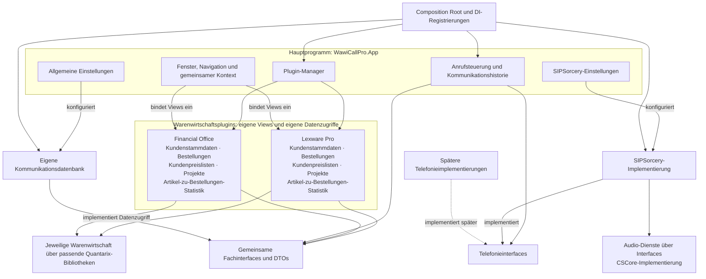

# WawiCallPro: Architektur

Stand: 04.11.2026. Verbindliches Zielbild nach den Nutzerfestlegungen zu Hauptprogramm,
Warenwirtschaftsplugins, Dependency Injection und austauschbarer Telefonie.
Der tatsächliche Umsetzungsstand steht am Dokumentende.

## Zuständigkeiten

| Hauptprogramm `WawiCallPro.App` | Jeweiliges Warenwirtschaftsplugin |
|---|---|
| Allgemeine Einstellungen | Kundenstammdaten-View |
| Plugin-Manager mit Oberfläche | Bestellungen-View |
| SIPSorcery-/SIP-Einstellungen | Kundenpreislisten-View |
| Gemeinsamer Fenster- und Navigationsrahmen | Projekte-View |
| Gemeinsamer Mandanten- und Gesprächskontext | Artikel-zu-Bestellungen-Statistik-View |
| Anrufsteuerung, Anruferfenster und Kommunikationshistorie | Produktspezifische Datenzugriffe und Fachlogik dieser Views |
| Gemeinsame Datenbank-, Audio- und Betriebseinstellungen | Warenwirtschaftsspezifische Verbindungs-/Fachoptionen |

Die fünf Fachansichten gehören einschließlich ihrer konkreten Oberfläche in jedes unterstützte
Warenwirtschaftsplugin. Die App bindet sie in ihre Navigation ein und übergibt den aktuellen Kontext.
Allgemeine Einstellungen, Plugin-Manager und SIPSorcery-Einstellungen bleiben im Hauptprogramm.

Der Plugin-Manager verwendet die vorhandene Quantarix-Pluginlaufzeit. Seine Oberfläche verwaltet
zulässige Plugins, Produktlinie, Version, Fähigkeiten, Ladezustand und Konfiguration. Ein jeweiliger
Pro-/FinOffice-Build enthält ausschließlich die dazu passenden Warenwirtschaftsbibliotheken.

## Zusammenspiel

Das Diagramm beschreibt das Zielbild. DI verbindet Verträge mit konkreten Implementierungen;
die Pfeile zu Datenbank und Warenwirtschaft stehen für Zugriffe über die jeweiligen Dienste.

## Dependency Injection

Alle Anwendungsdienste und ihre Abhängigkeiten werden über DI bereitgestellt. Jeder Hostprozess
besitzt einen Composition Root und einen Root-Container. App und Console verwenden dieselben
gemeinsamen Registrierungsmodule, haben als getrennte Prozesse aber eigene Instanzen.

- Klassen erhalten Dienste über ihre Konstruktoren. Geschäftslogik erzeugt keine versteckten
  Dienstinstanzen und greift nicht auf globale Service-Locators zu.
- Der Composition Root wählt die konkreten Implementierungen anhand der geprüften Konfiguration.
  Noch fehlende Module erhalten keine erfolgreich arbeitenden Leerimplementierungen.
- Für zur Laufzeit entstehende Views und Gesprächsobjekte werden typisierte Factories verwendet.
  Die Factory löst ihre Dienste im vorgesehenen Lebenszyklus auf.
- Plugins erhalten typisierte Hostdienste. Diese geliehenen Dienste werden vom Plugin nicht freigegeben.
  Plugininterne Dienste und Views erhalten einen begrenzten, vollständig freizugebenden Lebenszyklus.
- Der Laufzeitadapter verbindet Quantarix-Pluginaktivierung und DI. Zusätzliche Container dürfen
  gemeinsame Hostdienste nicht versehentlich duplizieren.
- Prozessweite Telefonie-, Konfigurations- und Hostdienste leben bis zum geordneten Shutdown.
  Views, Mandantenoperationen und Gesprächssitzungen haben ihren jeweils eigenen Lebenszyklus.

WinForms-Designerkonstruktoren bleiben parameterlos und rufen nur `InitializeComponent()` auf.
Der Laufzeitpfad erhält seine Dienste über einen DI-fähigen Konstruktor beziehungsweise die Factory.
Der Designer löst keine Laufzeitdienste auf und öffnet keine Datenbankverbindung.

## Telefonie hinter Interfaces

Unsere Telefonie-Dienstklassen erhalten immer ein Interface. App, Plugins, Gesprächsabläufe und Tests
verwenden diese Verträge und referenzieren keine konkrete SIP-Implementierung.

`ITelephonyService` ist bereits vorhanden. Der Vertrag beschreibt Wählen, Annehmen, Ablehnen,
Auflegen, Halten, Fortsetzen, Weiterleiten, DTMF und Statusereignisse. Gesprächs-IDs, Zustände,
Zeitstempel und Ereignisse bleiben eigene WawiCallPro-Typen. SIP-Dialoge, SIPSorcery-Klassen und
herstellerspezifische Gerätetypen bleiben im Adapter.

Auch unsere Dienste für Gesprächssitzungen, Zustandssteuerung, Geräte, Wiedergabe und Aufnahme
werden über passende Interfaces und gegebenenfalls Factories angesprochen. DTOs, Records, Enums
und reine Werte benötigen dadurch keine künstlichen Dienstinterfaces.

Der erste konkrete Telefonieadapter wird mit SIPSorcery umgesetzt. Windows-Audio verwendet die
vorgegebene `SIPSorceryMedia.Windows.CSCore`-Bibliothek mit CSCore. Die aktuellen Repository-Vorgaben
für diese Implementierung gelten weiter. Andere Technologien sind eine spätere Erweiterung;
zusätzliche Backends sind derzeit nicht zur Implementierung beauftragt.

Ein späterer Adapter implementiert die gemeinsamen Verträge und wird am Composition Root registriert.
Fähigkeiten und Einschränkungen werden ausdrücklich ausgewiesen. Nicht unterstützte Funktionen melden
einen klaren Status/Fehler. Einstellungen eines weiteren Adapters folgen erst mit dessen Implementierung.

## Projektgrenzen

| Projekt/Bereich | Zuständigkeit |
|---|---|
| `WawiCallPro.App` | Hauptprogramm, allgemeine Einstellungen, Plugin-Manager-UI, SIPSorcery-Einstellungen und gemeinsame Anruf-/Historienoberfläche |
| `WawiCallPro.Console` | Diagnosehost mit denselben Fachverträgen und DI-Modulen; erzeugt keine Plugin-Views |
| `WawiCallPro.Interfaces` | UI- und technikunabhängige Fachverträge, DTOs und Hostdienste |
| `WawiCallPro.Core` | Gemeinsame Abläufe, Mandantenkontext und Dispatcher |
| `WawiCallPro.Telephony` | Gemeinsame Gesprächszustände und Abläufe hinter Telefonieinterfaces |
| `WawiCallPro.Telephony.Sip` | SIPSorcery-Adapter und SIP-spezifische Umsetzung |
| `WawiCallPro.Audio` | Eigene Audio-Dienstimplementierungen hinter Interfaces; vorgegebene CSCore-Anbindung |
| `WawiCallPro.Database` | Eigene Kommunikationsdatenbank, Migrationen und Repositories |
| `WawiCallPro.Plugins.Lexware.Pro` | Alle fünf Pro-Fachviews und zugehörige Pro-Zugriffe über Quantarix Lexware/APIService |
| `WawiCallPro.Plugins.Lexware.FinOffice` | Alle fünf FinOffice-Fachviews und zugehörige Zugriffe über Quantarix Pcfk |
| Windows-spezifischer Plugin-UI-Anschluss, noch festzulegen | Einbettung, Erzeugung und Freigabe der Plugin-Views ohne UI-Typen in den Fachinterfaces |

Die bestehenden Fachinterfaces bleiben frei von WinForms, DevExpress, SIPSorcery und konkreten
Datenbanktypen. Der UI-Anschluss benötigt deshalb eine eigene Windows-spezifische Vertragsgrenze.
Seine endgültige API und DI-Anbindung werden mit der Pluginlaufzeit umgesetzt.

## Daten und Lebenszyklus

Ein Plugin lädt seine Warenwirtschaftsdaten über den passenden Adapter und liefert gemeinsame DTOs.
Die Capability-Matrix weist alle fünf Fachbereiche je Warenwirtschaftssystem gesondert nach.
Nicht verfügbare Quellfunktionen werden sichtbar ausgewiesen; Fachansichten erhalten keine Demo-/Leerdaten.

Rufnummernzuordnung und gemeinsame Gesprächsabläufe verwenden die Fachverträge. Die Telefonie sendet
Ereignisse über ihre Interfaces. Gespräch, Herkunft, Zuordnung, Notizen und Aufnahmemetadaten werden
über gemeinsame Repository-/Historiendienste in der eigenen Kommunikationsdatenbank gespeichert.
Das WawiCallPro-Schema wird nicht in einer Lexware-Quelldatenbank angelegt.

Jedes gespeicherte Gespräch enthält PC-Name und Windows-Benutzer als historische Momentaufnahmen.
Die zusätzliche Arbeitsplatz-ID ist eine eigene, dauerhaft vorgesehene GUID. Ihre einmalige Erzeugung
und gemeinsame Ablage für App/Console sowie die Windows-Erfassung sind noch umzusetzen.
Spätere PC-/Kontoumbenennungen ändern vorhandene Herkunftswerte nicht.

Beim Start gilt: Konfiguration prüfen → DI-Host aufbauen → zulässige Plugins laden und konfigurieren →
Mandantenkontext bereitstellen → Plugin-Views bei Bedarf erzeugen → Fachoperationen ausführen.
Mandantenwechsel brechen überholte Ladevorgänge ab; Ergebnisse erscheinen erst nach Kontextprüfung.

Beim Beenden werden Operationen, Gespräche und Aufnahmen geordnet abgeschlossen, Plugin-Views und
Ereignisbindungen freigegeben und anschließend Plugin-/Hostdienste beendet. Ein Plugin kann erst
entladen werden, wenn seine Views, Operationen und gebundenen Ressourcen beendet sind.

Alle App- und Plugin-Forms/-Controls bleiben als `.cs`, `.Designer.cs` und `.resx` designerfähig.
Layouts verwenden TableLayoutPanel und vorhandene DevExpress-Eingaben. Die betroffenen Ansichten
werden mit leeren/befüllten Daten, kleineren Fenstern und größerer Schrift visuell geprüft.

## Umsetzungsstand

Vorhanden sind die Hostprojekte mit Standard-.NET-Host/DI-Grundlage, gemeinsame Fachverträge
einschließlich `ITelephonyService`, Mandantenkontext/Dispatcher, Konfiguration und Gesprächszustandsautomat.
Die Datenbankmigrationen 1–5 und die Herkunftsfelder sind implementiert und geprüft.

Noch offen sind insbesondere:

- Migrationssperre zwischen Prozessen und Rechteprüfung: nächster Umsetzungspunkt, Phase 3/Punkt 5.
- Pluginlaufzeit im Host und Plugin-Manager-Oberfläche.
- Windows-spezifischer Plugin-UI-Vertrag und alle fünf tatsächlichen Fachviews je Plugin.
- Erweiterte Fach-/Capability-Verträge insbesondere für Bestellungen und Kundenpreislisten.
- DI-Anbindung der fehlenden Module und Interfaces für die bisher konkrete Zustandssteuerung.
- SIPSorcery-/CSCore-Betrieb, Repository-/Hostpersistenz und Herkunftserfassung.

Dieses Dokument legt die Architektur fest; es meldet die offenen Teile nicht als implementiert.
Details: [Fachverträge](Vertraege.md), [Umsetzungsplan](Neuaufbau-Plan.md),
[Datenbankschema](Datenbankschema.md), [Quantarix-Zuordnung](Quantarix-Zuordnung.md).
