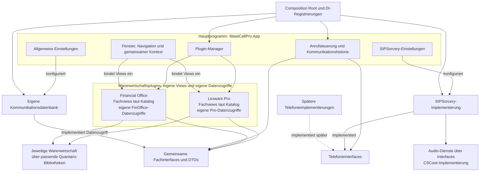

# WawiCallPro: Architektur

Stand: 09.11.2026. Verbindliches Zielbild nach den Nutzerfestlegungen zu Hauptprogramm,
Warenwirtschaftsplugins, Dependency Injection und austauschbarer Telefonie.
Der tatsächliche Umsetzungsstand steht am Dokumentende.

## Zuständigkeiten

| Hauptprogramm `WawiCallPro.App` | Jeweiliges Warenwirtschaftsplugin |
|---|---|
| Allgemeine Einstellungen | Kunden-/Lieferantenstammdaten |
| Plugin-Manager mit Oberfläche | Aufträge und Bestellungen |
| SIPSorcery-/SIP-Einstellungen | Kundenpreislisten-View |
| Gemeinsamer Fenster- und Navigationsrahmen | Top-Artikel und Artikel-zu-Aufträgen-/Bestellungen-Statistik |
| Gemeinsamer Mandanten- und Gesprächskontext | Offene Posten und Zahlungsverhalten |
| Anrufsteuerung, Anruferfenster und Kommunikationshistorie | Umsatzentwicklung und Projekte |
| Gemeinsame Datenbank-, Audio- und Betriebseinstellungen | Produktspezifische Datenzugriffe, Fachlogik und Verbindungs-/Fachoptionen |

Die Fachansichten des folgenden Katalogs gehören einschließlich ihrer konkreten Oberfläche in jedes unterstützte
Warenwirtschaftsplugin. Die App bindet sie in ihre Navigation ein und übergibt den aktuellen Kontext.
Allgemeine Einstellungen, Plugin-Manager und SIPSorcery-Einstellungen bleiben im Hauptprogramm.

Nutzerpräzisierung vom 06.11.2026: Der gemeinsame Fensterrahmen orientiert sich an LxTranslate.
Nutzerpräzisierung vom 07.11.2026: LxTranslate.App ist die direkte Vorlage für Ribbon, DockManager
mit Navigation/Ausgabe/Hilfe und DocumentManager/TabbedView. Im Hauptfenster wird kein Mandant
angezeigt oder ausgewählt. Mehrere Quellen für den Telefon-Cache werden ausschließlich in den
Einstellungen ausgewählt; sie sind unabhängig vom Kontext eines geöffneten Gesprächs oder einer Fachansicht.
Nach dem Laden des Warenwirtschaftsplugins erscheinen dessen individuelle Kunden-/Lieferantenansichten
als Tabs: insbesondere Stammdaten, Aufträge/Bestellungen, Projekte und Top-Artikel sowie die weiteren
fachlich unterstützten Bereiche. Die App stellt den Tabrahmen; konkrete Controls, Datenzugriffe und
Fähigkeiten kommen aus dem aktiven Plugin. Kunden- und Lieferantenkontext bleiben unterscheidbar.

Pro Hostprozess ist zu jeder Zeit höchstens ein Warenwirtschaftsplugin geladen. Vor einem Pluginwechsel
müssen laufende Aufrufe beendet und Views, Dienste sowie der bisherige Ladekontext freigegeben sein.
Erst danach darf das nächste Plugin geladen werden; bei fehlgeschlagener Freigabe bleibt der Wechsel
gesperrt. Ein paralleles zweites Start-/Ladekommando darf keine weitere Pluginsitzung erzeugen.
Getrennte Pro-/FinOffice-Anwendungsprozesse behalten ihre unabhängige Produktidentität.

Nutzerpräzisierung vom 09.11.2026: Alle Einstellungen folgen dem zentralen `FrmSettings`-Dialog
mit Tabs nach LxTranslate.App. Pluginliste, Aktivierung und Fähigkeitsprüfung liegen unter
**Einstellungen → Plugins**. Hierfür wird kein Dokument im Hauptarbeitsbereich geöffnet;
Ribbon und Navigation öffnen unmittelbar den passenden Einstellungen-Tab.
Jeder Produktbuild enthält sein Lexware-Plugin und das klar als Testbetrieb bezeichnete
`WawiCallPro.Plugins.Dummy`. Die Liste zeigt beide, während stets nur eine Pluginsitzung aktiv ist.
Vor dem Wechsel werden laufende Abrufe abgebrochen/abgewartet und alte Fachansichten geschlossen.
Eine fehlgeschlagene Freigabe sperrt das Nachladen. Firmen-/Cache-Ladezustände werden verworfen;
noch nicht gespeicherte allgemeine Eingaben bleiben erhalten. Die aktive Kennung wird getrennt
von der Mandantenauswahl als `user.activePluginId` im Einstellungsformat 4 gespeichert.
Das Dummy-Plugin nutzt eigene Testidentitäten und ausschließlich explizite Testdaten, ohne ERP-,
Netzwerk- oder Datenbankzugriffe. Nach Auswahl lädt der nächste Start genau dieses Plugin.

Der Plugin-Manager verwendet die vorhandene Quantarix-Pluginlaufzeit. Seine Oberfläche verwaltet
zulässige Plugins, Produktlinie, Version, Fähigkeiten, Ladezustand und Konfiguration. Ein jeweiliger
Pro-/FinOffice-Build enthält ausschließlich die dazu passenden Warenwirtschaftsbibliotheken.

### Navigation im View-Verlauf (15.11.2026)

Die Ribbon-Schnellzugriffsleiste zeigt Zurück/Vorwärts direkt nach dem App-Symbol mit denselben kleinen
SVG-Pfeilen wie LxTranslate. Sie enthält keine Textbuttons; nicht verfügbare Schritte sind deaktiviert.
`ViewNavigationHistory<BaseDocument>` gehört dem Hauptfenster und erfasst tatsächliche Besuche offener
Views einschließlich manueller Tabwechsel. Die Referenzidentität verhindert Verwechslungen gleichartiger
Ansichten. Native Aktivierung eines noch nicht veröffentlichten Hintergrund-Tabs erzeugt keinen Besuch.

Zurück/Vorwärts aktiviert die bestehende View. Erneute Aktivierung desselben aktuellen Eintrags verändert
den Verlauf nicht; eine neue Auswahl nach Zurück verwirft nur den Vorwärtszweig. Schließen entfernt alle
Referenzen auf diese View und fasst benachbarte Duplikate zusammen, auch wenn das native TabbedView den
Nachbarn schon vor `DocumentClosed` aktiviert. Der Verlauf lebt nur für die laufende Hauptfensterinstanz;
er öffnet keine geschlossenen Views erneut und umgeht keinen vorhandenen Anruf-/Notiz-/Plugin-Schließschutz.
Fachtests und gezielte Hintergrundbilder der Schnellzugriffsleiste stehen in
[Phase 8](Neuaufbau-Plan.md#phase-8--app-und-erstes-vollständiges-kernprodukt-).

### Übertragbare Einstellungen als JSON (15.11.2026)

Der zentrale Einstellungsdialog bietet Importieren/Exportieren nach LxTranslate. Die gemeinsame
Fußzeile wechselt bei wenig Platz in zwei Zeilen. DevExpress-Dateidialoge erhalten Owner, JSON-Filter
und einen Wartecursor, der auch bei Abbruch und Fehlern wiederhergestellt wird. Export verwendet
den gespeicherten Stand; Import ersetzt nach Bestätigung auch die noch ungespeicherten UI-Eingaben.

Der eigene JSON-Vertrag Version 1 enthält ausschließlich allgemeine/logbezogene Benutzervorgaben,
Tastenkürzel sowie Lautstärken und Mikrofon-Stummschaltung. Zugangsdaten, Datenbank-/ERP-/SIP-
Verbindungen, aktive Plugins, Mandanten-/Leitungszuordnungen und Geräte-IDs sind nicht Teil dieses
Formats und bleiben beim Import lokal erhalten. Windows-Autostart ist eine lokale Betriebssystemoption.
Der interne Einstellungsvertrag hat inzwischen Version 13 mit benannten SIP-Profilen und geschützten Werten;
die interne Datei `connection.local.json` ist kein Import-/Exportziel.

`ConfigurationStore` übernimmt die Dateioperationen über den bereits injizierten Persistenzdienst.
Export finalisiert eine temporäre Geschwisterdatei inklusive Flush vor atomarer Zielersetzung.
Import begrenzt die Datei auf 128 KiB, verwirft fremde Versionen/Produkte, fehlende, unbekannte und
doppelte Felder sowie ungültige Werte und speichert erst danach mit dem vorhandenen Konkurrenzschutz.
Fehler lassen den gespeicherten Stand erhalten; Meldungen geben keine fremden Pfade/JSON-Inhalte aus.
Der UI-Bearbeitungsstand wird nach erfolgreichem Import aktualisiert. Laufende Dienste behalten
ihre Startkonfiguration; der Dialog bietet einen Neustart an. Prüfungen und Rendernachweise in
[Phase 8](Neuaufbau-Plan.md#phase-8--app-und-erstes-vollständiges-kernprodukt-).

### Benannte SIP-Profile (22.11.2026)

Der zentrale SIP-Tab verwaltet bis zu 16 Profile mit getrennten Zugangsdaten, erweiterten Optionen
und Leitungsfirma. Ein bestehendes Einzelkonto wird als Standard-Profil bearbeitet. Alle Änderungen
bleiben bis Speichern im Dialogentwurf; nur ein Profil wird für die nächste Anmeldung ausgewählt.
`SipProfileCatalog` bildet diesen Katalog auf das bestehende aktive `SipAccount` ab. Ein bereits
registrierter SIP-Dienst behält Konto und Profilkennung bis zum ausdrücklichen Abmelden; kein
Einstellungswechsel startet eine zusätzliche Registrierung oder schaltet ein Gespräch um.
Die Anrufzuordnung verwendet das Profil zum tatsächlichen Leitungskontext statt der späteren Auswahl.
DPAPI, atomarer Konkurrenzschutz und die Ausschlussliste des portablen Exports bleiben wirksam.
Einrichtung und Formatbeschreibung: [SIP-Einstellungen](SIP-Einstellungen.md#mehrere-gespeicherte-sip-profile-22112026).

## Wawi-Einstellungen und Funktions-Interfaces

Nutzerpräzisierung vom 21.11.2026: Wawi-spezifische Einstellungsseiten werden als vollständige
UserControls mit eigener `.cs`, `.Designer.cs` und `.resx` im jeweiligen Plugin aufgebaut. Das aktive
Plugin liefert über ein optionales Interface die komplette View und ihren Titel. Der zentrale
Einstellungsdialog bettet das Control ein und besitzt dessen Lease bis zum Schließen/Pluginwechsel.
Ohne bereitgestellte View erscheint kein Platzhaltertab. Der Host baut keine einzelnen Lexware-Felder
zusammen. Allgemeine Einstellungen, Pluginverwaltung, SIP und Audio bleiben gemeinsame Hostseiten.

Stand 22.11.2026: `IWawiCallPluginSettings` exportiert für beide Lexware-Produktlinien den Tab
**„Lexware“**. Pro liefert die vollständige `LexwareSettingsPage` mit eigenem Zugangseditor und
Mandantenauswahl; FinOffice exportiert die vollständige Mandantenseite ohne Pro-API-Felder.
Die gemeinsame pluginseitige `PluginCompanySettingsPage` enthält nur die Darstellung und
produktneutrale Auswahlprüfung. Das jeweilige Plugin liefert seinen `IBusinessDirectory` samt
Einrichtungsstatus und bei Pro der festen Übersetzung seiner Quellfehler. Erkennung, Anmeldung,
berechtigter Firmenkatalog und alle produktabhängigen Zugriffe bleiben in den Datenadaptern der Plugins.
Der frühere Mandantenbereich im Navigationsdock wird nicht mehr erzeugt.

`IPluginSettingsView`/`IPluginSettingsHandle` umfassen nun asynchrones Laden, Validieren und Stoppen.
Controls entstehen auf dem UI-Thread; Laden beginnt nach Freigabe des Erzeugungs-Callbacks, sodass
kein Runtime-Reentry-Deadlock entsteht. Schließen bricht Abrufe ab und wartet vor Dispose auf ihr Ende.
`PluginSettingsPageContext` verbindet den vorhandenen Zugangsentwurf mit einem reinen
Mandantenauswahlentwurf und den zentralen Größen-/Wartecursorhilfen. Die Quelle wird vor Zugriff und
Bindung erneut gegen das aktive Plugin und dessen Zugriffssperre geprüft. Keine Container-/Formreferenzen
werden dem Plugin gegeben. Die ausdrückliche Tabregistrierung des separaten Phasenplans ist damit noch
nicht an die tatsächliche Pluginsitzung angeschlossen; der Viewexport verwendet den bestehenden Leasevertrag.

Mandanten werden ausschließlich aus dem berechtigten Plugin-Katalog ausgewählt, nur ihr Name ist sichtbar.
Kein automatischer erster Treffer. Speichern prüft eine geänderte Auswahl erneut gegen den aktuellen
Katalog, speichert `User.PreferredCompany` atomar und veröffentlicht erst danach den Laufzeitkontext.
Abbrechen, Validierungs-/Konkurrenzfehler und abgebrochene Abrufe erhalten ihn. Beim Start wird eine
vorhandene Präferenz nur bei weiterhin gültiger Berechtigung wiederhergestellt. Die Quellenwahl des
Telefon-Caches bleibt davon unabhängig. Geänderte Pro-Zugangsdaten benötigen weiterhin einen Neustart;
neu eingetippte Daten lösen keinen verdeckten Anmeldeversuch aus. Ein Pro-Plugin ohne Zugang meldet
Einrichtungsbedarf, statt den COM-Katalog erfolglos abzufragen. `settings-wawi` bleibt vor der Anmeldung
als COM-ID erreichbar. Prüfungen und offene Live-Abnahme stehen im [Plugin-UI-Plan](Plugin-UI-Registrierung-und-Lexware-Tab-Plan.md).

Fachfunktionen werden über kleine Funktions-Interfaces angeboten; bestehend sind insbesondere
`IBusinessDirectory`, `IWawiCallPluginWorkspaces` und `IWawiCallPluginViews`. Der gemeinsame Host nutzt
die unterstützten Verträge und Kontexte. Produktabhängige Quellen-/Authentifizierungs- und
Datensatzlogik wird nicht durch Produktlinienabfragen in Views ersetzt. Weitere Funktionen ergänzen
passende Verträge und Fähigkeiten; die offene fachliche Umsetzung bleibt in der Capability-Matrix sichtbar.

## Fachansichten nach LxOutlook-Vorlage

Zusätzliche fachliche Referenz ist `D:\Application-Development\OutlookBlazorAddin` mit LxOutlook.
Das Nutzerbild und `Home.razor` zeigen die Reiter Stammdaten, Aufträge, Top-Artikel, Offene Posten,
Zahlungsverhalten, Umsatzentwicklung und Projekte. Die ausdrücklich gewünschten Kundenpreislisten
und die Artikel-zu-Bestellungen-Statistik bleiben zusätzlich Bestandteil des Katalogs.


| Fachbereich im Wawi-Plugin | Inhalt/Zusammenhang |
|---|---|
| Stammdaten | Kunden/Lieferanten, Anschriften, Kontakte und Rufnummern im jeweiligen Mandanten |
| Aufträge / Bestellungen | Belege und Positionen; Verkaufs-/Einkaufssicht je Kunden-/Lieferantenkontext unterscheiden |
| Kundenpreislisten | Kundenspezifische Preise und Konditionen gemäß verfügbarer Wawi-API |
| Top-Artikel | Artikelbezogene Auswertung, Mengen und Werte aus den fachlich relevanten Belegen |
| Artikel-zu-Aufträgen-/Bestellungen-Statistik | Zugehörige Belege/Positionen zu einem Artikel; als Detailansicht aus Top-Artikeln nutzbar |
| Offene Posten | Offene Forderungen/Verbindlichkeiten mit Beträgen, Fälligkeiten und Status |
| Zahlungsverhalten | Nachvollziehbare Auswertung aus tatsächlich verfügbaren Zahlungs-/Beleginformationen |
| Umsatzentwicklung | Zeitbezogene Umsatzsicht; bei Lieferanten fachlich getrennte Einkaufsentwicklung |
| Projekte | Projekte und tatsächlich zugehörige Geschäftsdaten/Belege |

Die Umsetzung erfolgt als designerfähige DevExpress-/WinForms-Pluginansichten. Alle Bereiche werden
je Warenwirtschaftssystem, Produktlinie, Mandant und Kunden-/Lieferantenkontext in der Capability-Matrix
geprüft. Die Vorlage belegt keine automatische Funktionsparität der WawiCallPro-Adapter.
Die [aktuelle Capability-Matrix](Capability-Matrix.md) trennt implementierte Stammdatenabrufe,
Anschlüsse der Referenzbibliotheken und offene Fachansichten für beide Produktlinien.

Die Referenz trennt beispielsweise `ArticleRevenueTab`, `SupplierArticlePurchasesTab`,
`SupplierPurchaseStatisticsTab`, `OpenItemsTab`, `SupplierPerformanceTab` und `ProjectsTab`.
Die Lieferantenzahlungssicht nennt ausdrücklich ihre belegbasierte Grenze ohne vollständige
Kreditorenbuchhaltung. Solche fachlichen Grenzen, getrennte Währungen sowie Gutschrift-/Stornoregeln
müssen die jeweiligen Wawi-Dienste korrekt abbilden.

Referenz-HEAD: `f2d9e17cb62684d6d2b2b9e641e115b98f45473c`. Die Arbeitskopie enthält lokale Änderungen;
gesichtet wurden die aktuellen Dateien. Einstieg:
[Home.razor](../../OutlookBlazorAddin/src/OutlookBlazorAddin.Web/Pages/Home.razor),
[Components](../../OutlookBlazorAddin/src/OutlookBlazorAddin.Web/Components).

## Zusammenspiel



Das Diagramm beschreibt das Zielbild. DI verbindet Verträge mit konkreten Implementierungen;
die Pfeile zu Datenbank und Warenwirtschaft stehen für Zugriffe über die jeweiligen Dienste.

## Dependency Injection

Alle Anwendungsdienste und ihre Abhängigkeiten werden über DI bereitgestellt. Jeder Hostprozess
besitzt einen Composition Root und einen Root-Container. App und Console verwenden dieselben
gemeinsamen Registrierungsmodule, haben als getrennte Prozesse aber eigene Instanzen.

- Klassen erhalten Dienste über ihre Konstruktoren. Geschäftslogik erzeugt keine versteckten
  Dienstinstanzen und greift nicht auf globale Service-Locators zu.
- Der Composition Root wählt die konkreten Implementierungen anhand der geprüften Konfiguration.
  Noch fehlende Module erhalten keine erfolgreich arbeitenden Leerimplementierungen.
- Für zur Laufzeit entstehende Views und Gesprächsobjekte werden typisierte Factories verwendet.
  Die Factory löst ihre Dienste im vorgesehenen Lebenszyklus auf.
- Plugins erhalten typisierte Hostdienste. Diese geliehenen Dienste werden vom Plugin nicht freigegeben.
  Plugininterne Dienste und Views erhalten einen begrenzten, vollständig freizugebenden Lebenszyklus.
- Der Laufzeitadapter verbindet Quantarix-Pluginaktivierung und DI. Zusätzliche Container dürfen
  gemeinsame Hostdienste nicht versehentlich duplizieren.
- Prozessweite Telefonie-, Konfigurations- und Hostdienste leben bis zum geordneten Shutdown.
  Views, Mandantenoperationen und Gesprächssitzungen haben ihren jeweils eigenen Lebenszyklus.

WinForms-Designerkonstruktoren bleiben parameterlos und rufen nur `InitializeComponent()` auf.
Der Laufzeitpfad erhält seine Dienste über einen DI-fähigen Konstruktor beziehungsweise die Factory.
Der Designer löst keine Laufzeitdienste auf und öffnet keine Datenbankverbindung.

## Quantarix-Pluginvertrag: Attribute, Build und Laufzeit

Seit Phase 4/Punkt 1 erzeugt die gemeinsame DI-registrierte IPluginManagerFactory den vorhandenen
Quantarix-PluginManager mit dem Hostlogger. Jeder Aufrufer besitzt und entsorgt seinen Manager vor
dem Host-Shutdown. Die ausdrücklich übergebene Tokenliste wird kopiert; eine leere Liste ist nur für
unsignierte Entwicklungsfixtures vorgesehen. Erstellung der Factory lädt keine Plugins.
Phase 4 ist vollständig implementiert: echte Produkt-Einstiegsklassen in beiden Hosts, DI-Aktivierung,
Shared-Verträge/-Pakete, Signierung, rekursive Build-/Publish-Bundles und geordneter Shutdown.

Punkt 2 ergänzt ISharedPluginContracts: markierte Interfaces/Abstractions werden vor jeder
Managerkonstruktion im Default-ALC geladen und geprüft. SharedProjectAssembly listet beide Namen
zentral in Directory.Build.props. SharedPackage enthält inzwischen Dapper, Microsoft-Hosting-/DI-/
Logging-Abhängigkeiten und Serilog. Ein beim Build eingebettetes Manifest nennt die Runtime-Assemblies;
abweichende Paket-/Assemblynamen werden über RuntimeAssemblyNames beschrieben. Die Pakete erhalten
keine fremden SharedAssembly-Attribute, sondern explizite Shared-Namen im Quantarix-Manager.
Der Fixture-Test liefert trotz privater Vertragskopien exakt dieselben CompanyKey-Typen/Instanzen.
Der Windows-UI-Vertrag WawiCallPro.Plugin.Windows ist ebenfalls markiert und vorgeladen; der Sharedfilter
ist wirksam importiert/adaptiert. Identische Quell-/Host-DLLs und fehlende Bundleduplikate sind geprüft.

Geprüft wurde der aktuelle Quellcode unter `D:\Application-Development\Quantarix.Plugin.System`,
Ursprungsstand `1e43c99068cd17bfa32586d86099c6e66fae4076`, für Phase 4 bis `1f80ba2` erweitert.
Maßgeblich sind die tatsächlichen C#-/MSBuild-Dateien.
In diesem Stand liegen die Buildregeln in `Directory.Build.props`, `Directory.Build.targets` und im
TestHost-Projekt; eine `Solution.props` existiert dort nicht. WawiCallPro besitzt seine eigene
`Solution.props`; seine Directory.Build.targets importiert/adaptiert die Plugin-Buildfilter ausdrücklich.

| Mechanismus | Konkrete Bedeutung für WawiCallPro |
|---|---|
| `[assembly: SharedAssembly]` | Markiert eigene gemeinsame Vertragsassemblies. `WawiCallPro.Interfaces` trägt das Attribut bereits; ein künftiger eigener UI-Vertrag benötigt dieselbe Behandlung. Die konkrete Pluginimplementierung wird dadurch nicht selbst zur Shared Assembly. |
| Shared-Erkennung beim Managerkonstruktor | `PluginManager` erfasst nur die zu diesem Zeitpunkt im Default-ALC geladenen markierten Assemblies. Alle gemeinsamen Verträge müssen vorher ausdrücklich geladen sein. |
| `IsPluginProject=true` | Aktiviert den Buildfilter für das jeweilige Pluginprojekt. |
| `SharedProjectAssembly` | Benennt die vom Host bereitgestellten Projekt-DLLs; Buildfilter entfernt deren `ReferenceCopyLocalPaths`-Einträge nach `ResolveReferences`. |
| `SharedPackage` | Entsprechende Paketliste, gefiltert über `NuGetPackageId`; gemeinsam verwendete Drittanbieterpakete bekommen kein eigenes SharedAssembly-Attribut. Der Host muss die passenden Pakete bereitstellen. |
| Host-Kopierziele | Stellen jedes Plugin samt `.deps.json` und privaten/native Abhängigkeiten unter `plugins/<AssemblyName>/` bereit und entfernen dort gemeinsame DLL-/PDB-Kopien. |
| Laufzeitauflösung | Pro Plugin ein sammelbarer `PluginLoadContext`; gemeinsame Typen aus dem Default-ALC, private/native Bibliotheken über `AssemblyDependencyResolver`. |
| Erkennung/Validierung | Erwartet `plugins/<AssemblyName>/<AssemblyName>.dll`, sucht konkrete `IPlugin`-Implementierungen und prüft den Strong-Name-Public-Key-Token gegen die Host-Allowlist. Eine leere Allowlist schaltet diese Prüfung im vorhandenen Code ab. |

Attribute, gemeinsame Buildlisten und Deployment müssen zusammenpassen: Das Attribut ersetzt die
Buildfilter nicht; Buildfilter ersetzen das rechtzeitige Laden gemeinsamer Verträge nicht. Die nötigen
Targets werden im WawiCallPro-Build ausdrücklich importiert/adaptiert. Produktlinien, reguläre Debug-
Ausgaben, Publish-Pakete und die finale Strip-/Signierreihenfolge bleiben dabei erhalten.

Seit Phase 4/Punkt 3 besitzt der bestehende Manager einen rückwärtskompatiblen Aktivierungsdelegaten
(Quantarix-Commit ec5be52). IPluginSessionFactory benutzt ActivatorUtilities mit einem eigenen Scope,
prüft Produktlinie und ruft Configure nach Initialize auf. IWawiCallHostServices ist im Host registriert;
Scope-Freigabe ersetzt keine Freigabe geliehener Hostdienste. WawiCallPro.Plugin.Windows kapselt den
optionalen Windows-View-/Leasevertrag und wird in beiden Composition Roots als Shared-Vertrag vorgeladen.

Der ursprüngliche Loader verwendet ohne diesen Hook `Activator.CreateInstance(type)` und ruft anschließend
`Initialize(this)` auf. `IPluginHost` stellt dabei ausschließlich den Quantarix-Logger bereit.
Unser `Configure(IWawiCallHostServices)` ist ein nachgelagerter typisierter Anschluss; er ist keine
Konstruktorinjektion. Diese übernimmt jetzt der implementierte Aktivierungshook mit ActivatorUtilities
und eigenem DI-Scope; Configure wird danach mit denselben geliehenen Hostdiensten aufgerufen.
Es gibt keinen zweiten Loader und keinen globalen Service-Locator als Ersatz für DI.

Seit Phase 5/Punkt 1 können Einstiegsklassen ihre privaten Registrierungen mit
`[PluginServices(typeof(...))]` und einem `IPluginServiceModule` bereitstellen. Die Session baut den
privaten Container und Scope vor der Konstruktoraktivierung auf. Das Pro-Modul registriert
Installationserkennung, PropertyStore, Client-/Transportfactory, API-Sitzung und Firmenverzeichnis.
Geschäftsdienste erhalten ihre Abhängigkeiten über Konstruktoren; nur die typisierten Factories
erzeugen auftragsbezogene Clients/Transporte. Synchrones und asynchrones Entladen geben den Scope
und den privaten Container nach Shutdown und vor ALC-Unload frei. Hostdienste bleiben im Besitz des Hosts.

Die Manager-API ergänzt UnloadAllAsync: Shutdown, abgewartete Scope-Freigabe und anschließend
ALC-Unload. Die Host-Runtime stoppt vorher neue Aufrufe, cancelt/awaitet laufende Arbeit und schließt
View-Leases auf dem UI-Dispatcher. IWawiCallPluginLifetime bietet den optionalen async Stopvertrag.
Einzelne Plugins werden weiterhin nicht während aktiver Sitzungen ausgetauscht; die GUI folgt Phase 8.

Vor Entladen: Aufrufe stoppen und asynchrone Arbeit vollständig abwarten, Views/Ereignisbindungen
freigeben, im geordneten Shutdown die Plugin-DI-Ressourcen freigeben und anschließend den ALC entladen.
Der Manager ruft `Shutdown` synchron vor `Unload` auf. `Unload` fordert die Entladung an; verbleibende Referenzen
verhindern sie. Die Integration muss Typidentität, private/native Auflösung, fehlerhafte Plugins und
tatsächliche Freigabe prüfen. Strong Names/ALCs bilden keine Sicherheits-Sandbox.

Aktuelle MSBuild-Auswertung: IsPluginProject/EnableDynamicLoading, Signierung und Sharedlisten sind
gesetzt; Build und Publish liefern private/native Dependencies unter plugins/<AssemblyName>.
Der vorhandene Quantarix-Schlüssel wird über WawiCallPluginKeyFile referenziert, nicht kopiert.
Die Produktions-Allowlist kommt aus dem signierten Hostvertrag; keine deaktivierte Prüfung beim Hoststart.

Quellen:
[SharedAssemblyAttribute](../../Quantarix.Plugin.System/src/Quantarix.Plugin.Abstractions/SharedAssemblyAttribute.cs),
[PluginManager](../../Quantarix.Plugin.System/src/Quantarix.Plugin.Hosting/PluginManager.cs),
[PluginLoadContext](../../Quantarix.Plugin.System/src/Quantarix.Plugin.Hosting/PluginLoadContext.cs),
[Buildfilter](../../Quantarix.Plugin.System/Directory.Build.targets),
[TestHost-Deployment](../../Quantarix.Plugin.System/src/Quantarix.Plugin.TestHost/Quantarix.Plugin.TestHost.csproj).

## Telefonie hinter Interfaces

Unsere Telefonie-Dienstklassen erhalten immer ein Interface. App, Plugins, Gesprächsabläufe und Tests
verwenden diese Verträge und referenzieren keine konkrete SIP-Implementierung.

`ITelephonyService` ist bereits vorhanden. Der Vertrag beschreibt Wählen, Annehmen, Ablehnen,
Auflegen, Halten, Fortsetzen, Weiterleiten, DTMF und Statusereignisse. Gesprächs-IDs, Zustände,
Zeitstempel und Ereignisse bleiben eigene WawiCallPro-Typen. SIP-Dialoge, SIPSorcery-Klassen und
herstellerspezifische Gerätetypen bleiben im Adapter.

Auch unsere Dienste für Gesprächssitzungen, Zustandssteuerung, Geräte, Wiedergabe und Aufnahme
werden über passende Interfaces und gegebenenfalls Factories angesprochen. DTOs, Records, Enums
und reine Werte benötigen dadurch keine künstlichen Dienstinterfaces.

Der erste konkrete Telefonieadapter wird mit SIPSorcery umgesetzt. Windows-Audio verwendet die
vorgegebene `SIPSorceryMedia.Windows.CSCore`-Bibliothek mit CSCore. Die aktuellen Repository-Vorgaben
für diese Implementierung gelten weiter. Andere Technologien sind eine spätere Erweiterung;
zusätzliche Backends sind derzeit nicht zur Implementierung beauftragt.

Ein späterer Adapter implementiert die gemeinsamen Verträge und wird am Composition Root registriert.
Fähigkeiten und Einschränkungen werden ausdrücklich ausgewiesen. Nicht unterstützte Funktionen melden
einen klaren Status/Fehler. Einstellungen eines weiteren Adapters folgen erst mit dessen Implementierung.

### DTMF als Telefoniefunktion

DTMF bleibt Bestandteil eines vollständigen Telefonprogramms: Zifferntasten während eines Gesprächs
werden beispielsweise für Sprachmenüs, Vermittlungen und Konferenzzugänge benötigt. Reine
Gesprächsprotokollierung benötigt diese Funktion nicht, interaktive Telefonie und Telefonmenüs dagegen schon.

| Aufgabe | Vorgesehene Umsetzung |
|---|---|
| Ziffern im aufgebauten Gespräch senden | Über das vorhandene `ITelephonyService.SendDtmfAsync`; SIPSorcery-Adapter verwendet `SIPUserAgent.SendDtmf` |
| Empfangene Ziffern für eigene Telefonmenüs | RTP-Empfang über `OnDtmfTone` in ein technikunabhängiges, einem Gespräch zugeordnetes Ereignis übersetzen; der gemeinsame Empfangsvertrag fehlt noch |
| Tatsächliche DTMF-Töne im Audiosignal erkennen | Separater optionaler Audio-Detektor hinter Interface/DI, erst bei nachgewiesenem Bedarf für In-band-DTMF oder Dateianalyse |

Der SIP-Pfad verwendet ausgehandelte RTP-Telefonieereignisse gemäß RFC 4733, häufig weiterhin
„RFC 2833“ genannt. Empfangene RTP-Pakete sind nicht jeweils ein neuer Tastendruck; vollständige
Ereignisse müssen sauber zugeordnet und Mehrfachmeldungen vermieden werden. Andere DTMF-Verfahren
wie SIP INFO oder In-band werden nur für tatsächlich benötigte, geprüfte Anlagenprofile ergänzt.

In `D:\Application-Development\WawiCallPro_old\WawiCallPro.old.sln` stehen `DtmfDetection`,
`DtmfDetection.CSCore` und `DtmfDetector`. Die ersten beiden sind .NET-Framework-4.8-Bibliotheken für
Audio-Tonerkennung und ihre CSCore-Anbindung; `DtmfDetector` ist ein Demo-EXE. Der Kern verwendet
Goertzel-Analyse von Audiodaten. Sie werden für den normalen SIP-RTP-Ereignispfad nicht als weitere
Abhängigkeiten benötigt. Auch der alte `Audio/DtmfToneGenerator.cs` erzeugt Audiosignale und ersetzt
keine ausgehandelte RTP-DTMF-Übertragung.

Zunächst werden keine dieser alten Projekte eingebunden. DTMF-Senden gehört zu Phase 7; der
Empfangsvertrag wird für die Telefonmenüs in Phase 12 benötigt. Nutzdaten wie gewählte Ziffernfolgen
werden nicht in das bereinigte Betriebslog übernommen. Abnahme: Ziffern/`*`/`#`, Zuordnung zum richtigen
Gespräch, ausgehandelte Unterstützung, Wiederholungen, Abbruch und Gesprächsende; Audioerkennung
würde zusätzlich eigene Codec-/Rausch-/Fehlerkennungstests benötigen.

Quellen: [alte Solution](../../WawiCallPro_old/WawiCallPro.old.sln),
[Audio-Detektor](../../WawiCallPro_old/3rd/DtmfDetection-master/README.md),
[SIPSorcery-DTMF-API](https://sipsorcery-org.github.io/sipsorcery/api/SIPSorcery.SIP.App.SIPUserAgent.html),
[RFC 4733](https://www.rfc-editor.org/rfc/rfc4733).

### Erforderliche SIPSorcery-Einstellungen

Die [SIP-/Audioanalyse](SIP-Einstellungen.md) legt den anhand von PlaySounds und RecordIncomingCall
geprüften Einstellungsumfang fest: Registrar/Serverport, Transport, Konto/Authname/Kennwort, lokaler
SIP-Port und Bindung, Registrierungsdauer sowie Audioausgabe, Mikrofon, Klingelausgabe und Codecprofil.
Die Demos verwenden unterschiedliche Transporte und Codecfreigaben. Domain/Proxy, TLS, RTP-/NAT-
Optionen bleiben bedarfsabhängige Experteneinstellungen. Konfiguriert und tatsächlich registriert
werden getrennt dargestellt; reine Anzeige/Speicherung startet weder Anmeldung noch Audiohardware.

## Projektgrenzen

| Projekt/Bereich | Zuständigkeit |
|---|---|
| `WawiCallPro.App` | Hauptprogramm, allgemeine Einstellungen, Plugin-Manager-UI, SIPSorcery-Einstellungen und gemeinsame Anruf-/Historienoberfläche |
| `WawiCallPro.Console` | Diagnosehost mit denselben Fachverträgen und DI-Modulen; erzeugt keine Plugin-Views |
| `WawiCallPro.Interfaces` | UI- und technikunabhängige Fachverträge, DTOs und Hostdienste |
| `WawiCallPro.Core` | Gemeinsame Abläufe, Mandantenkontext und Dispatcher |
| `WawiCallPro.Telephony` | Gemeinsame Gesprächszustände und Abläufe hinter Telefonieinterfaces |
| `WawiCallPro.Telephony.Sip` | SIPSorcery-Adapter und SIP-spezifische Umsetzung |
| `WawiCallPro.Audio` | Eigene Audio-Dienstimplementierungen hinter Interfaces; vorgegebene CSCore-Anbindung |
| `WawiCallPro.Database` | Eigene Kommunikationsdatenbank, Migrationen und Repositories |
| `WawiCallPro.Plugins.Lexware.Pro` | Pro-Fachviews laut Katalog und zugehörige Zugriffe über Quantarix Lexware/APIService |
| `WawiCallPro.Plugins.Lexware.FinOffice` | FinOffice-Fachviews laut Katalog und zugehörige Zugriffe über Quantarix Pcfk |
| Windows-spezifischer Plugin-UI-Anschluss, noch festzulegen | Einbettung, Erzeugung und Freigabe der Plugin-Views ohne UI-Typen in den Fachinterfaces |

Die bestehenden Fachinterfaces bleiben frei von WinForms, DevExpress, SIPSorcery und konkreten
Datenbanktypen. Der UI-Anschluss benötigt deshalb eine eigene Windows-spezifische Vertragsgrenze.
Seine endgültige API und DI-Anbindung werden mit der Pluginlaufzeit umgesetzt.

## Telefonnummern, Suchfirmen und Anruferzuordnung

[libphonenumber-csharp](https://github.com/twcclegg/libphonenumber-csharp) übernimmt Parsing,
Normalisierung und Rufnummern-Metadaten hinter eigenen DI-Interfaces. Die Bibliothek kennt weder
Lexware-Geschäftspartner noch individuelle Telefonanlagen. Eine Rufnummernregion ist keine
Live-Ortsangabe. Für Stammnummern ist ein firmenbezogen aktivierbarer `StartWidth`-Abgleich geplant:
gleicher Ländercode, gleiche Orts-/Netzvorwahl und gleiche erste N Anschlussziffern ergeben einen
positiven Geschäftspartnertreffer. Die restlichen Ziffern gelten gemäß Einstellung als Apparatenummer,
ohne eine Kontaktperson zu bestätigen. `StartWidth` zählt weder Ländercode noch Vorwahl mit.

Das verbindliche Detailkonzept steht in [Telefonnummern-Cache.md](Telefonnummern-Cache.md).
Das Hauptprogramm bietet eine DevExpress-CheckedListBox für mehrere Suchfirmen. Die Haken bilden
eine Menge vollständiger `CompanyKey`-Werte; aktuelle Ansichtsfirma und bevorzugte Firma sind davon
getrennt. Der Telefon-Cache hält Stammdaten und Nummern je Firma, der gemeinsame Index liefert alle
passenden Firmen-/Geschäftspartnerkandidaten. Detaildaten laden die Plugin-Views anschließend nur
im ausdrücklich gewählten Firmenkontext nach.

| Suchergebnis | Auswahl der Fachansichten |
|---|---|
| Genau ein belastbarer Treffer bei vollständigem Suchstand | Firma und Geschäftspartner für den Anruf übernehmen |
| Mehrere Datensätze in einer Firma | Firma steht fest; Datensatzauswahl anbieten |
| Gleiche Nummer in mehreren Firmen | Treffer nach Firma gruppieren und ausdrücklich auswählen lassen |
| Eindeutiger positiver StartWidth-Match bei vollständigem Suchstand | Geschäftspartner-Views öffnen; abgeleitete Apparatenummer und Trefferart anzeigen |
| Nur Stammnummernheuristik oder unvollständiger Cache | Vorschläge beziehungsweise fehlenden Suchstand anzeigen; keine eindeutige Zuordnung behaupten |

Aktive/bevorzugte Firma und frühere Entscheidungen beeinflussen die Reihenfolge, verdrängen aber
keine gleichwertigen Treffer. Eine verlässlich konfigurierte angerufene Leitung kann ihre Firma
sichtbar bevorzugen, wenn dort genau ein belastbarer Datensatz passt; Alternativen bleiben erhalten.
Ein Anruferbereich erhält einen eigenen Firmen-/Viewkontext und wechselt keine Hauptansicht mit
offenen Änderungen. Späte Antworten benötigen Anruf-ID, vollständige Quellidentität und Revision.

Seit Migration 6 besitzen historische Kandidaten eigene Firmenidentität und optionale Matchnachweise;
Suchstände und versionierte Firmenregeln haben eigene Tabellen/Verträge. Die ausgewählte Partei ist
auch per SQL-FK an die Gesprächsfirma gebunden. Migrationen 1–5 bleiben unverändert. Der Offline-Parser ist seit Phase 6/Punkt 1
über `IPhoneNumberParser` in beiden Hosts registriert; seine DTOs behalten Original/Quelle,
E.164/Extension, Prüfstatus, Rufnummernregion und Parserversion ohne Bibliothekstypen im gemeinsamen
Vertrag. Seit Punkt 2 wendet `IPhoneNumberInterpreter` ausdrücklich getrennte Firmen-/Leitungskontexte,
lokale Ortsvorwahl und Präsentationszustände an. Firmenvorgaben werden nach vollständigem CompanyKey
gelesen; interne Nummern benötigen Anlagenbezug, unterdrückte Nummern werden nicht geparst.
Mehrfirmensuche, StartWidth-Abgleich, Auswahlkonfiguration und UI bleiben Zielbild.

## Mail-Anbindung: Microsoft 365 und Gmail

Für Phase 11 sind zwei eigene Connectoren vorgesehen; beide sind noch nicht implementiert:

| Anbieter | Geplanter Connector |
|---|---|
| Microsoft 365 | Eigener Connector über [Microsoft Graph](https://learn.microsoft.com/en-us/graph/api/user-list-messages?view=graph-rest-1.0). |
| Gmail und Google Workspace | Eigener Connector über die [Gmail API](https://developers.google.com/workspace/gmail/api/guides/filtering), mit OAuth-Anmeldung und passenden [Leserechten](https://developers.google.com/workspace/gmail/api/auth/scopes). |

Beide Connectoren verwenden gemeinsame, technikunabhängige Mailverträge und DI-Anbindung.
Die E-Mail-Adressen aus Lexware dienen zur kundenbezogenen Zuordnung; gelesen wird das vom Benutzer
autorisierte Postfach. Konkrete Berechtigungen und Anmeldeabläufe werden bei der Umsetzung festgelegt.

### Klassisches Outlook Desktop und vorhandene Bibliotheken

[MMS.MSGraph](../../MMS.MSGraph/MMS.MSGraph.csproj) ist eine vorhandene Implementierungsreferenz
für den Graph-Connector. Anmeldung, Nachrichtensuche, Anhänge und Versand sind dort bereits angelegt;
die Übernahme hinter neue Fachverträge und die WawiCallPro-Anbindung bleiben offen.

Für klassisches Outlook ist zusätzlich ein lokaler Lese-/Importconnector vorgesehen. Vorlage ist
[MMS.Office](../../MMS.Office/MMS.Office.csproj) mit `Outlook/MailProvider.cs` und Outlook-COM-Interop.
Er liest ausdrücklich ausgewählte Stores und Ordner des Benutzerprofils, einschließlich dort eingebundener
Datendateien. Im [Microsoft-Funktionsvergleich](https://support.microsoft.com/en-us/outlook/getstarted/feature-comparison-between-new-outlook-and-classic-outlook)
ist das Outlook Object Model nur für klassisches Outlook unterstützt; neues Outlook benötigt die
Anbindung des jeweiligen Mailanbieters. Graph ist kein Leser beliebiger lokaler Outlook-Datendateien.

Am 14.11.2026 wurde die externe MMS.Office-Leseroutine überarbeitet: ungefiltertes Lesen funktioniert
ohne Adressfilter; eine ausdrücklich leere Filterliste liefert keine Mails. Der Durchlauf prüft Abbruch,
gibt Ordner, Items, Empfänger-/Absenderobjekte und PropertyAccessor frei und reicht Lesefehler weiter.
Asynchrone Ordnersuchen verwenden einen STA-Worker, dessen Thread vor Rückgabe beendet wird.
Doppelte Treffer werden anhand von Store-ID und Entry-ID innerhalb des Abrufs zusammengeführt.
Bei mehreren passenden Filtern bleibt der erste Absendertag, sonst der erste Empfängertag als `UserTag`;
eine spätere fachliche Mehrfachzuordnung ist getrennt vom physischen Nachrichtenduplikat abzubilden.
`EntryID` ist keine dauerhafte globale Mailidentität: beim Wechsel des Stores kann sie sich ändern;
die spätere Persistenz muss Verschiebungen gesondert behandeln ([Microsoft](https://learn.microsoft.com/en-us/office/vba/api/outlook.mailitem.entryid)).

Das optionale `OutlookConfig.MaximumImportMessages` begrenzt eindeutige Treffer. Überschreiten schlägt
fehl, statt einen unvollständigen Abruf als Erfolg auszugeben; ohne Vorgabe bleibt die bisherige Mengenfreiheit.
Datumsgrenzen werden lokal und exakt geprüft; der Jet-Filter liefert wegen seiner Minutengenauigkeit
zunächst eine Obermenge ([Datumsfilter](https://learn.microsoft.com/en-us/office/vba/outlook/how-to/search-and-filter/filtering-items-using-a-date-time-comparison)).
Ein laufender blockierender COM-Aufruf lässt sich nicht mitten im Aufruf abbrechen; auf seine Rückkehr
wird gewartet. Aktive Suchen vor `MailProvider.Dispose()` abwarten; dessen bisherige Lebensdauer bleibt bestehen.

Die Quellen sind direkt unter `D:\Application-Development\MMS.Office` geändert. Dieses Verzeichnis besitzt
kein Git-Repository; der vollständige [Patch](../scripts/patches/mms-office-outlook-import.patch) und die
[Regressionstests](../Tools/OutlookImport.Tests/OutlookImport.Tests.csproj) sind deshalb in WawiCallPro versioniert.
Build-/Prüf- und Rücknahmehinweise stehen in [Build](Build.md#externe-mms-office-leseroutine-14112026).
Der Nachweis umfasst 21 isolierte Tests und den Bibliotheksbuild, keine echte Outlook-Sitzung.
Die WawiCallPro-Importoberfläche, Mailpersistenz und Anzeige bei einem Anruf sind weiterhin offen.

### Mailconnectoren und geschützte Anmeldung (17.11.2026)

`WawiCallPro.Office` enthält eigene Connectoren für klassisches Outlook Desktop, Microsoft Graph
und Gmail. `IMailConnector` liefert ausschließlich neutrale Ordner-, Nachrichten-, Änderungs- und
Anhangsdaten. `ImportedMailViewSource` führt mehrere explizit konfigurierte Konten zusammen;
Provider und lokale Konto-GUID gehören zu jeder Quellidentität. Kein Lesen verändert den Gelesen-Status.
Der App-Host registriert die echten Anbieter, die lokale Importablage und die Kontoeinrichtung im
zentralen Einstellungsdialog. Der Browser liest die bestätigten lokalen Schnappschüsse und funktioniert
damit auch ohne aktuelle Verbindung; ein deaktiviertes Konto wird nicht freigegeben.

Microsoft-Anmeldung verwendet MSAL: interaktive Desktop-Anmeldung über Systembrowser mit delegiertem
Mail.Read/User.Read oder eine ausdrücklich konfigurierte App-Anmeldung mit Tenant-GUID, Client-ID,
geschütztem Client-Secret und festem Zielpostfach. Die Einrichtung erfolgt direkt in WawiCallPro;
eine Übernahme aus anderen Anwendungen ist nicht vorgesehen. Erfolgreiche Tokenbeschaffung bestätigt noch keine Leserechte;
die Verbindung prüft zusätzlich einen tatsächlichen Ordnerabruf. App-Berechtigung Mail.Read benötigt
die entsprechende Freigabe des Administrators. Die Connectoren führen ausschließlich GET-Aufrufe aus.

Gmail verwendet die offizielle Google-Authentifizierungsbibliothek mit PKCE, Systembrowser,
Loopback-Empfänger und gmail.readonly. Importiert wird ausschließlich eine Desktop-Clientdefinition
mit `installed`-Abschnitt. Normale Lesevorgänge erneuern Tokens still oder verlangen eine ausdrückliche
erneute Anmeldung; sie öffnen keinen Browser. Ein verbundenes Konto darf seine entfernte Identität
nicht unbemerkt wechseln. Abmelden deaktiviert das Konto und entfernt den lokalen Tokenzustand.

Einstellungen ab Format 9 enthalten lokale Kontodefinitionen. Das portable Einstellungsformat bleibt
eine Positivliste und exportiert keine Mailkonten, Client-Secrets oder Tokens. Tokenzustand wird
unter `mail-tokens-v1` mit DPAPI CurrentUser gespeichert, an Konto/Anbieter/Client/Mandant gebunden und
atomar ersetzt. Begrenztes Chunking hält die bestehenden Größenlimits des Secret-Protectors ein;
Reihenfolge und Anzahl der Chunks sind kryptographisch an den Zweck gebunden. Es gibt keinen
Klartext-Fallback. Auftragssperren serialisieren parallele Tokenoperationen; Fehlertexte enthalten
keine Antwortinhalte, Zugangsdaten oder Anmelde-URLs.

Graph verwendet ImmutableId, folgt Fortsetzungslinks nur innerhalb des festen Anbieter-/Kontopfads,
behandelt verschobene Nachrichten erneut über ihre aktuelle Identität und erkennt abgelaufene
Delta-Checkpoints. Gmail hält den History-Anker einer initialen Runde über alle Seiten fest und
liest spätere Änderungen über die History API. MIME-Text, HTML, Empfänger und Anhangsmetadaten
werden getrennt abgebildet. Vollständige Abfragen sind begrenzt; Überschreitung wird als Fehler
gemeldet statt als unvollständiger Erfolg. Redirects für Bearer-Anfragen sind deaktiviert.

Outlook nutzt den überarbeiteten generischen MMS.Office-Reader und eigene COM-Adapter. Objekte werden
auf einem STA-Thread erzeugt, gelesen und vor dessen Ende freigegeben. Store-ID und Entry-ID bilden
die aktuelle Öffnungsadresse; der storebezogene PR_RECORD_KEY dient, sofern verfügbar, als stabile
Objektidentität. PR_SEARCH_KEY wird nicht zur Deduplizierung verwendet, weil Kopien denselben Suchschlüssel
haben können. Kein COM-Objekt verlässt den Reader. Anhangsinhalte werden nur ausdrücklich, größenbegrenzt
und über eine private temporäre Datei gelesen; es gibt keine automatische Dateiöffnung.

Quellen: [Graph ImmutableId](https://learn.microsoft.com/en-us/graph/outlook-immutable-id),
[Graph Delta](https://learn.microsoft.com/en-us/graph/api/message-delta),
[MSAL-Cache](https://learn.microsoft.com/en-us/entra/msal/dotnet/how-to/token-cache-serialization),
[Gmail-Scopes](https://developers.google.com/workspace/gmail/api/auth/scopes),
[Google Desktop OAuth](https://developers.google.com/identity/protocols/oauth2/native-app),
[MAPI Record-/Search-Keys](https://learn.microsoft.com/en-us/office/client-developer/outlook/mapi/mapi-record-and-search-keys).

Prüfungen verwenden ausschließlich HTTP-/Token-Doubles, synthetische Clientdaten und isolierte
Konfigurationsverzeichnisse. Eine lokale LxPrintStudio-Quelldatei wurde auf vorhandene Appdaten und
Entschlüsselbarkeit geprüft, ohne Werte auszugeben oder ein Postfach zu öffnen. Live-Anmeldung,
native Outlook-Abnahme und tatsächlich erteilte Cloud-Berechtigungen bleiben gesondert nachzuweisen.
Rollback: Connectoren, lokale Konfigurationsgruppe und neue Formatversion gemeinsam zurücknehmen;
geschützte Benutzerdaten erhalten und vor Einsatz einer älteren Version kontrolliert migrieren.

### Persistierter Mailimport

Migration 13 ergänzt Postfachbindungen, verschlüsselte Nachrichtenschnappschüsse, gehashte exakte
Adressindizes, Ordnerzugehörigkeiten und Synchronisierungsstände. `DapperMailImportRepository`
bestätigt jede Nachrichtenseite zusammen mit ihrem Fortsetzungszeiger in einer Transaktion.
Schreibversionen verhindern veraltete Bestätigungen; derselbe Seitenfingerprint ist wiederholbar.
Erst die letzte erfolgreiche Seite einer vollständigen Abgleichrunde entfernt nicht mehr bestätigte
Ordnerzugehörigkeiten. Unvollständige Runden behalten bisherige Nachrichten.

Konten sind an Anbieter und Postfachidentität gebunden. Stabile Nachrichtenidentitäten erhalten
den lokalen Datensatz bei einer geänderten Outlook-EntryID. Gelöschte oder nicht mehr im gewählten
Bereich liegende Nachrichten werden ausgeblendet; Inhalte werden dabei nicht hart gelöscht.
Eine leere Ordnerfreigabe oder ausdrücklich leere Adresssuche liefert keine Nachrichten.
Adresshashes sind Suchindizes und keine Verschlüsselung; Inhalte und Fortsetzungszeiger schützt
der aufrufende Office-Dienst vor Übergabe an das Repository mit Windows-Benutzerbindung.

### Mailansicht nach DevExpress WindowsMailClient

`WawiCallPro.App/Views/MailPage` verwendet das Bedienmuster des vom Nutzer bereitgestellten Beispiels
unter `C:\Users\Public\Documents\DevExpress Demos 26.1\Components\WinForms\DevExpress.WindowsMailClient.Win\CS\DevExpress.WindowsMailClient.Win`.
Nach Nutzerkorrektur vom 15.11.2026 wurden `MailViewer.Designer.cs`, `MailViewer.cs`, `MailPresenter`
und die echte Ordnernavigation erneut verglichen: AccordionControl für Ordner, TileView für Nachrichtenkarten,
OfficeNavigationBar für Alle/Ungelesen sowie RichEdit-Lesebereich. Die ursprüngliche GridView-/TreeList-
Annäherung ist ersetzt. Der WawiCallPro-Aufbau verwendet TableLayoutPanel und verschiebbare
SplitContainer; die demo-eigenen LayoutControls, Datenmodelle und Beispielmails wurden nicht übernommen.
Ungelesene Nachrichten werden hervorgehoben, Ordnerglyphen kommen aus eigenen SVG-Ressourcen. Schrift,
Kartenhöhe und Ordnerbreite folgen der aktuellen UI; bei wenig Breite wechselt der Lesebereich nach unten.
Leere Zustände blenden den Editor aus und zeigen eine klare Meldung ohne Eingaberahmen.

Der Arbeitsbereich ist in Ribbon und Navigation eingebunden. `IMailViewSource` liefert Ordner, vollständige
Suchergebnisse und einzelne Inhalte als eigene DTOs mit Provider-/Kontobezug. Je Abrufart besitzt die Ansicht
Abbruch und Ergebnisprüfung; Tab-/Anwendungsende wartet ausstehende Quellen ab. Die bestehende UI-Zustandshilfe
persistiert das Tile-Spaltenlayout unter `MailTiles_v2` ohne Such-/Filterwerte. Strg+F steuert das eingebaute
Find Panel; eine Suche erreicht die Datenquelle. Der eigene RowFilter verhindert eine zusätzliche lokale
Suche im Listenschnipsel, die sonst Backendtreffer aus dem vollständigen Nachrichtentext ausblenden würde.
Nur Alle/Ungelesen wird lokal auf die gelieferten Daten angewendet; Lesen verändert keinen Mailstatus.

RichEdit zeigt Text/HTML schreibgeschützt mit dem aktiven Skin und der UI-Schrift. Ein eigener Ersatz des
`IUriStreamService` verhindert Datei-/Netzwerk-Fallbacks für Ressourcen. Hyperlinks starten keine externen
Programme. Öffnen, Neuanlegen und Speichern fremder Dokumente sind im Reader deaktiviert.
Die Anhangszeile zeigt Metadaten. Ein gezielter Abruf über den Anbieter speichert Anhänge bis 32 MiB
nach Auswahl in einem besitzenden DevExpress-Speicherdialog. Die Ausgabe wird erst nach vollständigem
Download atomar ersetzt, bei Abbruch bleiben vorhandene Dateien erhalten. Keine Datei wird automatisch
geöffnet. RichEdit bleibt unabhängig davon schreibgeschützt; Mailversand gehört nicht zum Leseumfang.

Die reguläre DI-Registrierung verwendet `ImportedMailViewSource` mit klarer Leermeldung ohne Konten.
Aktualisieren importiert Änderungen der freigegebenen Ordner und lädt die lokale Ansicht neu.
Optional startet ein geordnet beendeter Hintergrunddienst beim Programmstart einen stillen Import;
fehlende Anmeldung und Leserechte werden diagnostiziert, ohne einen Browser zu öffnen.
Eine kundenbezogene Quelle prüft bei jedem Abruf Kontoaktivierung, explizite Ordner, vollständigen
Produkt-/Installations-/Mandantenschlüssel und exakte kanonisierte E-Mail-Adressen des Geschäftspartners.
Fehlende Adressen liefern keine Nachrichten. Der Mail-Tab eines Anrufs behält seinen angenommenen
Geschäftspartnerkontext; er verändert weder den globalen Mandanten noch vorhandene Fach-Tabs.
Build-/Bildnachweise und die verbleibende Abnahme stehen in Phase 11 des [Neuaufbau-Plans](Neuaufbau-Plan.md).

### Gemeinsame Lexware-Zuordnung für Telefon und Mail (Analyse 18.11.2026)

**Verbindliches Ziel:** Ein eingehender Anruf ermittelt den Kunden-/Lieferantenbesitzer und gegebenenfalls
die konkrete Kontaktperson. Die Mailansicht verwendet danach sämtliche zu diesem Besitzer gehörenden
Mailadressen aus Stammdaten, Anschriften und verknüpften Kontaktpersonen. Ein Treffer auf eine Kontaktperson
darf die Mailansicht nicht auf deren erste Mailadresse einschränken. Diese vollständige Zusammenführung
ist seit 18.11.2026 über den Kontaktindex und die besitzergebundene Mailquelle implementiert.

#### Verifizierte lokale Quellen und Feldumfang

Geprüft wurden die vorhandenen Quantarix-Modelle, das Pro-GraphQL-Schema `graphql-schema-07062026.json`,
das PCFK-DDL `Scripts/musterfirma-naked.sql` und die aktuellen WawiCallPro-Adapter. Das ist eine
Quellcode-/Schemaanalyse, keine vollständige Abnahme sämtlicher installierter Lexware-Versionen.
Der vom Benutzer gezeigte FinOffice-Kontaktdialog bestätigt den Kundenbezug und auswählbare Telefonarten.
Die Anzahl sichtbarer Kommunikationszeilen begrenzt nicht den zu lesenden Datenumfang.

Die zusätzlichen FinOffice-Screenshots zeigen `fk_kontaktperson` mit beiden Mailfeldern und allen
vier Telefonarten sowie die separate Zuordnungstabelle. Im geprüften DDL verbindet
`fk_kunde2kontaktperson.lIdKontaktperson` den Kontakt mit `fk_kunde2kontaktperson.lIdKunde`;
dieser Wert bezeichnet die native Besitzer-ID und ist nicht ungeprüft die sichtbare Kundennummer.
`fk_kontaktperson2zuordnung.lIdZuordnung` verweist dagegen auf die frei benannte Zugehörigkeit
`fk_zuordnung.szValue`. Die Repository-Abfragen unterscheiden beide Beziehungen ausdrücklich.
Die Zuordnungen sind daher nicht austauschbar. Eine fehlende **Anschriften-Zuordnung** im Kontaktdialog
hebt die Kunden-/Lieferantenbindung ebenfalls nicht auf. Dasselbe gilt für optionale Pro-Kontaktanschriften.

| Produkt / Quelle | Mailfelder | Telefonfelder / Besonderheit |
|---|---|---|
| Pro: Kunde, Rechnungs-/Lieferanschrift | Je `email`, `email2` | Je `telephone`, `telephone2`, `telephone3`, `cellphone`, `fax` |
| Pro: Kunden-Zusatzanschrift (`AddressData`) | `email`, `email2` | `telephone`, `telephone2`, `telephone3`, `cellphone`, `fax`; native Anschrift und Besitzer erhalten |
| Pro: Lieferant, Bestell-/Rechnungs- und Lieferanschrift | Im geprüften Typ jeweils `email`; kein pauschales `email2` anfordern | `telephone`, `telephone2`, `telephone3`, `fax`; Alias `invoiceAddress`/`orderAddress` nicht als zwei unabhängige Quellen zählen |
| Pro: `CustomerContactPersonDataType` und `SupplierContactPersonDataType` | `email1`, `email2` | `phone1`, `phone2`, `mobil`, `fax`; über `customer.contactPersons` beziehungsweise `supplier.contactPersons` zum Besitzer |
| FinOffice: `fk_kd_view` für Kunde/Lieferant | `szEMail` | `szTel1`, `szTel2`, `szFax`, zusätzlich `szLieferTel`; weitere Hauptstamm-Mobil-/Liefermailfelder im geprüften Schema nicht belegt |
| FinOffice: `fk_kontaktperson` | `szEmail1`, `szEmail2` | `szTel1`, `szTel2`, `szMobil`, `szFax`; Besitzer über `fk_kunde2kontaktperson` und dessen Kunden-/Lieferantenrolle |
| Zusätzliche fachliche Mailfelder | Pro-Lieferant `electronicInvoiceRecipientEmail`; FinOffice `szElectronicInvoiceRecipientEmail` einschließlich RFC-Variante im Basis-DDL | Nutzungskennzeichen und Fachbedeutung berücksichtigen; gemeinsam verwendete Rechnungsadressen beweisen keine eindeutige Identität |

Pro-Referenzen: [Adressmodell](../../Quantarix.Lexware.APIService/Quantarix.Lexware.APIService/Models/Address/AddressModels.cs),
[Kontaktmodell](../../Quantarix.Lexware.APIService/Quantarix.Lexware.APIService/Models/ContactPerson/ContactModels.cs),
[Schema](../../Quantarix.Lexware.APIService/LexwareApiTokenClient.Console/Schemas/graphql-schema-07062026.json).
FinOffice-Referenzen: [Kontaktmodell](../../Quantarix.Pcfk.DataAccess/Entities/PcfkKontaktperson.cs),
[Schema](../../Quantarix.Pcfk.DataAccess/Scripts/musterfirma-naked.sql).
Adress-/Kontaktbezüge und die tatsächliche Verfügbarkeit optionaler Felder sind je Quelltyp zu prüfen;
keine nicht belegten Felder für sämtliche Adresstypen voraussetzen. Historische Kommunikationsvermerke
und Mailabsender der eigenen Firma sind nicht automatisch aktuelle Kontaktadressen eines Geschäftspartners.

#### Schlüssel und logischer Ablauf

Die Kunden-/Lieferantennummer ist die sichtbare Fachnummer. Intern bleibt der bestehende vollständige
Schlüssel maßgeblich: **Produktlinie + Installation + Mandant + Kunden-/Lieferantenrolle + native Datensatz-ID**.
Kontaktpersonen behalten zusätzlich ihre native Kontakt-ID und den eindeutigen Besitzerbezug. Anzeigename,
Fachnummer oder eine alleinstehende Kontakt-ID sind keine mandantenübergreifenden Schlüssel.
Eine Firmenbezeichnung ist dabei der Name eines Geschäftspartners; sie ersetzt weder den Besitzerbezug
noch den Mandanten. Bei mehreren ausdrücklichen Besitzerverknüpfungen jede Beziehung getrennt erhalten.

1. Alle belegten Telefon- und Mailfelder der Besitzer, Anschriften und ausdrücklich verknüpften Kontakte
   lesen. Originalwert, Quellfeld, Quell-ID, Besitzer, Rolle und gegebenenfalls Kontaktperson erhalten.
2. Telefonnummern im vorhandenen Rufnummernindex normalisieren und auf Besitzer **und** Kontakt beziehen.
   Mailadressen in einem entsprechenden Kontaktwegeindex exakt kanonisieren; mehrere Werte pro Feld
   fachgerecht parsen, ungültige Werte melden. Keine Domain-, Teilstring- oder geratenen Gmail-Alias-Treffer.
3. Bei einem Anruf den Besitzer bestimmen. Mehrere Kontakte derselben Firma bedeuten nicht automatisch
   einen bestimmten Ansprechpartner. Mehrere Besitzer, Rollen oder Mandanten bleiben Mehrfachtreffer und
   benötigen eine fachlich abgesicherte Auswahl.
4. Für den angenommenen Besitzer sämtliche zugehörigen Mailadressen auflösen, einschließlich beider
   Mailfelder aller verknüpften Kontakte. Ein Ansprechpartnerfilter kann die Ansicht zusätzlich eingrenzen;
   die allgemeine Kunden-/Lieferantenansicht verwendet die vollständige Besitzergruppe.
5. Nachrichten über Absender und verfügbare Empfänger mit diesem Adresssatz verknüpfen. Konto-, Ordner-,
   Produktlinien- und Mandantenfreigaben gelten weiterhin. Eine Nachricht kann mehreren berechtigten
   Besitzern zugeordnet sein; der Mailcache speichert ihren Inhalt nur einmal je Quellnachricht.

Damit lautet die Verbindung **Rufnummer → Besitzer/Kontakt → vollständiger Mailadresssatz → Nachrichten**.
Eine direkte Verknüpfung von Telefonnummer und Mailadresse ist nicht erforderlich. Änderungen oder
Entfernungen in Lexware müssen beide Zuordnungen revisionsgebunden aktualisieren; veraltete Mailbezüge
dürfen nicht allein wegen einer einmal gespeicherten Fachnummer erhalten bleiben.

`CompanyContactIndex` stellt diesen unveränderlichen Kontaktwegeindex für einen vollständigen
Mandantensnapshot bereit. Exakte Mail-/E.164-Treffer behalten Besitzer, Quell-Geschäftspartner und
SourceField; gleiche Werte können mehrere Treffer liefern. Kontaktgruppen werden nach vollständigem
Besitzerschlüssel gebildet und erhalten eine Inhaltsversion aus Mitgliedern und freigegebenem Mailadresssatz.
Ein entfernter Kontakt oder geänderter Adresssatz ändert diese Version. Inaktive Besitzer/Kontakte und
deaktivierte Rechnungs-Mailfelder geben keine Treffer frei. Verwaiste Besitzer und fremde Mandanten
werden abgewiesen. Die bestehende Rufnummernerkennung mit Durchwahlen und Mehrfachtrefferentscheidung
bleibt erhalten; der neue Index ersetzt keine ihrer fachlichen Regeln.

`MailAddressFields` zerlegt komma-/semikolongetrennte Werte unter Beachtung zitierter Anzeigenamen,
kanonisiert Adressen und internationale Domainnamen und bewahrt ungültige Originalwerte zur Diagnose.
Punkte und Plus-Tags werden nicht als angebliche Anbieter-Aliase entfernt. Historische einzelne
Mailwerte bleiben lesbar, gelten aber weiterhin als unvollständiger Quellstand.

#### Umsetzung und Behandlung älterer Cachebestände

Der Telefoncache liest Besitzer-, Anschrift- und Kontakttelefonnummern und erhält die Kontaktbesitzer.
Die Adapter wurden am 18.11.2026 auf die vollständige Feldmatrix erweitert: `Party.Emails` hält alle
Mailfelder einschließlich der zweiten Adress-/Kontaktmailwerte und ihrer SourceField-Herkunft.
Deaktivierte alternative Rechnungsempfänger bleiben mit `UseForMatching=false` erhalten.
`Party.Email` und `PartyAddress.Email` bleiben als einzelne Anzeigewerte kompatibel.
Migration 14 persistiert die Mailfelder und `Party.ContactFieldsVersion`; Altbestände tragen Version 0,
aktuell vollständig gelesene Datensätze Version 1. Das markiert keine alten Daten ungeprüft als vollständig.
Eine ausschließlich als eigener Cache identifizierte SQLite-Maildatei kann ihre regulären Basistabellen
von Schema 13 auf 14 aktualisieren; Nachrichten/BLOBs bleiben erhalten. Die Kommunikationsdatenbank
wird weiterhin über den vorhandenen Datenbank-Assistenten aktualisiert.
`PartyMailScopeResolver` bindet den bestehenden Telefon-/Geschäftspartnercache und das aktive Lexware-
Verzeichnis per DI an den Kontaktindex. Nur vollständige, revisionsstabile Snapshots dürfen als
Cachegrundlage dienen. Beim Öffnen/Aktualisieren eines Mail-Tabs wird ein aktueller Lexware-Snapshot
bevorzugt; ein vollständiger Telefoncache kann bei vorübergehend nicht erreichbarer Quelle dienen und
wird im Mailstatus ausdrücklich als Cachequelle bezeichnet. Unvollständige Altbestände erfordern einen
erneuten Quellabruf. Zwischenzeitlich geänderte Cachegenerationen werden erneut geladen; Live-Snapshots
werden höchstens 30 Sekunden zwischen Quellenabrufen wiederverwendet. Der Speicher ist auf 32 Mandanten
und 100.000 Quellzeilen je Snapshot begrenzt. Fremde Mandanten, fehlende Besitzer und unvollständige
Quellantworten ergeben keine globale oder geraten zugeordnete Mailansicht.

Der reguläre DI-Aufbau von `MailApplication.ForParty` liefert eine `OwnedPartyMailSource`. Sie löst
auch einen gewählten Kontakt auf dessen Besitzer und die vollständige aktive Kontaktgruppe auf.
Der ursprüngliche Ansprechpartner bleibt im Anrufkontext und in den Fachansichten erhalten.
Der Mailstatus nennt Rolle, Kunden-/Lieferantennummer und Besitzername der aufgelösten Gruppe.
Listen-/Vorschauabrufe prüfen die Gruppenversion vor und nach dem Await; ein offener Ordner mischt
keine unterschiedlichen Gruppenstände. Änderungen des Datenbankziels ohne Neustart, gesperrte Lexware-
Funktionen und falsche Produktlinien werden zusätzlich gesperrt. Die Gruppenauflösung verändert weder
Mailinhalte noch Lexware-Datensätze.

Cache- und Direktmodus verwenden denselben vollständigen Mailadresssatz. Adressfilter werden in Blöcken
zu 500 Hashes abgefragt, sodass auch Besitzer mit mehr als 2.048 Adressen vollständig erreichbar bleiben.
Nachrichten werden über ihre gespeicherte Identität dedupliziert; ein Treffer über mehrere Kontakte
zählt nur einmal gegen die Nachrichtenbegrenzung. Internationale Domainnamen berücksichtigen auch
die bisher gespeicherte Unicodeform. Ungültige Feldteile werden ohne ihre Originalinhalte im Status
gezählt; gültige Teiladressen bleiben nutzbar. Direkte und gespeicherte Ergebnisse prüfen die aktuelle
Kontofreigabe zusätzlich nach dem Abruf.

`DownloadForSourceAsync` prüft die konkrete Mailquelle vor und nach dem Anhangsabruf. Die Mailansicht
nutzt diese Aktion auch im kundenbezogenen Anruf-Tab. Bei inzwischen entzogener Zuordnung werden
die Bytes verworfen und genullt; die globale Postfachansicht behält ihre ausdrücklich freigegebenen Rechte.
Die Aufteilung des Lesebereichs berücksichtigt den benötigten Raum für Betreff, Absender, Empfänger,
Datum und Anhänge. Bei kleiner Höhe kann die automatische Ansicht nach rechts wechseln; eine ausdrücklich
gewählte untere Ansicht erhält vorrangig Platz für die Nachrichteninformationen.

Für bestehende Installationen die Kommunikationsdatenbank mit dem vorhandenen Assistenten auf Schema 14
aktualisieren und den Telefoncache erneut aus Lexware laden. Der zusätzliche SQLite-Mailcache aktualisiert
seine eigenen Basistabellen nach Eigentumsprüfung selbst; ein Mailneuaufbau ist dafür nicht erforderlich.

Abnahmefälle: Treffer ausschließlich über zweite Kunden-/Kontaktmailadresse; Anruf auf zweiter oder
mobiler Kontaktnummer; Mails anderer Kontakte desselben Besitzers; Kunde und Lieferant mit gleicher
Fachnummer; gemeinsam verwendete Nummern/Mailadressen; mehrere Mandanten/Installationen;
entfernte oder neu zugeordnete Kontakte; ungültige/leere Felder; gleicher Ablauf mit und ohne Mailcache.

### Optionaler lokaler SQLite-Mailcache (18.11.2026)

`MailCacheService` ersetzt die Kommunikationsdatenbank als reguläre Mailquelle des App-Hosts.
Pro Windows-Benutzer und Edition liegt eine eigenständige `mail-cache-v1.db` neben der lokalen
Konfiguration. Die bestehende Kommunikationsdatenbank und ihre Migrationen 1–13 bleiben unverändert.
Die Cachedatei verwendet deren bewährtes Dapper-/FluentMigrator-Mailmodell; nicht benötigte
Fachtabellen sind in dieser Datei leer. Eine separate Cachemigration mit eigener Versionstabelle
ergänzt Eigentumskennung, Aufbewahrungszeitraum und echte SQLite-Anhangs-BLOBs.
Auf ausdrücklichen Nutzerwunsch ist diese zusätzliche Ablage ausschließlich SQLite; sie ist keine
neue Servermigration. Spalten und Nachweise stehen in der Datenbankdokumentation.

Einstellungsformat 10 ergänzt `MailCache.Enabled` und `MailCache.Days` (Vorgabe aktiv, 30 Tage;
erlaubt 1–36500). Ältere lokale Einstellungen erhalten diese Vorgaben, ohne Konten oder Credentials
zu verändern. Die beiden allgemeinen Cachepräferenzen sind portabel; Konto- und Tokenwerte bleiben lokal.
Der Cache enthält Nachrichten nach **Empfangsdatum** innerhalb dieses Zeitraums und der engeren
kontobezogenen Importgrenze. Beim Zugriff werden ältere oder ausgeblendete Nachrichten samt
Adress-/Ordnerindizes und BLOBs entfernt. Eine Vergrößerung des Zeitraums setzt Delta-Cursor zurück,
damit ältere Nachrichten erneut erreichbar sind. Graph erhält den dokumentierten
[`receivedDateTime`-Deltafilter](https://learn.microsoft.com/en-us/graph/api/message-delta?view=graph-rest-1.0#odata-query-parameters).

Text/HTML, Betreff, Absender und sämtliche Empfänger einschließlich Bcc, Empfangszeit,
Gelesen-Status, Vorschau, Internet-/Anbieter-IDs, Revisionen, Ordner und Anhangsmetadaten sind im
geschützten Nachrichtenumschlag enthalten. Anhangsbytes werden beim Abruf ebenfalls geladen und als
benutzergebundene DPAPI-BLOBs gespeichert. Die Verschlüsselungsbindung umfasst Konto, stabile
Nachrichtenidentität, Revision und Anhangs-ID. Bis 32 MiB je Anhang; Überschreitungen erzeugen einen
Fehler und werden nicht abgeschnitten. Metadaten und verschlüsselte BLOBs ermöglichen anschließend
das Lesen und Speichern ohne erreichbaren Anbieter. Fehlende BLOBs nach einem abgebrochenen
normalen Abruf werden beim nächsten Abruf nachgeholt.

Bei deaktiviertem Cache lesen `DirectMailViewSource` und die Anhangsaktion unmittelbar vom Anbieter;
es wird keine Cachedatei angelegt oder verwendet. Produkt-/Mandanten-/Konto-/Ordner- und genaue
Adressgrenzen gelten in beiden Modi. Bereits vorhandene Cachedateien bleiben beim Ausschalten erhalten.

Ein Neuaufbau erstellt eine eigene Datei im selben Verzeichnis, lädt nur freigegebene Konten/Ordner,
bestätigt Daten und BLOBs und ersetzt erst danach atomar den bisherigen Cache. Fehler und Abbruch
erhalten den alten Cache. Prozesslokale und dateibasierte Sperren verhindern konkurrierende Zugriffe;
SQLite-Pooling ist ausgeschaltet, Dateilinks werden zurückgewiesen. Der Aufbau verändert keine Mails
und verwendet weder automatische OAuth-Browseranmeldungen noch echte Postfächer in den Prüfungen.

### Postfach einrichten

Unter **Einstellungen → Office / Mail** über **Hinzufügen** ein Postfach anlegen und den Anbieter auswählen.
Für den Mailcache ist keine Einrichtung der Kommunikationsdatenbank erforderlich; die eigene SQLite-Datei
wird vom Cachedienst angelegt. Eine bestehende Kommunikationsdatenbank bleibt unverändert.
Microsoft-365-Zugangsdaten werden in der eigenen Kontoeinrichtung angegeben. Für Gmail kann eine
Google-Desktop-Clientdatei importiert werden.

**Mailcache verwenden** schaltet die lokale Ablage ein oder aus. **Cachezeitraum (Tage)** legt die
Aufbewahrung nach Empfangsdatum fest (Vorgabe 30 Tage). Die normalen Speichern-/Import-/Exportaktionen
übernehmen diese beiden Präferenzen; Verbindung und Import übernehmen sie ebenfalls zusammen mit dem
Kontostand, ohne ungespeicherte Änderungen anderer Einstellungstabs zu verwerfen.

Im Ribbon **Mails → Postfach** stehen **Nachrichten abrufen** und **Konten und Cache** bereit;
die zweite Aktion öffnet unmittelbar den Tab **Office / Mail**. Unter **Lokaler Cache** liegt
**Cache neu erstellen**, bei ausgeschaltetem Cache deaktiviert. **Vorgang abbrechen** beendet den
laufenden Abruf oder Neuaufbau geordnet. Gleichzeitige Ribbon-Mailvorgänge werden verhindert;
das Schließen der Anwendung bricht den Vorgang ab und wartet auf seinen Abschluss.
Nach erfolgreichem Abruf/Neuaufbau öffnet sich die aktualisierte Mailansicht.

Der Start-Ribbon trennt **Ansichten**, **Telefonie** und **Fenster**. Fensteraktionen sind kompakt
gruppiert. Eigene Aktionssymbole werden einheitlich neutral und mit der Skinpalette dargestellt;
Produktlogo und die Farbvorschauen der Skin-/Palettenauswahl behalten ihre Bedeutung.

Clientdaten werden zunächst als deaktivierter Entwurf angezeigt. **Verbinden** speichert nur die
Office-/Mail-Einstellungen, prüft Anmeldung und Ordner-Leserechte und aktiviert das Konto nach erfolgreicher Prüfung.
Ungespeicherte allgemeine Einstellungen in anderen Tabs bleiben als Entwurf erhalten.

Für eine neue Microsoft-Desktop-Registrierung Client-ID und Entra-Mandant eintragen und die öffentliche
Desktop-Anmeldung mit `http://localhost`, `Mail.Read` und `User.Read` einrichten. Vorhandene App-Anmeldung
benötigt stattdessen eine konkrete Tenant-GUID, Client-ID, geschütztes Secret und Zielpostfach sowie
`Mail.Read` als Anwendungsberechtigung mit Administratorzustimmung. Vorhandenes `Mail.Send` reicht nicht.
Der Benutzer beziehungsweise Administrator erteilt diese Rechte; die Anwendung erweitert sie nicht selbst.

Für Gmail/Google Workspace die Gmail API und einen OAuth-Desktop-Client im eigenen Google-Projekt
einrichten. **Google-Client importieren** liest die Client-JSON, **Verbinden** öffnet die Google-Anmeldung
mit `gmail.readonly`. Im Testbetrieb muss das Konto für den Zustimmungsbildschirm freigegeben sein.
Für Outlook Desktop ein klassisches Outlook-Profil voraussetzen; ein Store kann über dessen Namen
ausgewählt werden. Das neue Outlook ersetzt diesen COM-Zugriff nicht;
[Microsofts Funktionsvergleich](https://support.microsoft.com/en-us/outlook/getstarted/feature-comparison-between-new-outlook-and-classic-outlook)
führt das Outlook Object Model dort als nicht unterstützt auf.

Nach dem Verbinden **Importordner → Ordner laden** wählen und ausschließlich benötigte Ordner anhaken.
Zeitraum, Mengenbegrenzung und optionalen Startimport festlegen; 0 Tage umfasst alle Nachrichten.
**Importieren** bestätigt die Auswahl und beginnt den wiederaufnehmbaren Import. Für Kundenmails bei
Anrufen zusätzlich den passenden **Lexware-Mandanten** auswählen. Ohne diese Zuordnung bleibt das
Postfach im allgemeinen Mailbrowser nutzbar, wird aber keinem Kundenkontext zugeordnet.
Die Lesefunktionen sind mit isolierten Anbietern geprüft; echte OAuth-Zustimmung, Tenantberechtigungen
und die konkrete lokale Outlook-Installation benötigen weiterhin eine Abnahme durch den Benutzer.

## Gesprächsaufzeichnung, WAV-Mixer und MP3

Auf Nutzerwunsch ist die Aufnahme eingehender und ausgehender Gespräche verbindlicher Bestandteil.
Funktionale Vorlage ist [TestCSCoreRecording](../../WawiCallPro_old/TestCSCoreRecording/TestCSCoreRecording.csproj)
mit [WavMixer](../../WawiCallPro_old/TestCSCoreRecording/WavMixer.cs),
[SimpleMixer](../../WawiCallPro_old/TestCSCoreRecording/SampleMixer.cs),
[SoundRecorder](../../WawiCallPro_old/TestCSCoreRecording/SoundRecorder.cs) und
[WavToMp3Converter](../../WawiCallPro_old/TestCSCoreRecording/WavToMp3Converter.cs).
Das Projekt verwendet CSCore 1.2.1.5 und Media Foundation. Die eigene Windows-Medienanbindung
`SIPSorceryMedia.Windows.CSCore` und SIPSorcery bleiben vorgegeben. Diese Analyse führt noch keine Aufnahme aus.

Der Quellstand wurde am 14.11.2026 erneut lesend abgeglichen. Weitere Vorlagen im selben Projekt:

| Vorhandener Code | Verwendung bei der Portierung |
|---|---|
| [PeakLevelMeter](../../WawiCallPro_old/TestCSCoreRecording/PeakLevelMeter.cs) | Gerätebezogene Mikrofon-/Ausgabepegel; Messung des Endpunkts von gesprächsbezogenen PCM-Pegeln unterscheiden. |
| [SampleWavGainSource](../../WawiCallPro_old/TestCSCoreRecording/SampleWavGainSource.cs) | Verstärkung in dB mit Begrenzung der Samples; als Ausgangspunkt für Pegelanpassung prüfen. |
| [WavFileConverter](../../WawiCallPro_old/TestCSCoreRecording/WavFileConverter.cs) | WAV-/MP3-/WMA-Eingaben, Abtastraten-/Mono-Konvertierung und PCM-/A-Law-Ausgabe zur Aufbereitung von Audiodateien. |
| [ALawEncodeStream](../../WawiCallPro_old/TestCSCoreRecording/ALawEncodeStream.cs) und [ALawEncoder](../../WawiCallPro_old/TestCSCoreRecording/ALawEncoder.cs) | Vorhandene A-Law-Verarbeitung als Referenz; keine zweite SIP-Codecimplementierung neben der Medienanbindung aufbauen. |

Die Beispiele in `Program.cs` führen Aufnahme, Dateimischung und Konvertierung vor. Eine fertige
Text-to-Speech-Erzeugung oder gesprächsgebundene Ansagewiedergabe ist dort nicht enthalten.
Das vorhandene [Code-Review](../../WawiCallPro_old/TestCSCoreRecording/CODE_REVIEW.md) dokumentiert
bereits korrigierte Befunde; bei der Übernahme den aktuellen Code statt der alten Fehlerbeschreibung zugrunde legen.
Der Abgleich ist kein Build-, Laufzeit-, Aufnahme- oder Portierungsnachweis.

Die Aufnahme bekommt die dekodierten Empfangsdaten und den wirksam gesendeten Audiostrom genau
dieses Gesprächs. Mikrofonstumm-/Halten-Zustände müssen zum tatsächlich übertragenen Ton passen.
Die Mikrofon-/Desktop-Loopback-Erfassung des Testprogramms wird dafür durch gesprächsgebundene
Medienabgriffe ersetzt: Sonst könnten Klingelton, andere Programme oder weitere Gespräche mit aufgezeichnet werden.
Der [RecordIncomingCall-Empfangspfad](../../sipsorcery-examples/RecordIncomingCall/Program.cs)
ist Referenz für den dekodierten Empfang, erfasst aber noch nicht beide Gesprächsrichtungen.

Geplanter Ablauf je Anruf und Aufnahmesegment:

1. Aufnahme-ID und Call-ID anlegen, Beginn/Status in der eigenen Kommunikationsdatenbank speichern.
2. Beide PCM-Ströme auf eine gemeinsame Zeitbasis bringen. Sampleformat, Kanäle und Abtastrate
   angleichen, Paketlücken zeitlich erhalten und verspätete Daten geordnet behandeln. Die tatsächliche
   Decoder-Abtastrate ist maßgeblich; insbesondere G.722 darf nicht pauschal als PCM mit 8 kHz behandelt werden.
3. Die Mixerlogik aus der Vorlage unter einem eigenen Interface aufbauen und eine gültige PCM-WAV-Datei
   schreiben. Aufnahme-/Encoderwarteschlangen blockieren keine RTP-Callbacks; ein Überlauf ist ein sichtbarer Fehler.
4. Bei Stop/Gesprächsende Quellen beenden, ausstehende Daten abarbeiten und WAV-Header/Datei finalisieren.
   Aufnahmedauer aus geschriebenen Frames bestimmen; Aufnahmebeginn/-ende getrennt von Gesprächszeiten halten.
5. Erst danach asynchron WAV nach MP3 konvertieren. Verfügbaren MP3-Encoder und unterstützte
   Abtastraten/Kanäle/Bitrate prüfen, in eine temporäre Zieldatei schreiben und nach Erfolg veröffentlichen.
6. Erst die finalisierte MP3 als verfügbar melden. WAV bis zum bestätigten Erfolg erhalten; bei
   Encoder-/Datei-/DB-Fehlern nutzbare WAV und Fehlerzustand für Wiederanlauf beziehungsweise erneute Konvertierung behalten.

Neue Anwendungsdienste, etwa Aufnahmeverwaltung, PCM-Mixer, Encoder und gesprächsgebundene
Aufnahmesitzung, erhalten eigene Interfaces und DI-/Factory-Anbindung. App und Console verwenden
dieselben Dienste. Manuelle und ausdrücklich konfigurierte automatische Aufnahme bleiben getrennte Startarten.

Die frühere WMA-Prüfung im `WavToMp3Converter` ist in der aktuellen Vorlage bereits durch
`AudioSubTypes.MpegLayer3` korrigiert; diese MP3-Fähigkeitsprüfung bei der Portierung erhalten.
`Finished` wird nach abgefangenen Fehlern ebenfalls ausgelöst und darf deshalb kein Erfolgsnachweis sein.
Das aktuelle RecordIncomingCall-Beispiel verwendet einen WaveWriter mit `.mp3`-Dateiname; RIFF/WAV-Inhalt
wird dadurch nicht zu MP3. Produktdateiendung, Header und tatsächlicher Codec müssen übereinstimmen.

Die Gesprächshistorie wird unabhängig vom Erfolg einer Aufnahme gespeichert: eingehend/ausgehend,
Beginn, Annahme, Ende, Endgrund, Nummern, ausgewählter Firmen-/Geschäftspartnerkontext sowie PC/Windows-Nutzer.
Gesprächsdauer beginnt bei Annahme; Zeitbereichsabfragen verwenden UTC. Zu einem Gespräch können mehrere
Aufnahmesegmente gehören. Audio liegt als Datei im Aufnahmeverzeichnis, die DB enthält Metadaten und
relative Dateireferenzen mit Call-ID/Aufnahme-ID. Ausstehende Repositories und Host-/SIP-Anbindung bleiben erforderlich.

Die Recording-Struktur enthält Pfad, Format, Dauer und Verfügbarkeit. Migration 10 ergänzt optional
Beginn, bekanntes Ende, PCM-Format und Ergebnis eines Capturevorgangs. Die automatische Übergabe aus
dem Aufnahmedienst ergänzt der Journal-/Dienstanschluss unten. Migration 11 ergänzt optionale,
getrennte WAV-/MP3-Dateimetadaten. Migration 12 ergänzt dauerhafte Konvertierungsaufträge mit
Schreibversionen und Versuchsbesitz. WAV-Zustellung und Hintergrundabgleich sind unten implementiert;
Ein Worker für gespeicherte Pending-MP3-Aufträge ist unten angeschlossen; automatisches Einreihen und
vollständiger Dateiabgleich bleiben offen. Weitere Migrationen beginnen
ab Version 13; bestehende Migrationen und Daten bleiben erhalten.
Wiederanlauf muss abgebrochene Jobs und verwaiste/fehlende Dateien mit den Metadaten abgleichen.
Dateierzeugung und DB-Commit sind keine gemeinsame atomare Transaktion.

### Persistenter Aufnahmeverlauf und gezielte Recovery (16.11.2026)

Migration 10 erstellt mit der regulären FluentMigrator-API `recordingcaptures` als optionale
1:1-Ergänzung zu `recordings`. Die Aufnahme-ID ist zugleich Primär-/Fremdschlüssel; die Call-ID
wird über den bestehenden Aufnahmeverweis gelesen. Bestehende Aufnahmen bekommen keine erfundenen
Beginn-/Endzeiten. Die zehn neuen Spalten stehen einzeln in
[Datenbank-Tabellen-und-Spalten](Datenbank-Tabellen-und-Spalten.md#recordingcaptures--verlauf-einer-pcm-aufnahme).

`RecordingCapture` beschreibt Beginn, bekanntes Ende, PCM-Zielabtastrate/-kanäle, Status, Framezahl
und einen festen Fehlercode. Aktive Vorgänge haben keine Ergebnisdaten; erfolgreicher Abschluss
benötigt bekanntes Ende und positive Framezahl. Fehler/Abbruch benötigen einen Fehlercode und
behaupten keine erfolgreiche WAV. Unbekanntes Medienende bleibt NULL. Die Mediendauer folgt allein
aus Frames und Zielabtastrate, unabhängig von Gesprächsdauer oder UTC-Zeitdifferenz.
Format, UTC-Zeitfolge, Zustandskombinationen und Acht-Stunden-/CSCore-WAV-Größe sind im Vertrag und
in nativen SQL-Constraints begrenzt. Fehlercodes enthalten keine Dateipfade oder Ausnahmetexte.

Der gemeinsame Host registriert `IRecordingCaptureRepository` als Singleton-Dapper-Adapter.
Sein Aufbau greift nicht auf eine Datenbank zu. Operationen verwenden den bestehenden Context mit
Schemavorprüfung, Migrationssperre, frischer Verbindung, serialisierbarer Transaktion und Abbruch.
Alle SQL-Zugriffe sind parametrisiert und laufen über Dapper. Aufnahmebesitz wird über die
Elternzeile geprüft. Beginn, Zielabtastrate und Kanalzahl bleiben nach dem Insert unveränderlich.
Ein neuer Vorgang beginnt laufend; Abschluss und terminale Fehler-/Abbruchzustände dürfen nicht
zurückgesetzt werden. Eine eigene Schreibversion schützt konkurrierende Änderungen.
Wird exakt der unmittelbar vorherige Auftrag mit demselben vorherigen Versionsstand und
Änderungszeitpunkt wiederholt, liefert das Repository den bestehenden Stand ohne neue Zeile/Version.

`RecoverEndedCallAsync` erfordert eine ausdrücklich ausgewählte, bereits beendete oder
fehlgeschlagene Call-ID. Nur deren noch laufende/abschließende Vorgänge werden als unterbrochen
markiert. Fertige Aufnahmen und alle nicht ausgewählten Gespräche bleiben erhalten. Beginn und
Format bleiben bestehen, Medienende und Dauer bleiben unbekannt. Wiederholung ist wirkungslos.
Ein Konflikt, etwa eine rückwärts laufende Änderungszeit oder erschöpfte Schreibversion, rollt die
gesamte Recovery zurück. Live-Gespräche dürfen so nicht wiederhergestellt werden. Der Aufruf ist
noch nicht als Host-Automatik angeschlossen; insbesondere gibt es keinen globalen pauschalen Reset.

15 neue Datenbankprüfungen belegen Lebenszyklus, exakte Wiederholungen, neue Lesekontexte,
Versions-/Besitz-/Formatkonflikte, Abbruch, SQL-Constraints, atomare Recovery und konkurrierende
Schreiber. Ein gefülltes Schema 9 wird auf 10 aktualisiert; bestehende Aufnahme-/Gesprächsdaten
bleiben erhalten und erhalten keine künstlichen Capturezeilen. Derselbe Nachweis läuft auf
SQLite sowie isolierten nativen SQL-Server-, PostgreSQL-, MySQL- und MariaDB-Instanzen, beide
Produktlinien. Die bestehenden Migrations-/Repository-/Hostprüfungen bleiben Teil des Providerlaufs.

Der folgende Journal-/Dienstanschluss ergänzt die automatische Übergabe aus Aufnahmeaktionen.
Optionale WAV-/MP3-Artefaktmetadaten ergänzt Migration 11 weiter unten; ihr Dateidienst-Anschluss und
dauerhafte Konvertierungsjobs fehlen weiterhin. Das Einzelrepository
ändert keine Dateiverfügbarkeit und bestätigt keine Dateiinhalte; vorhandene Aufnahmezeilen, Dateien
und unabhängige Abgriffdienste bleiben nutzbar.
Rollback eines bereits angewendeten Schemas erfolgt über die vorherige Datenbanksicherung;
Migrationen bleiben vorwärtsgerichtet. Ein älterer Host darf das neuere Schema nicht beschreiben.

### Persistenter Aufnahmedienst mit atomarem Journal (16.11.2026)

App und Console ergänzen ihre Audioregistrierung ausdrücklich mit `AddPersistedRecordings`.
`PersistedSipMediaSessionFactory` stellt der vorhandenen besitzenden Mediensitzung den persistenten
Duplex-Dienst bereit. Der unabhängige `IDuplexPcmRecordingFactory` bleibt für Audiovorgänge ohne DB
nutzbar; bei einer persistenten Gesprächsaufnahme gibt es keinen stillen Rückfall auf diesen Pfad.
DI-Aufbau öffnet weder Datenbank noch Geräte. Gesprächsende und Host-Shutdown warten weiterhin auf
den besessenen Aufnahmeabschluss einschließlich seiner Metadatenoperationen.

Ein persistenter Auftrag benötigt `RecordingEpochUtc`: den expliziten UTC-Zeitpunkt zu Null auf
derselben Aufnahmezeitachse wie die beiden RTP-Anker. Die bisherige Basis `CallerSamplingReferences`
setzt verifizierte Abtastzeitreferenzen des Aufrufers voraus; der NTP-Resolver beschafft diese nicht selbst.
Seit 22.11.2026 verwendet die manuelle Live-Aufnahme ausdrücklich `LocalCodecObservation`:
gemeinsame lokale monotone Epoche und erste Codecbeobachtung je Seite, danach reale RTP-Zähler.
Das behauptet keine Synchronisierung entfernter Abtastuhren. Basis, vorbereitete Quellenidentität
und Anker werden vor dem Journal geprüft. Nicht-UTC-, fehlende und zukünftige Epochen bleiben gesperrt.
Details und Grenzen stehen unter [manuelle Live-Aufnahme](SIP-Einstellungen.md#manuelle-live-aufnahme-und-lokale-medienzeitachse-22112026).
WAV-Ziele müssen lokal unter `ApplicationPaths.RecordingsDirectory` liegen; in der DB wird nur
die relative Referenz gespeichert. Vorhandene Reparsepunkte im Zielpfad sind unzulässig. Die
Pfadprüfung ist keine atomare Sperre gegen externe gleichzeitige Verzeichnisänderungen.

`IRecordingJournal` bündelt den existierenden Aufnahmeverweis und seinen Captureverlauf in einer
Dapper-Transaktion. Dazu werden die bisherigen Schreiboperationen innerhalb derselben Session
wiederverwendet. Beide IDs, Call-Zuordnung, Status, Dauer und Änderungszeit müssen zusammenpassen;
Verweis und Format dürfen nicht verschoben werden. Start ist ein strikter Insert beider Zeilen,
damit eine wiederverwendete ID keinen zweiten Besitzer eines bestehenden Vorgangs erzeugt.
Die Elternzeile wird durch den vorhandenen Call-Fremdschlüssel gebunden. Erst nach Bestätigung
werden der Aufnahmeordner und die eigentliche Audiositzung erzeugt.

Stop prüft Dauer-/Frame-/WAV-Grenzen sowie das daraus auf der bestätigten UTC-Epoche berechnete
Medienende vor dem Abmelden. Ein zukünftiges Ende ist unzulässig. Die bestehende Audiositzung
drainiert/finalisiert die WAV; anschließend werden deren Verweis, tatsächliche Framezahl, Dauer,
Ende und erfolgreicher Status gemeinsam bestätigt. Resultatidentität/-format/-länge müssen mit
dem Auftrag übereinstimmen. Startupfehler, Stopfehler und Freigabe ohne Stop werden als feste
Fehler-/Abbruchzustände gespeichert; ohne bestätigte Medienendposition bleiben Ende/Dauer unbekannt.
Ein DB-Ausfall vor Start erzeugt keine Audioartefakte. Das bestehende Nichtüberschreiben des WAV-
Ziels bleibt erhalten. Unabhängige Abgriff-/Codecaufrufe führen weiterhin keine DB-Zugriffe aus.

Scheitert die Abschlussbestätigung nach fertiger WAV, wirft Stop `RecordingPersistenceException`;
die Datei bleibt erhalten und ein unbestätigter DB-Stand wird nicht als erfolgreicher Abschluss
zurückgegeben. Audiostatus und Metadatenbestätigung sind getrennt. `IRecordingPersistenceStatus`
zeigt den ausstehenden Auftrag an und bietet dessen ausdrückliche Wiederholung. Beide erwarteten
Versionen und die ursprüngliche Änderungszeit bleiben unverändert. Das Journal erkennt nur die
vollständig passende Wiederholung beider zuletzt bestätigten Zeilen. Ein teilweiser Versionsreplay
führt zum Rollback, auch wenn die Elternzeile innerhalb der Transaktion schon geändert war.
Ein tatsächlicher Parallelkonflikt wird nicht überschrieben. Wiederholung mischt oder erfasst
kein Audio erneut und funktioniert auch nach Freigabe der Audioreferenzen.

Der erste Stop-Task behält sein Ergebnis. Ist ausschließlich seine Metadatenstörung inzwischen
bestätigt behoben und die WAV erfolgreich, blockiert dieser alte Fehler den nächsten Abschnitt
oder Mediencleanup nicht. Unbestätigte Persistenzfehler und Audio-/Cleanupfehler bleiben sichtbar.
Besitz, Abmeldung und Freigabe der bisherigen Medienpipeline bleiben erhalten.

23 Ablaufprüfungen mit isolierten Adaptern und sieben zusätzliche Integrationen prüfen echte
synthetische CSCore-Capture-/RTP-/WAV-Verarbeitung mit SQLite. PCMA, PCMU und G.722 liefern
samplegenaue Stereo-WAVs und gemeinsame Metadaten. Tests erhalten fertige Dateien bei fehlender
Bestätigung/unsicherem Commit, bestätigen exakt erneut, beginnen einen weiteren Abschnitt und
behalten konkurrierende Zieldateien. Das Journal prüft Rollback und vollständige Wiederholungen
zusätzlich auf allen fünf nativen/SQLite-Engines. Konkrete Editionsnachweise stehen in Phase 9.

Der ausstehende Metadatenauftrag bleibt im Besitzobjekt ausdrücklich wiederholbar. Die nachfolgende
dauerhafte Ablage ergänzt die Zustellung nach Neuaufbau der Dienste. Ohne vollständig abgelegten
Auftrag bleibt Prozessverlust Teil des offenen Host-Recovery-/Dateiabgleichs; insbesondere bei
ungewissem Startcommit darf nicht blind dieselbe Aufnahme-ID erneut gestartet werden. Getrennte
Artefaktverwaltung, dauerhafte Konvertierungsjobs, Live-Zeitreferenzen und Aufnahmebedienung bleiben offen.
Rollback: Hosts auf die vorherige `RecordingSipMediaSessionFactory` zurückstellen und persistente
Factory-/Journalregistrierungen entfernen. Schema 10 und bisherige Metadaten bleiben erhalten;
der eigenständige Duplex-Dienst ist weiterhin verfügbar. Es entsteht keine Migration 11.

### Dauerhafte Zustellung von Aufnahmeabschlüssen (16.11.2026)

`DurableRecordingJournal` ergänzt das Dapper-Journal beider Hosts. Vor jedem terminalen Schreibversuch
legt `ProtectedRecordingJournalOutbox` den exakten Auftrag mit beiden Schreibversionen und ursprünglichem
Änderungszeitpunkt unter `ApplicationPaths.RootDirectory/recording-pending` ab. Begin bleibt ein strikter
DB-Insert; laufende Zustände werden unverändert direkt geschrieben. Die geschützte JSON-Hülle enthält
keinen Klartextauftrag: DPAPI CurrentUser mit Zweck `recording-journal-v1` schützt die Nutzdaten, ein
SHA-256-Hash bindet Produktlinie, Provider und exaktes Start-Datenbankziel. Server-Verbindungsdaten werden
weder im Klartext abgelegt noch protokolliert. Abweichende Editionen oder Ziele dürfen nicht zustellen.

Ein exklusives Leasehandle pro Recording-ID serialisiert Ablegen, Zustellen und Bestätigen. Die
verschlüsselte Datei wird zunächst eindeutig temporär geschrieben, auf Datenträger geflusht und dann
ohne Überschreiben veröffentlicht. Vorhandene Aufträge müssen vollständig identisch sein. Erst nach
bestätigter gemeinsamer DB-Transaktion wird der Auftrag gelöscht; Freigabe des Besitzobjekts allein
löscht ihn nicht. Ein bestätigter DB-Commit mit fehlgeschlagener Auftragsbereinigung ist über das
bestehende exakte Journal-Replay wiederholbar. Echte Versionskonflikte werden nicht überschrieben.

Fertige WAVs erhalten bei der Ablage einen SHA-256-Dateihash. Beim erneuten Öffnen muss die unveränderte
Datei unter dem Aufnahmeverzeichnis liegen; vorgefundene Reparsepunkte werden abgewiesen. Ein nur lesend
geteiltes Datei-Handle bleibt während der Zustellung offen und verhindert Schreiben/Löschen. Zusätzlich
prüft die Recovery den bestehenden PCM-WAV-Parser, Abtastrate, Kanalzahl und tatsächliche Framezahl gegen
den Auftrag. Fehler-/Abbruchzustände benötigen keine WAV und ergänzen kein unbekanntes Medienende.
Maximal 4096 Aufträge werden aufgelistet, jede Datei ist auf 64 KiB und JSON-Tiefe 16 begrenzt. Ungültige
Namen, Inhalte oder Zugriffe führen zu einer sicheren Fehlermeldung; die Dateien werden nicht verworfen.
Diese Prüfungen ersetzen keine atomare Abwehr sämtlicher gleichzeitiger externer Dateisystemänderungen.

`RecordingRecoverySipPersistence` führt zuerst die bestehende SIP-Gesprächsrecovery und danach
`IRecordingJournalRecovery` aus. Der SIP-Dienst besitzt zu diesem Zeitpunkt bereits die Kontolease;
es wird kein zusätzlicher automatisch verbindender Hintergrunddienst gestartet. Die Recovery benötigt
die vorhandene lokale Arbeitsplatz-ID und ein bereits beendetes/fehlgeschlagenes Gespräch dieses
Arbeitsplatzes in derselben Datenbank. Laufende oder fremde Gespräche bleiben unberührt. Ohne Identität,
bei beschädigter/fehlender WAV, beschädigtem Auftrag oder Versionskonflikt bleibt die Zustellung offen;
Warnungen enthalten keine rohen Ausnahmeinhalte. Ein Caller-Abbruch bleibt beobachtbar.

Elf isolierte Outbox-Prüfungen und 14 neue Integrationsfälle prüfen neu aufgebaute Stores/Dienste,
DB-Ausfall, unbestätigten Commit, exaktes Replay, Dateisperren, veränderte Ziele/Dateien, Header-/Versions-
konflikte, Fremdbesitz, fehlende Identität und Abbruch. PCMA, PCMU und G.722 durchlaufen den tatsächlichen
synthetischen CSCore-/UDP-/WAV-Pfad. Dies ist kein Nachweis eines echten Betriebssystem-Prozessabbruchs.
Builds und weitere Editionsprüfungen sind im Phase-9-Teilpunkt des Neuaufbauplans dokumentiert.

Die Garantie beginnt erst mit vollständig veröffentlichtem Auftrag: Ein Prozessverlust nach WAV-Abschluss
vor dessen Ablage, unsichere Startcommits und unfertige/verwaiste Audiodateien benötigen weiterhin einen
gesonderten Abgleich. Der folgende Teilpunkt behandelt nachweisbare DB-Aufnahmen ohne WAV/Abschlussauftrag.
Die Recovery zeichnet nicht erneut auf, mischt nicht erneut und startet keine
Konvertierung. Schema 10 bleibt unverändert. Rollback: Journalregistrierung auf `DapperRecordingJournal`
und SIP-Persistenzregistrierung auf `SipCallPersistence` zurückstellen; geschützte Aufträge und WAVs für
späteren Abgleich erhalten, nicht löschen. Vorhandene Daten werden dabei nicht zurückmigriert.

### Unterbrochene Aufnahmen ohne WAV und Abschlussauftrag (16.11.2026)

`InterruptedRecordingSipPersistence` ergänzt die Startreihenfolge beider Hosts: SIP-Gesprächsrecovery,
geschützte Abschlusszustellung, danach `IInterruptedRecordingRecovery`. Die bestehende Kontolease ist
weiterhin Voraussetzung; es wird kein zusätzlicher automatisch verbindender Dienst gestartet.
Die gespeicherte lokale Arbeitsplatz-ID wird nur gelesen. Ohne sie oder ohne lesbare Liste ausstehender
Abschlussaufträge darf der neue Abgleich keine Aufnahmen unterbrechen.

`DapperInterruptedRecordingQuery` liest in der gewählten Kommunikationsdatenbank ausschließlich eigene,
bereits beendete/fehlgeschlagene Gespräche mit noch laufenden Capturing-/Stopping-Verläufen. Der
zugehörige WAV-Verweis muss Pending sein und noch keine Dauer behaupten. Terminale Capturezustände,
andere Verfügbarkeiten/Formate und Altaufnahmen ohne Capturezeile sind ausgeschlossen. Parametrisierte
Abfragen verwenden den vorhandenen Repository-Context mit serialisierbarem Lesesnapshot. Begrenzte
Seiten und ein exklusiver Recording-ID-Cursor ersetzen einen veränderlichen Offset: Der Abschluss einer
vorigen Seite darf die nachfolgenden Kandidaten nicht überspringen. Beide Schreibversionen werden gelesen.

Jeder noch vorhandene Abschlussauftrag blockiert die Unterbrechung seiner Recording-ID, auch bei
beschädigtem Inhalt oder fehlender WAV. Ein während des Abgleichs neu veröffentlichter, abweichender
Auftrag wird durch das exklusive/exakte Staging des bestehenden Journals geschützt. Ein unlesbares
Auftragsverzeichnis wird nicht als leere Liste behandelt. `LocalRecordingFileProbe` prüft die relative
Referenz unter dem Aufnahmeverzeichnis komponentenweise. Nur tatsächliche File-/DirectoryNotFound-Fälle
belegen Abwesenheit. Zugriffsfehler, vorgefundene Reparsepunkte oder eine Datei anstelle eines nötigen
Verzeichnisses sperren die Zustellung. Jede vorhandene Datei, auch eine unbekannte oder ungültige WAV,
und jedes Verzeichnis am Ziel bleiben erhalten und werden zum weiteren Abgleich zurückgestellt.
Dies ist keine atomare Sperre gegen sämtliche gleichzeitigen externen Dateisystemänderungen.

Nur bei fehlender WAV und fehlendem Abschlussauftrag wird der Verlauf als Aborted/Interrupted und der
Verweis als Failed gemeinsam über `IRecordingJournal` bestätigt. Beginn, Identität, Zielpfad und PCM-Format
bleiben unverändert. Ende, Framezahl und Dauer bleiben NULL; Gesprächsende ist kein erfundenes Medienende.
Die Änderungszeit ist mindestens so neu wie Gesprächszustand und beide Metadatenstände, auch wenn die
Systemuhr zurückgestellt wurde. Beide erwarteten Schreibversionen verhindern blindes Überschreiben;
ein Teilkonflikt rollt die gemeinsame Transaktion zurück. Der Abbruchauftrag wird vor DB-Zustellung
geschützt abgelegt. Scheitert die Bestätigung, kann die vorhandene Abschlussrecovery ihn nach Neuaufbau
der Dienste exakt erneut zustellen. Wiederholung eines bestätigten Abgleichs verändert keine Versionen.
Warnungen enthalten keine rohen Ausnahmeinhalte oder Dateipfade; Abbruch bleibt beobachtbar.

13 neue isolierte Ablauf-/SQLite-Fälle prüfen Reihenfolge, Wiederholung, 103 Aufnahmevorgänge mit
Seitenwechsel, erhaltene Artefakte/Aufträge, Besitz-/Zugriffssperren, DB-Ausfall und konkurrierende
Metadatenänderung. Eine zusätzliche Dateiprüfung unterscheidet Abwesenheit von ungültigen Elternpfaden.
Die gemeinsame Query-Abnahme läuft auf SQLite und getrennten isolierten SQL-Server-, PostgreSQL-,
MySQL- und MariaDB-Instanzen beider Editionen. Sechs bestehende synthetische Capture-/UDP-/WAV-Läufe
prüfen die neue äußere Startreihenfolge mit erfolgreicher Abschlusszustellung vor dem Abgleich.
Dies ersetzt keinen echten Prozessabbruch oder eine Geräteabnahme. Editionsnachweise stehen in Phase 9.

Vorhandene WAVs ohne überprüfbaren Abschluss, unreferenzierte/partielle Dateien und Vorgänge ohne
nachweisbare DB-Zeilen werden weiterhin nicht automatisch rekonstruiert. Es werden keine Audiodateien
gelöscht oder neu gemischt. Schema 10 bleibt unverändert. Rollback: Die ISipCallPersistence-Registrierung
auf `RecordingRecoverySipPersistence` zurückstellen; die geschützte Abschlusszustellung bleibt erhalten,
der zusätzliche Unterbrechungsabgleich entfällt. Bereits bestätigte Zustände bleiben erhalten und dürfen
nicht pauschal zurückgesetzt werden. Geschützte Aufträge und Audioartefakte für späteren Abgleich bewahren.

### Optionale WAV-/MP3-Artefaktmetadaten (16.11.2026)

Migration 11 ergänzt `recordingartifacts` als optionale Kindtabelle von `recordings`. Jede Aufnahme
kann je ein kanonisches WAV- und MP3-Artefakt mit eigener ID, relativer Dateireferenz, Verfügbarkeit,
Dateigröße, SHA-256, Erstellungs-/Änderungszeit und Schreibversion besitzen. Die Call-ID wird aus der
Elternaufnahme gelesen. Bestehende Aufnahmeverweise und Captureverläufe bleiben unverändert; aus alten
Metadaten werden keine behaupteten Dateien oder Fingerprints rückgefüllt. Alle zehn neuen Spalten sind
einzeln in [Datenbank-Tabellen-und-Spalten](Datenbank-Tabellen-und-Spalten.md#recordingartifacts--getrennte-wav--und-mp3-dateimetadaten) erklärt.

Tabellen, Spalten und eindeutiger Index werden in der Migration mit der regulären FluentMigrator-API
definiert. Native Inline-Checks ergänzen Typ-/Wertebereiche, relative Pfade, Dateiendung, Hashformat,
Zeiten und Ergebnisfelder. Der Fremdschlüssel verhindert verwaiste Artefakte; die eindeutige Kombination
aus Recording-ID und Format verhindert doppelte kanonische Artefakte. Globale Dateinamenkollisionen
zwischen verschiedenen Aufnahmen werden dadurch nicht geprüft und bleiben Aufgabe der Dateidienste.

`IRecordingArtifactRepository` ist im gemeinsamen Host als Dapper-Adapter registriert. Konstruktion
öffnet keine Datenbank oder Datei. Schreiboperationen laufen im vorhandenen serialisierbaren Context
mit Eltern-/Call-Prüfung und optimistischer Schreibversion. ID, Aufnahmebesitz, Format und Pfad bleiben
unveränderlich. Exakte Wiederholung des letzten bestätigten Auftrags mit vorheriger Version und gleicher
Änderungszeit liefert denselben Stand; ein Versions-/Inhaltskonflikt wird nicht blind überschrieben.
WAV- und MP3-Metadaten ändern weder Gesprächsrevision noch Capturezustand oder alten Aufnahmeverweis.

Ein Artefakt wird zunächst Pending ohne Größe/Hash registriert. Danach sind Available mit positiver
Dateigröße und kanonischem SHA-256 oder Failed ohne Fingerprint möglich. Failed kann unter derselben ID
wieder Pending werden; dadurch entstehen bei erneutem Versuch keine zusätzlichen Artefakte. Einmal
bestätigte Fingerprints bleiben erhalten: Available und Missing wechseln ausschließlich unter Erhalt
von Größe und Prüfsumme. Das erlaubt den späteren Abgleich mit unveränderten Dateien. Ein kontrollierter
Austausch des bestätigten Inhalts benötigt einen eigenen Ablauf für neue Inhaltsgenerationen; er ist
mit dem jetzigen Metadaten-Schreibpfad ausdrücklich nicht implementiert.

Das Repository führt keine Dateiprüfung aus, berechnet keine Hashes, erzeugt keine Audiodateien und
startet keine Konvertierungsjobs. Seine Eingaben müssen den tatsächlich geprüften Dateien entsprechen.
Den automatischen Anschluss für explizit abgeschlossene WAVs ergänzt der folgende Teilpunkt.
Encoder-/MP3-Anschluss und vollständiger Dateiabgleich bleiben offen.
Alte Available-Verweise werden ohne neue Prüfnachweise nicht in den Artefaktkatalog übernommen.

19 neue Prüfungen decken Vertragsfehler, Lebenszyklus, Besitz-/Pfad-/Hashkonflikte, Schreibversionen,
exakte Wiederholung, Wiederanlauf nach Fehler, Versionserschöpfung, Abbruch, konkurrierende Schreiber,
native Constraints und ein gefülltes Upgrade von Version 10 ab. Jede neue Spalte wird mit der deutschen
Dokumentation verglichen. Alle Migrationen werden einzeln auf ihre Tabellenzahlen geprüft; die bestehenden
Version-9-Upgrades erhalten ebenfalls alte Daten. Dieselbe Artefakt-Abnahme und das gefüllte Version-10-
Upgrade laufen auf SQLite und isolierten SQL-Server-, PostgreSQL-, MySQL- und MariaDB-Instanzen beider
Editionen. Build-/Editionsnachweise stehen im Phase-9-Teilpunkt des Neuaufbauplans.

Rollback eines bereits angewendeten Schemas benötigt eine geprüfte Sicherung vor Migration 11; ein
Schema-10-Host wird vom bestehenden Versionsschutz gesperrt. Keine manuelle Entfernung der Tabelle oder
Rücksetzung von Versionseinträgen. Migrationen 1–10 bleiben unverändert. Laufzeitdienste können den noch
optionalen Katalog ungenutzt lassen, ohne bestehende Aufnahmefunktionen zu entfernen. Dauerhafte Jobs,
Inhaltsgenerationen und der Abgleich vorhandener/verwaister Dateien bleiben weitere offene Punkte.

### WAV-Artefaktzustellung aus geschützten Aufnahmeabschlüssen (16.11.2026)

`IRecordingCompletionPublisher` ist im gemeinsamen Host als zustandsloser `RecordingWaveArtifactPublisher`
registriert. Der besitzende Aufnahmedienst verwendet ihn über `DurableRecordingJournal`; dieselbe
Bestätigung läuft bei Wiederanlauf über die bestehende lokale `RecordingJournalRecovery`. Die bisherigen
Workstation-/Gesprächs-/Datenbankprüfungen der Recovery bleiben bestehen. Es wird kein neuer automatisch
verbindender Dienst und keine allgemeine Dateisuche gestartet.

Vor der Aufnahme-/Capturebestätigung prüft der Publisher Zuordnung, Abschlusszustand, Format und die
tatsächlichen PCM-WAV-Headerdaten gegen Abtastrate, Kanäle und Framezahl. Der vorhandene begrenzte
PCM16-RIFF-Prüfer ist dafür nach Core verlegt und wird gemeinsam von Mix-, Segment-, Konvertierungs-
und Artefaktprüfung genutzt. Die Algorithmik bleibt erhalten. Fehler-/Abbruchzustände benötigen keine
WAV und erzeugen keinen Katalogeintrag.

Der geschützte Zustellauftrag besitzt die Vorgangslease und das nur lesend geteilte WAV-Handle während
aller Bestätigungsschritte. `IRecordingJournalDelivery.WaveSha256` gibt den ursprünglichen geschützten
Dateihash weiter; das v1-Dateiformat und der DPAPI-Zweck ändern sich nicht. Der Publisher berechnet den
aktuellen Datei-SHA-256 aus diesem Stream und vergleicht ihn mit dem geschützten Original. Erst dann
werden Länge und kanonischer Hash als Artefakt bestätigt. Keine Änderung des Dateiinhalts und keine
erneute Audioerfassung/Mischung. Diese Sperren ersetzen nicht die vollständige Abwehr sämtlicher
gleichzeitiger externer Dateisystemänderungen durch denselben Windows-Benutzer.

Die WAV-Artefakt-ID entspricht der Recording-ID. Sie ist eine separate Tabellenidentität und verändert
den Aufnahmeverweis nicht. Der Publisher registriert Pending und bestätigt anschließend Available unter
dem unveränderten relativen Pfad. Ein vorhandenes identisches Available-Artefakt wird ohne weiteres
Schreiben akzeptiert. Missing kann nur bei passendem vorhandenen Dateihash und gleicher Größe wieder
Available werden; Änderungszeiten laufen nicht hinter dem Katalogstand zurück. Abweichende IDs, Besitzer,
Pfade oder Fingerprints sowie Failed-Katalogzustände werden nicht blind übernommen oder zurückgesetzt.
MP3-Katalogeinträge bleiben unberührt. Fremde Dateiinhalte werden nicht als vermeintliche Wiederherstellung
eines alten Artefakts akzeptiert.

Aufnahmeverweis und Captureverlauf werden weiterhin gemeinsam bestätigt. Artefaktregistrierung und
Artefaktabschluss sind zusätzliche eigene DB-Transaktionen; es gibt keine gemeinsame Dateisystem-/DB-
Transaktion oder atomare Dreizeilenbestätigung. Bei Fehlern können die ersten beiden Zeilen bereits
bestätigt sein und das Artefakt noch fehlen/Pending sein. Die Zustelllease wird aber erst nach erfolgreicher
Artefaktbestätigung quittiert. Stop beziehungsweise Wiederanlauf melden unbestätigte Zustellung und
erhalten Auftrag/WAV. Eine neue Dienstinstanz erkennt exakte bereits bestätigte Metadaten, ergänzt den
Katalog und entfernt erst danach den Auftrag. Ein verlorener Artefakt-Commit-Ack erzeugt weder weitere
Artefaktzeilen noch zusätzliche bestätigte Versionen.

14 neue Utilities-Fälle prüfen tatsächliche Dateien mit SQLite, Konflikte und die Störstellen vor/nach
Artefaktbestätigung. Die gemeinsame Ablaufabnahme mit geschützter Ablage, Dateisperren, erhaltenen MP3-
Metadaten und neuen Zustellinstanzen läuft zusätzlich auf allen vier nativen Server-Engines beider Editionen.
Drei neue tatsächliche synthetische Capture-/UDP-Läufe und sechs erweiterte Wiederanlauffälle prüfen
PCMA, PCMU und G.722 bis zur Datei und ihrem Kataloghash. Die bestehenden Mixer-/Konvertierungstests prüfen
den gemeinsamen Parser weiter. Dies ist kein Nachweis eines echten Prozessabbruchs oder echter Audiogeräte.
Konkrete Editionsnachweise stehen im Phase-9-Teilpunkt des Neuaufbauplans.

Schema 11 bleibt unverändert. Der Anschluss übernimmt ausschließlich explizite, geschützte Abschlussaufträge;
alte Available-Verweise oder verwaiste WAVs werden ohne passende Nachweise nicht rückgefüllt. MP3-Zustellung,
kontrollierte neue Inhaltsgenerationen, vollständiger Dateiabgleich und dauerhafte Konvertierungsjobs bleiben
offen. Rollback: Aufnahme-/Recoverybestätigung auf den früheren Stand vor Artefaktzustellung zurückstellen,
vorhandene Aufträge und Artefaktmetadaten erhalten. Dann kann ein späterer Abgleich Kataloglücken behandeln;
Schema- oder Dateiinhalte dürfen dazu nicht pauschal zurückgesetzt oder gelöscht werden.

### Hintergrundabgleich bekannter WAV-Artefakte (17.11.2026)

Nach der bisherigen SIP-/Abschluss-/Unterbrechungsrecovery fordert `ReconciledRecordingSipPersistence`
einen Dateiabgleich an. `RecordingArtifactAuditScheduler` ist ein besessener Hosted Worker: Der Start
allein führt keine Datei-/DB-Arbeit aus. Ein begrenzter Kanal fasst parallele Anforderungen zusammen,
jeweils ein Abgleich läuft. Die SIP-Anmeldung wartet nicht auf Dateihashes. Host-Stop bricht die laufende
Prüfung ab; asynchrone Freigabe wartet deren Bereinigung ab. Es wird keine SIP-Verbindung automatisch
angefordert. Die Prüfung darf nach Freigabe der SIP-Kontolease weiterlaufen; ihre eigenen Schutzbedingungen
sind unveränderlicher Gesprächsbesitz/-abschluss, Recording-Lease und optimistische Artefaktversion.

`DapperRecordingArtifactAuditQuery` liefert begrenzte, exklusiv über die Artefakt-ID fortgesetzte Seiten:
nur WAV/MP3, Available/Missing, beendete/fehlgeschlagene Gespräche und gespeicherte lokale Workstation-ID.
Ohne vorhandene Identität wird nichts verändert. Pending-/Failed-Artefakte und fremde/laufende Gespräche
und alte Verweise ohne Artefakt werden nicht geprüft. Alle Zugriffe verwenden den vorhandenen Dapper-
Context; Schema 11 bleibt unverändert. Der Abgleich verändert ausschließlich Artefaktverfügbarkeit/-version.
Aufnahmeverweis, Captureverlauf, Gesprächsdaten und Audioinhalte werden nicht umgeschrieben.

Ausstehende Abschlussaufträge haben Vorrang. Die Prüfung liest die Auftragsliste fehlersicher und erwirbt
vor jeder Dateibeobachtung dieselbe exklusive Recording-Lease wie die Abschlusszustellung. Unter dieser
Lease wird die aktuelle Existenz eines Auftrags erneut geprüft; auch ein nach der ersten Auflistung
veröffentlichter Auftrag sperrt den Abgleich. Beschädigte Dateien werden nicht verworfen. Die Lease
verhindert gleichzeitig eine neue Abschlusszustellung bis zum Ende der Artefaktbestätigung.

`RecordingArtifactFileInspector` liest ausschließlich den registrierten relativen Pfad. Bekannte
Reparsepunkte, falsche Verzeichniskomponenten und Zugriffsfehler werden abgewiesen. Ein nur lesend geteiltes
Datei-Handle bleibt bis zur DB-Bestätigung offen. Dateigröße und SHA-256 müssen zum
bestätigten Fingerprint passen. Fehlende oder veränderte Originalbytes führen zu Missing; Größe und
Originalhash bleiben erhalten. WAV erfordert zusätzlich einen gültigen PCM-Header. Eine identisch
zurückgelegte Originaldatei darf wieder Available werden. Für MP3 wird die Identität bereits bestätigter
Bytes geprüft; der Abgleich dekodiert nicht und benötigt keinen verfügbaren MP3-Encoder oder Decoder.
Es werden keine neuen Inhalte als Ersatzfingerprint übernommen. Verzeichnisse am Dateiziel und Dateisperren
werden als ungeklärter Zugriff behandelt und nicht als Dateiabwesenheit behauptet.

Gleiche Zustände verursachen keinen Schreibvorgang. Für einen Wechsel gelten die gelesene Schreibversion
und eine nicht rückwärts laufende Änderungszeit. Parallele Änderungen werden nicht überschrieben; eine
unbestätigte Commit-Antwort ist beim nächsten Abgleich über den tatsächlichen Status ohne Versionssprung
erkennbar. Fehlende/veränderte Dateien und unvollständige Prüfungen erzeugen zusammengefasste, verständliche
Warnungen im vorhandenen Log-Fenster. Nur geschlossene Ereigniscodes gelangen ins strukturierte Logging,
keine Dateipfade oder rohen Ausnahmeinhalte. Neue Logtexte verändern keine Fenster-/Controllayouts.

18 Datei-/SQLite-Fälle prüfen Originalverlust/-wiederherstellung, unveränderte Fingerprints, Header-/Längen-
und Inhaltsänderungen, geschützte/späte Aufträge, Zugriffssperren, Besitz, 103 Kandidaten, Versionskonflikte
und unsicheren Commit. Zwei Schedulerfälle prüfen nicht blockierende Anforderung, Fehlerbeobachtung und
abgewartete Abbruchbereinigung; zwei fensterlose Logprüfungen belegen die deutschen Warnungen. Die gemeinsame
Query- und Ablaufabnahme läuft auf SQLite sowie getrennten isolierten SQL-Server-, PostgreSQL-, MySQL- und
MariaDB-Instanzen beider Editionen. Konkrete Build-/Editionsnachweise stehen in Phase 9.

Eine fehlende Datei lässt sich nicht sperren. Externe Änderungen zwischen Beobachtung und Statusbestätigung
oder danach sind deshalb kein atomar ausgeschlossener Zustand; Folgelauf und spätere Nutzungsprüfung bleiben
erforderlich. Nicht registrierte/verwaiste Dateien werden weder entdeckt noch übernommen/gelöscht.
Automatische Konvertierungsjobs und neue Inhaltsgenerationen bleiben offen. Rollback: den zusätzlichen Hosted
Worker und Trigger abmelden; Abschluss- und Aufnahmerecovery bleiben erhalten. Katalogstatus kann später
erneut geprüft werden. Keine pauschale Rücksetzung von Fingerprints, Versionen oder Dateien.

Erweiterung 18.11.2026: Der bestehende Abgleich berücksichtigt auch bestätigte MP3-Artefakte. Der reguläre
DI-Aufbau bindet den geschützten Konvertierungsausgang und das Job-Repository ein. Unter der gemeinsamen
Recording-Lease werden offene MP3-Abschlussaufträge erneut auf den aktuellen Zielartefakt-Schlüssel geprüft;
auch ein bereits bestätigter DB-Abschluss ohne Quittierung wird zurückgestellt. Ein nicht mehr auflösbarer
Auftrag blockiert vorsichtshalber die MP3-Prüfung. Aktive Konvertierungen besitzen dieselbe Recording-Lease.
Konvertierungsstatus, Versuche und Abschlussaufträge werden vom Abgleich nicht verändert. Die Warnung im
Log-Fenster nennt WAV und MP3. Schema 14 und sämtliche Migrationen bleiben unverändert. Rollback nur dieser
Erweiterung: Kandidaten wieder auf WAV begrenzen; vorhandene MP3-Fingerprints und Dateien erhalten.

### Lesende Bestandsaufnahme des Aufnahmeordners (19.11.2026)

`IRecordingDirectoryInventory` ergänzt den Abgleich bekannter Originale um eine ausdrücklich lesende
Bestandsaufnahme. `DapperRecordingFileCatalogQuery` lädt für die bereits gespeicherte lokale Workstation-ID
alle Aufnahmeverweise und Artefaktpfade, unabhängig von Gesprächs- und Verfügbarkeitszustand. Dadurch bleiben
auch laufende Aufnahmen, Pending-/Failed-Artefakte und alte Aufnahmen ohne Capture-/Artefaktmetadaten bekannt.
Cursor-Seiten werden zuerst nach Aufnahme-ID begrenzt; eine zweite parametrisierte Dapper-Abfrage lädt die
zugehörigen Artefakte. Die ID-Liste nutzt den bestehenden Dialektadapter (`ANY` für PostgreSQL,
`IN` für die anderen Provider). Mehrere Pfade einer Aufnahme gehen dadurch an Seitengrenzen nicht verloren.

`LocalRecordingDirectoryEntries` liest ausschließlich Verzeichniseinträge und Dateiattribute unter dem
Aufnahmeordner. Bekannte Reparsepunkte werden als übersprungene Links erfasst und nicht verfolgt; eine
verlinkte Ordnerwurzel wird abgewiesen. Inhalte werden weder geöffnet noch gehasht. Der Inventurdienst
vergleicht relative Pfade ohne Beachtung der Groß-/Kleinschreibung und vereinheitlicht Pfadtrenner.
Er liefert Anzahlen registrierter Dateien, Dateien ohne lokale Referenz, unbekannter temporärer `.tmp`-Dateien
und Links sowie relative Prüfpfade. Pfade werden nicht protokolliert. Dateidaten, Metadaten, Jobs und
Abschlussaufträge bleiben unverändert; insbesondere keine automatische Übernahme, Konvertierung oder Löschung.

Zunächst wird der gesamte lokale Katalog gelesen. Fehlende Arbeitsplatzidentität, Katalogfehler, unzulässige
Pfade, Zugriffsfehler oder überschrittene Mengen-/Tiefengrenzen brechen den Aufruf ab und liefern keinen
vermeintlich vollständigen Bericht. Grenzen: 100.000 Aufnahmen, 100.000 Verzeichniseinträge und 32 Ebenen unter
der Aufnahmeordnerwurzel. Ein nicht vorhandener Aufnahmeordner ergibt eine leere Dateiliste.

Der Bericht beschreibt beobachtete Zustände, keinen atomaren Snapshot und keinen Verwaisungsnachweis.
Zwischen Kataloglesen und Dateierfassung können Aufnahmen oder Umbenennungen stattfinden; temporäre Dateien
können aktiv sein. Referenzen fremder Arbeitsplätze werden nicht geladen. Auch ein Austausch von Pfaden/Links
durch externe Prozesse ist nicht atomar ausgeschlossen. Vor jeder späteren Übernahme oder Dateiveränderung
sind deshalb eigene Besitz-, Abschluss- und Inhaltsnachweise nötig. Das ist hier noch nicht implementiert.
Der Dienst ist über den gemeinsamen Composition Root verfügbar; der nachfolgende Abschnitt beschreibt
den Anschluss an den Hintergrundabgleich. Die Prüfoberfläche bleibt offen. Es gibt keine neue Migration;
Schema 14 bleibt erhalten. Rollback der Inventurgrundlage: zuerst den folgenden Hintergrundanschluss lösen,
dann die drei zusätzlichen
DI-Registrierungen und ihre ungenutzten Inventurtypen entfernen, Dateien und vorhandenen Katalog erhalten.

Die isolierten Prüfungen erfassen laufende und vorgemerkte Aufnahmen, Altverweise, Cursor-Paging, Pfadvergleich,
eine exklusiv gesperrte unbekannte Datei, unveränderte Metadaten/Bytes bei Wiederholung, Fehler-/Abbruchfälle
und echte Verzeichnis-Junctions. Der Provider-Harness führt denselben Katalog-/Inventurrundlauf zusätzlich
auf den getrennten SQL-Server-, PostgreSQL-, MySQL- und MariaDB-Testdatenbanken aus. Konkrete Build- und
Testergebnisse stehen in Phase 9 des Neuaufbauplans.

### Hintergrundinventur nach Aufnahmerecovery (19.11.2026)

Der bestehende `RecordingArtifactAuditScheduler` erhält zusätzlich `IRecordingDirectoryInventory` über DI.
Seine bisherige Registrierung als gemeinsamer Singleton und Hosted Service bleibt erhalten. Der Hoststart
allein liest keine Dateien oder Datenbankeinträge. `ReconciledRecordingSipPersistence` fordert wie bisher
erst nach erfolgreich abgeschlossener Gesprächs-/Aufnahmerecovery einen Hintergrunddurchlauf an. Ohne
diese Anforderung findet keine Inventur statt; eine SIP-Verbindung wird dadurch nicht aufgebaut.

Im besessenen Worker folgt die Inventur auf die zurückgekehrte Artefaktprüfung. Beide Schritte laufen
seriell; der begrenzte Anforderungskanal und die abgewartete Abbruchbereinigung gelten auch für die Inventur.
Ein Inventurfehler wird ohne rohe Exception als eigenes geschlossenes Warnereignis gemeldet. Er verhindert
keine spätere Anforderung. Beim regulären Hostabbruch entsteht keine zusätzliche Inventurwarnung.

`RecordingDirectoryReviewRequired` meldet zusammengefasst Dateien ohne lokale Referenz, unbekannte `.tmp`-
Dateien oder übersprungene Links. `RecordingDirectoryInventoryIncomplete` meldet einen unvollständigen Lauf.
Beide erscheinen als verständliche deutsche Warnung im vorhandenen Log-Fenster. Keine Dateipfade, Prüflisten,
Dateiinhalte oder Fehlerdetails gelangen in die Ereignisse. Ein sauberer Bestand erzeugt keine Warnung.
Die Meldung erklärt ausdrücklich möglichen Bezug zu aktiven Aufnahmen oder anderen Arbeitsplätzen.
Die oben beschriebenen Grenzen des beobachteten Zustands bleiben bestehen; keine Übernahme oder Löschung.

Sieben isolierte Workerfälle prüfen Start, Reihenfolge, unbekannte/temporäre Dateien, Links, sauberen Bestand,
Fehlerwiederholung und Hostabbruch mit verzögerter Bereinigung. Zwei zusätzliche fensterlose Logfälle prüfen
die deutschen Warntexte. Query und Schema sind unverändert; keine zusätzliche Provider-/GUI-Prüfung nötig.
Rollback dieses Anschlusses: zusätzlichen Inventurkonstruktor und Aufruf im Scheduler entfernen;
Artefaktprüfung, Inventurdienst und alle Dateien/Metadaten erhalten. Konkrete Nachweise stehen in Phase 9.

### Explizite Aufnahmeinventur in der Diagnosekonsole (19.11.2026)

`WawiCallPro.Console.<Produktlinie>.exe --recordings-inventory` ruft den gemeinsamen Inventurdienst auf,
ohne Warenwirtschaftsplugin zu laden oder SIP zu verbinden. Der Befehl benötigt eine vorhandene aktuelle
Kommunikationsdatenbank und die bereits gespeicherte Arbeitsplatzkennung. Er initialisiert oder migriert
nichts und verändert weder Aufnahmeinhalte noch deren Metadaten.

Standardmäßig erscheinen nur die Anzahlen der vier Inventurkategorien und die Einordnung des beobachteten
Bestands. Erst `--recordings-inventory --details` gibt zusätzlich die nach relativem Pfad sortierte Prüfliste
mit dem jeweiligen Prüfgrund aus. Absolute Pfade und rohe Ausnahmeinhalte werden nicht ausgegeben;
Dateipfade werden nicht automatisch protokolliert. Bewusst umgeleitete Detailausgaben enthalten relative
Dateinamen und sind entsprechend als lokale Diagnosedaten zu behandeln. Eine leere Prüfliste ist ausdrücklich
gekennzeichnet. Die Ausgabe behauptet keine Verwaisung und löst keine Übernahme oder Löschung aus.

Der bestehende Konsolenpager übernimmt N/P/G/Q-Navigation, Umbruch und die vollständige Ausgabe ohne
Tastaturabfrage bei Umleitung. Fehler ergeben Exitcode 1 mit bereinigter Meldung, ohne einen erfolgreichen
Teilbericht auszugeben. Angeforderter Abbruch bleibt erhalten. Parser, Datenfreigabe und Fehlerpfad sind
isoliert geprüft. Der echte reguläre Konsolenhost beider Editionen prüft zusätzlich fehlende Einrichtung
und einen lokalen SQLite-Testbestand mit 105 synthetischen Dateien; DB, Kennung und Dateibytes bleiben
erhalten. SQL-Abfragen und Schema ändern sich nicht. Die Desktop-Prüfoberfläche bleibt offen.
Rollback: Befehlszweige, Hilfeeintrag und CLI-Adapter entfernen; Inventurdienst und Hintergrundabgleich erhalten.
Build- und Testnachweise stehen in Phase 9 des Neuaufbauplans.

### Export bestätigter lokaler Originaldateien (19.11.2026)

`IRecordingExport.ExportAsync` kopiert ein ausdrücklich gewähltes Artefakt als neue Datei. Der gemeinsame
Composition Root registriert `RecordingExport`; der folgende Abschnitt beschreibt den Konsolenanschluss. Der Dienst
konvertiert keine Audiodaten und verändert weder Aufnahmeverweise noch Capture-, Artefakt- oder Jobmetadaten.
Nur verfügbare WAV-/MP3-Artefakte lokaler beendeter/fehlgeschlagener Gespräche sind zulässig. Ohne bestehende
Arbeitsplatzkennung wird kein Export freigegeben. Unter der gemeinsamen Recording-Lease haben offene
WAV-Abschlüsse Vorrang. Bei MP3 blockieren passende geschützte Konvertierungsabschlüsse; nicht mehr
auflösbare ausstehende Aufträge blockieren vorsichtshalber ebenfalls.

Der vorhandene Dateiprüfer bestätigt Größe, SHA-256 und bei WAV den PCM-Header. Seine Lesesperre bleibt
bis zum Exportende erhalten. Die Kopie entsteht exklusiv in einer eigenen zufälligen temporären Datei im
Zielordner. Nach Flush werden auch ihre Länge und SHA-256 geprüft. Anschließend werden gespeicherte
Artefaktversion, lokaler Gesprächsbesitz, Arbeitsplatz und ausstehende Abschlüsse erneut geprüft. Erst dann
veröffentlicht eine Umbenennung ohne Überschreiben die neue Datei. Ein später Abbruch nimmt einen bereits
veröffentlichten Erfolg nicht zurück. Vorherige Fehler/Abbrüche versuchen die eigene temporäre Datei zu
entfernen; Zugriffssperren oder Prozess-/Stromausfall können deren Bereinigung verhindern.

Das Ziel muss absolut sein und die zum Original passende Endung besitzen. Der vorhandene Elternordner
wird geprüft; der Dienst legt keine Ordner an. Vorhandene Ziele, alternative Datenströme sowie bekannte
Reparsepunkte in Zielverzeichnissen werden abgewiesen. Ein normalisierter Pfad unter dem Anwendungsstamm
ist unzulässig. Diese Pfadprüfung ist lexikalisch: externe Pfad-/Verzeichnisaustausche, Dateisystemaliase und
Änderungen nach der letzten Metadatenprüfung werden nicht atomar ausgeschlossen. Der Dienst ist kein
Dateisystem-Sandboxersatz. Bereits vorhandene Dateien werden nicht überschrieben. Es gibt keine Garantie
gegen Stromausfall und keine automatische Aufnahme verwaister Exportdateien in den Katalog.

16 isolierte Exportfälle prüfen bestätigte WAV-/MP3-Bytes, unveränderte Metadaten, Besitz und Zustände,
fehlende/veränderte/gesperrte Quellen, vorhandene und unzulässige Ziele, offenen WAV-Abschluss, späte
Artefaktänderung, Zielanlage und Abbruch. Die MP3-Prüfung verwendet synthetische bestätigte Bytes und
belegt keine Encoder-/Decoderfähigkeit. Bestehende Dapper-Abfragen und Schema 14 bleiben unverändert.
Keine Pfade oder Originalbytes werden vom Dienst geloggt; spätere Bedienadapter müssen IO-Fehler bereinigen.
Exportbuttons und Wiedergabe bleiben offen. Rollback: zuerst den folgenden Konsolenanschluss lösen,
dann DI-Registrierung und Exporttypen entfernen;
Originaldateien, Metadaten und bereits ausdrücklich exportierte Kopien erhalten. Nachweise stehen in Phase 9.

### Ausdrücklicher Konsolenexport eines Aufnahmeoriginals (19.11.2026)

`--recording-export <Artefakt-GUID> <absoluter Zielpfad>` delegiert an `IRecordingExport`. Die Artefakt-ID
muss als nicht leere GUID im D-Format vorliegen. Sie bezeichnet genau das kanonische WAV- oder MP3-Artefakt,
nicht dessen Gespräch oder Aufnahme. Die Aufnahmeinventur gibt keine solchen IDs aus; eine interaktive
Artefaktauswahl fehlt weiterhin. Nur bekannte Katalog-IDs verwenden, keine Dateinamen als Ersatz übergeben.

Der Befehl lädt kein Warenwirtschaftsplugin und baut keine SIP-Verbindung auf. Der gemeinsame Dienst
behält seine Schutzbedingungen; bestehende Ziele werden nicht überschrieben und kein Format wird
konvertiert. Es gibt keinen Überschreibschalter. Der Zielpfad muss ausdrücklich mitgegeben werden;
für spätere interaktive Auswahl gilt weiterhin die DevExpress-Browse-Vorgabe.

Die Konsole meldet Erfolg erst nach Rückkehr des Exportdienstes. Der Adapter bewahrt diesen Erfolg,
wenn danach ein Abbruch eingeht. Angeforderter Abbruch während des Dienstaufrufs wird weitergereicht.
Dienstfehler werden als bereinigte deutsche Meldung mit Exitcode 1 ausgegeben; keine Dateipfade,
Artefakt-IDs oder rohe Ausnahmeinhalte in Erfolgs-/Fehlermeldungen. Aufrufargumente bleiben natürlich
dem lokalen Aufrufer beziehungsweise dessen Shell bekannt.

Vier neue isolierte Fälle prüfen Parser/Hilfe, Dienstübergabe, Erfolg, Fehlerbereinigung und Abbruch.
Der echte reguläre Konsolenhost beider Editionen prüft zusätzlich den Fehlerpfad einer unbekannten ID
auf isoliertem SQLite-Bestand ohne Zielanlage und ohne DB-/Kennungsänderung. Erfolgreiche Dateiübertragung
ist separat im Exportdienst geprüft; kein zusätzlicher nativer CLI-Erfolgsnachweis. SQL und Schema bleiben
unverändert. Rollback: Befehlszweig, Hilfe und CLI-Adapter entfernen; den Exportdienst und Originale erhalten.
Konkrete Build-/Testnachweise stehen in Phase 9. Desktop-Auswahl, Wiedergabe und Formatwahl bleiben offen.

### Dauerhafte Datenbankgrundlage für MP3-Konvertierungsaufträge (17.11.2026)

Migration 12 ergänzt ausschließlich die optionale Tabelle `recordingconversions`. Migrationen 1–11,
Aufnahmeverweise, Captureverläufe und vorhandene Artefakte bleiben unverändert. Bestandsaufnahmen
erhalten keine automatisch erzeugten Aufträge. Alle Spalten stehen einzeln in der
[Datenbankdokumentation](Datenbank-Tabellen-und-Spalten.md#recordingconversions--dauerhafte-mp3-konvertierungsaufträge).

`IRecordingConversionRepository` ist in beiden Hosts als zustandsloser Singleton mit injiziertem
`DatabaseRepositoryContext` registriert. Jede Operation verwendet dessen frische, serialisierbare
Dapper-Transaktion. Keine Dateien, Geräte, Encoder oder Hintergrundarbeiten beim Auflösen des Dienstes.
Ein Auftrag enthält eine stabile ID, Quell-/Zielartefakt-ID, exaktes MP3-Format, Zustand, Versuchszähler,
Versuchs-ID und festen Fehlercode. Keine absoluten Pfade, Audiodaten oder nativen Fehlermeldungen.

Beide kanonischen Artefakte sind vor Auftragserstellung ausdrücklich zu registrieren: bestätigtes
verfügbares WAV und ausstehendes MP3 derselben abgeschlossenen Aufnahme. Eine eindeutige Quelle und
ein eindeutiges Ziel verhindern doppelte Aufträge auch bei anderen Auftrags-IDs. Der Capture muss
abgeschlossen sein; Rate und Kanäle müssen passen. Diese erste Jobversion führt keine abweichende
Zielrate ein; der eigenständig nutzbare Konverter behält seine Resampling-Fähigkeit. Die Metadatengrenzen
für die Bitrate ersetzen keine Abfrage des tatsächlich installierten Encoders.

Zustandsfolge: `Pending → Running → Completed/Failed`, Wiederholung `Failed → Pending → Running`.
Der Start erhöht den Versuchszähler genau um eins und enthält eine vom Aufrufer neu erzeugte
Versuchs-GUID. Ergebnis/Fehler müssen dieselbe GUID behalten. Auftrags-ID, Quell-/Zielidentität und
Format bleiben unveränderlich. Optimistische Schreibversionen verhindern konkurrierende Starts und
verspätete Ergebnisse; unmittelbar identische Schreibwiederholungen liefern den bestätigten Stand.
Zeitstempel dürfen nicht rückwärts laufen. `Completed` verlangt ein bereits bestätigtes verfügbares
MP3 und darf zeitlich nicht vor dessen Bestätigung liegen. Fehler und Versuchszähler beschreiben den
aktuellen Stand, keine vollständige Historientabelle; erneutes Einreihen löscht den aktuellen Fehlercode.

Neue Repository-/Hostinstanzen lesen gespeicherte laufende Versuche unverändert. Ein Neustart ist
kein Beweis, dass ein anderer Prozess seinen Versuch beendet hat. Nach nachgewiesenem Besitzerende
kann ein Aufrufer gezielt `Failed/Interrupted` mit passender Schreibversion und Versuchs-ID bestätigen
und denselben Auftrag erneut einreihen. Kein automatisches Zurücksetzen fremder/laufender Aufträge.
Die Arbeitsplatzabfrage nutzt die ursprüngliche Gesprächsherkunft und stabile GUID-Schlüsselseiten;
kein Zugriff auf fremde Arbeitsplatzaufträge über diese Abfrage, keine automatische globale Recovery.

Grenzen dieses Teilpunkts: nur Metadaten und explizite Aufrufe. Das folgende Journal ergänzt atomare
Anlage und gemeinsame Statusbestätigung von MP3-Ziel und Auftrag. Automatisches Einreihen, besitzender
Encoder-Worker und sichere Dateiveröffentlichung/Wiederaufnahme nach tatsächlichem Prozessabbruch
bleiben offen. Die Repositoryverträge garantieren keine atomare Dateisystem-/DB-Transaktion oder bereits
ausführbare automatische Konvertierung. Bestätigte Inhalte werden weder überschrieben noch durch eine
neue Generation ersetzt; WAVs und vorhandene MP3s bleiben erhalten.

Prüfungen: synthetische Metadaten mit neuen Repositoryinstanzen, exklusiver Start, explizite
Unterbrechung/Wiederholung ohne zweite Artefakte oder Jobs, verspätete Ergebnisse, Fehlend-Sperre,
Format-/Eigentümerkonflikte, Schreibabbruch, Zeitfolge, Versionserschöpfung, Arbeitsplatz-Paging,
Fremdschlüssel und eindeutige Schlüssel sowie gefülltes Upgrade von Version 11. Derselbe Ablauf ist
im nativen Provider-Einstieg enthalten; konkrete Ergebnisse stehen in
[Phase 9](Neuaufbau-Plan.md#phase-9--audio-aufzeichnung-und-ansagen-). Kein echter Prozessabbruch- oder Gerätenachweis.

Rollback: Dienstregistrierung, Repository, Verträge und Tests gemeinsam zurücknehmen. Eine bereits
angewendete Vorwärtsmigration nicht aus einer produktiven Datenbank entfernen oder manuell herabstufen;
vorherige Version nur mit passend wiederhergestelltem Backup verwenden. Keine Audiodateien löschen.

### Atomare MP3-Auftragsannahme und Statusbestätigung (17.11.2026)

`IRecordingConversionJournal` ist in beiden Hosts als zustandsloser Singleton mit injiziertem
`DatabaseRepositoryContext` registriert. Es ergänzt die einzelnen Artefakt-/Auftragsrepositories um
eine gemeinsame serialisierbare Dapper-Transaktion. Schema und Migrationen 1–12 bleiben unverändert.
Die mit Rider extrahierten internen Schreibmethoden behalten die vorhandenen Prüfungen zu Eigentümer,
Format, Zustand, Zeitfolge, Schreibversion und Versuchs-ID; keine zweite Implementierung dieser Regeln.

`BeginAsync` erhält ausdrücklich ein neues ausstehendes MP3-Artefakt und einen neuen ausstehenden
Auftrag mit Versuchszähler 0. Ziel-ID und Änderungszeit müssen übereinstimmen; beide erwarteten
Versionen sind NULL. Das bestätigte verfügbare Quell-WAV gehört zu einem abgeschlossenen Capture.
Das Journal registriert Ziel und Auftrag zusammen. Ein Konflikt beim nachfolgenden Auftragsschreiben
rollt auch die Zielanlage zurück. Alleinstehende Ziele oder nur einzeln passende Schreibstände werden
nicht automatisch übernommen. Wiederholungen verwenden dieselben IDs, Werte und ursprünglichen Zeitpunkte;
nur ein vollständig passendes unmittelbar gespeichertes Paar wird ohne neue Version zurückgegeben.

Der exklusive Start bleibt eine einzelne Auftragsänderung `Pending → Running` über das vorhandene
Repository. Das MP3-Artefakt ändert dabei weder Status noch Version. `WriteAsync` erhält anschließend
beide erwarteten Versionen und denselben Änderungszeitpunkt. Erlaubte Paare sind `Available/Completed`,
`Failed/Failed` und `Pending/Pending` zur ausdrücklichen Wiederholung. Ein laufender Versuch kann
nicht als solches Paar gespeichert werden. Erfolgs-/Fehlerdaten müssen zum aktuellen Versuch gehören;
die erlaubten Übergänge und Versuchszähler werden weiterhin vom Auftragsrepository geprüft.

Beide Versionsprüfungen erfolgen vor dem ersten Schreibschritt. Schlägt danach etwa die Prüfung der
Versuchs-ID, eines geänderten Zielformats oder die Versionserhöhung des Auftrags fehl, wird die bereits
vorgenommene Artefaktänderung ebenfalls zurückgerollt. Nur die exakte Wiederholung des gesamten letzten
Paars ist idempotent. Dabei werden die gespeicherten Inhalte, Versionen und Zeitpunkte verglichen;
dies ist kein historischer Nachweis einer früheren gemeinsamen Transaktion. Ein veralteter Schreibstand
nur einer Hälfte wird zurückgewiesen; kein stilles Vervollständigen eines Teilstands. Konkurrierende unterschiedliche Abschlüsse
können nicht verschiedene Metadatenhälften hinterlassen.

Das Journal liest keine Audiodateien, bestätigt keine tatsächlichen Encoderergebnisse und startet keine
Aufnahme oder Konvertierung. Vor einer Erfolgsbestätigung muss der spätere Dateidienst die MP3-Datei
einschließlich Größe, Hash und Format prüfen und ihre Veröffentlichung absichern. Dateiveröffentlichung
und diese Datenbanktransaktion bleiben getrennt; der besitzende Worker und sein geschützter Wiederanlauf
stehen weiterhin aus. Bestehende Dateien werden weder erzeugt noch gelöscht oder überschrieben.

Prüfungen: explizite Neuanlage, Dienstneuaufbau und exakte Paarwiederholung, keine Übernahme unabhängig
angelegter Ziele, fehlende Quelle, Abbruch, konkurrierende Anlage/Abschlüsse, Unterbrechung und zweiter
Versuch, gemischte Schreibversionen sowie Rücknahme nach Fehlern beim zweiten Schreibschritt einschließlich
erschöpftem Versionszähler. Derselbe Ablauf läuft über den Provider-Einstieg auf allen fünf Engines;
konkrete Ergebnisse stehen in [Phase 9](Neuaufbau-Plan.md#phase-9--audio-aufzeichnung-und-ansagen-).
Synthetische Metadaten und neue Dienstinstanzen belegen keinen echten Prozessabbruch oder Dateiwiederanlauf.

Rollback: Journal, Vertrag und DI-Eintrag gemeinsam zurücknehmen; die gemeinsamen internen Schreibmethoden
können von den Einzelrepositories weiterverwendet werden. Keine Schemaänderung oder Audiodatei zurückrollen.

### Explizite MP3-Konvertierung mit eigener Sitzung (17.11.2026)

`IPersistedMp3ConversionFactory` ist über `AddPersistedRecordings` in App und Console registriert.
`StartAsync(jobId)` übernimmt ausschließlich einen ausdrücklich gewählten Pending-Auftrag des lokalen
Arbeitsplatzes für ein beendetes Gespräch. Laufende/abgeschlossene Aufträge werden nicht übernommen;
die Arbeitsplatzidentität wird gelesen und nicht neu angelegt. Vorhandenes bestätigtes WAV, ausstehendes
kanonisches MP3-Ziel, abgeschlossener Capture und passende Rate/Kanäle sind erforderlich.

Vor dem Reservieren des Versuchs werden die gemeinsame Aufnahmesperre, ausstehende WAV-Abschlussaufträge,
Pfadkomponenten, WAV-Header, tatsächliche Länge und ursprünglicher SHA-256 geprüft. Die Quelle wird
gegen Schreiber/Löschen lesend gesperrt. Ein bereits vorhandenes Ziel oder fehlender Zielordner sperrt
den Start; Ordner und Fremddateien werden nicht automatisch angelegt/übernommen. Das konkrete Zielformat
muss vom installierten Encoder gemeldet werden. Erst danach bestätigt das bestehende Repository
`Running` mit neuer Versuchs-ID und um eins erhöhtem Versuchszähler. Während der Kodierung bleibt keine
Datenbanktransaktion offen; die gemeinsame Aufnahmesperre schützt ausschließlich diese Aufnahme.

Die zurückgegebene `IPersistedMp3Conversion` gehört dem Aufrufer. `RunAsync` kodiert einmal, parallele
Aufrufe teilen denselben Task. Die Sitzung hält Quelle, Aufnahmesperre und später die bestätigte MP3 bis zum
abgewarteten `DisposeAsync`. Die Ausgabe verwendet den vorhandenen `WavToMp3Converter` und den
CSCore-/Media-Foundation-Adapter. Nach Finalisierung/Flush wird die SHA-256 noch in der exklusiv geöffneten
temporären Datei berechnet und anschließend wie bisher ohne Überschreiben veröffentlicht.
`Mp3ConversionResult.Sha256` ist eine zusätzliche optionale DTO-Eigenschaft; der produktive Konverter
liefert sie immer. Ein Adapter ohne Originalhash kann kein persistiertes verfügbares MP3 bestätigen.

Die Sitzung öffnet das veröffentlichte Ziel lesend gegen Schreiber/Löschen und vergleicht Ergebnisformat,
Quelldauer, Größe und tatsächlichen Hash mit dem ursprünglichen Konverterergebnis. Danach bestätigt das
MP3-Journal `Available/Completed` mit den ursprünglichen erwarteten Versionen und einem gemeinsamen
Zeitpunkt. Der Hash belegt die vom eigenen Konverter erzeugten Bytes. Dies ist kein allgemeiner
Decoder oder Import fremder MP3-Dateien; die produktive Kodierung wird zusätzlich nativ mit Dekodierung geprüft.

Encoderfehler und ungültige Ergebnisse bestätigen `Failed/Failed` mit festem Fehlercode ohne native
Fehlertexte. Abbruch vor Veröffentlichung bestätigt `Failed/Cancelled` und propagiert anschließend
die Cancellation. Ein bereits erfolgreich veröffentlichtes Ergebnis wird auch bei späterem Abbruch
fertig bestätigt. Freigabe ohne `RunAsync` bestätigt den reservierten Versuch als abgebrochen.
Freigabe während einer Kodierung fordert Abbruch an und wartet auch eine nicht kooperative Rückkehr ab,
bevor Dateien und Aufnahmesperre freigegeben werden. Sämtliche WAVs und bereits veröffentlichte Ziele
bleiben auch bei Fehlern erhalten.

Bei fehlender oder unsicherer DB-Bestätigung bleiben Originaldaten, Datei-Lesesperren und das exakte
vorbereitete Metadatenpaar in der lebenden Sitzung erhalten. `ConfirmAsync` wiederholt ausschließlich
dieses Paar; kein erneutes Kodieren, kein Neuvergeben von IDs/Versionen oder Überschreiben.
Ein dauerhafter Versionskonflikt bleibt ein Fehler. `DisposeAsync` beobachtet diesen Fehler und gibt
die Ressourcen trotzdem frei; danach ist diese Sitzung nicht mehr wiederholbar. Unbestätigte Dateien
und gegebenenfalls Running-Aufträge werden für eine spätere kontrollierte Aufklärung erhalten.

Grenzen: ausdrücklicher Dienstaufruf und Aufruferbesitz, keine automatische Hintergrundwarteschlange,
Bedienoberfläche oder automatische Bindung offener Sitzungen an Host-Stop. Das Metadatenpaar liegt in
diesem ursprünglichen Teilpunkt nur im Arbeitsspeicher. Der folgende Zustellanschluss legt das genaue
Paar vor der Datenbankbestätigung geschützt ab. Prozessverlust vor dieser Auftragsablage benötigt
weiterhin einen gesonderten Nachweis; ein neuer Host darf unbestätigte Dateien/Running-Jobs ohne
passenden geschützten Auftrag nicht übernehmen oder erneut kodieren. Schema 12 bleibt unverändert.

Prüfungen: eigene temporäre WAVs und isolierte DBs, Start-/Eigentümersperren, Quelle/Ziel gesperrt,
geänderte Dateien/Ergebnisdaten, nicht vorhandener Originalhash, Kodierungsfehler, Cancellation,
Freigabe ohne Start und während nicht kooperativer Verarbeitung, bestätigte und unsichere DB-Antworten,
wiederholbare Metadaten ohne zweite Kodierung und bleibender Versionskonflikt. Derselbe Zustellablauf
läuft auf allen fünf Engines. Der native Console-Lauf verwendet den echten CSCore-Encoder und Decoder
bis zum gespeicherten abgeschlossenen Auftrag. Konkrete Ergebnisse stehen in
[Phase 9](Neuaufbau-Plan.md#phase-9--audio-aufzeichnung-und-ansagen-). Keine Geräte-/SIP- oder Prozessabbruchabnahme.

Rollback: Sitzungsvertrag, Factory/Sitzung, DI-Eintrag und ihre Prüfungen gemeinsam zurücknehmen.
Die additive Ergebnis-Prüfsumme und die atomaren Einzelrepositories können erhalten bleiben.
Vorhandene Dateien und Auftragsstände behalten; kein pauschales Zurücksetzen laufender Aufträge.

### Geschützte MP3-Abschlussaufträge und Wiederzustellung beim Hoststart (17.11.2026)

`DurableRecordingConversionJournal` ersetzt in beiden Hosts die direkte Journalregistrierung.
Bei Completed/Failed wird das exakte MP3-/Auftragspaar über `IRecordingConversionOutbox` gespeichert,
bevor das bestehende Dapper-Journal beide Metadatenstände atomar bestätigt. Erst danach wird der
Zustellauftrag quittiert und entfernt. Fehler bei Ablage, DB-Bestätigung oder Quittierung lassen
Dateien und noch vorhandene Zustellaufträge erhalten. Die ursprünglichen Schreibversionen, Werte
und Änderungszeitpunkte werden bei Wiederholungen unverändert weitergereicht.

`ProtectedRecordingConversionOutbox` speichert versionierte Aufträge unter `mp3-pending/<Job-ID>.pending`.
DPAPI CurrentUser mit eigener Purpose `recording-conversion-v1` schützt den vollständigen Inhalt;
WAV-Aufträge werden nicht als MP3-Aufträge akzeptiert. Ein Hash bindet den Inhalt an Produktlinie,
Provider und das exakte Datenbankziel der eingefrorenen Startkonfiguration. Keine Zugangsdaten im
Auftragsinhalt, kein Klartext-Fallback. JSON-Tiefe 16, höchstens 64 KiB je geschützter Datei und maximal
4096 Aufträge begrenzen das Lesen. IDs und Dateinamen müssen kanonisch sein; erkannte Links und
ungültige Inhalte werden zurückgewiesen. Veröffentlichung über eigene temporäre Datei, Flush und
nicht überschreibende Umbenennung; nur eigene temporäre Dateien werden bereinigt.

Ein Completed-Auftrag wird nur mit passender lesbarer MP3 angenommen. Größe und tatsächlicher SHA-256
müssen den bestätigten Originalwerten im Metadatenpaar entsprechen. Die Datei bleibt während der
Zustellung gegen Schreiber/Löschen gesperrt. Failed-Aufträge besitzen keinen bestätigten Dateihash;
ihre Zustellung liest oder verändert keine möglicherweise vorhandene unbestätigte MP3.

Die exklusive Auftragssperre schützt Ablage, Lesen und Quittierung. `AcquireEmpty` hält dieselbe Sperre
während Anlage, erneutem Einreihen und Reservieren eines Konvertierungsversuchs, solange kein
Abschlussauftrag aussteht. Dadurch reicht eine ungeschützte Vorabfrage nach Pending-Dateien nicht
zum Vorbeilaufen an einem bereits abgelegten Abschluss. Auch ein unabhängig erneut eingereihter
Auftrag darf bei vorhandenem Abschluss nicht neu kodiert werden. Zusätzlich bleibt die gemeinsame
Aufnahmesperre maßgeblich: Reihenfolge Aufnahme → Auftrag, Freigabe in umgekehrter Reihenfolge.

`RecordingConversionRecovery` liest ausschließlich abgelegte Auftrags-IDs. Die aktuelle Datenbank,
Auftrags-/Artefaktidentität, lokale vorhandene Arbeitsplatz-GUID und ein beendetes Gespräch sind
Voraussetzung. Aktive Sitzungen und noch ausstehende WAV-Abschlüsse haben Vorrang und werden
zurückgestellt. Nach Entschlüsselung werden Binding, Werte und Originaldatei erneut geprüft; das
unveränderte Paar geht direkt an das atomare Dapper-Journal. Erfolgreich bestätigte DB-Stände mit
noch nicht quittiertem Auftrag werden idempotent wiedererkannt. Konflikte werden weder durch neue
Versionen noch durch neue Hashes aufgelöst. Es wird kein Encoder aufgerufen und keine ungeschützte Datei übernommen.

`RecordingConversionRecoveryStartup` startet in App und Console einen einzelnen beobachteten
Hintergrunddurchlauf nach Konfigurationsstart. Start und DI-Aufbau öffnen keine Audiogeräte.
Host-Stop fordert Abbruch an; asynchrone Freigabe wartet den Durchlauf ab. Der Ablauf belegt keine
SIP-Kontosperre. Zurückgestellte/fehlgeschlagene Aufträge bleiben für einen weiteren expliziten Lauf
oder den nächsten Hoststart erhalten. Eine feste deutsche Warnung im bestehenden Log-Fenster
verwendet ausschließlich `RecordingConversionRecoveryIncomplete`, keine nativen Fehlertexte/Pfade.

Der ursprüngliche Version-1-Auftrag setzt eine bereits veröffentlichte Datei voraus. Der folgende
Version-2-Anschluss sichert den Abschluss vor der Dateiumbenennung. Automatische Kodierungswarteschlange,
Bedienung, laufende Aufnahme-Sitzungsbindung an Host-Stop und vollständiger Verzeichnisabgleich bleiben offen.
Keine neue Migration.

Prüfungen verwenden neue Dienstinstanzen, echte DPAPI-Aufträge, isolierte Dateien/DBs, simulierte
Unterbrechung vor/nach DB-Bestätigung, Success/Failed, ursprüngliche und veränderte Dateien, Decoder-
unabhängige Zustellung ohne zweite Kodierung, Produkt-/DB-Binding, getrennte WAV-Purpose, fehlende
Identität, fremden Arbeitsplatz, Sperren, korrupte/zu große Aufträge, Versionskonflikte und Vorrang
vor erneutem Start. Derselbe Zustellablauf läuft auf allen fünf Engines. Der vorhandene native
CSCore-Lauf bestätigt seine echte MP3 jetzt ebenfalls über das geschützte Journal. Konkrete Ergebnisse
stehen in [Phase 9](Neuaufbau-Plan.md#phase-9--audio-aufzeichnung-und-ansagen-).
Neue Instanzen und erhaltene Dateien belegen keinen nativ ausgeführten Prozessabbruch/Stromausfall.

Rollback: Decorator, neuer Outbox-/Recovery-Dienst, Startworker und ihre Registrierungen gemeinsam
zurücknehmen. Vorhandene `mp3-pending`-Dateien erhalten und vor erneutem Einreihen kontrolliert
zustellen; Dateien und Running-Aufträge nicht pauschal löschen/zurücksetzen. Schema 12 bleibt bestehen.

### Vorbereitete MP3-Veröffentlichung mit geschütztem Wiederanlauf (17.11.2026)

Eine persistierte Konvertierung übergibt einen `IMp3PublicationObserver` im Laufzeitauftrag an den
Encoderadapter. Nach erfolgreicher Finalisierung, Flush und ursprünglicher SHA-256-Berechnung ruft
`WavToMp3Converter` diesen Beobachter auf seinem Arbeits-Thread auf. Die temporäre Datei ist dabei
weiterhin exklusiv geöffnet und das Ziel noch nicht veröffentlicht. Die Sitzung friert das genaue
Completed-/Available-Paar einschließlich Schreibversionen, Versuch und Änderungszeit ein.

`StagePrepared` prüft die ursprüngliche Datei und legt dieses Paar mit dem temporären relativen Pfad
als Version-2-Auftrag geschützt und dauerhaft ab. Derselbe DPAPI-Purpose und dieselbe Datenbank-/Produktbindung
bleiben bestehen; alte Version-1-Aufträge sind weiter lesbar. Zulässig sind ausschließlich kanonische
`.wawi-mp3-<GUID>.tmp`-Dateien im Verzeichnis des kanonischen MP3-Ziels. Kein absoluter Pfad, keine Traversierung,
Links oder frei gewählte Fremddatei. Erst danach schließt der Adapter die Datei und benennt sie ohne
Überschreiben um. Nach erfolgreicher Übergabe wird ein Abbruch bis zur Veröffentlichung/Bestätigung
nicht mehr berücksichtigt. Fehler nach Beginn dieser Übergabe lassen Originaldatei und vorhandenen
Auftrag erhalten; ein vorbereiteter Erfolg wird nicht nachträglich durch ein Fehlerpaar ersetzt.

Die Live-Sitzung bestätigt nur die veröffentlichte, erneut geprüfte Datei und verwendet exakt das
vorbereitete Paar. Ein Adapter, der den Beobachter ignoriert, kann keinen erfolgreichen Abschluss bestätigen.
Ein unsicherer Übergabe-/Veröffentlichungsausgang bleibt für den Wiederanlauf gesperrt; `ConfirmAsync`
und Freigabe übernehmen keine ungeprüfte temporäre Datei. Die Freigabe löst die Dateisperren auch im Fehlerfall.

Beim Wiederanlauf ist `ResumeAsync` an das aus der aktuellen Datenbank gelesene Ziel und den Versuch gebunden.
Lokale Gesprächsherkunft, Gesprächsende sowie Aufnahme-/Auftragssperre gelten weiterhin. Nur wenn Identität,
Pfad, Format, Versuch und für eine noch vorbereitete Datei auch Running-/Pending-Status und Schreibversionen
passen, darf die Originaldatei veröffentlicht werden. Größe und Hash werden vor der Umbenennung und danach
an der endgültigen MP3 geprüft. Die finale Datei bleibt während DB-Zustellung lesegesperrt. Sind temporäre
und endgültige Datei gleichzeitig vorhanden, bleibt die Kollision ungeklärt; keine Datei wird überschrieben
oder gelöscht. `OpenAsync` und die gewöhnliche Abschlussablage veröffentlichen keine temporären Dateien.

Der folgende Dienst ergänzt den Statusabgleich verwaister Versuche vor dauerhafter Vorbereitung.
Unbekannte temporäre Dateien, vollständiger Verzeichnisabgleich, automatische Warteschlange und Bedienung bleiben offen. Die Prüfungen
verwenden erhaltene Dateien und neue Dienstinstanzen unmittelbar vor/nach der Umbenennung; dies ist kein
Nachweis eines tatsächlichen Betriebssystem-Prozessabbruchs oder Stromausfalls. Native Encoder-/Decoderprüfung
nutzt ausschließlich synthetische Audiodaten ohne Geräte. Schema und Migrationen 1–12 bleiben unverändert.

Rollback: Beobachteranschluss, vorbereitete Ablage und Wiederaufnahme gemeinsam zurücknehmen. Vorhandene
Version-2-Aufträge und zugehörige Dateien erhalten und mit einer kompatiblen Version kontrolliert zustellen;
eine ältere Version kann diese Aufträge nicht bearbeiten. Keine laufenden Aufträge pauschal zurücksetzen.

### Verwaiste MP3-Versuche vor geschützter Vorbereitung (17.11.2026)

Nach der geschützten Abschlusszustellung führt `RecordingConversionRecoveryStartup` genau einen
beobachteten `IInterruptedMp3Recovery`-Durchlauf aus. Die SQL-Abfrage
`DapperInterruptedRecordingConversionQuery` liefert ausschließlich Running-Versuche beendeter oder
fehlgeschlagener Gespräche des vorhandenen lokalen Arbeitsplatzes. Ein exklusiver Job-ID-Cursor
verhindert ausgelassene Einträge, wenn bereits bearbeitete Versuche aus der Ergebnismenge verschwinden.
Je Durchlauf werden höchstens 4096 Kandidaten in Seiten von maximal 100 geprüft; `HasMore` meldet
verbleibende Arbeit. Kein neuer Arbeitsplatz wird für eine Wiederherstellung erzeugt.

Der Dienst erwirbt die bestehende exklusive Aufnahmesperre. Damit haben auch noch nicht gestartete
oder gerade freigegebene Live-Sitzungen Vorrang; eine neue Dienstinstanz allein belegt keinen Besitzerverlust.
Offene WAV-Abschlüsse und jeder geschützte MP3-Abschluss sperren die Unterbrechungsmarkierung.
Beschädigte Auftragsverzeichnisse werden nicht als leer betrachtet. Nach Erwerb der Sperre müssen
der gespeicherte Versuch unverändert, das Ziel Pending und das zugehörige Gespräch lokal und beendet sein.
Das kanonische MP3-Ziel muss nach der vorhandenen Pfad-/Linkprüfung fehlen. Bereits vorhandene,
unbestätigte Zieldateien bleiben für einen späteren Dateiabgleich ungeklärt erhalten.

Nur dann werden MP3-Artefakt und Versuch zusammen als Failed/Interrupted über das geschützte Journal
bestätigt. Versuch-ID, Versuchszähler, Quellen-/Ziel-IDs und Format bleiben erhalten; Änderungszeiten
gehen gegenüber den aktuellen Ständen nicht zurück. Dauerhafte Ablage und atomare DB-Zustellung
schützen auch die Unterbrechungsbestätigung. Ein währenddessen auftauchender geschützter Abschluss
wird durch die exklusive Auftragssperre und den exakten Paarvergleich erhalten. Unsichere Antworten
erzeugen weder einen neuen Versuch noch eine automatische Kodierung.

Der Durchlauf öffnet keinen Encoder und liest oder löscht keine unbekannte temporäre Datei. Die WAV
bleibt unverändert. Nach erfolgreicher Markierung ist ein ausdrücklich eingereihter weiterer Versuch
mit neuer Versuch-ID möglich; er verwendet dieselben kanonischen Artefakte. Die deutsche Warnung
`RecordingConversionInterrupted` erscheint im vorhandenen Log-Fenster ohne Pfade oder native Fehlerdetails.
Zurückgestellte/fehlgeschlagene Kandidaten und eine erreichte Durchlaufgrenze melden weiterhin
`RecordingConversionRecoveryIncomplete`. Host-Stop bricht ab und wartet auf die beobachteten Aufgaben.

Nachweise prüfen gespeicherte Running-Stände mit neuen Diensten, aktive Besitzer, lokale/fremde und
laufende/beendete Gespräche, geschützte Version-1-/Version-2-Aufträge, geänderte Versuche, späte Aufträge,
vorhandene Ziele, erhaltene Teildateien, unsichere Antworten, Abbruch und explizites erneutes Einreihen.
Die Abfrage und der Wiederherstellungs-/Wiederholungsablauf laufen auf allen fünf Engines; konkrete
Laufergebnisse stehen im Plan. Dieser Dienstnachweis simuliert Besitzerverlust; die folgende Prüfung
ergänzt tatsächliche Prozessabbrüche mit SQLite. Ein Stromausfallnachweis bleibt aus. Unbekannte Dateien, vollständiger Verzeichnisabgleich, Warteschlange und Bedienung
bleiben offen. Schema und Migrationen 1–12 bleiben unverändert.

Rollback: zusätzliche Kandidatenabfrage, Dienst, Startanschluss und Ereignisabbildung gemeinsam
zurücknehmen. Bereits bestätigte Failed/Interrupted-Stände sind reguläre Schema-12-Daten und bleiben
erhalten. Vorhandene Abschlussaufträge mit einer kompatiblen Version zustellen; Dateien und Versuche
nicht pauschal löschen, zurücksetzen oder erneut kodieren.

### Hintergrund-Worker für gespeicherte MP3-Aufträge (18.11.2026)

`RecordingConversionBatch` liest die vorhandenen Aufträge der gespeicherten lokalen Arbeitsplatzidentität
in exklusiv fortgesetzten Seiten zu 100. Fehlende Identität erzeugt keinen neuen Arbeitsplatz. Nur Pending
wird verarbeitet; Running, Completed und Failed bleiben unverändert. Die bestehende Sitzungsfactory prüft
erneut Gesprächsende, lokalen Besitz, WAV-Fingerprint, Codec, Aufnahmesperre und geschützte Abschlüsse,
bevor sie einen Versuch beansprucht. Der Worker startet keine eigene Dateiveröffentlichung und kein neues
Persistenzverfahren. Jede Sitzung wird einschließlich Bestätigung und Freigabe abgewartet; erst danach
darf die nächste starten. Unsichere Freigabe zählt nicht als erfolgreicher Abschluss. Blockierte Aufträge
bleiben für eine spätere ausdrückliche Anforderung erhalten; Fehler führen nicht zu einer Wiederholungsschleife.
Seiten müssen strikt fortschreiten und werden vor dem Start ihrer Aufträge validiert.

`RecordingConversionQueue` ist ein Singleton und zugleich ein besessener Hosted Service beider Desktop-
und Console-Hosts. Ein begrenzter Kanal hält höchstens eine zusätzliche Anforderung neben dem laufenden
Durchlauf. Start allein bewirkt keinen Datenzugriff. `RecordingConversionRecoveryStartup` fordert den
ersten Durchlauf erst nach vollständig bestätigter Abschlusszustellung und Unterbrechungsrecovery an;
zurückgestellte/fehlgeschlagene Wiederherstellungen oder `HasMore` verhindern diesen automatischen Start.
Die Anfrage blockiert den Hoststart nicht. `StopAsync` und asynchrone Freigabe brechen den Durchlauf ab
und warten auf die besessene Sitzung samt ihrer geschützten Bestätigung. Rohfehler und Dateipfade gelangen
nicht ins Log; `RecordingConversionQueueIncomplete` wird im vorhandenen Log-Fenster verständlich angezeigt.

Die unten beschriebene Option ergänzt das Anlegen neuer Jobs nach Aufnahmen. Freie Formatauswahl,
Aufnahmebedienung und zeitgesteuerte Wiederholungen bleiben offen. Bestehende Failed-Aufträge werden niemals automatisch auf Pending gesetzt.
Schema 14 und SQL bleiben unverändert; genutzt wird die vorhandene Dapper-Jobabfrage. Synthetische Sitzungs-
und Datenbanktests prüfen Paging, Lebensdauer, Abbruch, Wiederholung und Arbeitsplatzbindung. Die vorhandenen
nativen Encoder-/Prozessabbruchprüfungen bleiben getrennte Nachweise. Rollback: Workerregistrierung und
Anforderung am Ende der Recovery entfernen; Aufträge, Dateien und bestehende Recovery erhalten.

### Sichere Einreihung einer MP3-Konvertierung (18.11.2026)

`IRecordingConversionRequests.EnqueueAsync` erhält eine Aufnahme-ID und das gewünschte MP3-Format.
Der injizierte Dienst erwirbt zuerst die gemeinsame Recording-Lease und lehnt offene WAV-Abschlüsse ab.
Er verlangt einen bestätigten kanonischen WAV-Eintrag, einen abgeschlossenen Capture mit passendem
PCM-Format sowie ein beendetes Gespräch des vorhandenen lokalen Arbeitsplatzes. Er erzeugt keine
Arbeitsplatzidentität. Für einen neuen Auftrag werden PCM-WAV-Header, Dateigröße und Originalhash unter
gehaltener Lesesperre geprüft. Ein vorhandener MP3-Artefakteintrag ohne passenden Job oder eine beliebige
Datei am vorgesehenen Ziel wird nicht übernommen, überschrieben oder gelöscht.

Das Ziel erhält denselben relativen Basisnamen mit `.mp3`. Neue Ziel-/Auftrags-IDs werden ausschließlich
über das bestehende geschützte, atomare Konvertierungsjournal gemeinsam gespeichert. Vorhandene Jobs
werden über ihren WAV-Quellschlüssel gelesen und nur bei identischem Format und passendem Ziel zurückgegeben.
Pending wird vor erneuter Signalisierung gegen Originaldatei und unbelegtes Ziel geprüft. Running,
Completed und Failed werden nicht zurückgesetzt; abgeschlossene/fehlgeschlagene Aufträge signalisieren
keine neue Arbeit. Geschützte MP3-Abschlüsse haben Vorrang. Eine unsichere Commit-Antwort wird nicht als
neue Erstellung interpretiert: der nächste Aufruf liest zuerst das gegebenenfalls bereits gespeicherte Paar.

Erst nach Freigabe der Datei- und Recording-Sperren fordert der Dienst den Worker an. Andernfalls könnte
der Worker sofort an der noch vom Aufrufer gehaltenen Sperre scheitern. Der Dienst kodiert selbst nicht.
Ein Abbruch vor der Anlage lässt den Katalog unverändert; eine bereits bestätigte Anlage bleibt für einen
späteren Durchlauf erhalten. Konkurrierende Anfragen werden durch dieselbe Recording-Lease abgegrenzt.
Die folgende opt-in-gebundene Vorbereitung nutzt diese Dienstaufrufe. Aufnahmebedienung und freie
Formatauswahl bleiben offen. Schema 14 und SQL bleiben unverändert. Rollback: Registrierung des Einreihungsdienstes
entfernen; vorhandene Aufträge, Dateien, Worker und geschützte Abschlusszustellung erhalten.

### Automatische MP3-Aufträge nach ausdrücklicher Aktivierung (18.11.2026)

Unter **Einstellungen → Audio → Lautstärken und MP3** kann die automatische Konvertierung neuer WAVs
aktiviert werden. Vorgabe ist aus. `AutomaticMp3Settings` hält Enabled und den UTC-Aktivierungszeitpunkt;
die Oberfläche setzt ihn bei einer neuen Aktivierung, erhält ihn bei unverändertem Speichern und löscht
ihn beim Ausschalten. Seit Einstellungsformat 11 werden ältere Formate weiterhin ohne automatische Freigabe gelesen;
Format 12 ergänzt inzwischen die lokale Aufnahmequellenwahl.
Die lokale Freigabe wird über den portablen JSON-Export/-Import nicht auf einen anderen Rechner übertragen.

`AutomaticRecordingConversions` prüft bei einer Workeranforderung nur bestätigte lokale WAV-Artefakte
beendeter Gespräche, deren erste Kataloganlage nach dieser Aktivierung liegt. Ältere Katalogeinträge,
MP3s, fehlende Dateien und fremde/laufende Gespräche erhalten keine automatischen Aufträge. Alle bereits
existierenden Jobzustände werden übersprungen; Failed wird nicht automatisch erneut eingereiht.
Vor jeder neuen Anfrage werden die gespeicherte Freigabe und das Datenbankziel erneut geprüft.
Ein bereits begonnener Einreihungsvorgang darf seine geschützte Anlage abschließen. Format: 128 kbit/s,
Abtastrate und Kanäle aus dem Capture; nicht unterstützte Quellformate bleiben mit unveränderter WAV
und einer zusammengefassten Warnung zur Prüfung erhalten. Der bestehende Einreihungsdienst prüft Original,
Zieldatei, Aufnahmebesitz und Abschlussaufträge erneut. Die WAV wird weder gelöscht noch ersetzt.

WAV-Journalzustellung signalisiert erst nach Quittierung und Freigabe der Datei-/Recording-Lease.
Die SIP-Persistenz signalisiert nach Speicherung eines terminalen Gesprächs sowie nach der Wiederherstellung.
Damit werden beide Reihenfolgen erfasst: zuerst Gesprächsende oder zuerst WAV-Abschluss. Der bestehende
Startanschluss bleibt erhalten. `RecordingConversionSignals` enthält den begrenzten Anforderungskanal
unabhängig vom Hosted Worker; dadurch bleiben Vorbereitung, Einreihungsdienst und Worker ohne DI-Zyklus.
Der Batch bereitet freigegebene neue Aufträge vor und verarbeitet anschließend vorhandene Pending-Jobs.
Beim Ausschalten entstehen keine weiteren automatischen Aufträge; bereits gespeicherte Aufträge werden
weiter verarbeitet. Wiederanlauf verwendet denselben gespeicherten Aktivierungszeitpunkt und erzeugt keine
Doppeljobs. Schema 14 und SQL unverändert. Keine sichtbaren GUI-Tests oder produktiven Aufnahmen verwendet.

Rollback: Option deaktivieren und automatische Vorbereitung sowie die zusätzlichen Signalschnittstellen
zurücknehmen; vorhandene Jobs und Abschlussaufträge mit kompatiblen Diensten zustellen. Einstellungen
im jeweils aktuellen Format vor Verwendung einer älteren Programmversion sichern; alte Versionen kennen neue Felder/Freigaben nicht.

### Tatsächliche Prozessabbrüche bei der MP3-Verarbeitung (17.11.2026)

`Mp3ProcessCrashTests` startet je Prüfpunkt einen eigenen unsichtbaren `dotnet`-Testprozess mit
derselben gebauten Testassembly. Der Kindprozess verwendet eine eigene temporäre SQLite-Datenbank,
synthetische Stereo-WAV, echte DPAPI-Aufträge, den CSCore-Media-Foundation-Encoder und die produktiven
Aufnahmesperren/MP3-Sitzungsdienste. Es wird kein Anwendungshost gestartet und kein Audiogerät geöffnet.
Nur der angeforderte Prüfpunkt wird im Kind ausgeführt; weitere Testfälle starten keine Kindprozesse.

Fünf gezielte Grenzen: erster positiver nativer Ausgabeblock vor Rückkehr des Encoders, finalisierte
Datei vor geschützter Vorbereitung, unmittelbar nach Vorbereitung, nach Dateiumbenennung vor Rückgabe
an die Sitzung und nach atomarer DB-Bestätigung vor Quittierung des Auftrags. Der Kindprozess meldet
PID, Assemblypfade, Fixture-IDs und die tatsächliche Länge/Prüfsumme seiner Datei erst nach Flush
über eine atomar veröffentlichte Bereitschaftsdatei. Anschließend bleibt er am Prüfpunkt blockiert.

Der Elternprozess prüft den beobachteten Datenbank-/Dateistand, die getrennte PID und die tatsächlich
laufenden Assemblies. Die Aufnahmesperre muss einen zweiten Wiederhersteller weiterhin abweisen.
Dann beendet ausschließlich der Elternprozess seinen eigenen Kindprozess mit `Process.Kill` und
wartet dessen Ende mit einem Fehler-Exitcode ab. Der Kindprozess führt dabei keine geordnete Freigabe
oder Abschlussbestätigung aus. Erst danach werden neue Dienste aus der gespeicherten Konfiguration
und Fixture-Metadaten aufgebaut; Prozesszustand wird nicht als Wiederherstellungsergebnis weitergereicht.

Vor geschützter Vorbereitung müssen Versuch und Ziel als Failed/Interrupted bestätigt werden und die
ursprünglichen temporären Bytes erhalten bleiben. Ab Vorbereitung muss der geschützte Auftrag die
ursprüngliche Datei veröffentlichen beziehungsweise bereits bestätigte Metadaten idempotent quittieren.
Originalhash, Dateigröße, Versuch-ID/Zähler und eingefrorene Zeitpunkte bleiben erhalten. Alle Fälle
enden mit Jobversion 3 und Zielversion 2; Wiederholung verändert diese Versionen nicht. Quell-WAV,
Quellartefakt, Aufnahme/Capture und eine fremde synthetische Datei bleiben unverändert. Der Encoder
wird genau einmal gestartet; erfolgreich wiederhergestellte MP3s werden mit dem echten Decoder
auf Stereo, Abtastrate, Dauer und vorhandenes Audiosignal geprüft.

Die Läufe erzeugen unter `.artifacts/mp3-process-crash/<Edition>/<Engine>` JSON-Nachweise mit Prüfpunkt,
Zeit, Eltern-/Kind-PID, Exitcode, tatsächlichen Assemblypfaden, Framework, Hashes und resultierenden
Versionen. Temporäre Fixture-Verzeichnisse werden erst nach Ende des eigenen Kindes entfernt;
der berechnete absolute Pfad muss unter dem temporären Verzeichnis liegen und dem Fixture-Namensschema
entsprechen. Konkrete Editionsergebnisse und Logs stehen im Plan.

Erweiterung 19.11.2026: Derselbe Ablauf kann nach ausdrücklicher Neuanlage durch den Provider-Harness
auch SQL Server, PostgreSQL, MySQL und MariaDB verwenden. Einstieg:
`scripts/test-database-backup.ps1 -ProviderCompatibility -Mp3ProcessCrashes -LexwareProductLine FinOffice`.
Der separate Modus migriert die frische Testdatenbank und führt pro Engine fünf echte Kindprozessabbrüche
aus; die übrigen Provider-/Backup-Abnahmen bleiben getrennte Läufe. `-Engine` begrenzt bei Bedarf die Engines.
Die Datenbank muss den GUID-Namen des Harness tragen und auf Loopback beziehungsweise dessen zugehöriger
LocalDB-Instanz liegen. Vorhandene oder entfernte Ziele werden vor dem Öffnen einer Verbindung abgewiesen.
Der Elternprozess übergibt dem Kind ausschließlich den temporären Root und den Prüfpunkt. Die Serververbindung
wird mit DPAPI im isolierten Einstellungsordner gespeichert; weder Kommandozeile noch Nachweis-JSON enthalten
Zugangsdaten. Das Kind legt auf Servern keine weitere Datenbank an und erhält keine Schemafreigabe.
Ein aus dem Harness aufgerufener Test startet die reguläre Console-Testassembly der tatsächlichen
Buildkonfiguration und Edition; Dateihash und tatsächliche Assemblypfade müssen zum geladenen Stand passen.

Grenzen: Windows; die bisherigen Providerprüfungen ohne Prozessabbruch bleiben getrennte Nachweise.
Ein beendeter Kindprozess simuliert keinen Stromausfall und keinen Verlust des Datenbankservers. Geräte-
und echte Gesprächsabnahme bleiben offen. Produktivcode, Schema 14 und sämtliche Migrationen unverändert.
Rollback: ausschließlich Testfälle/Fixture und zugehörige Dokumentation zurücknehmen; gespeicherte
Produktivdateien oder Auftragsstände werden dadurch nicht verändert.

### Begrenzte RTP-Paketordnung vor der Dekodierung (15.11.2026)

`IRtpAudioPacketBufferFactory` ist über die gemeinsame Audioregistrierung in beiden Hosts verfügbar.
Sie erhält einen injizierten `TimeProvider`; eine bereits registrierte Uhr bleibt erhalten. Pro
identifiziertem Audiostream erzeugt sie einen besessenen Puffer mit explizitem SSRC, erster Sequenz
und RTP-Taktrate. Der Aufrufer filtert DTMF/nicht unterstützte Payloadtypen und ordnet ausgehandelte
Audioformate zu. Der Puffer erzeugt weder Decoder noch Geräte, Timer oder Hintergrundthreads.

Kodierte Payloads werden vor Rückkehr kopiert: Standard 64, zulässig 1–256 Pakete mit jeweils höchstens
4096 Bytes (maximal 1 MiB reine Payloaddaten). `TryDequeue` überträgt ein geordnetes Paket mit seinen
ursprünglichen RTP-Metadaten und seinem eigenen Payloadtyp. Ein später eingetroffenes Paket darf
nicht das Format früherer gepufferter Pakete bestimmen. Identische gepufferte Duplikate und bereits
überholte Pakete werden vor der zustandsbehafteten Dekodierung gezählt und verworfen.

Fehlende Sequenzen warten standardmäßig höchstens 60 ms seit dem ersten Hinweis auf die Lücke;
zulässig sind 0–1000 ms. Die monotone Uhr dient ausschließlich dieser Wartefrist. Neue Pakete setzen
sie nicht zurück. Der Besitzer muss `NextPacketDelay` auch ohne weitere Netzankunft bedienen und
Abfrage, genau eine Dekodierung sowie PCM-Übergabe als Pipeline serialisieren. Das ist ein Puffer zur
Paketordnung, kein getakteter Wiedergabe-/Jitterregler, keine Verlustrekonstruktion und keine gemeinsame
Sende-/Empfangszeitbasis. RTP-Zeitstempel werden nicht aus Ankunftszeiten neu geschrieben.

Sequenzüberläufe sind zulässig; genau halbe Sequenzräume und Vorwärtssprünge über 1024 Sequenzen sind
nicht eindeutig innerhalb dieses Fensters. Solche Sprünge, widersprüchliche Kopien, falsche Quellen/
Taktraten, ungültige Payloads oder volle Kapazität beenden den Puffer mit erster fester Fehlerursache
und lösen alle gepufferten Referenzen. Der Besitzer muss Fehler an `IPcmRecordingInputGuard` melden,
bevor er eine betroffene Aufnahme stoppt. Der unabhängige Puffer kennt/besitzt keine Aufnahmesitzung.
`CompleteInput` sperrt neue Pakete und erlaubt sofortiges geordnetes Restleeren; `Dispose` verwirft Reste.

25 deterministische Core-Prüfungen sowie sieben Integrationsprüfungen belegen echte PCMA-/PCMU-/G.722-
Dekodierung nach Paketordnung, ursprüngliche Formate bei Codecwechsel, genau einmal beobachtetes PCM,
sampleidentische WAVs, Stille bei Paketlücken und erforderliche Fehlersperren. Keine Audiogeräte oder
echten Anrufe. Die unten beschriebene Empfangsbindung verwendet diesen Puffer jetzt vor dem
vorhandenen Decoder. Gemeinsame Zeitanker und die Aufnahmeverbindung bleiben offen;
siehe [Phase 9](Neuaufbau-Plan.md#phase-9--audio-aufzeichnung-und-ansagen-).

### RTP-/PCM-Aufnahmeübergabe mit explizitem Zeitanker (15.11.2026)

`IRtpPcmRecordingFeedFactory` erzeugt je Gesprächsseite einen besessenen Feed, der eine bereits
aufnehmende `IPcmRecordingSession` ausleiht. Die zustandslose Factory ist über die gemeinsame
Audioregistrierung in beiden Hosts verfügbar. Ein `RtpPcmTimelineAnchor` ordnet ein erwartetes Paket
(SSRC, Sequenznummer, RTP-Zeitstempel und RTP-Taktrate) ausdrücklich einer aufnahmebezogenen Position zu.
Die Sende-/Empfangsanker müssen vom späteren SIP-Adapter auf dieselbe Aufnahmezeitbasis bezogen werden.
Keine Ankunftszeitmessung, Geräteuhr oder stillschweigende Gleichsetzung beider ersten Pakete.

`TryAppend` erhält Paketposition und bereits geordnetes, dekodiertes Mono-PCM16 mit tatsächlicher
PCM-Abtastrate. RTP-Ticks bestimmen die Position, PCM-Samplezahl/-Rate die Dauer; damit bleiben
G.722 mit 8-kHz-RTP und 16-kHz-PCM sowie spätere PCM-Ratenwechsel getrennt. Modulare Sequenz- und
Zeitstempelüberläufe werden berücksichtigt, auch mehrere Zeitstempelumläufe in langen Sitzungen.
Das letzte identische Sequenz-/Zeitstempelpaar zählt als Duplikat; ältere Pakete zählen als verspätet
und werden ausgelassen. Zeitlücken bleiben erhalten und werden im vorhandenen Aufnahme-/Mixpfad still.
Halbe Sequenznummernumläufe sind mehrdeutig und werden abgelehnt. Vorwärtssprünge über fünf Minuten,
Quellen-/RTP-Taktratenwechsel, widersprüchliche Sequenzen oder überlappende Samples beenden die
betroffene Aufnahme als Fehler. Ein Fortsetzen benötigt eine neue Sitzung mit explizitem Anker.

Ein Anker darf bis zu zwei Sekunden vor Aufnahmebeginn liegen. Vorherige Samples werden abgeschnitten;
vollständig davor liegende Pakete aktualisieren die Medienposition, erzeugen aber keine Audiodaten.
Ein Paket darf bis zu zwei Sekunden PCM enthalten und wird anhand seiner ursprünglichen Sampleposition
in höchstens 100-ms-Blöcke geteilt. Dadurch entsteht keine kumulierte Rundungsdrift. Das Aufnahmefenster
bleibt auf acht Stunden begrenzt; die strengeren Datei-/Queuegrenzen der Aufnahmesitzung gelten weiter.

Pro Feed ist nur ein gleichzeitiger Schreiber zulässig. Konkurrierende Aufrufe, ungültige Metadaten
oder abgelehnte Übergaben schließen den Feed. `IPcmRecordingInputGuard` setzt zusätzlich die geliehene
Aufnahmesitzung auf Fehler, damit `StopAsync` keinen lückenhaften Teilmitschnitt als Erfolg veröffentlicht.
Die erste Ursache bleibt erhalten, insbesondere ein bereits festgestellter Queueüberlauf. Verbraucher-
Exceptions verlassen den Mediencallback nicht; Diagnosen enthalten feste Codes statt PCM oder Pfaden.
Asynchrone Feed-Freigabe sperrt neue Aufrufe und wartet laufende Übergaben ab. Der Besitzer gibt erst
alle Feeds frei und stoppt danach die Sitzung; der Feed selbst besitzt oder beendet diese nicht.

Der unten beschriebene Empfangsadapter verbindet diesen Baustein auf ausdrücklichen Aufruf mit
`IConversationPcmFailureSource` und einem vorgegebenen Aufnahmeanker. Reihenfolge/Jitter
müssen bereits **vor** der zustandsbehafteten Dekodierung behandelt werden. Beim verwendeten
[SIPSorcery-10.0.17-Audiostream](https://github.com/sipsorcery-org/sipsorcery/blob/08c2ed0ad72c423ca06950dee2e842488a219884/src/SIPSorcery/net/RTP/Streams/AudioStream.cs)
wird `OnAudioFrameReceived` vor dem öffentlichen RTP-Paketereignis ausgelöst. Der bestehende PCM-Callback
besitzt deshalb nicht automatisch die zum aktuellen Paket gehörenden Headerdaten. Die folgende
Empfangsbindung ergänzt diese Zuordnung und die Paketordnung vor der Dekodierung. Gemeinsame
Ankerermittlung für beide Gesprächsseiten und die Aufnahmesteuerung bleiben offen.

30 gezielte Core-Prüfungen und fünf neue Integrationstests mit realem Aufnahme-/WAV-Pfad prüfen
Zeitprojektion, Überläufe, Lücken, G.722, Zuschnitt, Nebenläufigkeit, Queuefehler und wirksame Sperren.
Beide Hostregistrierungen sind geprüft; konkrete Editionsläufe und Grenzen stehen in
[Phase 9](Neuaufbau-Plan.md#phase-9--audio-aufzeichnung-und-ansagen-). Keine Geräte-/SIP-Abnahme.

### Empfangs-RTP-Header am vorhandenen PCM-Decoder (15.11.2026)

`ISipRtpPcmBridgeFactory` ist in beiden Hosts als zustandslose Factory registriert.
`WindowsSipMediaSessionFactory` besitzt pro Gespräch eine Bindung zwischen `VoIPMediaSession`,
dem vorhandenen CSCore-Sink und seinem `PcmObservingAudioEncoder`. Kein Gerätezugriff beim DI-Aufbau.
Auch Sitzungen ohne Mikrofonquelle können bereits vor der SDP-Aushandlung gebunden werden.

Die Bindung berücksichtigt die oben dokumentierte Ereignisreihenfolge der gepinnten SDK-Version:
Sie ersetzt ausschließlich den unmittelbaren `GotEncodedMediaFrame`-Handler des eigenen Sinks,
behält dessen Format und ordnet ihm im folgenden RTP-Ereignis den Header zu. Die kodierten Daten
werden anschließend über die unten beschriebene Paketordnung an denselben Sink gegeben.
Andere Ereignishandler bleiben erhalten. Höchstens acht gleichzeitig ausstehende Frames werden
nach Dispatchthread zugeordnet; Nutzdaten müssen dieselbe Arrayreferenz und denselben Payloadtyp
haben. Die Headerzuordnung selbst bleibt synchron; die nachfolgende Paketordnung kann die
Dekodierung bis zum Ablauf ihrer Lückenfrist verzögern.

Ein kurzlebiger Kontext verbindet genau diesen nativen Decode-Aufruf mit SSRC, Sequenznummer,
RTP-Zeitstempel und RTP-Taktrate. `IReceivedRtpPcmObserver` erhält diese Werte zusammen mit den
unveränderten PCM-Samples, deren tatsächlicher Rate und Kanalzahl. Der Basis-Callback bleibt für
Sendedaten zuständig. Es gibt keinen zweiten Decoder; G.722 behält 16-kHz-PCM bei 8-kHz-RTP.
Der Kontext ist nur einmal konsumierbar, wird im `finally` gesperrt und gibt seine Payloadreferenz
frei. Ein erfasster, später fortgesetzter ExecutionContext darf ihn nicht wiederverwenden.

Fehlende oder widersprüchliche Zuordnung, überzählige ausstehende Frames, übersprungene Dekodierung
bei geschlossenem Sink und native Codecfehler sperren zeitabhängige Beobachter mit
`ReceivedMetadataUnavailable`. Neue solche Beobachter bleiben nach einem Bindungsfehler gesperrt.
Verwaiste Frames werden ohne erfundene Zeitstempel an den vorhandenen Sink gegeben; passive
Beobachter bleiben nutzbar. Verbraucherfehler behalten die vorhandene isolierte Behandlung.
Native Codecfehler im aufrufenden Empfangspfad werden unverändert weitergereicht. Im Timer werden
sie wie unten beschrieben abgefangen. Die Bindung protokolliert weder PCM noch Header und führt
keine Dateioperationen aus.

`PcmSipMediaSession` sperrt zuerst die Empfangsbindung, entfernt deren Ereignishandler und wartet
laufende Empfangsaufrufe ab. Danach beendet sie den Fristtimer und leert geordnete Restpakete,
bevor PCM-Beobachter freigegeben und die vorhandenen nativen Medien
im `finally` geschlossen. Mehrfache Freigaben warten denselben Task ab. Eine Mediensitzung kann
nicht gleichzeitig mehrfach gebunden werden; ausstehende Payloadreferenzen werden beim Schließen verworfen.

24 neue Prüfungen in `ReceivedRtpPcmTests.cs` verwenden den tatsächlichen CSCore-Sink mit einem
Speicherpuffer ohne Geräteinitialisierung. Drei UDP-Loopbacks handeln SDP für PCMA, PCMU und G.722
aus und vergleichen echte empfangene Header sowie PCM mit der Referenzdekodierung. Weitere Fälle
prüfen Sequenz-/Zeitstempelüberlauf, einmalige Dekodierung, Parallelität, begrenzte Zuordnung,
Metadaten-/Codecfehler, verzögerte Kontexte, geschlossenen Sink und geordnetes Freigeben.
Beide DI-Hosts und vorhandene SIP-Lebenszyklen sind geprüft; Editionsnachweise stehen in
[Phase 9](Neuaufbau-Plan.md#phase-9--audio-aufzeichnung-und-ansagen-).

Offen bleiben Sendeanker, eine gemeinsame Medienzeitbasis und die Aufnahmesteuerung. Diese Bindung startet keine
Aufnahme und belegt weder Gerätewiedergabe noch vollständige Gesprächsaufzeichnung.
Rollback: Bridge-Registrierung/-Besitz und optionale Empfangsbeobachtung zurücknehmen; damit
wieder den ursprünglichen unmittelbaren Sink-Handler verwenden. Keine Migration oder Konfiguration.

### Paketordnung im tatsächlichen SIP-/CSCore-Empfangspfad (15.11.2026)

Die Empfangsbindung besitzt jetzt zusätzlich einen `SipRtpAudioReceiver`. Die per DI zugeführte
`IRtpAudioPacketBufferFactory` und derselbe `TimeProvider` wie im Puffer bestimmen Paketgrenzen und
Fristen. Ein Timer entsteht erst beim Aufbau einer Mediensitzung, keine Hardware beim DI-Aufbau.
Der erste vollständig zugeordnete Audioheader legt SSRC, erste Sequenz und RTP-Taktrate fest;
Pakete vor diesem Beobachtungsbeginn lassen sich daraus nicht rekonstruieren.

Pro Sitzung werden standardmäßig höchstens 64 kodierte Pakete mit jeweils höchstens 4096 Bytes
gehalten. Der Receiver hält daneben nur die zugehörigen Frame-/Formatmetadaten. Enqueue, geordnetes
Dequeue, genau ein Aufruf des vorhandenen Sinks/Decoders und PCM-Übergabe sind serialisiert.
Gepufferte Duplikate und bereits überholte Pakete erreichen den Decoder nicht. Jedes ausgegebene
Paket behält seine eigenen Header und sein ausgehandeltes Format, auch bei PCMA/G.722-Wechseln.
Die native Frame-Dauer wird für die Sink-Kompatibilität mitgeführt; Medienposition und tatsächliche
Sampledauer stammen weiterhin aus RTP-Header beziehungsweise dekodiertem PCM.

Der besessene One-shot-Timer bedient `NextPacketDelay` auch ohne neues Paket. Standardmäßig nach
60 ms wird die fehlende Sequenz übersprungen; neue Ankünfte verlängern die Frist nicht. Ein beim
Armen bereits fälliger Timer darf die Decoder-Sperre noch belegt vorfinden. In diesem Fall fragt
derselbe Timer nach einer Millisekunde erneut ab, damit die letzte Lücke nicht ohne weitere Ankunft
liegen bleibt. Es werden keine separaten Task-Warteschlangen für Timerabfragen aufgebaut.
Ankunftszeiten bestimmen ausschließlich diese Frist; ursprüngliche RTP-Zeitstempel bleiben erhalten.
Keine getaktete Wiedergabe, adaptive Latenzregelung oder Rekonstruktion verlorener Sprache.

Bei Pufferfehlern werden Restdaten freigegeben und zeitabhängige Beobachter über
`ReceivedMetadataUnavailable` gesperrt. Die bestehende Wiedergabe/passive Beobachtung kann danach
mit neu eintreffenden Frames ohne Zeitzuordnung weiterlaufen; verworfene Restpakete werden nicht
als erfolgreiche Aufnahme ausgegeben. Bei ausdrücklich angebundener Empfangsaufnahme setzt der
folgende Adapter zusätzlich synchron `IPcmRecordingInputGuard`. Rekursive Aufrufe aus einem Sink/Beobachter
werden ebenfalls gesperrt, statt erneut in denselben zustandsbehafteten Decoder einzutreten.
Ein Codecfehler im Timer verlässt den Threadpool-Callback nicht. Der Hostlogger erhält ausschließlich
einen festen Warntext ohne Exception, Header oder Audio; seine Ausgabe läuft über das vorhandene Logging.

Beim Freigeben werden neue Übergaben gesperrt, laufende Decoder-/Timeraufrufe abgewartet und der Timer
beendet. `CompleteInput` leert die verbleibenden geordneten Pakete ohne weitere Lückenwartezeit.
Erst danach meldet `PcmSipMediaSession` die Beobachter ab und schließt die nativen Medien.
Auch ein Fehler beim Restleeren lässt Timer, Referenzen, Beobachter und native Ressourcen frei;
der Fehler bleibt über den gemeinsam abgewarteten Freigabetask sichtbar.

20 zusätzliche Prüfungen in `ReceivedRtpPcmTests.Ordering.cs`: drei echte UDP-Loopbacks mit vertauschten
und doppelten PCMA-/PCMU-/G.722-Paketen, sampleidentischer Decoder-/Speicher-Sink-Ausgabe, Fristablauf
ohne neue Ankunft, Sequenz-/Zeitstempelüberlauf, Payloadbesitz, Codecwechsel, Pufferfehler und
unveränderte Zeitstempel. Dazu deterministisch reproduzierter Timer-/Sperren-Rennfall, aktiver echter
Systemtimer beim Schließen, fehlerhaftes Restleeren, geschlossener Sink und rekursive Übergabe.
Die vorhandene Parallelitätsprüfung belegt jetzt serialisierten Empfang statt paralleler Decoderaufrufe.
Sämtliche Audiodaten sind synthetisch; keine Geräte- oder echte Gesprächsabnahme.

Gemeinsame Sende-/Empfangsanker und Aufnahmebedienung bleiben offen. Die ausdrückliche Empfangs-
Aufnahmekopplung mit vorgegebenem Anker ist im folgenden Abschnitt beschrieben.
Rollback: Receiver und seine Factory-Abhängigkeiten zurücknehmen und die vorherige synchrone
Header-/PCM-Zuordnung wieder direkt an denselben Sink geben. Keine Konfiguration oder Migration geändert.

### Empfangsaufnahme mit explizitem Zeitanker und synchroner Fehlersperre (15.11.2026)

`IReceivedPcmRecordingBindingFactory` ist in beiden Hosts als zustandslose Singleton-Factory registriert.
`AttachAsync` erhält eine bereits aufnehmende, geliehene `IPcmRecordingSession`, deren wirksamen
`IPcmRecordingInputGuard`, die optionale PCM-Quellfähigkeit `IConversationPcmFailureSource` und einen
ausdrücklich vorgegebenen `RtpPcmTimelineAnchor`. Die Bindung besitzt ihre Subscription und den
Empfangsfeed. Sie öffnet keine Dateien, Geräte oder Transporte und beginnt keine Aufnahme.
Ein fehlgeschlagener Subscription-Aufbau gibt den bereits erzeugten Feed frei und sperrt die Aufnahme.

Der Adapter implementiert `IReceivedRtpPcmObserver` und reicht bereits geordnete Empfangssamples an
den bestehenden `IRtpPcmRecordingFeed` weiter. Damit bleiben RTP-Zeitstempel, Sequenzüberläufe,
Lücken und der Aufnahmeoffset maßgeblich. Größere Blöcke werden weiterhin durch den Feed begrenzt
geteilt, negative Offsets schneiden Samples vor Aufnahmebeginn ab. Mono-PCM ist Voraussetzung;
die tatsächliche Decoder-Abtastrate bleibt erhalten, insbesondere 16-kHz-G.722-PCM bei 8-kHz-RTP.
Dieser Empfangsadapter übernimmt keine Sende-Callbacks in die Aufnahme. Die unten beschriebene
Sendekopplung verwendet dafür einen eigenen expliziten Aufnahmeanker.

Eine nur asynchrone Überwachung von Subscription-`Completion` würde eine Lücke lassen: Nach einem
Medienfehler könnte `StopAsync` starten, bevor der Fehlerbeobachter wieder eingeplant wird. Deshalb
garantiert `IConversationPcmFailureSource` zusätzlich die synchrone Benachrichtigung eines optionalen
`IConversationPcmFailureObserver`, bevor der fehlschlagende Medienaufruf zurückkehrt und bevor die
Subscription abschließt. `PcmObservingAudioEncoder` unterstützt diesen Vertrag. Die Benachrichtigung
bleibt kurz, threadsicher und ohne IO. Ausnahmen eines fremden Fehlerbeobachters verlassen den
Mediencallback nicht; der ursprüngliche feste Fehlercode bleibt erhalten.

Die Empfangsbindung setzt dabei unmittelbar die Aufnahmesperre: ungültiges PCM als `InvalidBlock`,
fehlende Metadaten oder Beobachterfehler als `TimelineConflict`. Feed-/Aufnahmefehler behalten ihre
ursprüngliche erste Ursache, etwa `BufferOverflow`. Die Bindung führt einen eigenen festen Fehlercode;
keine Audio-, Header-, Datei- oder Exceptiondetails im Diagnostikvertrag. Bereits fehlerhafte
Empfangsmetadaten sperren auch eine neu angehängte Aufnahme, bevor `AttachAsync` zurückkehrt.

Abmelden sperrt neue Aufrufe und wartet laufende PCM-Übergaben einschließlich Fehlerbenachrichtigung
ab; anschließend wird der Feed freigegeben. Ein Fehler während einer bereits begonnenen Abmeldung
bleibt sichtbar. `Completion` endet nach diesem Ablauf mit einem festen Fehlercode oder null.
Mehrfache `DisposeAsync`-Aufrufe warten denselben Task ab. Die geliehene Quelle und Aufnahmesitzung
bleiben nutzbar; die Bindung stoppt oder entsorgt sie nicht. Der Besitzer wartet Bindungsfreigabe
beziehungsweise `Completion` ab und ruft erst danach `session.StopAsync` mit einer gültigen Dauer auf.
Beim geordneten Medienende leert `PcmSipMediaSession` zuerst den Empfangspuffer und schließt danach
die PCM-Quelle. Die Bindung verarbeitet dabei die Restpakete und schließt ihren Feed automatisch ab.
Aufnahmefinalisierung, Dauerwahl und Ergebnisverwaltung bleiben Aufgabe der Aufnahmesteuerung.

23 zusätzliche Prüfungen in `ReceivedRtpPcmTests.Recording.cs` verwenden tatsächliche Aufnahmesitzungen,
CSCore-WAV-Dateien und ausschließlich synthetisches Audio. Drei UDP-Loopbacks für PCMA, PCMU und G.722
prüfen den vollständigen Empfangsweg bis zu sampleidentischen WAV-Kanälen. Weitere Fälle prüfen
vertauschte/doppelte Pakete, Lücken, Überläufe, Aufnahmeoffset und Beginn innerhalb eines G.722-Pakets,
sofortiges Stoppen nach Medien-/Timerfehler, Stereoablehnung, erhaltene erste Aufnahmefehler,
normalen Quellabschluss, fehlgeschlagenes Anhängen und geliehene Lebensdauern. Abmelde-/Fehlerrennen
belegen synchrone Sperre und verzögerten Abschluss bis zur Rückkehr laufender Übergaben.
Eine separat synthetisch positionierte Sendespur in der Stereo-WAV-Prüfung ist kein Nachweis der
automatischen Zuordnung des realen Sendepfads. Editionsläufe stehen in
[Phase 9](Neuaufbau-Plan.md#phase-9--audio-aufzeichnung-und-ansagen-).

Lokale Sendezeitfenster und ihre explizite Aufnahmezuordnung sind in den folgenden Abschnitten ergänzt.
Offen bleiben die automatische Ermittlung verlässlicher gemeinsamer Sende-/Empfangsanker,
Aufnahmebedienung/-automatik, geordnete Host-Aufnahmesteuerung und echte SIP-/Geräteabnahme.
Callback-Ankunft, unabhängige Samplezähler und Wanduhr werden nicht als gemeinsame Zeitbasis verwendet.
Rollback: Empfangsbindungs-Factory/-Adapter, DI-Registrierung und optionale synchrone Fehlerfähigkeit
zurücknehmen; die vorherigen RTP-/PCM-Feeds und Aufnahmedateien bleiben erhalten. Keine Migration
oder Konfiguration geändert und keine automatische Aufzeichnung beim Anwendungsstart ergänzt.

### Lokale RTP-Sendefenster am CSCore-PCM-Abgriff (15.11.2026)

Die bestehende Mediensitzungsfactory erzeugt jetzt zusätzlich einen besessenen `SipRtpPcmSender`,
wenn eine Audioquelle vorhanden ist. Keine weitere DI-Auflösung in der View und kein zweiter Codec.
Die Verdrahtung berücksichtigt die tatsächliche
[VoIPMediaSession 10.0.17](https://github.com/sipsorcery-org/sipsorcery/blob/08c2ed0ad72c423ca06950dee2e842488a219884/src/SIPSorcery/app/Media/VoIPMediaSession.cs):
Der Sender ersetzt den unmittelbaren `SendAudio`-Handler der Quelle durch einen eigenen Handler,
der denselben nativen Sendeaufruf genau einmal ausführt. Andere Quellhandler bleiben erhalten.
Auch der Extras-Sendehandler wird über dieselbe serielle Sendesperre geführt.

`PcmObservingAudioEncoder` behält nach erfolgreicher Kodierung nur für aktive `ISentRtpPcmObserver`
eine besessene PCM-Kopie zusammen mit Format und Referenz des originalen Codec-Payloads.
Es gibt höchstens acht ausstehende Zuordnungen nach Capturethread; ein Block darf höchstens zwei
Sekunden PCM mit 8–192 kHz und einem oder zwei Kanälen sowie höchstens 65536 kodierte Bytes enthalten.
Der spätere Quellcallback muss genau denselben Payload liefern. Es wird kein weiterer Encode- oder
Decode-Aufruf zur Beobachtung ausgeführt. Ohne solche Beobachter entsteht keine zusätzliche PCM-Kopie.

Vor dem nativen Senden werden der lokale Track, SSRC und sein RTP-Zeitstempel gelesen. Nach dem
Senden müssen Track/SSRC unverändert sein, die Zeit um die tatsächlich übergebene RTP-Dauer
fortgeschritten sein und das ausgewählte native Format zum Codec-Aufruf passen. Die Dauer muss
außerdem zur ursprünglichen PCM-Frameanzahl und RTP-/PCM-Rate gehören. Erst dann erhält
`TryObserveSent` ein `SentRtpPcmPosition` mit SSRC, Beginn, RTP-Taktrate und Dauer sowie die
ursprünglichen PCM-Samples, deren wirkliche Rate und Kanalzahl. Bei G.722 bleiben 8-kHz-RTP
und 16-kHz-PCM getrennt. Ein längerer Kodierblock darf durch den nativen Sender in mehrere Pakete
zerlegt werden; sein beobachtetes PCM bildet ein einziges Zeitfenster. Sequenznummern und
Paketgrenzen werden hierfür nicht erfunden oder durch zusätzliche Sendeschritte verbraucht.

Die Zuordnung bezeichnet ein überprüft fortgeschrittenes **lokales Sendezeitfenster**, keinen
Zustellnachweis. Sie umfasst den kontrollierten Quell-/Extraspfad. Gleichzeitigkeit mit direkten
fremden RTP-Produzenten beziehungsweise DTMF und der vollständige Halte-/Wiederaufnahmepfad bleiben
gesondert abzunehmen. Extras-Daten liefern keine Mikrofon-PCM-Kopie; ihre Zeitfortschritte bleiben
als Lücke zwischen den Mikrofonfenstern sichtbar. Es wird weder eine Ankunftsuhr noch ein
unabhängiger Samplezähler als Ersatz für die lokale RTP-Position verwendet.

Fehlende/widersprüchliche Zuordnung, übersprungener nativer Sendefortschritt, Überlauf, verwaiste
Codec-Ergebnisse und native Codecfehler sperren nur Sendezeitbeobachter als `SentMetadataUnavailable`.
Die synchrone Fehlerfähigkeit des PCM-Abgriffs bleibt dabei wirksam. Neue Sendezeitbeobachter
bleiben nach einem Bindungsfehler gesperrt. Reine Empfangs- und Basisbeobachter bleiben nutzbar;
native Codec-/Sendefehler behalten ihre Ausnahme. Verbraucherfehler werden wie bisher isoliert.
Ein Kodierblock kann nur einmal als zeitpositioniertes PCM ausgegeben werden. Die bestehende
Basisbeobachtung erfolgt weiterhin unmittelbar nach dem Encode; nur die ausdrücklich aktivierte
Sendezeitbeobachtung wartet auf die Quell-/RTP-Zuordnung.

Freigabe sperrt neue Sendecallbacks, entfernt die eigenen Quellhandler und wartet laufende
Sendeaufrufe/Beobachter ab. Ausstehende nicht zugeordnete Captureblöcke erzeugen die feste
Fehlermeldung und geben ihre Referenzen frei. Der übergeordnete Medienwrapper beendet Sender und
Empfänger vor der PCM-Quelle und den nativen Ressourcen. Mehrfache Freigaben warten denselben Task ab.

22 zusätzliche Prüfungen in `SentRtpPcmTests.cs` nutzen den tatsächlichen CSCore-Capturehandler mit
synthetischem `IWaveSource` und ohne Geräteinitialisierung. Lokale UDP-Pakete für PCMA, PCMU und
G.722 stimmen mit beobachteter SSRC, RTP-Zeit, PCM-Rate und Codec-Payload überein. Weitere Fälle
prüfen Fragmentierung eines 500-ms-Blocks, Zeitstempelüberlauf, Extras-Lücken, unterdrücktes Senden,
falschen Payload/Dauer, begrenzte verwaiste Blöcke, PCM-Besitz, einmalige Zuordnung, parallele
Quellübergaben, Verbraucher-/Codecfehler, Empfangsisolation und laufende Beobachter beim Schließen.
Eine fehlende Zieladresse bleibt als ursprünglicher nativer Sendefehler sichtbar.

Die folgende Sendekopplung verbindet diese Fenster mit einem vorgegebenen Aufnahmeanker.
Automatisch ermittelte gemeinsame Sende-/Empfangsanker, Aufnahmebedienung, DTMF-/Halten-Abnahme
und echte Audiogeräteprüfung bleiben offen. Es wird keine Aufnahme automatisch gestartet.
Rollback: Sender, optionale Sendezeitbeobachtung und Senderbesitz zurücknehmen und die ursprünglichen
nativen Quellhandler wieder verwenden. Empfangskopplung, Migrationen, Konfiguration und bestehende
Aufnahmedateien bleiben erhalten. Editionsnachweise stehen in
[Phase 9](Neuaufbau-Plan.md#phase-9--audio-aufzeichnung-und-ansagen-).

### Sendekopplung zur Aufnahme mit explizitem RTP-Zeitanker (15.11.2026)

`ISentPcmRecordingBindingFactory` ist in beiden Hosts als zustandslose Singleton-Factory registriert.
`Attach` verbindet die geliehene `IConversationPcmFailureSource` mit einer bereits aufnehmenden,
geliehenen Sitzung samt `IPcmRecordingInputGuard`. Ein `SentPcmTimelineAnchor` ordnet SSRC,
RTP-Zeitstempel und RTP-Taktrate einem ausdrücklich vorgegebenen Aufnahmeoffset zu. Die Bindung
besitzt ihre Subscription, öffnet keine Dateien/Geräte und startet oder stoppt keine Aufnahmesitzung.
Ungültige Anker werden vor dem Anhängen abgewiesen; fehlschlagender Subscription-Aufbau sperrt
die Aufnahme mit festem Fehlercode und lässt den ursprünglichen Fehler sichtbar.

`ISentRtpPcmObserver` liefert das lokale Sendezeitfenster und ursprüngliche Mono-PCM an die Bindung.
Die RTP-Zeit bestimmt den Blockbeginn; die tatsächliche PCM-Abtastrate bestimmt seine Sampledauer.
Zeitstempelüberläufe werden fortlaufend aufgelöst, Extras-Lücken bleiben auf der Aufnahmezeitachse
erhalten. Es gibt keine synthetischen Sequenznummern. Quell- oder RTP-Taktratenwechsel, rückwärts
laufende beziehungsweise mehr als fünf Minuten springende Zeitstempel, doppelte/überlappende Fenster
und parallele Übergaben sperren die Aufnahme. Auch ein durch ganzzahlige RTP-Dauer verdeckter
PCM-Sampleüberlapp wird geprüft. PCM-Ratenwechsel sind bei gleichbleibender RTP-Taktrate zulässig.

Maximal zwei Sekunden Mono-PCM werden ohne kumulierte Rundungsdrift in höchstens 100-ms-Stücke an
die begrenzte Aufnahmequeue übergeben. Der explizite Offset darf bis zu zwei Sekunden vor Aufnahmebeginn
liegen; frühere Samples werden abgeschnitten. `TrimmedSamples` und `LastWindowEnd` sind feste
Diagnosewerte ohne Audiodaten. Das Aufnahmefenster bleibt auf acht Stunden begrenzt, strengere
Queue-/Dateigrenzen der vorhandenen Sitzung bleiben maßgeblich.

Fehler werden synchron an die wirksame Aufnahmesperre gemeldet: ungültige PCM-/Dauerdaten als
`InvalidBlock`, Metadaten-/Zeitachsen- und Beobachterfehler als `TimelineConflict`. Eine bestehende
erste Aufnahmeursache wie `BufferOverflow` wird nicht überschrieben. Der Callback wartet nicht,
führt kein IO aus und lässt keine fremden Guard-/Session-Exceptions in den Codec gelangen.
Nach Fehlern kann ein unmittelbar anschließendes Stoppen keinen erfolgreichen Teilmitschnitt publizieren.
Sende- und Empfangsbindung können dieselbe Sitzung nutzen; der Fehler einer Seite sperrt deren
gesamte Aufnahme und weitere Eingaben der anderen Seite werden abgelehnt.

`DisposeAsync` meldet die Subscription ab und wartet bereits laufende Aufnahmeübergaben einschließlich
Fehlerbenachrichtigung ab. Mehrfache Aufrufe warten denselben Task ab. Normaler Quellabschluss nach
geordnetem Medienende schließt die Bindung ebenfalls ab. Quelle und Sitzung bleiben geliehen.
Der Besitzer wartet **beide** Bindungen ab und finalisiert danach die Sitzung mit einer ausdrücklich
festgelegten Aufnahmedauer. Ein gemeinsames Aufnahmeformat und beide Offsets müssen sich auf dieselbe
vom Aufrufer bestimmte Aufnahmezeitbasis beziehen; es wird keine Kalibrierung aus Ankunftszeiten ergänzt.

19 neue isolierte Core-Prüfungen belegen Zeitprojektion, Überläufe, Lücken, PCM-/RTP-Raten, Zuschnitt,
Chunkgrenzen bis 192 kHz, Achtstundengrenze, ungültige Fenster, Nebenläufigkeit und erhaltene Fehlerursachen.
19 neue Integrationstests in `SentRtpPcmTests.Recording.cs` prüfen tatsächlichen CSCore-Capture und WAVs.
Drei davon kombinieren Quell-Capture mit geordnetem UDP-Empfang für PCMA, PCMU und G.722 in derselben
Stereo-WAV: links die ursprünglichen Mikrofon-Samples einschließlich Extras-Lücke, rechts die dekodierten
Empfangssamples mit vorgegebenem anderem Startoffset. Beide Kanäle stimmen samplegenau überein.
Weitere Fälle prüfen G.722-Aufnahmebeginn innerhalb eines Blocks, fragmentierte 500-ms-Quellblöcke,
Zeitstempelüberlauf, sofortige Fehlersperren, bereits fehlerhafte Quellen, fehlgeschlagenes Anhängen,
normale Quellfreigabe, Abmelden bei laufender Übergabe und die gemeinsame Duplex-Aufnahmesperre.
Alle Audiodaten sind synthetisch; keine Audiogeräte oder echten Gespräche wurden verwendet.

Damit sind beide Richtungen bei **explizit vorgegebenen, aufeinander bezogenen Ankern** anschließbar.
Offen bleiben automatische gemeinsame Ankerermittlung, Aufnahmebedienung/-automatik, Host-Aufnahmesteuerung,
DTMF-/Halten-Abnahme, Wiedergabetaktung und echte SIP-/Geräteabnahme. Die vorgelagerten lokalen
Sendefenster bleiben ein lokaler Zeitbezug ohne Zustellnachweis. Konkrete Editionsnachweise stehen in
[Phase 9](Neuaufbau-Plan.md#phase-9--audio-aufzeichnung-und-ansagen-).
Rollback: Sendebindung, Factory, Verträge und DI-Eintrag zurücknehmen; Empfangsbindung, lokale
Sendezeitbeobachtung und vorhandene Aufnahmedateien bleiben erhalten. Keine Migration/Konfiguration geändert.

### Ankerberechnung aus verifizierten Abtastzeitreferenzen (16.11.2026)

`IRtpRecordingAnchorResolver` ist in beiden Hosts ein zustandsloser Dienst ohne Datei-, Geräte-
oder Uhrzugriff. Er bildet ausdrücklich verifizierte RTP-/NTP-Abtastzeitpaare auf den bestehenden
`DuplexPcmRecordingRequest` ab. Der Aufrufer liefert je Seite zwei chronologische Referenzen mit
SSRC, RTP-Taktrate, RTP-Zeitstempel und vollem NTP-32.32-Wert sowie die ausgewählten Startpositionen.
Aufnahmebeginn und beide Seiten müssen dieselbe tatsächlich synchronisierte Referenzuhr verwenden.
`ReferenceClockId` identifiziert diese vom Aufrufer zuvor verifizierte Uhr; passende IDs allein sind
kein Synchronisationsnachweis. Der Resolver entdeckt oder bestätigt keine physische Synchronisation.

Gemeinsame Uhr-ID, Quellen und Taktraten werden über beide Referenzen und die ausgewählte Position
verglichen. Ein NTP-Nullwert gilt als nicht verfügbar. Der Referenzabstand muss 1–60 Sekunden betragen;
der nominale RTP-Takt darf im Vergleich zum NTP-Abstand höchstens 500 ppm plus eine RTP-Einheit
Quantisierung abweichen. Dies prüft Plausibilität, beweist weder absolute Genauigkeit noch das
Fehlen eines konstanten Zeitversatzes. Auch längere Taktabweichungen werden dadurch nicht korrigiert.

Die ausgewählte Startposition darf höchstens zwei Sekunden vor oder nach der letzten Referenz
liegen. Modulare vorzeichenbehaftete Differenzen behandeln RTP- und NTP-Erawechsel innerhalb der
begrenzten Fenster. Eine Kalender-/Zeitzonenumrechnung ist unnötig. `Int128`-Festkommarechnung
vermeidet Präzisionsverlust beim Subtrahieren großer NTP-Werte und bei hohen RTP-Taktraten.
Der RTP-Abstand wird mit der nominalen Taktrate projiziert und vom gemeinsamen Aufnahmebeginn
abgezogen. Positive und negative Ergebnisse werden symmetrisch auf `TimeSpan`-Ticks gerundet.
Offsets müssen vor und nach Rundung mindestens −2 Sekunden und weniger als acht Stunden betragen.
Ausgewählte SSRCs, RTP-Zeitstempel, RTP-Taktraten und Empfangssequenz bleiben unverändert erhalten;
Call-/Aufnahme-ID, WAV-Ziel und PCM-Zielformat ebenfalls. G.722-PCM wird nicht als RTP-Takt verwendet.
Fehler liefern feste Codes/Texte ohne Zeitstempel, Quellkennungen, Dateipfade oder native Ausnahmen.

Die Referenzbeschaffung ist weiterhin offen. Im verwendeten CSCore-Capturepfad erreicht kein
Geräte-/QPC-Abtastzeitpunkt den Codec-Aufruf. Im fixierten SIPSorcery-Stand speichert der Sendezähler
die Paketzeit, während der Senderbericht aktuelle Berichtszeit und letzten RTP-Zeitstempel kombiniert.
Diese Paare werden deshalb nicht automatisch als Abtastzeitreferenzen übernommen. Eine spätere
Anbindung muss echte Abtastzeitkorrelation und synchronisierte Referenzuhren nachweisen.
Quelle: [SIPSorcery 10.0.17, RTCPSession.RecordRtpPacketSend/GetRtcpReport](https://github.com/sipsorcery-org/sipsorcery/blob/08c2ed0ad72c423ca06950dee2e842488a219884/src/SIPSorcery/net/RTCP/RTCPSession.cs#L246).
Der gemeinsame Sampling-Bezug folgt [RFC 3550, 5.1 und 6.4.1](https://www.rfc-editor.org/rfc/rfc3550.html#section-5.1).
Berichts- oder Paketankunft ist kein Ersatz für Abtastzeit oder Uhrsynchronisation.

35 neue Core-Prüfungen decken unterschiedliche Taktraten und RTP-Offsets, positive/negative Rundung,
RTP-/NTP-Überläufe, 1-/60-Sekunden-Grenzen, Taktabweichung, entfernte/mehrdeutige Positionen,
fehlende Referenzen, Uhr-/SSRC-/Taktwechsel und beide Offsetgrenzen ab. Drei zusätzliche Integrationen
berechnen aus synthetisch bekannten Abtastzeitpunkten einen Beginn innerhalb des Sendeblocks und
einen anderen Empfangsoffset. Tatsächlicher CSCore-Capture und UDP-Empfang liefern für PCMA/PCMU/G.722
sampleidentische Stereo-WAVs. Beide Hosts lösen denselben Resolver wiederholt als Singleton auf.
Die Referenzen sind kontrollierte Testdaten; daraus folgt kein Nachweis realer Geräte-/Proxyuhren.

Automatische Live-Referenzbeschaffung, deren laufende Überwachung, Driftkorrektur, Wiederkalibrierung,
Aufnahmebedienung und reale Geräteabnahme bleiben offen. Die vorhandenen expliziten Start-/Stopaufrufe
bleiben erhalten. Rollback: Resolver, Kalibrierungsverträge und zugehörige DI-Registrierung entfernen;
der bestehende Duplex-Dienst mit ausdrücklich vorgegebenen Ankern bleibt unverändert nutzbar.
Keine Migration, Konfiguration oder externe Audiobibliothek geändert.

### Besitzender Duplex-Aufnahmeablauf für Start, Stop und Abbruch (15.11.2026)

Die gemeinsame Zeitbasis bleibt eine Voraussetzung: Unabhängige RTP-Zeitstempel sind nicht direkt
vergleichbar; für Synchronisation sind auf dieselbe Referenz bezogene Abtastzeitpunkte erforderlich.
RTCP-Senderberichte stellen solche Zeitpaare bereit, setzen für die Zusammenführung aber passende
synchronisierte Referenzuhren voraus. Das ist keine durch die Callback-Ankunft ersetzbare Kalibrierung.
Quelle: [RFC 3550, Abschnitt 5.1 und 6.4.1](https://www.rfc-editor.org/rfc/rfc3550.html#section-5.1).
WawiCallPro ermittelt diese gemeinsamen Anker noch nicht automatisch. Der folgende Ablauf verwendet
deshalb weiterhin ausdrücklich vorgegebene Sende-/Empfangsanker.

`IDuplexPcmRecordingFactory` ist in beiden Hosts als zustandslose Singleton-Factory registriert.
Ein expliziter `StartAsync` erhält die geliehene PCM-Quelle und einen `DuplexPcmRecordingRequest`
mit Aufnahmeauftrag und beiden Ankern. Er erzeugt und besitzt die Aufnahmesitzung sowie beide
Bindungen. Parameterprüfung und vorab bekannter Abbruch erfolgen vor der Sitzungserzeugung.
Der Lebensdauertoken steuert die Aufnahme; der Besitzer muss das zurückgegebene Objekt immer stoppen
oder asynchron freigeben, auch nach Tokenabbruch. Es werden keine Geräte oder Transporte erzeugt.

Der interne `DuplexPcmRecordingSource` bereitet zuerst beide privaten Bindungsbeobachter vor und
meldet danach **eine** gemeinsame Sende-/Empfangsbeobachtung an der tatsächlichen Quelle an. So kann
bereits ein Callback innerhalb von `Subscribe` beide Richtungen erreichen; zwischen zwei getrennten
Live-Anmeldungen entsteht keine einseitige Startlücke. Es wird nur ein Slot der begrenzten Live-Quelle
benötigt. Die privaten Subscriptions werden erst nach dem Drain der tatsächlichen Subscription
abgeschlossen. Fehler setzen zusätzlich unmittelbar die gemeinsame Aufnahmesperre.

Fehlgeschlagener Bindungs-/Quellaufbau, Abbruch während der Anmeldung und bereits beim Start
beendete oder fehlerhafte Quellen geben alle erzeugten Subscriptions und die Sitzung wieder frei.
Es wird kein Mix publiziert; vorhandene Quellsegmente bleiben nach dem bisherigen Vertrag erhalten.
Quelle und native Mediensitzung bleiben geliehen und werden vom Aufnahmedienst nicht geschlossen.

`StopAsync` meldet zuerst die tatsächliche Subscription ab und wartet laufende Medien-/Fehleraufrufe
ab. `InputCompletion` schließt anschließend beide privaten Bindungen ab. Erst danach werden sie
freigegeben und die Aufnahmesitzung mit der ausdrücklich übergebenen Dauer finalisiert. Die erste
gültige Stopanfrage bestimmt Dauer und Token; weitere Aufrufe erhalten denselben Task. Nichtpositive,
über acht Stunden lange, zu weniger als einem Frame gerundete oder die WAV-Größengrenze überschreitende
Dauern werden vor dem Abmelden abgewiesen und lassen die Aufnahme aktiv. Die Dateigröße berücksichtigt
die Zielabtastrate, den Kanalmodus und die signierte 32-Bit-Längengrenze des bestehenden CSCore-Writers.

`DisposeAsync` ohne Stop meldet beide Richtungen ab und bricht die Sitzung ab; es wird kein Mix
veröffentlicht. Beginnt Stop zuerst, wartet eine parallele Freigabe dessen Ergebnis ab. Beginnt die
Freigabe zuerst, ist ein späterer Stop unzulässig. Fehler und Abbruch des bereits begonnenen Stop
bleiben beim Freigeben sichtbar. In allen Abschlusswegen wird die besessene Sitzung freigegeben.
Normaler Quellabschluss beendet nur `InputCompletion`; Aufnahmedauer und Veröffentlichung benötigen
weiterhin einen expliziten Stop. Damit wird kein unbekanntes Gesprächsende als Medienzeit geraten.

15 neue isolierte Core-Prüfungen belegen atomischen Start, beide Richtungen schon innerhalb der
Anmeldung, Start-Rollback, Abmeldung bei laufendem Callback, normale/fehlerhafte Quellenden,
konkurrierenden Stop/Dispose, ersten Stopparameter, Abbruch und gültige WAV-Dauergrenzen.
13 neue Prüfungen in `SentRtpPcmTests.Duplex.cs` verwenden tatsächliche Aufnahmesitzungen und Dateien.
Drei davon prüfen PCMA-/PCMU-/G.722-Duplex vom CSCore-Capture und geordneten UDP-Empfang bis zu
sampleidentischen Stereo-WAVs. Weitere Fälle belegen Abbruch ohne Mix, Stopabbruch, sofortige
Fehlersperren, normale Quellenden, Startfehler, unzulässige Dauern, Erhalt eines konkurrierend
erstellten Ziels und einen vollständigen Duplexvorgang mit nur einem freien Live-Beobachterslot.
Die Quelle bleibt nach Stop/Abbruch weiter nutzbar; die fertige WAV wird nicht weiter verändert.

Die API ist ein expliziter Aufnahmeablauf ohne Bedienoberfläche. Der nachfolgende Anschluss ergänzt
Gesprächszuordnung und Freigabe beim Gesprächs-/Host-Shutdown. Automatische gemeinsame Ankerermittlung,
Aufnahmebuttons/-automatik bleiben offen. Ebenso DTMF/Halten, Wiedergabetaktung und echte SIP-/Geräteabnahme. Keine automatische
Aufnahme oder Dateiveröffentlichung beim Anwendungsstart. Editionsnachweise stehen in
[Phase 9](Neuaufbau-Plan.md#phase-9--audio-aufzeichnung-und-ansagen-).
Rollback: Duplex-Ablauf, interne Weiterleitung, Verträge und zugehörigen DI-Eintrag zurücknehmen;
beide bestehenden Einzelbindungen und die ursprüngliche Aufnahmesitzung bleiben nutzbar.
Keine Konfiguration, Migration, externe Audiobibliothek oder bestehende Aufnahme geändert.

### Aufnahmebesitz im Gespräch und beim Host-Shutdown (15.11.2026)

`ICallRecordingService` ist in beiden Hosts ein Alias derselben `SipTelephonyService`-Instanz.
`StartRecordingAsync` erhält den vollständigen Auftrag einschließlich Call-ID und ausdrücklich
aufeinander bezogener Zeitanker. Nur das aktuell verbundene Gespräch darf starten; Klingeln,
Halten, eine fremde oder beendete Call-ID und eine Mediensitzung ohne Aufnahmefähigkeit werden
zurückgewiesen. Der Aufruf läuft nach der Kommando-Sperre in der bestehenden SIP-Ereignisqueue.
Dort werden Zustand und Medien erneut geprüft: Ein zuvor verarbeiteter Gesprächsabschluss kann
keinen nachträglichen Aufnahmestart erhalten. Trifft BYE während des Starts ein, wartet dessen
Abschluss auf die Zuordnung und gibt anschließend auch die neu erzeugte Aufnahme frei.

`RecordingSipMediaSessionFactory` ergänzt in App und Console einen besitzenden Wrapper um die
vorhandene `WindowsSipMediaSessionFactory`; DI-Auflösung selbst öffnet keine Geräte. Die neue
`ISipRecordingMediaSession`-Fähigkeit ist optional, bestehende alternative Medienadapter bleiben
ohne Aufnahme verwendbar. `RecordingSipMediaSession` besitzt innere Mediensitzung und höchstens
eine aktive Duplex-Aufnahme. Die zurückgegebene Aufnahme bleibt ausdrücklich stopp-/abbrechbar,
ihre idempotente Bereinigung gehört zusätzlich dem Gespräch. Der native Medienadapter und die
Aufnahmefactory werden injiziert; keine DI-Auflösung in Fachlogik oder Mediencallbacks.

Start und Schließen sind serialisiert. Ein weiterer Start während Capturing/Stopping wird
abgelehnt. Nach abgeschlossenem oder ausdrücklich abgebrochenem Vorgang kann ein neuer Abschnitt
beginnen; zuvor wird der alte Besitzer freigegeben. Dessen Stopfehler bleiben dabei beobachtbar.
Beginnt Schließen während eines Starts, wartet es auf dessen Rückkehr; eine erst danach erzeugte
Aufnahme bleibt beim Besitzer und wird abgebrochen. Wiederholtes Schließen teilt denselben Task.

Beim Gesprächsende führt der bestehende SIP-Abschluss die Medienfreigabe aus. Der bestehende
Hostdienst ruft bei `IHost.StopAsync` `DisconnectAsync` auf und wartet diesen Weg vor der
Kontofreigabe ab. Der Wrapper gibt zuerst die Aufnahme frei, danach die innere Sitzung mit
RTP-Brücke, PCM-Beobachtern und nativen Medien. Aufnahmefehler verhindern den inneren Cleanup
nicht. Ohne vorherigen Stop entsteht kein Mix; Quellsegmente bleiben nach dem bisherigen Vertrag
erhalten. Ein laufender Stop wird einschließlich Ergebnis, Fehler oder Abbruch abgewartet.
Die bereits fertig veröffentlichte WAV bleibt bei späterem Medienende unverändert. SIPSorcery
kann seine native Sitzung bereits vor dem Wrapper-Cleanup schließen; die neue Ordnung beschreibt
den besessenen Cleanup und ersetzt keinen Nachweis des nativen Geräteverhaltens.

Neun Besitzerprüfungen prüfen parallele Starts, Schließen während des Starts, wartenden Stop,
Stopfehler mit anschließendem Mediencleanup, erneuten Abschnitt, Startfehler, Tokenabbruch und
fehlende synchrone PCM-Fehlerfähigkeit. Vier Audiointegrationen nutzen tatsächlichen CSCore-Capture,
UDP-Empfang und Dateien: drei samplegenaue Stereo-WAVs für PCMA/PCMU/G.722 sowie Abbruch ohne Mix.
Sechs SIP-Loopbacks prüfen Remote-BYE, Auflegen, Disconnect, tatsächlichen Host-Stop, Start/BYE sowie
fehlende Aufnahmefähigkeit und ungültige Gesprächszuordnung. Editionsnachweise stehen in Phase 9.

Automatische Aufnahme, gemeinsame Ankerermittlung, eine geprüfte automatische Enddauer und
Aufnahmebedienung bleiben offen. Weder Call-Wanduhr noch Paketankunft ersetzen die Medienzeit;
Gesprächsende wird daher ohne expliziten Stop nicht als erfolgreiche Aufnahme veröffentlicht.
Rollback: die beiden Host-Registrierungen auf `WindowsSipMediaSessionFactory` zurückstellen,
Aufnahmefähigkeits-/Gesprächsvertrag, Wrapper und SIP-Aufnahmealias entfernen. Der unabhängige
Duplex-Aufnahmedienst und die Einzelbindungen bleiben nutzbar; keine Migration oder Konfiguration.

### Passiver PCM-Abgriff im CSCore-Medienadapter (15.11.2026)

Die vorhandene `WindowsSipMediaSessionFactory` erzeugt weiterhin den eigenen
`SIPSorceryMedia.Windows.CSCore.WindowsAudioEndPoint`. Dessen bisheriger SIPSorcery-`AudioEncoder`
wird von `PcmObservingAudioEncoder` umschlossen. Nach erfolgreichem Encode wird dessen exaktes
PCM-Eingangsarray beobachtet, nach erfolgreichem Decode dessen PCM-Ausgangsarray. Kein zweiter
Decoder oder separater Codec-Zustand, keine Änderung der zurückgegebenen Arrays oder Formatlisten.
Codecfehler werden weiterhin durchgereicht; Verbraucherfehler werden getrennt behandelt.

Die durch dieselbe injizierte Factory erzeugte Mediensitzung bietet optional `ISipPcmMediaSession`
mit `IConversationPcmSource`. Bestehende `ISipMediaSession`-Implementierungen, etwa Testmedien,
benötigen diese Fähigkeit nicht. `Subscribe(IConversationPcmObserver)` liefert eine besessene,
asynchron freizugebende Subscription. Ohne Subscription wird kein PCM beobachtet, gespeichert
oder kopiert. Es gibt keine automatische Aufnahme und keinen zusätzlichen Hardwarezugriff.

Der synchrone `TryObserve`-Callback erhält Gesprächsseite, `AudioFormat.ClockRate`, Kanalzahl und
einen nur während des Aufrufs geliehenen PCM16-Span. Formatinformationen stammen vom tatsächlichen
Codec-Aufruf. Bei G.722 ist ClockRate 16 kHz, unabhängig von der 8-kHz-RTP-Rate. Stereo wird mit
seiner tatsächlichen Kanalzahl weitergegeben; ungültige Raten/Kanäle oder unvollständige Frames
beenden die betroffenen Subscriptions als InvalidFormat. Leere PCM-Daten erzeugen keinen Callback.

Beobachter müssen kurz, threadsicher und ohne Warte-/Dateioperationen arbeiten; gleichzeitige
Sende-/Empfangsaufrufe sind möglich. Benötigte Daten vor Rückkehr kopieren, keine geliehenen
Span-Referenzen speichern. Sende-/Empfangsseite können weiterhin gleichzeitig laufen; der produktive
Empfangsadapter serialisiert jetzt Paketordnung, Dekodierung und Empfangsbeobachtung. Der
Callback darf nicht synchron seine eigene Abmeldung abwarten. false-Rückgabe beendet nur diesen
Beobachter als ObserverRejected, eine Exception als ObserverFailed. Die Exception wird weder
weitergereicht noch gespeichert. `Completion` liefert einen festen Fehlercode oder nach normaler
Abmeldung null; LastFailure/FailureCount sind zusätzliche feste Diagnosen. Kein Fehler- oder PCM-Logging.

Abmelden sperrt neue Aufrufe sofort und wartet laufende Callbacks ab. Ein erst während der Abmeldung
auftretender Verbraucherfehler bleibt im Completion-Ergebnis sichtbar. Die Quelle hält auch bereits
abgemeldete, noch laufende Subscriptions bis zum Abschluss nach; maximal acht aktive/auslaufende
Subscriptions. Auslaufende Beobachterreferenzen werden freigegeben, auch wenn der Besitzer die
Subscription anschließend noch hält. `PcmSipMediaSession` meldet alle Beobachter ab, wartet deren
Abschluss ab und schließt danach die vorhandenen nativen Medien im finally. Gleichzeitige Freigaben
warten denselben Task ab; bisherige native Freigabefehler bleiben beobachtbar. Ein regelwidrig
blockierender Beobachter kann diesen Abschluss verzögern und ist kein geeigneter Aufnahmeadapter.

Der Basis-Callback enthält weiterhin **keine Medienzeitpositionen**. Im tatsächlich verwendeten
SIPSorceryMedia.Abstractions-10.0.17-Vertrag besitzt `EncodedAudioFrame` nur Streamindex, Format,
Dauer und Nutzdaten, keinen RTP-Zeitstempel/Sequenzwert. Geprüft anhand der installierten Assembly
und zugehöriger XML-Dokumentation sowie des verwendeten CSCore-Quelltexts. Aus Callbackankunftszeiten
darf deshalb keine fertige RTP-Zeitachse behauptet werden. Der oben ergänzte optionale
`IReceivedRtpPcmObserver` erhält korrelierte Empfangsheader; das liefert noch keine gemeinsame
Sende-/Empfangszeitbasis. Eine vollständige beidseitige Aufnahme benötigt diese Basis;
die Empfangspaketordnung vor der Dekodierung ist bereits angebunden. Die oben beschriebene
RTP-/PCM-Aufnahmeübergabe übernimmt bei explizit gelieferten Ankern die Aufteilung größerer PCM-Blöcke
und den Zuschnitt bei Aufnahmebeginn mitten im Gespräch. Der Empfangsadapter verbindet sie auf
ausdrücklichen Aufruf mit der Aufnahme; eine automatische beidseitige Kopplung bleibt offen.

Der dabei festgestellte externe Byte-/Sample-Befund wurde anschließend separat reproduziert und
korrigiert; siehe den folgenden Capture-Teilpunkt. Der Beobachter erhält nun den korrigierten
Codec-Eingang ohne die zuvor angehängten Nullsamples. Diese Korrektur ist keine RTP-Zeitachsenanbindung.

20 neue isolierte Prüfungen in `WawiCallPro.Console.Tests/PcmObservationTests.cs`: echte PCMA-/
PCMU-/G.722-Folgen mit unverändertem Codec-Ergebnis, tatsächliche PCM-Raten, Fehlerisolation,
Ablehnung, Parallelität, Abmelde-/Freigaberennen einschließlich bereits abgemeldeter Callbacks,
späte Fehler und Freigabe von Beobachterreferenzen. Zusätzlich echte Hostregistrierung und vorhandene
gerätelose Loopback-SIP-/Shutdownprüfungen. Konkrete Läufe in
[Phase 9](Neuaufbau-Plan.md#phase-9--audio-aufzeichnung-und-ansagen-).
Kein Nachweis des Hardware-Endpunktaufbaus, einer Aufnahmebedienung oder vollständigen SIP-Aufzeichnung.

Rollback: passiven Beobachter, optionale Schnittstellen, Mediensitzungswrapper und zugehörige Tests
zurücknehmen und den bisherigen direkten AudioEncoder-/AudioSession-Aufbau in der Factory herstellen.
Keine Konfiguration, Migration, externe Bibliothek oder bisherige Aufnahmedatei wurde verändert.

### Korrigierter CSCore-Capture-Byte-/Samplevertrag (15.11.2026)

Der im passiven Abgriff dokumentierte Befund ist am tatsächlichen Capture-Callback reproduziert:
`IWaveSource.Read` liefert Bytes, `AudioEncoder.EncodeAudio` erhält dagegen `short`-Samples.
Die vorherige Ausrichtung der Byteanzahl auf zwei Byte und deren Verwendung als Arraylänge
verdoppelte die PCM-Anzahl. Ein 20-ms-Monoblock mit 160 Samples/320 Bytes bei 8 kHz wurde dadurch
als 320 Samples einschließlich Null-Nachlauf an den Codec übergeben und als 40 ms gemeldet.
Bei G.722 betrifft dieselbe Verwechslung 320 Samples/640 Bytes bei 16 kHz.

`SIPSorceryMedia.Windows.CSCore/src/WindowsAudioEndPoint.cs` verwendet nun `read / sizeof(short)`
und prüft vollständige Samples/Kanalframes vor der Kodierung. Der bisherige Codec-Zustand,
Pufferinhalt und Abtastratenvertrag bleiben erhalten; der künstliche Null-Nachlauf entfällt.
Das ältere `OnAudioSourceEncodedSample`-Ereignis liefert RTP-Ticks aus der Framezahl pro Kanal
und `RtpClockRate / ClockRate`, unabhängig von der Länge des Codec-Nutzdatenpakets. Das neuere
`EncodedAudioFrame` bleibt bei Dauer in Millisekunden. Normale 20-ms-Blöcke liefern für PCMA/PCMU
160 RTP-Ticks und für G.722 ebenfalls 160 RTP-Ticks bei 320 PCM-Samples. Jitter, Paketisierung und
Rundung sehr kleiner Zeitabschnitte sind damit nicht als vollständige Medienzeitbasis abgenommen.

Externer Commit `e2975604c0e8b76253ec0362ed345eea31d90095`, Branch `fix/capture-pcm-sample-count`;
enger Patch [cscore-capture-pcm.patch](../scripts/patches/cscore-capture-pcm.patch).
Die vorhandene externe csproj-Paketänderung ist weder zurückgesetzt noch Teil dieses Fix-Commits.
Die Nachweise stammen aus der bestehenden Arbeitskopie mit dieser Paketänderung. Kein Push,
kein Paketrelease und keine Versions-/Frameworkumstellung. `deps.json` enthält weiterhin keinen
neuen CSCore-Eintrag; der Patch hält die benötigte Quellkorrektur im Verbraucherrepository fest.

Auf einem passenden ungeänderten Ausgangsstand, etwa `118ae74`, zunächst nur prüfen und erst
bei erfolgreicher Prüfung anwenden; auf einem bereits korrigierten Stand nicht erneut anwenden:

```powershell
git -C ../SIPSorceryMedia.Windows.CSCore apply --check ../WawiCallPro/scripts/patches/cscore-capture-pcm.patch
git -C ../SIPSorceryMedia.Windows.CSCore apply ../WawiCallPro/scripts/patches/cscore-capture-pcm.patch
```

Der Patch wurde vorwärts mit `git apply --check` gegen eine isolierte Originalquellkopie und am
korrigierten Arbeitsstand mit `git apply --reverse --check` geprüft. Rollback
nur dieser Korrektur durch Zurücknehmen des externen Fix-Commits oder nach separater Prüfung durch
Rückwärtsanwenden dieses Patches; fremde Änderungen und insbesondere das csproj erhalten.
Anschließend beide WawiCallPro-Hosts in der aktiven Konfiguration neu bauen. Der Rollback stellt
den bekannten Nullsample-/Dauerfehler wieder her; er ist kein empfohlener Betriebszustand.

`WawiCallPro.Console.Tests/CscoreCaptureTests.cs` ruft den echten privaten Handler mit synthetischer
PCM-Quelle und injizierten Codec-/Formatfeldern auf. Der Test erzeugt ausschließlich ein
uninitialisiertes Testobjekt und führt den normalen Konstruktor nicht aus, da dieser selbst mit
deaktiviertem Source/Sink die Windows-Standardgeräte auflöst. Keine Hardwarefreigabe oder andere
Instanzmethoden auf diesem Testobjekt aufrufen. Bei geänderter privater Struktur muss der eng
begrenzte Testadapter geprüft werden; es wird kein öffentlicher Produktions-Testzugang eingeführt.

Neun Prüfungen schlugen vor dem Fix fehl, danach bestehen 15 Captureprüfungen: Sampleinhalt und
Anzahl, mehrere Reads, Stereo-Framearithmetik mit Fake-Codec, unvollständige Samples/Kanalframes,
leere Reads, ältere RTP-Dauer und drei echte PCMA-/PCMU-/G.722-Codecfolgen. Der korrigierte
G.722-Capturepfad speist außerdem den tatsächlichen passiven Wawi-PCM-Beobachter mit 320 Samples
bei 16 kHz. Beide externen Target-Frameworks werden mitgebaut; Runtime-Nachweis über den .NET-11-
Wawi-Testhost. Keine gesonderte .NET-9-Runtime- oder Hardwareabnahme. Konkrete Build-/Testläufe in
[Phase 9](Neuaufbau-Plan.md#phase-9--audio-aufzeichnung-und-ansagen-).

### Implementierte PCM-Aufnahmesitzung (14.11.2026)

`IPcmRecordingSessionFactory` erzeugt je ausdrücklichem `PcmRecordingRequest` eine besessene
`IPcmRecordingSession`. Die Factory und der CSCore-Dateiadapter `IPcmSegmentSinkFactory` sind in
beiden Hosts registriert; Konstruktion startet keine Aufnahme und öffnet keine Geräte. Der Aufrufer
muss jede erzeugte Sitzung mit `StopAsync` oder `DisposeAsync` abschließen. Es gibt keinen
Service-Locator, keine gemeinsame laufende Recorderinstanz und keine automatische Aufnahme.

Der Auftrag enthält Gesprächs-/Aufnahme-GUID, lokale absolute Ziel-WAV, Zielrate, Kanalmodus und
Pufferkapazität. Start legt auf einem Worker einen eindeutigen `.wawi-record-<Aufnahme-ID>-<Zufalls-ID>`-
Ordner neben dem Ziel an. Der Zielordner muss existieren, ein bestehendes Ziel wird nicht ersetzt.
Die Factory wartet auf erfolgreiche Vorbereitung; ihr CancellationToken gilt anschließend für die
**gesamte Sitzungslebensdauer**. Der Besitzer muss Sitzungen selbst an Gesprächs- und Host-Shutdown binden.

`TryAppend(side, start, sampleRate, samples)` erhält Mono-PCM16 und eine Medienposition relativ zum
Aufnahmebeginn. Beide Seiten müssen dieselbe Zeitbasis verwenden; Paketankunftszeiten und unabhängige
Geräteuhren sind kein Ersatz. Höchstens 100 ms je Block, tatsächliche PCM-Rate im geprüften Bereich
8–192 kHz, gültige Seite und Position sowie Zeit-/WAV-Größenlimits werden vor Annahme geprüft.
Der Callback kopiert den Speicher, damit native Puffer sofort wiederverwendet werden dürfen. Er wartet
nicht auf Plattenzugriffe oder Queuekapazität und führt keine Benutzerereignisse aus. Die begrenzte
Mehrschreiber-Channel nutzt `TryWrite`, ohne Daten zu verwerfen oder Worker synchron fortzusetzen.
Standard sind 64 Blöcke, zulässig 1–256; maximal etwa 9,4 MiB PCM in der Queue bei 192 kHz/256×100 ms,
zuzüglich in Arbeit befindlicher und gleichzeitig kopierter Blöcke. Rückgabewert true bedeutet
Queueannahme, keine bestätigte Speicherung. Ein späterer Dateifehler ist am Sitzungszustand sichtbar.

Ein Worker besitzt alle Dateien und verarbeitet die Reihenfolge pro Seite. Bei gleicher Rate wird
ein Quellsegment fortgeschrieben; Medienlücken werden in kleinen Blöcken als Stille ergänzt. Ein
Ratenwechsel finalisiert das bisherige Segment und beginnt ein neues. Maximal 128 Segmente; negative,
verspätete oder überlappende Positionen scheitern ausdrücklich. Es gibt keine versteckte Sortierung
oder stillen Paketverlust. Der spätere SIP-Adapter muss Jitter/Reihenfolge vor dem Aufruf behandeln.
Framepositionen verwenden dieselbe Rundung auf die gemeinsame Zeitbasis wie der Dateimixer.
Ausgabe- und CSCore-WAV-Größenlimits verhindern einen Auftrag, dessen Ergebnis nicht darstellbar wäre.

`State` unterscheidet Capturing, Stopping, Completed, Failed und Aborted. `Failure` enthält den ersten
festen Fehlercode; `CaptureCompletion` endet erst nach Workerabschluss und Ressourcenfreigabe und kann
fehlschlagen oder abbrechen. Ein voller Puffer beendet die Aufnahme als `BufferOverflow`; er wird nicht
als erfolgreiche, nur kürzere Aufnahme behandelt. InvalidBlock, TimelineConflict, SegmentLimit und
FileFailure sind ebenfalls unterscheidbar. Callbackablehnung und Stop konkurrieren über einen atomaren
Zustand; ein nach geschlossenem Eingang eintreffender Callback verändert einen abgeschlossenen Stop nicht.

`StopAsync(duration, token)` sperrt den Eingang, arbeitet angenommene Blöcke ab und finalisiert alle
Mono-WAVs mit CSCore. Header, Datenlänge und Format prüfen, Dateiflush ausführen und Quelldateien
schließen, bevor der vorhandene `IConversationWaveMixer` sie liest. Dauer bezeichnet das gewünschte
Aufnahmezeitfenster. Ein zu kurzer Zeitraum scheitert als TimelineConflict, ohne Quellen zu löschen.
Wiederholte Stops verwenden denselben Task und die Parameter des ersten gültigen Aufrufs.
Ein ungültiger Stopparameter schließt den Eingang noch nicht. Ein paralleles Dispose wartet einen
begonnenen Stop ab; Dispose ohne Stop bricht die Sitzung ab. Dispose beobachtet Fehler und gibt Ressourcen
frei, ohne eine bereits von Stop/CaptureCompletion gemeldete Ausnahme beim Verlassen erneut zu werfen.

Lebensdauer- oder Stopabbruch wird zwischen Blöcken beobachtet. Bereits laufende synchrone/native IO
ist nicht zwangsweise abbrechbar und wird abgewartet. Bei Abbruch können angenommene, noch nicht
geschriebene Blöcke entfallen; die Sitzung ist dann Aborted. Fehlgeschlagene und abgebrochene Aufnahmen
erhalten ihren Segmentordner mit geschriebenen Dateien, gegebenenfalls nur einem unvollständigen Präfix.
Nur nach erfolgreicher Header-/Flushprüfung sind Quellsegmente als finalisiert bestätigt. Kein Löschen
oder Überschreiben bestehender Dateien. Die atomare Misch-WAV-Veröffentlichung und deren Erfolgsgrenze
bleiben beim vorhandenen Mixer; erfolgreiche Aufnahme enthält dessen Ergebnis und die Quellsegmentliste.
MP3-Konvertierung erfolgt weiterhin auf gesonderten ausdrücklichen Aufruf nach der Misch-WAV.

Die Fehler-DTOs und ihre Standardtexte enthalten keine Dateipfade, PCM-Inhalte oder native InnerException.
`SegmentDirectory` und die Quellsegmentliste sind ausdrücklich für den Besitzer bestimmte Dateireferenzen.
Es gibt noch kein persistiertes Jobjournal, keine automatische Bereinigung und keinen Wiederanlauf nach
Prozessabbruch. Aufnahmen dürfen deshalb noch nicht als gegen Absturz oder Stromausfall abgesichert gelten.

Isolierte Tests in `WawiCallPro.Console.Tests/PcmRecordingTests.cs` belegen Duplex-Samples, Lücken,
Ratenwechsel, Pufferbesitz, begrenzten Überlauf, parallele Produzenten, Segmentgrenze, Stop-/Dispose-/
Abbruchabläufe, Fehler und Ressourcenfreigabe sowie PCM→Quell-WAV→Misch-WAV→MP3 mit Dekodierung.
Die tatsächlichen App-/Console-Registrierungen sind ohne Aufnahmeinitialisierung geprüft. Konkrete Läufe
stehen in [Phase 9](Neuaufbau-Plan.md#phase-9--audio-aufzeichnung-und-ansagen-).
Diese ursprünglichen Sitzungstests prüfen keine Mikrofone, Geräte, SIP-Verbindungen oder Aufnahme-UI.
Die oben ergänzten Adapter liefern bei expliziten Aufnahmeankern nun Sende- und Empfangsdaten aus
dem SIPSorcery-/CSCore-Medienpfad bis zur WAV-Datei; eigene Duplex-Loopbacknachweise stehen dort.
Automatische gemeinsame Ankerermittlung, manuelle Bedienung, ausdrücklich konfigurierte Automatik,
Host-Aufnahmesteuerung und DB-/Wiederanlaufanbindung sind weitere offene Schritte.

Rollback: Sitzungsfactory, Sitzung, CSCore-Segmentadapter, neue Verträge/Tests und die beiden
zusätzlichen DI-Einträge gemeinsam zurücknehmen. WAV-Mixer und MP3-Dienst bleiben eigenständig
nutzbar; keine Migration, Konfiguration oder externe Audio-Bibliothek wurde geändert.

### Implementierter Gesprächs-WAV-Dateimixer (14.11.2026)

`IConversationWaveMixer` ist als zustandsloser Dienst in App und Console registriert. Sein
injizierter `IConversationWaveRenderer` kapselt CSCore und die pro Auftrag besessenen Quelldateien,
Resampler und WAV-Erzeugung. Der fachliche Ausgangspunkt sind `WavMixer` und `SimpleMixer` aus
der Vorlage; deren Dateimischung erhält ausdrücklich zeitlich positionierte Gesprächsseiten.
`SoundRecorder` mit laufender Aufnahme ist noch nicht angebunden. Es gibt keine automatische Aufnahme.

Ein `ConversationWaveMixRequest` enthält nicht leere Gesprächs-/Aufnahme-GUIDs, eine unveränderliche
Segmentliste, lokale absolute WAV-Ausgabedatei, Zielabtastrate, Dauer und Kanalmodus. Ein Segment
bezeichnet eine bereits finalisierte Mono-PCM16-WAV mit tatsächlicher Abtastrate und Startposition
relativ zum **Aufnahmebeginn**, auch wenn dieser mitten im Gespräch liegt. Quellformate und RIFF-Größen
werden durch denselben PCM-Prüfpfad wie beim MP3-Dienst geprüft. Unbekannte Metadatenchunks und Padding
werden übersprungen. Quelle und Ziel bleiben getrennte Dateien; keine Quelle wird verändert oder gelöscht.

Die Startpositionen und Fensterdauer werden einmal auf den nächsten Zielframe gerundet, bei Gleichstand
aufwärts. Segmentlänge aus PCM-Framezahl und tatsächlicher Abtastrate bestimmen und ebenso runden.
Das Ergebnis nennt geschriebene Framezahl, Zielformat und daraus abgeleitete Dauer. Maximale
Zeitabweichung dieser Rundung ist ein halber Zielframe je Position beziehungsweise Länge. Segmente dürfen
ungeordnet eingehen; auf derselben Seite sind Überlappungen oder Überschreiten des Aufnahmezeitraums
Fehler. Fehlende Seiten, Vorlauf und Lücken werden als Stille geschrieben, die Dauer bleibt erhalten.
Ein leerer Segmentauftrag erzeugt auf ausdrücklichen Aufruf ein gültiges stilles Aufnahmezeitfenster.

`SeparatedStereo` ordnet Senden links und Empfangen rechts zu. `MixedMono` addiert beide Seiten und
begrenzt auf den PCM16-Wertebereich; `ClippedSamples` zählt begrenzte Ausgabesamples. Keine verdeckte
Lautstärkeautomatik, kein Desktop-Loopback und keine erneute RTP-Dekodierung. Die tatsächliche PCM-Rate,
insbesondere 16 kHz nach G.722-Dekodierung, muss der spätere SIP-Adapter liefern.

CSCore-DMO passt jede Quelle getrennt an die Zielrate an. Der Mixer liest nur begrenzte Puffer,
keine vollständigen Aufnahmen in den Speicher. Bei unterschiedlicher Rate erhält DMO einen begrenzten
stillen Nachlauf von 100 ms und explizite Filterqualität 30, weil der CSCore-Adapter am ursprünglichen
Quellende nicht selbst drainiert. Gepufferte feste Lesegrößen vermeiden außerdem native Null-Lesungen
bei zu kleinen Restanforderungen. Nur die anhand der ursprünglichen PCM-Länge berechneten Frames werden
ausgegeben; Hilfsnachlauf verlängert weder Segment noch Aufnahme. Kurze Segmente und Signalenden sind
mit echten Resamplern geprüft. Nicht unterstützte native Kombinationen scheitern als Fehler.

Grenzen: maximal 128 Segmente, acht Stunden Fenster und wegen CSCore-WaveWriter eine PCM-Datenlänge
unter `int.MaxValue - 44`. Zielraten sind 8, 16, 32, 44,1 und 48 kHz; PCM16-Monoquellen werden nach
denselben 8–192-kHz-Formatgrenzen wie beim Konverter geprüft. Native Unterstützung ist bei Verarbeitung
zusätzlich erforderlich. Kein RF64, komprimierter Eingang oder automatischer Stereo-Downmix.

Der Worker hält alle geprüften Quellen lesend gegen Änderung/Löschen gesperrt und gibt sie vor Rückkehr
des Renderers frei. Ausgabe in eine mit `CreateNew` angelegte temporäre Geschwisterdatei. Erst nach
erfolgreicher WAV-Finalisierung, beobachteten Streamfehlern, Prüfung von Header, Datenlänge und Ergebnis
und `Flush(true)` erfolgt eine nicht überschreibende Umbenennung. Der gemeinsame geliehene Stream
erhält Fehler auch dann, wenn eine CSCore-Version sie während der Headerfinalisierung verschluckt.
Vorhandene oder zwischenzeitlich erstellte Ziele bleiben erhalten; Quelldateien bleiben auch bei Erfolg.

Abbruch wird zwischen nativen Lese-/Schreibblöcken und vor Veröffentlichung beobachtet; laufende native
Aufrufe werden abgewartet. Nach erfolgreicher Umbenennung gilt der Auftrag als abgeschlossen.
Fehlertexte und Fehlercodes enthalten keine Quellpfade oder native InnerException. Temporäre Dateien
werden bei Fehler/Abbruch entfernt; scheitert das Entfernen, meldet der Dienst `CleanupFailed` und eine
temporäre Datei kann zurückbleiben. Prozessabbruch und Stromausfall benötigen weiterhin den geplanten
Job-Wiederanlauf. Gesprächs-/Aufnahme-IDs sind bislang Auftragsbezug, keine persistierte Jobverwaltung.

Nachweise in `WawiCallPro.Console.Tests/ConversationWaveMixerTests.cs`: exakte Samples und Zeitfenster,
Lücken, Reihenfolge, Kanäle, Clipping, echte Resampler, kurze Signalenden, Lesesperren und vollständige
Freigabe, Abbruch, Quelldatei-/Ziel-/Finalisierungsfehler und WAV-zu-MP3-Übergabe mit Dekodierung.
Beide echten Hostregistrierungen sind geprüft. Konkrete Läufe in
[Phase 9 des Neuaufbau-Plans](Neuaufbau-Plan.md#phase-9--audio-aufzeichnung-und-ansagen-).
Keine SIP-, Geräte-, Mikrofon-, Aufnahme-UI- oder DB-Prüfung durch diesen Dateidienst.

Rollback: Mixer, Renderer, Verträge, beide DI-Einträge und neue Tests gemeinsam zurücknehmen.
Die gemeinsam genutzten PCM-/Streamadapter für den MP3-Dienst erhalten oder an ihre vorherige Stelle
zurücklegen. Keine Migration, Konfigurationsänderung oder Änderung an externen Vorlagen erforderlich.

### Implementierter WAV-zu-MP3-Dienst (14.11.2026)

`IMp3Converter` in `WawiCallPro.Interfaces/Audio` ist in App und Console per
`AddAudioConversion()` registriert. Der zustandslose `WavToMp3Converter` und sein injizierter
`IMp3EncodingBackend` benötigen beim Aufbau weder Geräte noch Dateien oder native Encoder.
Der produktive Adapter `MediaFoundationMp3Backend` nutzt die bereits eingebundene CSCore-Bibliothek;
es entsteht keine zusätzliche Audioabhängigkeit. Der Dienst ist separat aufrufbar; Aufnahme und
Jobverwaltung sind damit noch nicht angeschlossen.

Aufrufvertrag:

1. `GetSupportedFormatsAsync()` liefert die aktuell vom MP3-Encoder gemeldeten Kombinationen von
   Abtastrate, Kanalzahl und Bitrate. Ein leeres Ergebnis bedeutet fehlende MP3-Unterstützung;
   ein Abfragefehler wird als `EncoderUnavailable` gemeldet. Die Prüfung öffnet keine Audiogeräte.
2. `ConvertAsync(new Mp3ConversionRequest(wavePath, mp3Path, format), token)` erhält ausdrücklich
   gewählte lokale absolute Dateipfade und ein exaktes Zielformat. Keine UNC-/Gerätepfade oder
   alternativen Datenströme; Endungen werden geprüft und nicht still verändert. Der Zielordner muss
   bereits existieren. Ein vorhandenes Ziel wird nie überschrieben.
3. Die WAV ist vorab zu finalisieren. Unterstützt wird RIFF/WAVE mit PCM16, einem oder zwei Kanälen
   und 8–192 kHz; RIFF-/Chunkgrößen, Format, Datenlänge und vollständige Frames werden vor nativer
   Verarbeitung geprüft. Unbekannte Metadatenchunks samt RIFF-Padding bleiben außerhalb des
   begrenzten PCM-Datenstroms; kein zweiter Containerparser. Kein RF64, komprimiertes WAV,
   PCM24/Float oder WAVE_FORMAT_EXTENSIBLE.
   Quelle und Ziel müssen dieselbe Kanalzahl haben. CSCore-DMO resampelt bei Bedarf auf die exakte,
   verfügbare MP3-Abtastrate; der CSCore-Helfer mit stiller Bitratenannäherung wird nicht verwendet.
4. Pro Aufruf laufen Encoder und Resampler auf einem Worker mit eigenen Ressourcen. Die WAV bleibt
   lesend gegen Schreiber/Löschen gesperrt. Ausgabe in eine mit `CreateNew` angelegte temporäre Datei
   im Zielordner; erst nach erfolgreicher Encoderfinalisierung, beobachteten Streamfehlern,
   nicht leerer Ausgabe und `Flush(true)` erfolgt `File.Move(..., overwrite: false)`.
5. Das Ergebnis enthält Quelldauer, endgültige MP3-Dateigröße und Zielformat. Die WAV wird auch
   bei Erfolg nicht gelöscht. Dateiumbenennung ist die Erfolgsgrenze: vorher beobachteter Abbruch
   veröffentlicht keine MP3; danach eingehender Abbruch nimmt einen abgeschlossenen Erfolg nicht zurück.

Native Aufrufe sind kooperativ, nicht zwangsweise abbrechbar. Der Task kehrt bei Abbruch erst nach
nativer Rückkehr und Aufräumen zurück. Ein Betriebssystemfehler beim Entfernen einer temporären
Datei wird mit `CleanupFailed` gemeldet; eine solche Datei kann zurückbleiben. Stromausfall-/Prozessabbruch
und DB-Commit sind durch den Dateidienst nicht transaktional abgesichert; der geplante Job-Wiederanlauf
muss verwaiste Dateien erkennen. Keine automatische Ordnerbereinigung und keine automatische Aufnahme.

Die native Negativprüfung hat gezeigt, dass der Sink einen gescheiterten COM-Stream-Schreibaufruf
ohne Ausnahme zurückgeben kann. Der geliehene Zielstream merkt deshalb den ersten Fehler auch über
Threadgrenzen und wirft ihn nach Write/Finalize erneut. Bei explizitem Finalisierungsfehler werden
native Wrapper freigegeben und ein erneuter Finalisierungsversuch durch den CSCore-Finalizer verhindert.
`Mp3ConversionException` gibt nur feste Fehlercodes/-texte ohne Pfade, Quelldetails oder native
InnerException weiter. Die alte `Finished`-Semantik gilt nicht als Erfolgssignal.

Prüfungen in `WawiCallPro.Console.Tests/AudioConversionTests.cs` verwenden ausschließlich eigene
temporäre Dateien und synthetische Töne: echte Encoder-/Decoderläufe, Dauer, Kanäle, Abtastraten,
getrennte Stereofrequenzen, native Schreib-/Flushfehler und anschließende Wiederverwendung.
Isolierte Doubles prüfen Encoderfehler, Abbruch einschließlich nicht kooperativer Rückkehr,
fehlende/gesperrte Dateien sowie bestehende und konkurrierend erstellte Ziele. Die App-Prüfung
kontrolliert zusätzlich die echte Hostregistrierung ohne Start nativer Arbeit.
Kein Geräte-, SIP-, Gesprächsaufnahme- oder Wiederanlaufnachweis. Die konkreten Läufe stehen in
[Phase 9 des Neuaufbau-Plans](Neuaufbau-Plan.md#phase-9--audio-aufzeichnung-und-ansagen-).

Rollback: diesen abgegrenzten Dienst, seine beiden Hostregistrierungen und seine Tests gemeinsam
zurücknehmen. Bestehende Einstellungen, Migrationen, Gesprächsdaten und die CSCore-Vorlage sind
unverändert; es gibt keine Datenmigration oder Produktionsdateien zurückzurollen.

## Daten und Lebenszyklus

Ein Plugin lädt seine Warenwirtschaftsdaten über den passenden Adapter und liefert gemeinsame DTOs.
Die Capability-Matrix weist alle Fachbereiche des Katalogs je Warenwirtschaftssystem gesondert nach.
Nicht verfügbare Quellfunktionen werden sichtbar ausgewiesen; Fachansichten erhalten keine Demo-/Leerdaten.

Rufnummernzuordnung und gemeinsame Gesprächsabläufe verwenden die Fachverträge. Die Telefonie sendet
Ereignisse über ihre Interfaces. Gespräch, Herkunft, Zuordnung, Notizen und Aufnahmemetadaten werden
über gemeinsame Repository-/Historiendienste in der eigenen Kommunikationsdatenbank gespeichert.
Das WawiCallPro-Schema wird nicht in einer Lexware-Quelldatenbank angelegt.

Jedes gespeicherte Gespräch enthält PC-Name und Windows-Benutzer als historische Momentaufnahmen.
Die zusätzliche Arbeitsplatz-ID ist seit Phase 3/Punkt 9 eine atomar gespeicherte GUID in
workstation.local.json neben der Hostkonfiguration. App/Console desselben lokalen Benutzer-/Produktprofils
verwenden dieselbe Kennung. ICallJournal erfasst mit ICallOriginProvider PC und effektives Windows-Konto
beim Neuanlegen eines Gesprächs; diese Kennung ist keine Hardware-ID.
Spätere PC-/Kontoumbenennungen ändern vorhandene Herkunftswerte nicht.

Beim Start gilt: Konfiguration prüfen → DI-Host aufbauen → zulässige Plugins laden und konfigurieren →
Mandantenkontext bereitstellen → Plugin-Views bei Bedarf erzeugen → Fachoperationen ausführen.
Mandantenwechsel brechen überholte Ladevorgänge ab; Ergebnisse erscheinen erst nach Kontextprüfung.

Beim Beenden werden Operationen, Gespräche und Aufnahmen geordnet abgeschlossen, Plugin-Views und
Ereignisbindungen freigegeben und anschließend Plugin-/Hostdienste beendet. Ein Plugin kann erst
entladen werden, wenn seine Views, Operationen und gebundenen Ressourcen beendet sind.

Alle App- und Plugin-Forms/-Controls bleiben als `.cs`, `.Designer.cs` und `.resx` designerfähig.
Layouts verwenden TableLayoutPanel und vorhandene DevExpress-Eingaben. Die betroffenen Ansichten
werden mit leeren/befüllten Daten, kleineren Fenstern und größerer Schrift visuell geprüft.

## Umsetzungsstand

Der Programmstart besitzt seit dem LxTranslate-Abgleich eine kleine eigene DI-Bootstrapgrenze vor
WinForms-/Hostaufbau. `AppExceptionBoundary` registriert UI-/Task-/AppDomain-Handler früh und führt
den ersten fatalen Fehler an `RuntimeFailureState` weiter. `ICrashReporter` schreibt synchron auch
bei Prozessabbruch in die lokale, atomare und begrenzte `crash-reports`-Queue. Berichte enthalten
Produktlinie, Version, Fehlertyp und Methodenstack ohne Rohmeldungen, Exception.Data oder Quellpfade.
Bootstrap und Handler leben bis nach der abschließenden Fehlerdarstellung. Der bestehende Hostaufbau
und das abgewartete Herunterfahren werden wiederverwendet; keine zweite Hostlaufzeit.
Die Lizenzanbindung und der optionale authentifizierte Upload sind inzwischen ergänzt:
`LicenseStartupGate` startet vor dem Produktplugin. `IProductLicenseService` kapselt die tatsächlichen
Quantarix-Client-/Core-Verträge, CurrentUser-DPAPI, lokale Signatur-/Produkt-/App-/Versions-/Maschinen-
und Zeitprüfung sowie Aktivierung und Statusabfrage. Eigene Produktcodes und GUIDs trennen beide
WawiCallPro-Varianten von LxTranslate. Server-XML wird vor dem Ersetzen einer Lizenz lokal geprüft.
Eine ausdrückliche Sperrung wird persistiert und stoppt die Laufzeit über den vorhandenen Hostpfad.
Serverausfälle erlauben nur die weiterhin gültige signierte Offlinefrist; keine erfundene Verlängerung.
`CrashReportUploader` arbeitet nur nach ausdrücklicher Konfiguration und mit gültigem Lizenz-/
Aktivierungsnachweis. Diagnose/Audit unterdrücken Netzwerk und Aktivierungsdialoge.
Öffentliche Signaturschlüssel sind Buildressourcen; die ausgelieferte leere Vorlage erteilt keine
Berechtigung. Serverregistrierung und konkrete Betreiberwerte werden nicht von LxTranslate kopiert.

`IAppInstanceGuard` gehört zum frühen App-Bootstrap. Ein benutzer-/produkt-/profilbezogener Windows-
Mutex verhindert zweite normale Hosts; ein benanntes Signal merkt Aktivierungswünsche auch vor
Erzeugung der Hauptansicht vor. Die spätere Ansicht verarbeitet sie ausschließlich über IUiDispatcher.
Beim Schließen werden Ereignisbindungen gelöst und wartende UI-Aufrufe abgebrochen. Diagnose-/Audit-
Prozesse beanspruchen den Instanzschutz nicht. `AppUiStartup` initialisiert DevExpress auf dem UI-Thread
vor dem Lizenzgate. Kein erzwungenes DirectX-Painting und keine Änderung der vorhandenen DPI-Basis.

Abgleich mit LxTranslate.App/Program.cs:

| Baustein der Vorlage | Anschluss in WawiCallPro |
|---|---|
| DI und Lebensdauer | Bestehender Standardhost/HostExecution, ergänzt um AppBootstrap und Startdienste |
| Frühe globale Fehlerhandler | AppExceptionBoundary für UI, Tasks und AppDomain, einmalige Weitergabe |
| Lokale Lizenz und Aktivierung | IProductLicenseService, Lizenzgate, eigener Produkt-/App-Kontext und Quantarix-Dialog |
| Laufende Statusprüfung | LicenseMonitor, signierte Offlinefrist und persistierte Serversperre |
| Crashqueue und Übertragung | ICrashReporter, atomare begrenzte Queue und authentifizierter Opt-in-Uploader |
| Zweitinstanz | IAppInstanceGuard mit Windows-Mutex und vorgemerkt übertragenem Aktivierungssignal |
| DevExpress-Grundinitialisierung | AppUiStartup vor Lizenz-/Hauptfenster; vorhandene Einstellungen/Skalierung erhalten |
| Velopack/Updates und Splash/fortgeschrittene UI-Präferenzen | Eigene geplante Produktphasen; keine LxTranslate-COM-/Druck-/Demoabläufe kopiert |

Vorhanden sind die Hostprojekte mit Standard-.NET-Host/DI-Grundlage, gemeinsame Fachverträge
einschließlich `ITelephonyService`, Mandantenkontext/Dispatcher, Konfiguration und Gesprächszustandsautomat.
Die Datenbankmigrationen 1–7, Herkunftsfelder und prozessübergreifenden Migrationssperren/Rechteprüfungen
sind implementiert und auf allen vier Providern geprüft.
Hinzu kommen der offline arbeitende libphonenumber-Adapter und die Firmen-/Leitungskontextanwendung
hinter eigenen DI-Interfaces, einschließlich lokaler Vorwahl sowie interner/unterdrückter Nummern.

Phase 5/Punkt 1 ist implementiert und isoliert geprüft: Pro-Installationserkennung, PropertyStore-Namen,
API-Anmeldung/Tokenverwaltung, berechtigter Firmenkatalog und serialisierte Mandantenscopes.
Produktive Zugangsdaten/Client-Identität, konkrete Geschäftspartnerabbildung, FinOffice-Adapter und
Fähigkeitsnachweise sind weiterhin eigene offene Phase-5-Punkte. Geprüfter Stand: 299 Tests Pro,
266 FinOffice, zehn Debug-Builds, vier Diagnose-Hoststarts und Bundle-/Native-Prüfungen;
`.artifacts/phase5-item1`. Keine neuen Fachviews oder UI-Änderungen in diesem Punkt.

Phase 3 ist vollständig abgenommen: sieben Dapper-Repositories, SQLite-Backup, geprüfte administrative
Server-Restores sowie gemeinsame DI-/Console-Anbindung mit dauerhafter Arbeitsplatz-GUID und
Gesprächsherkunft. Je 244 Tests in Pro/FinOffice und reale isolierte Prüfungen aller vier Provider bestanden.

Noch offen sind insbesondere:

- Plugin-Manager-Oberfläche; Laufzeit, DI-Hook und Build-/Shared-/Signierintegration sind mit Phase 4 abgeschlossen.
- Konkrete Fachviews laut erweitertem Katalog je Plugin; die Windows-spezifische Vertrags-/Leasegrenze ist implementiert.
- Erweiterte Fach-/Capability-Verträge insbesondere für Bestellungen und Kundenpreislisten.
- DI-Anbindung der fehlenden Module und Interfaces für die bisher konkrete Zustandssteuerung.
- SIPSorcery-/CSCore-Betrieb und Anbindung seiner Ereignisse an die vorhandene Journal-/Historienpersistenz.

Dieses Dokument legt die Architektur fest; es meldet die offenen Teile nicht als implementiert.
Details: [Fachverträge](Vertraege.md), [Umsetzungsplan](Neuaufbau-Plan.md),
[Datenbankschema](Datenbankschema.md), [Quantarix-Zuordnung](Quantarix-Zuordnung.md).
