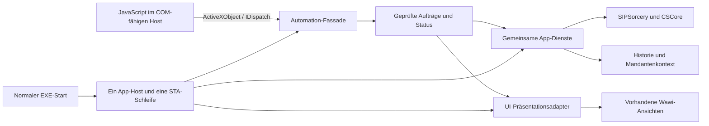

# WawiCallPro – COM-Automation: Studie und Phasenplan

Stand: 20.11.2026. Auftrag: WawiCallPro aus JavaScript über `ActiveXObject` erzeugen,
bei Bedarf anzeigen, seine Ansichten öffnen und mit der vorhandenen Telefonie wählen.

**Empfehlung:** Die vorhandene `WawiCallPro.App` wird selbst zum COM-LocalServer.
Sie erhält einen fensterlosen COM-Startmodus und eine kleine, getrennt implementierte
Automation-Fassade. Normaler Start und COM benutzen denselben Prozess, denselben Host und
dieselbe SIP-/Audiositzung. Ein zusätzlicher Server mit einer zweiten vollständigen Oberfläche
ist für diesen Auftrag nicht sinnvoll. Ein reiner COM-Vermittler bleibt eine spätere Alternative.

**Status:** ✅ Quellenanalyse sowie Phasen 1 und 2 abgeschlossen. Versionierte COM-Verträge,
DI-Adapter und Kunden-/Lieferantenauflösung sind implementiert: je Edition 15 Vertrags-/Adaptertests,
70 native COM-Prüfungen und 57 Prototyp-/Lebensdauerprüfungen bestanden.
Registrierung ausschließlich unter HKCU; keine TLB-/Interface-Registrierung. Temporäre Einträge entfernt.
⬜ App-Anbindung und reale UI-/Telefonieabnahme noch offen.
Die Prüfungen verwenden ausschließlich einen separaten Host, eigene Profile und synthetische Zustände;
sie führen keine echten Anrufe aus und ändern weder die Produktregistrierung noch den Start der App.
Grüne Häkchen bezeichnen ausschließlich tatsächlich abgeschlossene Arbeiten.

## 1. Was die vorhandenen Projekte tatsächlich leisten

| Fundstelle | Festgestellter Stand | Bedeutung für WawiCallPro |
|---|---|---|
| [LxTranslate.Server.csproj](../../LxTranslate/LxTranslate.Server/LxTranslate.Server.csproj) | `OutputType=WinExe`, WinForms und WPF, Referenz auf `Quantarix.Interop`, eingebundener IDL-/TLB-Build | Die Referenz ist keine gewöhnliche Konsolenanwendung. COM benötigt kein sichtbares Konsolenfenster. |
| [LxTranslate Hosting/Program.cs](../../LxTranslate/LxTranslate.Server/Hosting/Program.cs) und [InvisibleForm.cs](../../LxTranslate/LxTranslate.Server/Hosting/InvisibleForm.cs) | Registrierung vor dem normalen Start; unsichtbares Dispatcherfenster; `LocalServer.Instance.Register<ExeServer>()` und `Run(applicationContext)` | Vorhandenes Infrastrukturmuster nutzen, aber nicht dessen WPF-Ansichten übernehmen. |
| [LxTranslate ExeServer.cs](../../LxTranslate/LxTranslate.Server/Com/ExeServer.cs) und [Contract.idl](../../LxTranslate/Server.Contract/Contract.idl) | Explizite COM-Klasse, ProgID, GUIDs, `ClassInterfaceType.None`, Automation-Verträge und Ereignisse | Eigene kleine Wawi-Verträge mit eigenen IDs erstellen. Keine LxTranslate-GUIDs wiederverwenden. |
| [Quantarix LocalServer.cs](../../Quantarix.Interop/COM/LocalServer.cs) | Klassenregistrierung mit `REGCLS_MULTIPLEUSE`, suspendierter Veröffentlichung und eigener Nachrichtenschleife; automatisches Ende ohne Client beziehungsweise bei Zählerstand null | Aktivierung wiederverwendbar; Lebensdauer und Nachrichtenschleife passen noch nicht unverändert zur Desktop-Telefonie. |
| [ClassFactory.cs](../../Quantarix.Interop/COM/ClassFactory.cs) | Erzeugt `new T()` mit parameterlosem Konstruktor | Ein injizierter Aktivierungsweg fehlt; keine Service-Locator-Auflösung in die Fassade einbauen. |
| [ComBase.cs](../../Quantarix.Interop/COM/ComBase.cs) und [IObjectSafetyImpl.cs](../../Quantarix.Interop/Interfaces/IObjectSafetyImpl.cs) | Lebensdauer an Finalizer gekoppelt; Basisklasse erbt Freigaben für nicht vertrauenswürdiges Scripting und Initialisieren | Nicht ungeprüft für eine Wähl-API erben. Lebensdauer und diese Freigaben getrennt behandeln. |
| [RegistryTools.cs](../../Quantarix.Interop/COM/RegistryTools.cs) | Benutzer-/Maschinenregistrierung und beide Registry-Ansichten vorhanden; `LocalServer32` wird mit dem übergebenen Pfad befüllt | Vorhandenen Wrapper nutzen; Pfadquotierung, Argumente und zielgenaues Entfernen vor Wiederverwendung prüfen. |
| [Wawi Program.cs](../WawiCallPro.App/Program.cs) und [AppApplicationContext.cs](../WawiCallPro.App/Hosting/AppApplicationContext.cs) | STA, WinForms-Nachrichtenschleife, Hoststart, Konfigurationsladung und geordnetes Beenden; regulärer Ablauf erzeugt und zeigt ein `MainForm` | Gute Basis für einen gemeinsamen Host, aber noch kein COM-Server und noch kein Start ohne Hauptformular. |
| [AppCompositionRoot.cs](../WawiCallPro.App/Hosting/AppCompositionRoot.cs) und [AppWorkspace.cs](../WawiCallPro.App/Hosting/AppWorkspace.cs) | Zentrale DI-Registrierungen, Plugin-, Mail-, Audio-, Telefonie- und Präsentationsdienste | Gemeinsame Instanzen erhalten; kein zweiter Container oder zweiter Telefoniedienst pro COM-Objekt. |
| [AppInstanceGuard.cs](../WawiCallPro.App/Hosting/AppInstanceGuard.cs) | Instanzgrenze aus Produktlinie, Benutzer und Profil; `Local`-Objekte grenzen die Windows-Sitzung ein; Zweitstart fordert Aktivierung an | COM-Erzeugen muss davon getrennt werden: Es darf kein Fenster ungewollt aktivieren. |
| [MainForm.cs](../WawiCallPro.App/MainForm.cs), [MainForm.Telephony.cs](../WawiCallPro.App/MainForm.Telephony.cs) und [MainForm.Calls.cs](../WawiCallPro.App/MainForm.Calls.cs) | Routing, Dialogfabriken und Anrufdarstellung vorhanden; etliche Reaktionen sind noch an das Hauptformular gebunden | Ansichten über einen Präsentationsadapter öffnen; Gesprächsverarbeitung darf nicht von einem bereits erzeugten Formular abhängen. |
| [ITelephonyService.cs](../WawiCallPro.Interfaces/Telephony/ITelephonyService.cs) und [FrmDial.cs](../WawiCallPro.App/Views/FrmDial.cs) | `DialAsync(CompanyKey, destination)`, Gesprächs-IDs und Statusereignisse; UI prüft Mandant, Registrierung und bestehende Gespräche | COM delegiert an dieselben Dienste. Bedienregeln zusätzlich im gemeinsamen Anwendungsdienst durchsetzen. |

Die Untersuchung ist ein Quellenbefund, kein Nachweis einer bereits funktionierenden Wawi-COM-Aktivierung.

## 2. Variantenvergleich und Entscheidung

| Kriterium | A: Haupt-App als LocalServer | B: Eigener Server mit allen Views und Telefonie | C: Dünner COM-Vermittler zur Haupt-App |
|---|---|---|---|
| Sichtbare Oberfläche | Vorhandene App unverändert weiterverwenden | Gemeinsame UI-Bibliothek herauslösen oder Oberfläche doppelt pflegen | Bleibt ausschließlich in der App |
| Gespräch und Audio | Ein Besitzer im App-Host | Zusätzliche Koordination zwingend, sobald die App ebenfalls läuft | App bleibt Besitzer; Vermittler benötigt IPC |
| Fensterloser Start | Neuer Startmodus und bedarfsweise UI-Erzeugung nötig | Im eigenen Host leicht, spätere UI-Integration aufwendig | Vermittler unsichtbar; App benötigt trotzdem einen versteckten Startmodus |
| Wiederverwendung eurer COM-Funktionen | Klassenfabrik/Registrierung mit angepasstem Lebenszyklus | Nahe am bisherigen Servermuster | Nahe am bisherigen Servermuster plus IPC |
| Komplexität | Schwerpunkt Start, Lebensdauer, Automation-Vertrag | Größte Änderung an Projekt- und UI-Struktur | Zusätzlicher Prozess, Protokoll, Verbindungsabbruch und Zustandsabgleich |
| Fehlerisolation | COM und App teilen den Prozess | Getrennte Prozesse, aber Gefahr doppelter Betriebszustände | Adapterfehler getrennt; IPC-Ausfälle kommen hinzu |
| Eignung für diesen Auftrag | **Empfohlen** | **Nicht empfohlen** | Sinnvoll, falls später unabhängige Automationspakete erforderlich werden |

COM unterscheidet nicht zwischen einer Konsolen- und einer GUI-EXE als Architekturentscheidung.
Entscheidend sind Klassenfabrik, Registrierung, Nachrichtenverarbeitung und Lebensdauer.
Ein eigener Server würde auch als `WinExe` gebaut, wenn kein Konsolenfenster gewünscht ist.

Die Fassade ist vom Hauptformular getrennt: `WawiCallPro.Automation.Contracts` enthält die
stabilen Verträge, `WawiCallPro.Automation` die DI-Adapter und Auftragsverwaltung. Beide Projekte
sind angelegt und im isolierten Prüfhost eingebunden. Die App bleibt der vorgesehene einzige
produktive UI-/Telefoniehost; ihr Anschluss folgt ab Phase 3. Die vorhandene `WawiCallPro.Console`
bleibt ein eigener CLI-Host.



## 3. Aktivieren, ohne schon Fenster zu öffnen

### 3.1 COM-Start erkennen

Windows ergänzt beim Start über `LocalServer32` den Parameter `-Embedding`.
Das ist der vorgesehene Modusschalter; Elternprozessnamen sind dafür ungeeignet.
Das Argument ist keine Authentifizierung, weil es auch manuell übergeben werden kann.
Die Klassenfabrik muss rechtzeitig verfügbar sein; Windows nennt standardmäßig ein
60-Sekunden-Fenster. [Microsoft: LocalServer32](https://learn.microsoft.com/en-us/windows/win32/com/localserver32).

Vorgesehene Modi:

| Start | Verhalten |
|---|---|
| Normaler EXE-/Explorer-Start | Bisheriger sichtbarer Ablauf einschließlich Splash und bestehender Startoptionen. Eigene COM-Klassenfabrik ebenfalls veröffentlichen. |
| `-Embedding` | Bootstrap, STA-Schleife und COM-Fassade starten; kein Splash, Hauptformular, Trayicon, Anruferfenster oder Lizenzdialog. |
| `/regserver /user` bzw. `/unregserver /user` | Nur Registrierung bearbeiten und mit Exitcode enden; keine Dienste, UI, SIP-Anmeldung oder Datenbankmigration starten. |

Alle Argumente vollständig und ohne Beachtung der Groß-/Kleinschreibung auswerten. Unbekannte
oder widersprüchliche Kombinationen ablehnen. Die vorhandenen Velopack-Hooks und Diagnoseschalter
erhalten; Registrierungsbefehle müssen vor der teuren Anwendungsinitialisierung abgearbeitet werden.

Ein unsichtbarer Dispatcher-Handle ist technisch zulässig. Er ist kein verstecktes Hauptformular:
`MainForm` und seine Ansichten werden beim reinen Aktivieren noch nicht erzeugt.

### 3.2 Bestehende Instanz verwenden

Eine normal gestartete App veröffentlicht dieselbe Klassenfabrik wie die COM-gestartete App.
Dann kann COM vorhandene Klassenobjekte benutzen. Dafür ist kein zusätzlicher ROT-Eintrag nötig;
Klassenregistrierung und Running Object Table sind verschiedene Mechanismen.
[Microsoft: laufenden EXE-Server registrieren](https://learn.microsoft.com/en-us/windows/win32/com/registering-a-running-exe-server).

`new ActiveXObject(...)` erzeugt eine neue Automation-Fassade, aber keinen neuen App-Host.
Mehrere Fassaden teilen die bestehenden Dienste. Ein nachträglicher Explorer-Start zeigt eine
zuvor versteckte App; ein weiterer COM-Client lässt ihren Sichtbarkeitszustand unverändert.

Der jetzige Mutex-Abbruchpfad „andere Instanz aktivieren, dann beenden“ genügt beim COM-Kaltstart-Rennen
nicht. Zwei gleichzeitige Erstaktivierungen beziehungsweise Explorer und COM während der Initialisierung
müssen an derselben kanonischen Klassenfabrik enden. Die Zweitinstanz darf weder die UI ungefragt öffnen
noch die ausstehende COM-Aktivierung verwerfen. Dies ist ein eigener nativer Machbarkeitsnachweis in Phase 1.

Produktlinie, Benutzer, Sitzung und Profil müssen zur COM-Identität passen. V1 verwendet pro Produktlinie
das reguläre Benutzerprofil. Beliebige parallele Profile dürfen nicht dieselbe CLSID veröffentlichen.
Isolierte Prüfprofile benötigen eigene Test-CLSIDs/ProgIDs und einen expliziten Prüfhostpfad.
Bei einem SCM-Start nicht darauf vertrauen, dass Umgebungsvariablen des aufrufenden Skripts übernommen werden.

### 3.3 Fensterlos ist ein eigener Betriebsmodus

`PrepareForBackgroundRun()` und `StartupExecutionMode.SuppressNetwork` sind kein Ersatz:
Ersteres erzeugt weiterhin UI, Letzteres ist ein Diagnosemodus und beeinflusst auch Lizenz- und
Netzwerkverhalten. COM muss mit echten, unveränderten Lizenz-/Zugriffsregeln arbeiten.

Die Fassade darf früh `Starting`, `Ready`, `LicenseRequired`, `ConfigurationRequired`, `Failed`
oder `Stopping` melden. Keine Lizenzaktivierung, OAuth-Anmeldung, Fehlermeldungsbox oder Kontoeinrichtung
aus dem COM-Konstruktor öffnen. Fachbefehle erhalten einen verständlichen Fehlerstatus, bis ihre
Voraussetzungen erfüllt sind. Erst ein ausdrücklich angeforderter UI-Aufruf darf den passenden Dialog öffnen.

COM-Erzeugen allein löst weder einen Anruf noch eine neue SIP-Anmeldung oder einen Mailimport aus.
`ConnectTelephony()` verwendet nur lokal gespeicherte SIP-Einstellungen. Beim späteren sichtbaren
Start konfigurierte Hintergrundaufgaben höchstens einmal starten; keine doppelte Registrierung erzeugen.

## 4. Implementierter Automation-Vertrag V1

Die folgenden Verträge und Adapter sind implementiert. Nativ verfügbar sind sie in Phase 2 im
isolierten Prüfhost; die Produkt-App veröffentlicht sie noch nicht. COM-sichtbar sind nur die
ausdrücklichen Automation-Verträge; keine Forms, Controls, ServiceProvider, Tasks oder Pluginobjekte.

Versionsgebundene ProgIDs: `WawiCallPro.Pro.Application.1` und
`WawiCallPro.FinOffice.Application.1`, mit eigenen CLSIDs. Versionsunabhängige Aliase sind derzeit
nicht vorgesehen. Keine gemeinsame Alias-Registrierung, die Pro und FinOffice beim Build oder
Update gegenseitig überschreibt. Der gegenwärtige gemeinsame Buildausgabeordner
belegt keine gleichzeitige Installation beider Editionen; Installation und Registrierung getrennt planen.

| Aufruf/Eigenschaft | Vorgesehener Vertrag |
|---|---|
| `GetStatus()` | Kleiner schreibgeschützter Status: API-Version, Produktlinie, Bereitschaft, Sichtbarkeit, SIP-Status und sicherer Fehlercode. Keine Secrets oder vollständigen Konfigurationen. |
| `Show()` | Auftrag zum Anzeigen des vorhandenen oder einmalig erzeugten Hauptfensters; Auftrags-ID zurückgeben, als Benutzerbetrieb behalten. Keine Wartezeit auf einen später geschlossenen Dialog. |
| `ShowView(viewId, contextJson)` | Geprüften Präsentationsauftrag annehmen; Auftrags-ID zurückgeben. Unbekannte Ansicht oder ungültigen Kontext ausdrücklich melden. |
| `ShowDial(number, companyKey)` | Wähldialog vorbefüllen; **kein Anruf**. Auswahl und Bestätigung bleiben beim Benutzer. |
| `ShowCustomer(companyKey, customerNumber)` | Kunden anhand ihrer Kundennummer im eindeutig angegebenen Mandanten auflösen und vorhandene Kundenansicht öffnen; Auftrags-ID zurückgeben. |
| `ShowSupplier(companyKey, supplierNumber)` | Lieferanten anhand ihrer Lieferantennummer im eindeutig angegebenen Mandanten auflösen und vorhandene Lieferantenansicht öffnen; Auftrags-ID zurückgeben. |
| `ConnectTelephony()` | Gespeicherten SIP-Zugang explizit anmelden; Auftrags-ID zurückgeben. Keine Kennwörter über COM annehmen. |
| `Dial(number, companyKey, requestId)` | Bewusst wählen; Auftrags-ID zurückgeben. `companyKey` muss aus dem freigegebenen Firmenkatalog stammen. Client vergibt eine eindeutige Request-ID. |
| `GetOperation(operationId)` | Schreibgeschütztes Automation-Objekt mit `State`, `ErrorCode`, `Message` und gegebenenfalls `CallId`. |
| `GetCall(callId)` | Aktueller Gesprächsstatus; nur freigegebene Informationen des zugehörigen Kontextes. |
| `HangUp(callId)` | Explizites Beenden des eindeutig benannten Gesprächs, mit denselben Zustandsprüfungen wie die UI. |
| `GetCompaniesJson()` / `GetViewsJson()` | Größenbegrenzte Kataloge mit Schema-Version, stabilen Schlüsseln und Verfügbarkeit. Kontextschlüssel nicht aus Anzeigenamen erzeugen. |

Automation-Grundtypen verwenden: `BSTR`, `VARIANT_BOOL`, feste Zahlenbereiche und explizites `IDispatch`
für kleine Statusobjekte. Aufzählungen als dokumentierte stabile Werte; .NET-GUIDs als Strings.
Eigene Interface-IDs, feste `DispId`s und `ClassInterfaceType.None`; keine automatische Klassenoberfläche.
Bestehende Interfaceverträge nach Veröffentlichung nicht inkompatibel ändern. Zusätzliche Schnittstellen
mit neuen IIDs versionieren. IDL und C# gemeinsam prüfen; TLB mit MIDL erstellen. Der .NET-`comhost.dll`-
Bibliothekspfad allein macht aus einer EXE keinen LocalServer und erzeugt keine TLB aus C#.
[Microsoft: moderne .NET-COM-Bereitstellung](https://learn.microsoft.com/en-us/dotnet/core/native-interop/expose-components-to-com).

Verbindliche V1-Identitäten aus [AutomationContracts.cs](../WawiCallPro.Automation.Contracts/AutomationContracts.cs)
und [Automation.idl](../WawiCallPro.Automation.Contracts/Contract/Automation.idl):

| Identität | GUID |
|---|---|
| Bibliothek, Version 1.0 | `7155BD3A-6580-4A46-A034-1E4F55CFA047` |
| `IApplicationV1` | `710E28F8-6286-4F6E-8898-C88A3F872FC1` |
| `IStatusV1` | `9A897EBA-795D-4FDD-9417-97B156287D22` |
| `IOperationV1` | `643E9245-55FF-466E-A7E7-57B18E9D3FC6` |
| `ICallV1` | `68DA705A-6F68-49F7-8C6A-B6CC3F29A4FE` |
| Pro-Klasse | `B24140A1-859F-4A8F-97F6-962668F0D20D` |
| FinOffice-Klasse | `F078BC10-F918-49FF-99C7-C5A2B44CFD5E` |

`IApplicationV1` verwendet die festen Dispatch-IDs 1–13 in dieser Reihenfolge:
`GetStatus`, `Show`, `ShowView`, `ShowDial`, `ShowCustomer`, `ShowSupplier`, `ConnectTelephony`,
`Dial`, `GetOperation`, `GetCall`, `HangUp`, `GetCompaniesJson`, `GetViewsJson`.
`IStatusV1` hat die schreibgeschützten Eigenschaften 1–6: `ApiVersion`, `ProductLine`, `State`,
`IsVisible`, `SipState`, `ErrorCode`. `IOperationV1` hat 1–5: `Id`, `State`, `ErrorCode`, `Message`,
`CallId`; `ICallV1` hat 1–2: `Id`, `State`. Die Objekte sind unveränderliche Momentaufnahmen;
für Aktualisierungen erneut abfragen. `IsVisible` ist `VARIANT_BOOL`, alle übrigen Werte sind `BSTR`.
Die Objekt-Rückgaben sind ausdrücklich `IDispatch`. Neue inkompatible Verträge bekommen neue IIDs,
CLSID/ProgID-Hauptversionen; V1-Mitglieder, Reihenfolge, Typen und Dispatch-IDs bleiben erhalten.
Die beiden MIDL-TLBs werden mit `REGKIND_NONE` geladen und gegen die C#-Verträge geprüft, nie registriert.

### 4.1 DI-Adapter und Eingabegrenzen

`AddWawiAutomation()` registriert eine gemeinsame Auftragsverwaltung, den rollenbezogenen
`NumberedPartyResolver`, Router und eine typisierte Fassadenfabrik. Der Host injiziert
`IAutomationEnvironment`, `IPartySearch`, `IAutomationPresentation` und `IAutomationTelephony`.
`DispatchedAutomationPresentation` übergibt ausschließlich die Präsentation an den injizierten
UI-Dispatcher; weder COM-Aufruf noch UI-Thread warten synchron auf asynchrone Facharbeit.
Kataloge und Status müssen bereits geladene, vom Host freigegebene Momentaufnahmen liefern.
Zugriffsgates werden vor Annahme und bei Ausführung erneut geprüft, bei Präsentation nochmals
auf dem UI-Thread. Die tatsächlichen Lizenz-, Installations- und SIP-Regeln liefert später der App-Adapter.

`GetCompaniesJson()` und `GetViewsJson()` liefern `SchemaVersion: 1` und `Items`.
Firmen haben `Key`/`Name`, Ansichten `Id`/`Caption`. Den vollständigen `Key` unverändert zurückgeben:
Er codiert Produktlinie, Installation und externe Mandanten-ID und wird ausschließlich gegen den
freigegebenen Katalog aufgelöst. Er ist kein Berechtigungsnachweis. Namen oder Nummern nicht als
Ersatz verwenden. `ShowCustomer`/`ShowSupplier` suchen im angegebenen Mandanten und in der richtigen
Rolle, vergleichen die Nummer exakt als String und verlangen genau einen Treffer. Fremde Mandanten,
Rollen, doppelte Schlüssel oder inkonsistente Quellantworten werden abgewiesen.

Standardgrenzen: maximal 128 laufende oder aufbewahrte Aufträge, zehn Minuten Aufbewahrung ab Abschluss,
30 Sekunden kooperative Bearbeitungsfrist. Alle Fassaden teilen diese Grenzen. Ein voller Speicher
meldet `Busy`; gültige Deduplizierungsnachweise werden nicht vorzeitig verdrängt. Nach Fristablauf oder
Prozessende entfällt die In-Memory-Deduplizierung. Request-, Auftrags- und Gesprächs-IDs sind nichtleere
GUID-Strings im Format `D`. Nummern: maximal 200 Zeichen, View-ID 128, Firmenschlüssel 2048;
leere Werte und Steuerzeichen werden abgewiesen. `contextJson` darf leer sein oder ein Objekt mit
den Stringfeldern `companyKey`/`callId` enthalten, maximal 8192 Zeichen, keine doppelten oder unbekannten
Felder. Kataloge enthalten höchstens 1000 Firmen bzw. 256 Ansichten und 262144 JSON-Zeichen.
Firmenname/Ansichtsbeschriftung sind auf 256 Zeichen begrenzt.

Fehler vor Annahme werden als sichere COM-Ausnahme gemeldet; nach Annahme stehen dieselben Codes
im Auftrag. Rohmeldungen aus Providern werden durch feste Texte ersetzt.

| Fehlercode | HRESULT |
|---|---|
| `InvalidArgument` | `0x80070057` |
| `AccessDenied` | `0x80070005` |
| `NotFound` | `0x8004A101` |
| `Ambiguous` | `0x8004A102` |
| `NotReady` | `0x8004A104` |
| `NotSupported` | `0x8004A105` |
| `Conflict` | `0x8004A106` |
| `Busy` | `0x8004A107` |
| `ProviderUnavailable` | `0x8004A108` |
| `Timeout` | `0x8004A109` |
| `Stopping` | `0x8004A10A` |

### 4.2 Asynchrone Telefonie und eindeutige Rückmeldungen

Die COM-Aufrufe nehmen kurze, begrenzte Aufträge an. UI und Fachabläufe arbeiten danach asynchron;
der Client kann abfragen. Keine `.Wait()`-/`.Result`-Brücke auf dem STA und keine langen Telefonie-
oder Datenbankaufrufe im COM-Konstruktor. Ein STA benötigt eine weiterlaufende Nachrichtenschleife.
[Microsoft: Single-Threaded Apartments](https://learn.microsoft.com/en-us/windows/win32/com/single-threaded-apartments).

Auftragsstatus: `Pending`, `Running`, `Succeeded`, `Failed`, `Canceled`.
Die zurückgegebene Auftrags-ID ist keine Gesprächs-ID. `Succeeded` für `Dial` bedeutet, dass der
Rufaufbau vom Dienst angenommen wurde; ob der Teilnehmer annimmt, ergibt sich aus `GetCall`.
Timeout oder Clientabbruch beweisen nicht, dass kein Ruf ausgelöst wurde.

Gleiche Request-ID und gleiche Parameter liefern innerhalb des dokumentierten Aufbewahrungsfensters
denselben Auftrag; andere Parameter mit derselben ID ergeben `Conflict`. Nach Prozessabsturz ohne
dauerhaften Nachweis keine automatische Wiederholung eines möglicherweise gesendeten Wählbefehls.
Diese Regel begrenzt Dubletten, verspricht aber keine allgemeine Exactly-once-Telefonie.

Auftragszahl, Kontextgröße, Katalogumfang und Aufbewahrung begrenzen. Fehler vor Annahme über stabile
HRESULTs mit sicherem `IErrorInfo` melden, spätere Fehler im Auftrag. Keine still ignorierten Befehle
und keine gemeinsame veränderliche `LastError`-Eigenschaft für mehrere Clients. Ereignisse über
Connection Points sind später möglich, für den ersten JScript-Vertrag genügt Polling.

### 4.3 JavaScript-Verhalten nach Anschluss der Produkt-App

Ein COM-fähiger JScript-Host kann Objekte mit `ActiveXObject` erzeugen, etwa Windows Script Host.
Die konkrete Skriptumgebung und ihre Richtlinien werden gemeinsam geprüft; normale Browserseiten
sind nicht das hier geplante Ziel. [Microsoft: COM im Windows Script Host](https://learn.microsoft.com/en-us/windows/win32/com/using-com-objects-in-windows-script-host).

```javascript
// Produkt-App erst nach Host-Anschluss und HKCU-Registrierung verfügbar.
var app = new ActiveXObject("WawiCallPro.Pro.Application.1");
// Bis hierhin erscheint kein WawiCallPro-Fenster.
app.Show();
var viewRequest = app.ShowView("history", "");
```

```javascript
// Beispiel für die spätere Abnahme eines bewusst gestarteten Wähltests.
// Argumente: freigegebene Testnummer, Firmen-Schlüssel aus dem Katalog, neue Request-GUID.
// Voraussetzungen: Status Ready und explizit erfolgreich angemeldete Telefonie.
var app = new ActiveXObject("WawiCallPro.Pro.Application.1");
var operationId = app.Dial(
    WScript.Arguments.Item(0),
    WScript.Arguments.Item(1),
    WScript.Arguments.Item(2));
var until = new Date().getTime() + 15000;
while (new Date().getTime() < until) {
    var operation = app.GetOperation(operationId);
    if (operation.State == "Succeeded") {
        WScript.Echo("Rufaufbau angenommen. Gespräch: " + operation.CallId);
        break;
    }
    if (operation.State == "Failed" || operation.State == "Canceled") {
        throw new Error(operation.ErrorCode + ": " + operation.Message);
    }
    WScript.Sleep(100); // Client wartet; die Server-Nachrichtenschleife läuft weiter.
}
// Bei Timeout denselben Auftrag abfragen; nicht erneut mit neuer Request-ID wählen.
// Freigabe von app beendet kein laufendes Gespräch und kein sichtbares Hauptfenster.
```

Das Beispiel verlässt sich nicht auf native JSON-Unterstützung eines alten JScript-Hosts.
Für Katalog-/Kontext-JSON ist ein im jeweiligen Host verfügbarer Parser zu prüfen.

## 5. Alle Ansichten über eine gemeinsame Präsentationsschicht

Die COM-Fassade erhält einen injizierten Präsentationsdienst. Er übernimmt Dispatcher, Owner,
vorhandene Fenster, Modalität und dieselben fachlichen Sperren wie Ribbon und Navigation.
`MainForm` wird nicht selbst zur COM-Klasse; auch Button-Eventhandler werden nicht fernaufgerufen.

| Ansicht | Geplanter Zugang und Grenze |
|---|---|
| Startseite, Historie, E-Mails, Hilfe, Über | Explizite IDs `home`, `history`, `mail`, `help`, `about`; vorhandenes Dokument wiederverwenden. |
| Kunden-/Lieferantensuche und Plugin-Fachansichten | `parties` sowie vom aktiven Plugin veröffentlichte IDs. Berechtigter Mandant und vollständiger `PartyKey` erforderlich; keine beliebige Typinstanziierung. |
| Anrufersuche und Gesprächsdetails | `caller` beziehungsweise `call` mit gültiger Gesprächs-ID. Historischen Kontext erhalten und aktive Entwürfe schützen. |
| Wähldialog | `ShowDial`; ausdrücklich getrennt von `Dial`. |
| Einstellungen einschließlich Plugins, SIP, Audio, Telefon-Cache und Office/Mail | Vorhandener zentraler Dialog mit expliziter Tabauswahl; keinen zweiten Einstellungseditor aufbauen. |
| Datenbankeinrichtung und Nummerndiagnostik | Eigene freigegebene Präsentationsbefehle. Das heutige `Navigate("database")` wählt nur das Ribbon und ersetzt keinen Assistentenaufruf. |
| Log-Fenster | Vorhandenen Logfensterdienst verwenden; keine Rohlogs oder Zugangsdaten durch COM zurückgeben. |
| Untercontrols, Splash und technische Dispatcherfenster | Keine eigenständigen Automation-Ansichten. Untercontrols bleiben Bestandteil ihrer Dialoge; Splash entfällt beim COM-Start. |

`GetViewsJson()` soll alle tatsächlich verfügbaren Ansichten mit nötigem Kontext beschreiben.
Noch geplante oder nicht vom Plugin angebotene Funktionen mit `NotSupported` melden. „Alle Views“
bedeutet Zugang zu allen fachlich verfügbaren Oberflächen, nicht Freigabe jedes internen Controls.

Bei einem modalen Dialog das bedienbare Ownerfenster berücksichtigen. Kein zweites Hauptfenster,
kein ungefragtes Schließen eines Entwurfs und kein impliziter Wechsel der Warenwirtschaftsproduktlinie.
Ein `CompanyKey` enthält Produktlinie, Installation und externe ID; führende Nullen und Groß-/
Kleinschreibung erhalten. Eine Kundennummer oder ein Firmenanzeigename allein genügt nicht.
Die expliziten Kunden-/Lieferantenaufrufe sind ein zusätzlicher Benutzerauftrag vom 20.11.2026:
Nummern als Strings mit führenden Nullen behandeln, stets nach Mandant und Rolle auflösen und genau
einen Treffer verlangen. Fehlende oder doppelte Nummern ergeben `NotFound` beziehungsweise `Ambiguous`.
Danach über den aufgelösten `PartyKey` dieselbe Fachansicht wie in der App öffnen; keine willkürliche
Trefferauswahl, Datensatzänderung oder ungefragten Mandantenwechsel durchführen.

`Show` stellt Sichtbarkeit her; Vordergrundaktivierung bleibt von Windows-Rechten abhängig.
Native Clients können `CoAllowSetForegroundWindow` benutzen. Reines JScript kann diesen Win32-Aufruf
nicht unmittelbar ausführen; Fokusübergabe im tatsächlichen Host separat prüfen. Keine TopMost-
Schleifen als Ersatz. [Microsoft: COM-Vordergrundrecht übertragen](https://learn.microsoft.com/en-us/windows/win32/api/objbase/nf-objbase-coallowsetforegroundwindow).

## 6. Lebensdauer, bestehende COM-Hilfen und Schutzgrenzen

### 6.1 Was am COM-Subsystem angepasst werden muss

Die aktuelle `LocalServer.Run`-Schleife kann nicht zusätzlich zur bestehenden `Application.Run`-
Schleife auf demselben Thread gestartet werden. Ihr automatischer `WM_QUIT` bei Referenzzähler null
würde außerdem den geordneten asynchronen App-Shutdown umgehen. Der Fünf-Sekunden-Idle-Timer und
das erzwungene periodische `GC.Collect()` dürfen nicht die Telefonie-Lebensdauer bestimmen.
Ein Finalizer ist keine deterministische Bestätigung der letzten Skriptreferenz.

Bevorzugt: rückwärtskompatiblen Betriebsmodus für eine fremd verwaltete Nachrichtenschleife und
einen injizierbaren Aktivierungs-/Lebensdauerdienst im gemeinsamen Subsystem vorsehen. Beispielsweise
eine fabrikbasierte Registrierung ohne `new T()` und ein Beendigungsangebot statt unmittelbarem
`WM_QUIT`. Diese APIs existieren derzeit nicht. LxTranslate-Verhalten durch Regressionstests erhalten.
Falls diese Trennung nicht klein und sauber gelingt, Klassenregistrierung und Wawi-Lebensdauer
über einen eigenen Adapter zusammensetzen; keine zweite Kopie des gesamten COM-Subsystems erstellen.

### 6.2 Wer den Prozess am Leben hält

| Situation | Verhalten |
|---|---|
| Nur COM, noch kein Client/keine Arbeit | Begrenzte Anlauf-/Idlefrist; nach geordnetem Freigeben beenden. |
| COM-Objekt, laufender Auftrag oder gültiger Unterobjektzugriff | Host bleibt verfügbar; Unterobjekte zählen zur COM-Lebensdauer. |
| Aufbau, Klingeln oder aktives/gehaltenes Gespräch | Gespräch besitzt eine eigene Hostbindung. Wegfall des Skripts beendet es nicht. |
| `Show()` oder normaler Explorer-Start | Benutzerbetrieb bleibt bestehen, auch wenn das Skript endet oder das Fenster im Tray liegt. |
| Benutzer beendet die App | Vorhandenen Gesprächs-/Notiz-/Plugin-Schließschutz beachten; keine pauschale COM-Freigabe als Abbruchauftrag auslegen. |
| Tatsächlich freigegebener Shutdown | Neue Aktivierungen aussetzen, Aufträge abschließen/abbrechen, SIP/Audio und Datenablage geordnet stoppen, Klassenregistrierungen zurücknehmen. |

Zeitgleich eintreffende Aktivierung und Idle-Shutdown müssen atomar behandelt werden.
COM-Clients erhalten bei beendeter App einen Verbindungsfehler; ein erneutes Objekt kann später
eine neue App aktivieren, aber keine bereits gestarteten Telefonieaufträge blind wiederholen.

### 6.3 Sicherheits- und Kontextgrenzen

Lokale Automation läuft im Kontext des angemeldeten Benutzers, nicht als neuer administrativer
Dienst. Benutzer-, Sitzungs-, Produktlinien- und Lizenzgrenzen bleiben erhalten. Keine Remote-
DCOM-Freigabe und keine global gelockerten Start-/Zugriffsrechte als Abkürzung konfigurieren.
Das Startargument allein beweist weder vertrauenswürdigen Aufrufer noch dessen Berechtigung.

Für eine ausgehende Wählfunktion ist die geerbte pauschale `IObjectSafety`-Freigabe der bisherigen
`ComBase` ungeeignet. Automation-fähiges `IDispatch` und „sicher für beliebige fremde Skripte“ sind
unterschiedliche Eigenschaften. Diese Freigaben nicht in Wawi übernehmen; kontrollierte lokale
Skripthosts benötigen keine pauschale Browserfreigabe. Bestehendes LxTranslate-Verhalten nicht global ändern.
[Microsoft: IObjectSafety](https://learn.microsoft.com/en-us/previous-versions/windows/internet-explorer/ie-developer/platform-apis/aa768224(v=vs.85)).

Wählbereitschaft, Lizenz, Lexware-Installationsgate, Pluginverfügbarkeit, erlaubter Firmenkontext,
Nummernnormalisierung und bestehende Gespräche im gemeinsamen Dienst prüfen. Mehrdeutige
Kunden-/Lieferantentreffer weiterhin bewusst auflösen; COM darf keine willkürliche Zuordnung erzwingen.
Ankommende Statusänderungen und Historie unabhängig von einer erzeugten UI verarbeiten.

Keine Secrets setzen/auslesen, keine beliebigen Dateipfade, DLL-Namen, Skripte oder SQL über die API
annehmen. Serilog-/bestehende sichere Loggingadapter verwenden: Auftragstyp, technische IDs,
Ergebnis und Laufzeit genügen; keine vollständigen Nummern, Mails oder Anmeldedaten protokollieren.

## 7. Registrierung, Bitness und Auslieferung

Verbindlicher Benutzerauftrag: ausschließlich `HKCU\Software\Classes` mit eigenen
CLSID-/ProgID-/LocalServer32-Einträgen verwenden, entsprechend LxTranslate.Server.
Keine Maschinenregistrierung, keine TLB-Registrierung und keine zusätzlichen Interface-/Proxy-Einträge;
auch bei Fehlern nicht nach HKLM ausweichen. `RegistryTools` verarbeitet beide Registry-Ansichten.
Auflösung und tatsächliche `IDispatch`-Objektrückgaben mit beiden Client-Bitnessen prüfen.
Ein 32-Bit-Client kann grundsätzlich mit einem 64-Bit-LocalServer sprechen; das ersetzt den
Marshallingnachweis nicht. [Microsoft: Prozessinteroperabilität](https://learn.microsoft.com/en-us/windows/win32/winprog64/process-interoperability).

EXE-Befehl mit Leerzeichen korrekt quotieren; `ServerExecutable`, falls verwendet, separat als reinen
Pfad behandeln. TLB-Dateien werden für Werkzeuge und Vertragsprüfungen gebaut und mit ausgeliefert,
aber nicht registriert. Kein `RegisterTypeLib`, `RegisterTypeLibForUser`, Regasm oder Regsvr32.
Phase 2 prüft echte Aufrufe einschließlich Status-/Auftrags-/Gesprächsobjekten ohne registrierte TLB
oder Interface-Metadaten; die Abwesenheit wird unter HKCU und HKLM in beiden Ansichten kontrolliert.

Bei Installation, Update, Rücknahme und Deinstallation ausschließlich eigene Einträge bearbeiten.
Ein alter Uninstaller darf keine Registrierung löschen, die inzwischen auf eine neue Installation zeigt.
Velopack-Pfadwechsel und Editionstausch nachweisen; Registrierung nicht bei jedem normalen Start still
umschreiben. Debug- und Prüfregistrierungen dürfen die installierte Produktregistrierung nicht ersetzen.

## 8. Phasenübersicht

Die Phasen sind bewusst kleiner als eine Komplettumstellung. Jeden abgeschlossenen und geprüften
Punkt mit ✅ in dieser Übersicht und der zugehörigen Phase markieren und separat committen.
Die bestehende gemeinsame G1-Abnahme im [Neuaufbau-Plan](Neuaufbau-Plan.md) bleibt davon unberührt.
Für jede Phase mit Codeänderungen gelten die regulären Rebuilds in der aktiven Konfiguration,
die betroffenen Pro-/FinOffice-Hosts und gezielte Funktionstests vor dem Abschlusscommit.
UI-Änderungen benötigen die begrenzten visuellen Nachweise. Reine Studien-/Dokumentpflege benötigt
keinen Anwendungsbuild und keine GUI-Läufe.

| Phase | Status | Ergebnis | Verantwortlich / Abnahme |
|---|---|---|---|
| 0 | ✅ | Quellenstudie, Variantenentscheidung und dokumentierter Plan | Agent; Quellen- und Dokumentkonsistenzprüfung |
| 1 | ✅ | Isolierter Prototyp: je 57 Prüfungen Pro/FinOffice, x86/x64, parallele Aktivierung, Dispatcher und Lebensdauer | Agent; eigene HKCU-CLSIDs entfernt, keine echten Anrufe |
| 2 | ✅ | V1-Verträge und DI-Adapter einschließlich ShowCustomer/ShowSupplier; je Edition 15 Tests, 70 native und 57 Prototypprüfungen | Agent; x86/x64 ohne TLB-/Interface-Registrierung, eigene HKCU-Einträge entfernt |
| 3 | ⬜ | Begonnen: Startargumente abgesichert; gemeinsamer COM-/App-Host noch offen | Agent; isolierte Start-/Instanztests |
| 4 | ⬜ | Gemeinsamer Zugang zu allen verfügbaren Wawi-Ansichten | Agent; gezielte Layout-/UI-Nachweise; sichtbare Bedienung gemeinsam |
| 5 | ⬜ | Wähldialog, SIP-Verbindung, Wählen und Gesprächsstatus | Agent mit Test-Doubles; reale SIP-Prüfung gemeinsam |
| 6 | ⬜ | Mehrclientbetrieb, Idle-Shutdown und Fehler-/Sicherheitsgrenzen | Agent; gezielte konkurrierende und negative Tests |
| 7 | ⬜ | Registrierung, Update, Deinstallation und Dokumentation | Agent; isolierte Installationsprüfung, Zielinstallation gemeinsam |
| 8 | ⬜ | Native JavaScript-Abnahme Pro und FinOffice | Gemeinsam; reale Host-/Fenster-/Telefoniebelege |

### Phase 0 – ✅ Studie und Entscheidung

- [x] ✅ LxTranslate.Server, gemeinsame COM-Klassen und aktuelle Wawi-Start-/Wählpfade gelesen.
- [x] ✅ Drei Varianten verglichen; Haupt-App mit getrenntem COM-Modus empfohlen.
- [x] ✅ Unterschiede zwischen vorhandenem Quellcode, API-Entwurf und noch fehlendem Nachweis benannt.
- [x] ✅ Microsoft-Primärquellen zu Aktivierung, STA, Automation und Bitness abgeglichen.
- [x] ✅ 21 lokale Quellenverweise, neun übereinstimmende Phasenstatus, geschlossene Codeblöcke
  und genau einen Dokumenteintrag in der Hauptsolution geprüft. Neuaufbau-Plan auf den neuen Auftrag abgeglichen.

### Phase 1 – ✅ Technische Machbarkeit isoliert nachgewiesen

- [x] ✅ COM-Registrierung/-Aktivierung mit eigener Prüf-CLSID und eigenem Profil; x86-/x64-JScript-Clients.
- [x] ✅ Eine WinForms-Nachrichtenschleife mit COM-Klassenfabrik, DI-Erzeugung und expliziter UI-Thread-Übergabe nachgewiesen.
- [x] ✅ Zwei gleichzeitige COM-Kaltstarts sowie COM während des simulierten Normalstarts bedienen denselben Host; keine verlorene Aktivierung.
- [x] ✅ Keine sichtbaren Fenster beim Aktivieren; bei um 4,5 Sekunden verzögerter Initialisierung ist die Klassenfabrik schon erreichbar und liefert `Starting`.
- [x] ✅ Lebensdauerbindungen für Benutzerbetrieb und aktives Gespräch simuliert; letzter Client beendet diese Haltegründe nicht. Echte Fenster-/Gesprächsabnahme folgt später.
- [x] ✅ Keine Quantarix-Änderung nötig; eigener Adapter getrennt geprüft und unveränderter LxTranslate-Hostingpfad mit synthetischen Objekten aus x86/x64-JScript bestätigt.

Abnahme am 20.11.2026: kritischer Start-/Lebenszyklus im isolierten Host nativ belegt.
Die produktive API wird erst in den nachfolgenden Phasen angeschlossen.

#### Phase-1-Prototyp und Prüfumfang

Implementierung unter [Tools/ComPrototype.TestWorker](../Tools/ComPrototype.TestWorker/ComPrototype.TestWorker.csproj),
in der Hauptsolution als Test-Fixture eingebunden. Ausgaben bleiben nach Edition getrennt.
Der Host referenziert `Quantarix.Interop`, verwendet dessen `IClassFactory`-/Ole32-Verträge und
`WinFormsUiDispatcher`, betreibt aber genau eine eigene `Application.Run`-Schleife.
Die injizierte Klassenfabrik erhält eine typisierte Erzeugungsfunktion aus dem Composition Root.
Sie verwendet weder Service-Locator-Zugriffe noch `ComBase` für die neue Lebensdauer.
Am gemeinsamen Quantarix-Repository und an LxTranslate.Server wurde nichts geändert.
Deshalb werden keine Erweiterungen des gemeinsamen Subsystems benötigt; der eigene Adapter ist die
in Abschnitt 6.1 vorgesehene Alternative. Der bisherige `LocalServer.Register<T>`-/`Run`-/`ComBase`-Pfad
wird zusätzlich mit einem synthetischen Objekt aus beiden JScript-Bitnessen geprüft.

Wiederholbarer Einstieg nach dem regulären Build:

```powershell
./scripts/test-com-prototype.ps1 -Configuration Debug -LexwareProductLine FinOffice
./scripts/test-com-prototype.ps1 -Configuration Debug -LexwareProductLine Pro
```

Das Skript erzeugt pro Lauf neue CLSIDs/ProgIDs (`WCP.p<GUID>`, unter 39 Zeichen), eigene Profile
und ausschließlich eigene HKCU-Klassen-/ProgID-Einträge. Beide Registry-Ansichten werden berücksichtigt,
einschließlich gemeinsam sichtbarer Schlüssel. Ein belegter fremder Eintrag wird nicht überschrieben.
Nach dem Lauf werden die eigenen Einträge entfernt und deren Abwesenheit geprüft.
Die registrierte Befehlszeile enthält absolute, quotierte EXE-/Profilpfade. Kein `Regasm`, keine
HKLM-Registrierung und keine Änderung von UAC-/DCOM-Richtlinien. Erhöhte Prüfshells starten den Lauf
über den vorhandenen normalen Desktop mit verborgenem Konsolenfenster; der Kindprozess prüft, dass
er nicht erhöht läuft. Ein Scheitern führt nicht zu einer Registrierung unter HKLM.

Die native Prüfung hat gezeigt: .NET-COM-Aufrufe müssen ausdrücklich an den UI-Dispatcher übergeben
werden. Das `[STAThread]` des Programmeinstiegs allein garantiert nicht, dass ein CCW-Methodenaufruf
auf diesem Thread ausgeführt wird. Der Prototyp misst deshalb den tatsächlich benutzten UI-Thread.
Die langsame Initialisierung erfolgt asynchron nach Veröffentlichung der Klassenfabrik; ein Client
kann bereits `Starting` abfragen, bevor derselbe Host `Ready` erreicht.

**Bewusste Grenzen:** Benutzerbetrieb und aktives Gespräch sind in Phase 1 Haltegründe im
Lebensdauerdienst, keine sichtbaren Produktfenster und keine echten SIP-Gespräche. `Close` gibt die
kooperative Testsitzung frei, ohne die Benutzer-/Gesprächsbindung zu löschen. Die Freigabe eines
CCW ohne `Close` wird mit einer ausdrücklichen einmaligen Test-GC synchronisiert; daraus folgt
keine garantierte Freigabelatenz beim Absturz eines produktiven Skripthosts. Dieser Fall bleibt
Phase 6. Es gibt im neuen Host keinen periodischen erzwungenen GC. Die produktive UI-/Telefonie-
Anbindung bleibt den folgenden Phasen vorbehalten; Typbibliothek und Kunden-/Lieferantenverträge
sind inzwischen in Phase 2 ergänzt. Ihre Verbindung mit echten Ansichten folgt in Phase 4.

Nachweise: `.com-prototype-build-{fin,pro}.log` (Solution-Rebuilds Debug/Any CPU, je 0 Fehler und
26 bekannte externe CSCore-Nullablewarnungen), `.com-prototype-{fin,pro}.log` und
`.artifacts/com-prototype/{fin-final,pro-final}/results.json`. Je Edition sind 11 gezielte
Lebensdauer-/Grenzprüfungen und 46 native Assertions über zehn isolierte Fixture-Konfigurationen
bestanden. Die Fixtures belegen Kaltstart, beide Client-Bitnessen, denselben Singleton bei parallelem
Start, erneute Aktivierung derselben CLSID nach Idle-Shutdown, Einstieg während Initialisierung,
Benutzer-/Gesprächsbindung nach Sitzungsschluss, CCW-Fallback, Start ohne Client sowie den bisherigen
Quantarix-Serverpfad. HRESULT und `IErrorInfo` erreichen JScript unverändert. Die neue Fassade erbt
keine Freigabe für nicht vertrauenswürdiges Scripting. `RegistryCleanupConfirmed=true` und
`Elevated=false` sind für beide vollständigen Läufe festgehalten. Keine neuen Forms/UserControls,
keine Layoutänderung; daher kein Render-/Designer-Lauf für diese Phase erforderlich.

### Phase 2 – ✅ Verträge und Adapter

- [x] ✅ Eigene ProgIDs/CLSIDs/IIDs, feste Dispatch-IDs und IDL/TLB mit dokumentierter Versionsstrategie.
- [x] ✅ Injizierte Fassade, Präsentationsschnittstelle, Firmen-/Viewkatalog und begrenzte asynchrone Auftragsverwaltung implementiert.
- [x] ✅ `ShowCustomer`/`ShowSupplier` mit Mandant und rollenbezogener Nummer als String implementiert; exakter Einzelmatch liefert `PartyKey`, führende Nullen und Unicode bleiben erhalten.
- [x] ✅ Unveränderliche Status-/Fehlerobjekte, Limits, Aufbewahrung, Busy, Timeout, geordneter Abbruch und Request-Deduplizierung geprüft; 100 parallele Clients lösen einen simulierten Wählvorgang aus.
- [x] ✅ Keine UI-/Diensteobjekte oder Tasks durch COM; Unicode, leere Werte, falsche IDs, Mandanten-/Rollengrenzen und beide Client-Bitnessen geprüft.
- [x] ✅ Nur HKCU-Klassen-/ProgID-Registrierung im Prüfhost; tatsächliche `IDispatch`-Aufrufe einschließlich Objekt-Rückgaben funktionieren ohne TLB-/Interface-Einträge. HKCU/HKLM vor und nach dem Lauf in beiden Registry-Ansichten lesend geprüft.

Abnahme am 20.11.2026: Aktivieren, Status lesen und simulierte Kunden-/Lieferanten-, View- und
Telefonieaufträge aus x86-/x64-JScript erfolgreich ausgewertet. Kein Zugriff auf echte Daten oder SIP.

#### Implementierung und Nachweise zu Phase 2

- [Verträge und MIDL-Einstieg](../WawiCallPro.Automation.Contracts/WawiCallPro.Automation.Contracts.csproj):
  vier `IDispatch`-Interfaces, zwei Editionsklassen, x86-/x64-TLB Version 1.0.
- [Automation-Adapter](../WawiCallPro.Automation/WawiCallPro.Automation.csproj): injizierte Fassadenfabrik,
  Quantarix-Klassenregistrierungsadapter ohne Registry-Zugriffe, gemeinsamer Worker und UI-Dispatcheradapter.
- [Vertrags-/Adaptertests](../WawiCallPro.Automation.Tests/WawiCallPro.Automation.Tests.csproj): je Edition
  15 bestandene Tests. Beide TLBs über `LoadTypeLibEx(REGKIND_NONE)` geladen; GUIDs, Version, Bitness,
  Dispatch-IDs, Namen, Parameter-/Rückgabetypen und Coclass-Verträge mit C# abgeglichen.
- [Native JScript-Prüfung](../scripts/ComPrototype/contracts.js) über den erweiterten Prototyp:
  je Edition 70 bestandene Prüfungen, darunter beide Client-Bitnessen, Status-/Auftrags-/Gesprächsobjekte,
  Nummern-/Rollen-/Mandantenzuordnung, Fehlerredaktion, Request-Konflikt und UI-Thread-Übergabe.
- Zusätzlich je Edition alle 57 bisherigen Prototypprüfungen bestanden. Die neue Fixture gibt den
  asynchronen DI-Container frei, solange die UI-Nachrichtenschleife noch läuft; danach geordneter Exit.
- Reguläre Solution-Rebuilds in der aktiven Konfiguration Debug/Any CPU für FinOffice und zuletzt Pro:
  je 0 Fehler, nur 26 bekannte Nullablewarnungen der externen CSCore-Bibliothek. Beide App- und
  Konsolenhosts sind im regulären Ausgabeordner aktualisiert; kein Produktstart für diese Phase.

Wiederholbarer Einstieg nach dem regulären Editionsbuild:

```powershell
dotnet test --project WawiCallPro.Automation.Tests/WawiCallPro.Automation.Tests.csproj -c Debug '-p:Platform=Any CPU' -p:LexwareProductLine=Pro --no-build
./scripts/test-com-prototype.ps1 -Configuration Debug -LexwareProductLine Pro -ContractsOnly
./scripts/test-com-prototype.ps1 -Configuration Debug -LexwareProductLine Pro
# Für FinOffice jeweils LexwareProductLine=FinOffice verwenden.
```

Aktuelle vollständige native Nachweise:
`artifacts/com-automation-phase2/{fin,pro}-{native,regression}-final/results.json`.
Alle vier Läufe melden `Completed=true`, `RegistryCleanupConfirmed=true`, `Elevated=false`.
Die geprüften Worker-DLLs sind je Edition zwischen Vertrags- und Lebensdauerlauf identisch:
FinOffice `6D79B73A19907B86D9805429B7005012AF257436B39141CCAF3506EDB8F4448A`,
Pro `2E21289C8F399AAB7B88221A2AD91596C6781869B80A9085CED8CF26459205E5`.
Zusätzliche Ergebniskopien liegen in `.com-contract-{native,regression}-{fin,pro}-evidence.log`;
Build-/Unit-Protokolle in `.com-contract-build-{fin,pro}.log` und `.com-contract-unit-{fin,pro}.log`.
Ein vorheriger Pro-Regressionslauf wurde durch fehlende temporäre Nachweisdateien unter `.artifacts`
unterbrochen und nicht als bestanden gezählt; die vier genannten Läufe sind vollständig wiederholt.

**Phasengrenze:** Die Produkt-ProgIDs sind festgelegt, aber weiterhin nicht produktiv registriert.
Der Prüfhost verwendet zufällige eigene CLSIDs/ProgIDs und hält sich für die Vertragsprüfung explizit
selbst am Leben. Produktive COM-/Unterobjekt-Lebensdauer bleibt Phase 3/6, echte Views Phase 4,
SIP/Audio Phase 5 und gemeinsame native Abnahme Phase 8. Keine Forms, Layouts oder Designer geändert;
kein GUI-Renderlauf erforderlich. Die unveränderte Produkt-App referenziert die neuen Bibliotheken
noch nicht; Rücknahme dieses Phasencommits entfernt die Ergänzung ohne Produktdatenmigration.

### Phase 3 – ⬜ Startmodus und einzige Instanz

- [x] ✅ Vorarbeit: vollständige Argumentprüfung vor Konfiguration/UI. Optionen ohne Beachtung der Groß-/Kleinschreibung auswerten, widersprüchliche und unbekannte Kombinationen mit Exitcode 2 ablehnen; bestehende Diagnose-/Audit-/Aktivierungspfade erhalten. `-Embedding` fällt nicht mehr in den sichtbaren Normalstart durch.
- [ ] Modi in `Program` trennen; normale Starts und Installer-/Diagnosepfade erhalten.
- [ ] `AppApplicationContext` ohne `MainForm` lauffähig machen; UI erst bei explizitem Auftrag erzeugen.
- [ ] Lizenz-/Konfigurationsfehler ohne Dialoge melden; keine Diagnose-Abkürzung für produktives COM verwenden.
- [ ] COM-Klassen auch beim normalen Start registrieren; Profil-/Sitzungs-/Editionsgrenzen und frühe Aktivierungen prüfen.
- [ ] Explorer-Zweitstart einer versteckten COM-App zeigt dieselbe Instanz; COM-Zweitaktivierung bleibt unsichtbar.

Abnahme: Normaler Start verhält sich wie zuvor; reines COM-Erzeugen zeigt keine Oberfläche.

Zwischenstand am 20.11.2026: `AppStartArguments` und frühe Program-Verzweigung implementiert.
Bis zum vollständigen Hostanschluss beendet `-Embedding` die App ausdrücklich mit Exitcode 3;
es veröffentlicht noch keine Klassenfabrik. Dies ist keine abgeschlossene COM-Aktivierung.
Je drei gezielte Argumenttests für Pro/FinOffice bestanden; reguläre Solution-Builds Debug/Any CPU
für beide Editionen mit null Fehlern und Warnungen. Die reguläre Pro-EXE beendet `-Embedding`
mit 3 und `-Embedding --diagnostics` mit 2, ohne Konfigurations-/UI-Initialisierung.
Buildprotokolle: `.com-start-arguments-build-{fin,pro}.log`. Ein anfänglicher Testaufruf mit nicht
unterstütztem `--filter-class` führte keine Tests aus; mit `--filter` erfolgreich wiederholt.
Offen bleiben Host-/Klassenfabrikanschluss, bedarfsweise Formularerzeugung, dialogfreie Lizenz-/
Konfigurationszustände und native gemeinsame Instanztests. Die Phase bleibt ausdrücklich offen.

### Phase 4 – ⬜ Ansichten und Fensterführung

- [ ] Viewkatalog gemäß Abschnitt 5 an vorhandene Routing-/Dialogfabriken und Pluginverträge anbinden.
- [ ] Vorhandene Dokumente/Dialoge wiederverwenden; korrekte Owner, Modalität und Entwurfs-/Gesprächsschutz.
- [ ] Alle verfügbaren Ansichten öffnen, nötige Kontexte validieren und unbekannte IDs sichtbar ablehnen.
- [ ] Kunden-/Lieferantenaufrufe nach Nummer in Pro und FinOffice prüfen: führende Nullen, gleiche Nummer in verschiedenen Mandanten/Rollen, kein Treffer und Mehrdeutigkeit; vorhandene Fachansicht über `PartyKey` öffnen.
- [ ] Nur betroffene Oberflächen leer/gefüllt, klein, mit großer Schrift, höherer DPI und aktivem Skin prüfen.
- [ ] Vordergrund und minimiert/maximiert/Tray/modal im konkreten Skripthost gemeinsam nachweisen.

Abnahme: Jede im Katalog verfügbare Ansicht ist erreichbar; COM erzeugt keine zweite UI oder abweichende Layouts.

### Phase 5 – ⬜ Telefonie anschließen

- [ ] Gemeinsamen Wähl-Anwendungsdienst für UI und COM verwenden; `ShowDial` und `Dial` getrennt halten.
- [ ] Explizite SIP-Anmeldung, Rufaufbau, Status und Auflegen über bestehende SIPSorcery-/CSCore-Dienste anbinden.
- [ ] Lizenz, Installationsprüfung, Mandant, Nummer, Registrierung und Mehrfachwahl atomar durchsetzen.
- [ ] Anrufe ohne vorhandenes Hauptformular vollständig verfolgen, persistieren und später korrekt darstellen.
- [ ] Einmalige Ausführung bei doppelter Request-ID sowie Clientverlust während des Rufaufbaus isoliert prüfen.

Abnahme: Synthetische Gespräche erreichen dieselbe Historie und Kontextzuordnung wie UI-Gespräche.
Echte Anrufe bleiben Bestandteil der gemeinsamen Abnahme.

### Phase 6 – ⬜ Robustheit und Lebensdauer

- [ ] Benutzerbetrieb, COM-/Unterobjekte, Aufträge und Gespräche mit ausdrücklichen Lebensdauerbindungen versehen.
- [ ] Letzter Client verschwindet, Skriptabsturz, Aktivierung während Shutdown und parallele Clients prüfen.
- [ ] Busy-Zustand, fehlende Konfiguration/Lizenz/Lexware, nicht berechtigter Mandant und ungültige Eingaben prüfen.
- [ ] Fachfunktionen ohne UI-Sperren nicht umgehen; keine ungeprüfte `IObjectSafety`-Freigabe erben.
- [ ] Begrenzte Fehler-/Auftragsdaten und redigierte Logs kontrollieren; keine fremden Sitzungen übernehmen.

Abnahme: Keine Gesprächsabbrüche durch Objektfreigabe und kein erzwungenes Prozessende außerhalb des geregelten Shutdowns.

### Phase 7 – ⬜ Auslieferung

- [ ] Schnelle, idempotente Registrierung/-entfernung ausschließlich unter HKCU umsetzen; keine Maschinenvariante oder TLB-/Interface-Registrierung.
- [ ] Beide Client-Bitnessen, Pfade mit Leerzeichen, Aktivierung ohne registrierte TLB und Editionsbindung prüfen.
- [ ] Velopack-Update, Rücknahme und zielgenaue Deinstallation mit isolierten Installationen nachweisen.
- [ ] Kurze JavaScript-Beispiele, Hostvoraussetzungen, Fehlercodes und Diagnoseweg dokumentieren.
- [ ] Betroffene Anwendungshosts in der aktiven Konfiguration regulär rekompilieren; Produktregistrierung nicht für Tests ändern.

Abnahme: Installierte EXE wird zuverlässig aufgelöst; alte Einträge überschreiben keine neue Installation.

### Phase 8 – ⬜ Gemeinsame native Abnahme

| Fall | Erwarteter Nachweis | Pro | FinOffice |
|---|---|---|---|
| Nur `ActiveXObject` bei geschlossener App | Richtige EXE startet, kein sichtbares Wawi-Fenster | [ ] | [ ] |
| Zwei Clients / bereits sichtbare App | Ein App-Prozess und eine SIP-/Audiositzung | [ ] | [ ] |
| `Show` und Viewwechsel | Richtige Ansicht; minimiert/Tray/modal bedienbar; kein Entwurfsverlust | [ ] | [ ] |
| Tatsächlicher JavaScript-Host | Aufrufe und Fehlerdarstellung funktionieren; benötigte x86-/x64-Varianten belegt | [ ] | [ ] |
| `ShowDial` | Testnummer/Mandant vorbelegt; noch kein Ruf | [ ] | [ ] |
| Anmeldung, `Dial`, Gespräch, `HangUp` | Freigegebene Gegenstelle, richtige Rufnummer/Firma, Audio in beide Richtungen | [ ] | [ ] |
| Skriptende bei aktivem Gespräch | Gespräch bleibt kontrollierbar; kein ungefragtes Auflegen | [ ] | [ ] |
| Neustart und Historie | Genau ein Gespräch mit richtiger Zuordnung und erhaltenen Notizen | [ ] | [ ] |
| Letzter Client ohne Benutzerbetrieb | Beendet nach definierter Idlefrist geordnet; nächster COM-Start funktioniert | [ ] | [ ] |
| Lizenz-/Installations-/Verbindungsfehler | Verständlicher Status ohne unangeforderte Dialoge und ohne Schutzumgehung | [ ] | [ ] |

Vorher gemeinsam festlegen: tatsächlicher JavaScript-Host, Testzeitpunkt, Testmandant und Gegenstelle.
Keine Zugangsdaten im Skript oder in diesem Plan ablegen. EXE-Pfad, Build, Prozesszahl und bereinigte
Ergebnisse pro Fall dokumentieren. Phase 8 erst nach beiden Produktlinien ✅ markieren.

## 9. Nächster sinnvoller Arbeitsschritt

Als Nächstes folgt **Phase 3**: den fensterlosen COM-Start und die gemeinsame Klassenfabrik in
den einzigen App-Host integrieren. Phasen 1/2 bestätigen Machbarkeit, V1-Verträge und DI-Adapter;
sie stellen noch keine produktiv aktivierbare Wawi-App mit realen Ansichten oder Telefonie bereit.
