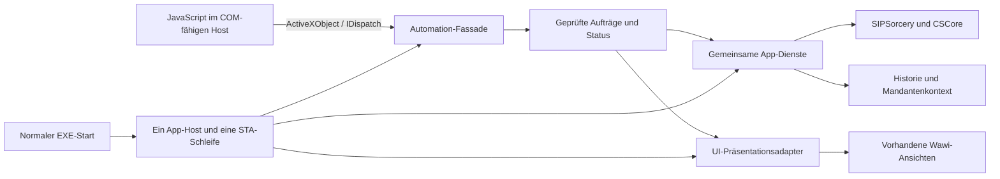

# WawiCallPro – COM-Automation: Studie und Phasenplan

Stand: 21.11.2026. Auftrag: WawiCallPro aus JavaScript über `ActiveXObject` erzeugen,
bei Bedarf anzeigen, seine Ansichten öffnen und mit der vorhandenen Telefonie wählen.

**Empfehlung:** Die vorhandene `WawiCallPro.App` wird selbst zum COM-LocalServer.
Sie erhält einen fensterlosen COM-Startmodus und eine kleine, getrennt implementierte
Automation-Fassade. Normaler Start und COM benutzen denselben Prozess, denselben Host und
dieselbe SIP-/Audiositzung. Ein zusätzlicher Server mit einer zweiten vollständigen Oberfläche
ist für diesen Auftrag nicht sinnvoll. Ein reiner COM-Vermittler bleibt eine spätere Alternative.

**Status:** ✅ Quellenanalyse sowie Phasen 1–7 abgeschlossen. Versionierte COM-Verträge,
DI-Adapter und Kunden-/Lieferantenauflösung sind implementiert: je Edition 15 Vertrags-/Adaptertests,
70 native COM-Prüfungen und 57 Prototyp-/Lebensdauerprüfungen bestanden.
Registrierung ausschließlich unter HKCU; keine TLB-/Interface-Registrierung. Temporäre Einträge entfernt.
✅ Gemeinsamer App-/COM-Host mit fensterlosem Start, Status, bedarfsweisem Hauptfenster und
Instanzübergabe: je Edition 37 gezielte App-Tests, 15 COM-Vertragstests und 23 native App-Prüfungen.
✅ Phase 4: Firmen-/Viewkatalog, Kunden-/Lieferantenansichten, gespeicherte Gesprächsdetails und
vorhandene Dialoge angeschlossen. Je Edition 42 gezielte App-Tests, 15 Vertragstests, 78 native
Viewprüfungen und 23 Start-/Fensterregressionen bestanden.
✅ Phase 5: COM-Telefonie am gemeinsamen UI-/SIP-Dienst, fensterlose Anrufzuordnung und
Clientverlust-/Deduplizierungsnachweise implementiert. Je Edition 46 gezielte App-Tests und
15 COM-Vertragstests bestanden. Die anschließende Lebensdauermatrix und Schutzprüfung steht in Phase 6;
Die Auslieferung wird anschließend in Phase 7 belegt; die reale Produktabnahme bleibt Phase 8.
✅ Phase 6: native Referenzbindungen für Fassaden und Unterobjekte, parallele Clients, harter
Skriptabbruch, geordneter Shutdown und Aktivierung während Shutdown sowie erneute Fachautorisierung
und Daten-/Loggrenzen geprüft. Je Edition 84 gezielte App-Tests, 18 Vertragstests, 18 native App-Prüfungen
und 70 native Vertragsprüfungen bestanden. Pro zuletzt regulär in Debug/Any CPU gebaut.
✅ Phase 7: HKCU-Registrierung ohne TLB, Besitz-/Versionsschutz, Velopack-Installation/Update/
Rücknahme/Deinstallation und Bedienanleitung abgeschlossen. Je Edition 99 gezielte App-Tests,
18 Vertragstests, 26 native Deploymentprüfungen und 21 echte Installationsprüfungen; zusätzlich
57 Releaseskriptprüfungen bestanden. Produktregistrierungen für die Prüfungen nicht geändert.
Phasen 1/2 verwenden einen separaten Host; Phase 3 prüft die reguläre App mit eigenen Profilen und
synthetischen Daten. Keine echten Anrufe und keine persistente Produktregistrierung für die Tests.
Grüne Häkchen bezeichnen ausschließlich tatsächlich abgeschlossene Arbeiten.

## 1. Quellenbefund vor Beginn der Umsetzung

| Fundstelle | Festgestellter Stand | Bedeutung für WawiCallPro |
|---|---|---|
| [LxTranslate.Server.csproj](../../LxTranslate/LxTranslate.Server/LxTranslate.Server.csproj) | `OutputType=WinExe`, WinForms und WPF, Referenz auf `Quantarix.Interop`, eingebundener IDL-/TLB-Build | Die Referenz ist keine gewöhnliche Konsolenanwendung. COM benötigt kein sichtbares Konsolenfenster. |
| [LxTranslate Hosting/Program.cs](../../LxTranslate/LxTranslate.Server/Hosting/Program.cs) und [InvisibleForm.cs](../../LxTranslate/LxTranslate.Server/Hosting/InvisibleForm.cs) | Registrierung vor dem normalen Start; unsichtbares Dispatcherfenster; `LocalServer.Instance.Register<ExeServer>()` und `Run(applicationContext)` | Vorhandenes Infrastrukturmuster nutzen, aber nicht dessen WPF-Ansichten übernehmen. |
| [LxTranslate ExeServer.cs](../../LxTranslate/LxTranslate.Server/Com/ExeServer.cs) und [Contract.idl](../../LxTranslate/Server.Contract/Contract.idl) | Explizite COM-Klasse, ProgID, GUIDs, `ClassInterfaceType.None`, Automation-Verträge und Ereignisse | Eigene kleine Wawi-Verträge mit eigenen IDs erstellen. Keine LxTranslate-GUIDs wiederverwenden. |
| [Quantarix LocalServer.cs](../../Quantarix.Interop/COM/LocalServer.cs) | Klassenregistrierung mit `REGCLS_MULTIPLEUSE`, suspendierter Veröffentlichung und eigener Nachrichtenschleife; automatisches Ende ohne Client beziehungsweise bei Zählerstand null | Aktivierung wiederverwendbar; Lebensdauer und Nachrichtenschleife passen noch nicht unverändert zur Desktop-Telefonie. |
| [ClassFactory.cs](../../Quantarix.Interop/COM/ClassFactory.cs) | Erzeugt `new T()` mit parameterlosem Konstruktor | Ein injizierter Aktivierungsweg fehlt; keine Service-Locator-Auflösung in die Fassade einbauen. |
| [ComBase.cs](../../Quantarix.Interop/COM/ComBase.cs) und [IObjectSafetyImpl.cs](../../Quantarix.Interop/Interfaces/IObjectSafetyImpl.cs) | Lebensdauer an Finalizer gekoppelt; Basisklasse erbt Freigaben für nicht vertrauenswürdiges Scripting und Initialisieren | Nicht ungeprüft für eine Wähl-API erben. Lebensdauer und diese Freigaben getrennt behandeln. |
| [RegistryTools.cs](../../Quantarix.Interop/COM/RegistryTools.cs) | Benutzer-/Maschinenregistrierung und beide Registry-Ansichten vorhanden; `LocalServer32` wird mit dem übergebenen Pfad befüllt | Vorhandenen Wrapper nutzen; Pfadquotierung, Argumente und zielgenaues Entfernen vor Wiederverwendung prüfen. |
| [Wawi Program.cs](../WawiCallPro.App/Program.cs) und [AppApplicationContext.cs](../WawiCallPro.App/Hosting/AppApplicationContext.cs) | STA, WinForms-Nachrichtenschleife, Hoststart, Konfigurationsladung und geordnetes Beenden; regulärer Ablauf erzeugt und zeigt ein `MainForm` | Gute Basis für einen gemeinsamen Host, aber noch kein COM-Server und noch kein Start ohne Hauptformular. |
| [AppCompositionRoot.cs](../WawiCallPro.App/Hosting/AppCompositionRoot.cs) und [AppWorkspace.cs](../WawiCallPro.App/Hosting/AppWorkspace.cs) | Zentrale DI-Registrierungen, Plugin-, Mail-, Audio-, Telefonie- und Präsentationsdienste | Gemeinsame Instanzen erhalten; kein zweiter Container oder zweiter Telefoniedienst pro COM-Objekt. |
| [AppInstanceGuard.cs](../WawiCallPro.App/Hosting/AppInstanceGuard.cs) | Instanzgrenze aus Produktlinie, Benutzer und Profil; `Local`-Objekte grenzen die Windows-Sitzung ein; Zweitstart fordert Aktivierung an | COM-Erzeugen muss davon getrennt werden: Es darf kein Fenster ungewollt aktivieren. |
| [MainForm.cs](../WawiCallPro.App/MainForm.cs), [MainForm.Telephony.cs](../WawiCallPro.App/MainForm.Telephony.cs) und [MainForm.Calls.cs](../WawiCallPro.App/MainForm.Calls.cs) | Routing, Dialogfabriken und Anrufdarstellung vorhanden; etliche Reaktionen sind noch an das Hauptformular gebunden | Ansichten über einen Präsentationsadapter öffnen; Gesprächsverarbeitung darf nicht von einem bereits erzeugten Formular abhängen. |
| [ITelephonyService.cs](../WawiCallPro.Interfaces/Telephony/ITelephonyService.cs) und [FrmDial.cs](../WawiCallPro.App/Views/FrmDial.cs) | `DialAsync(CompanyKey, destination)`, Gesprächs-IDs und Statusereignisse; UI prüft Mandant, Registrierung und bestehende Gespräche | COM delegiert an dieselben Dienste. Bedienregeln zusätzlich im gemeinsamen Anwendungsdienst durchsetzen. |

Die Tabelle beschreibt den Ausgangsstand. Die implementierte Wawi-COM-Aktivierung und ihre Nachweise
sind unten bei den abgeschlossenen Phasen dokumentiert.

## 2. Variantenvergleich und Entscheidung

| Kriterium | A: Haupt-App als LocalServer | B: Eigener Server mit allen Views und Telefonie | C: Dünner COM-Vermittler zur Haupt-App |
|---|---|---|---|
| Sichtbare Oberfläche | Vorhandene App unverändert weiterverwenden | Gemeinsame UI-Bibliothek herauslösen oder Oberfläche doppelt pflegen | Bleibt ausschließlich in der App |
| Gespräch und Audio | Ein Besitzer im App-Host | Zusätzliche Koordination zwingend, sobald die App ebenfalls läuft | App bleibt Besitzer; Vermittler benötigt IPC |
| Fensterloser Start | Neuer Startmodus und bedarfsweise UI-Erzeugung nötig | Im eigenen Host leicht, spätere UI-Integration aufwendig | Vermittler unsichtbar; App benötigt trotzdem einen versteckten Startmodus |
| Wiederverwendung eurer COM-Funktionen | Klassenfabrik/Registrierung mit angepasstem Lebenszyklus | Nahe am bisherigen Servermuster | Nahe am bisherigen Servermuster plus IPC |
| Komplexität | Schwerpunkt Start, Lebensdauer, Automation-Vertrag | Größte Änderung an Projekt- und UI-Struktur | Zusätzlicher Prozess, Protokoll, Verbindungsabbruch und Zustandsabgleich |
| Fehlerisolation | COM und App teilen den Prozess | Getrennte Prozesse, aber Gefahr doppelter Betriebszustände | Adapterfehler getrennt; IPC-Ausfälle kommen hinzu |
| Eignung für diesen Auftrag | **Empfohlen** | **Nicht empfohlen** | Sinnvoll, falls später unabhängige Automationspakete erforderlich werden |

COM unterscheidet nicht zwischen einer Konsolen- und einer GUI-EXE als Architekturentscheidung.
Entscheidend sind Klassenfabrik, Registrierung, Nachrichtenverarbeitung und Lebensdauer.
Ein eigener Server würde auch als `WinExe` gebaut, wenn kein Konsolenfenster gewünscht ist.

Die Fassade ist vom Hauptformular getrennt: `WawiCallPro.Automation.Contracts` enthält die
stabilen Verträge, `WawiCallPro.Automation` die DI-Adapter und Auftragsverwaltung. Beide Projekte
sind angelegt, im isolierten Prüfhost und seit Phase 3 auch im gemeinsamen App-Host eingebunden.
Die vorhandene `WawiCallPro.Console`
bleibt ein eigener CLI-Host.



## 3. Aktivieren, ohne schon Fenster zu öffnen

### 3.1 COM-Start erkennen

Windows ergänzt beim Start über `LocalServer32` den Parameter `-Embedding`.
Das ist der vorgesehene Modusschalter; Elternprozessnamen sind dafür ungeeignet.
Das Argument ist keine Authentifizierung, weil es auch manuell übergeben werden kann.
Die Klassenfabrik muss rechtzeitig verfügbar sein; Windows nennt standardmäßig ein
60-Sekunden-Fenster. [Microsoft: LocalServer32](https://learn.microsoft.com/en-us/windows/win32/com/localserver32).

Vorgesehene Modi:

| Start | Verhalten |
|---|---|
| Normaler EXE-/Explorer-Start | Bisheriger sichtbarer Ablauf einschließlich Splash und bestehender Startoptionen. Eigene COM-Klassenfabrik ebenfalls veröffentlichen. |
| `-Embedding` | Bootstrap, STA-Schleife und COM-Fassade starten; kein Splash, Hauptformular, Trayicon, Anruferfenster oder Lizenzdialog. |
| `/regserver /user` bzw. `/unregserver /user` | Nur Registrierung bearbeiten und mit Exitcode enden; keine Dienste, UI, SIP-Anmeldung oder Datenbankmigration starten. |

Alle Argumente vollständig und ohne Beachtung der Groß-/Kleinschreibung auswerten. Unbekannte
oder widersprüchliche Kombinationen ablehnen. Die vorhandenen Velopack-Hooks und Diagnoseschalter
erhalten; Registrierungsbefehle müssen vor der teuren Anwendungsinitialisierung abgearbeitet werden.

Ein unsichtbarer Dispatcher-Handle ist technisch zulässig. Er ist kein verstecktes Hauptformular:
`MainForm` und seine Ansichten werden beim reinen Aktivieren noch nicht erzeugt.

### 3.2 Bestehende Instanz verwenden

Eine normal gestartete App veröffentlicht dieselbe Klassenfabrik wie die COM-gestartete App.
Dann kann COM vorhandene Klassenobjekte benutzen. Dafür ist kein zusätzlicher ROT-Eintrag nötig;
Klassenregistrierung und Running Object Table sind verschiedene Mechanismen.
[Microsoft: laufenden EXE-Server registrieren](https://learn.microsoft.com/en-us/windows/win32/com/registering-a-running-exe-server).

`new ActiveXObject(...)` erzeugt eine neue Automation-Fassade, aber keinen neuen App-Host.
Mehrere Fassaden teilen die bestehenden Dienste. Ein nachträglicher Explorer-Start zeigt eine
zuvor versteckte App; ein weiterer COM-Client lässt ihren Sichtbarkeitszustand unverändert.

Der jetzige Mutex-Abbruchpfad „andere Instanz aktivieren, dann beenden“ genügt beim COM-Kaltstart-Rennen
nicht. Zwei gleichzeitige Erstaktivierungen beziehungsweise Explorer und COM während der Initialisierung
müssen an derselben kanonischen Klassenfabrik enden. Die Zweitinstanz darf weder die UI ungefragt öffnen
noch die ausstehende COM-Aktivierung verwerfen. Dies ist ein eigener nativer Machbarkeitsnachweis in Phase 1.

Produktlinie, Benutzer, Sitzung und Profil müssen zur COM-Identität passen. V1 verwendet pro Produktlinie
das reguläre Benutzerprofil. Beliebige parallele Profile dürfen nicht dieselbe CLSID veröffentlichen.
Isolierte Prüfprofile benötigen eigene Test-CLSIDs/ProgIDs und einen expliziten Prüfhostpfad.
Bei einem SCM-Start nicht darauf vertrauen, dass Umgebungsvariablen des aufrufenden Skripts übernommen werden.

### 3.3 Fensterlos ist ein eigener Betriebsmodus

`PrepareForBackgroundRun()` und `StartupExecutionMode.SuppressNetwork` sind kein Ersatz:
Ersteres erzeugt weiterhin UI, Letzteres ist ein Diagnosemodus und beeinflusst auch Lizenz- und
Netzwerkverhalten. COM muss mit echten, unveränderten Lizenz-/Zugriffsregeln arbeiten.

Die Fassade darf früh `Starting`, `Ready`, `LicenseRequired`, `ConfigurationRequired`, `Failed`
oder `Stopping` melden. Keine Lizenzaktivierung, OAuth-Anmeldung, Fehlermeldungsbox oder Kontoeinrichtung
aus dem COM-Konstruktor öffnen. Fachbefehle erhalten einen verständlichen Fehlerstatus, bis ihre
Voraussetzungen erfüllt sind. Erst ein ausdrücklich angeforderter UI-Aufruf darf den passenden Dialog öffnen.

COM-Erzeugen allein löst weder einen Anruf noch eine neue SIP-Anmeldung oder einen Mailimport aus.
`ConnectTelephony()` verwendet nur lokal gespeicherte SIP-Einstellungen. Beim späteren sichtbaren
Start konfigurierte Hintergrundaufgaben höchstens einmal starten; keine doppelte Registrierung erzeugen.

## 4. Implementierter Automation-Vertrag V1

Die folgenden Verträge und Adapter sind implementiert. Nativ verfügbar sind sie in Phase 2 im
isolierten Prüfhost und seit Phase 3 auch im App-Host. Phase 4 ergänzt Firmenkatalog, Fachansichten
und Dialoge; Phase 5 bindet die Telefonie an dieselben Dienste wie die UI. COM-sichtbar sind nur die
ausdrücklichen Automation-Verträge; keine Forms, Controls, ServiceProvider, Tasks oder Pluginobjekte.

Versionsgebundene ProgIDs: `WawiCallPro.Pro.Application.1` und
`WawiCallPro.FinOffice.Application.1`, mit eigenen CLSIDs. Versionsunabhängige Aliase sind derzeit
nicht vorgesehen. Keine gemeinsame Alias-Registrierung, die Pro und FinOffice beim Build oder
Update gegenseitig überschreibt. Der gegenwärtige gemeinsame Buildausgabeordner
belegt keine gleichzeitige Installation beider Editionen; Installation und Registrierung getrennt planen.

| Aufruf/Eigenschaft | Vorgesehener Vertrag |
|---|---|
| `GetStatus()` | Kleiner schreibgeschützter Status: API-Version, Produktlinie, Bereitschaft, Sichtbarkeit, SIP-Status und sicherer Fehlercode. Keine Secrets oder vollständigen Konfigurationen. |
| `Show()` | Auftrag zum Anzeigen des vorhandenen oder einmalig erzeugten Hauptfensters; Auftrags-ID zurückgeben, als Benutzerbetrieb behalten. Keine Wartezeit auf einen später geschlossenen Dialog. |
| `ShowView(viewId, contextJson)` | Geprüften Präsentationsauftrag annehmen; Auftrags-ID zurückgeben. Unbekannte Ansicht oder ungültigen Kontext ausdrücklich melden. |
| `ShowDial(number, companyKey)` | Wähldialog vorbefüllen; **kein Anruf**. Auswahl und Bestätigung bleiben beim Benutzer. |
| `ShowCustomer(companyKey, customerNumber)` | Kunden anhand ihrer Kundennummer im eindeutig angegebenen Mandanten auflösen und vorhandene Kundenansicht öffnen; Auftrags-ID zurückgeben. |
| `ShowSupplier(companyKey, supplierNumber)` | Lieferanten anhand ihrer Lieferantennummer im eindeutig angegebenen Mandanten auflösen und vorhandene Lieferantenansicht öffnen; Auftrags-ID zurückgeben. |
| `ConnectTelephony()` | Gespeicherten SIP-Zugang explizit anmelden; Auftrags-ID zurückgeben. Keine Kennwörter über COM annehmen. |
| `Dial(number, companyKey, requestId)` | Bewusst wählen; Auftrags-ID zurückgeben. `companyKey` muss aus dem freigegebenen Firmenkatalog stammen. Client vergibt eine eindeutige Request-ID. |
| `GetOperation(operationId)` | Schreibgeschütztes Automation-Objekt mit `State`, `ErrorCode`, `Message` und gegebenenfalls `CallId`. |
| `GetCall(callId)` | Aktueller Gesprächsstatus; nur freigegebene Informationen des zugehörigen Kontextes. |
| `HangUp(callId)` | Explizites Beenden des eindeutig benannten Gesprächs, mit denselben Zustandsprüfungen wie die UI. |
| `GetCompaniesJson()` / `GetViewsJson()` | Größenbegrenzte Kataloge mit Schema-Version, stabilen Schlüsseln und Verfügbarkeit. Kontextschlüssel nicht aus Anzeigenamen erzeugen. |

Automation-Grundtypen verwenden: `BSTR`, `VARIANT_BOOL`, feste Zahlenbereiche und explizites `IDispatch`
für kleine Statusobjekte. Aufzählungen als dokumentierte stabile Werte; .NET-GUIDs als Strings.
Eigene Interface-IDs, feste `DispId`s und `ClassInterfaceType.None`; keine automatische Klassenoberfläche.
Bestehende Interfaceverträge nach Veröffentlichung nicht inkompatibel ändern. Zusätzliche Schnittstellen
mit neuen IIDs versionieren. IDL und C# gemeinsam prüfen; TLB mit MIDL erstellen. Der .NET-`comhost.dll`-
Bibliothekspfad allein macht aus einer EXE keinen LocalServer und erzeugt keine TLB aus C#.
[Microsoft: moderne .NET-COM-Bereitstellung](https://learn.microsoft.com/en-us/dotnet/core/native-interop/expose-components-to-com).

Verbindliche V1-Identitäten aus [AutomationContracts.cs](../WawiCallPro.Automation.Contracts/AutomationContracts.cs)
und [Automation.idl](../WawiCallPro.Automation.Contracts/Contract/Automation.idl):

| Identität | GUID |
|---|---|
| Bibliothek, Version 1.0 | `7155BD3A-6580-4A46-A034-1E4F55CFA047` |
| `IApplicationV1` | `710E28F8-6286-4F6E-8898-C88A3F872FC1` |
| `IStatusV1` | `9A897EBA-795D-4FDD-9417-97B156287D22` |
| `IOperationV1` | `643E9245-55FF-466E-A7E7-57B18E9D3FC6` |
| `ICallV1` | `68DA705A-6F68-49F7-8C6A-B6CC3F29A4FE` |
| Pro-Klasse | `B24140A1-859F-4A8F-97F6-962668F0D20D` |
| FinOffice-Klasse | `F078BC10-F918-49FF-99C7-C5A2B44CFD5E` |

`IApplicationV1` verwendet die festen Dispatch-IDs 1–13 in dieser Reihenfolge:
`GetStatus`, `Show`, `ShowView`, `ShowDial`, `ShowCustomer`, `ShowSupplier`, `ConnectTelephony`,
`Dial`, `GetOperation`, `GetCall`, `HangUp`, `GetCompaniesJson`, `GetViewsJson`.
`IStatusV1` hat die schreibgeschützten Eigenschaften 1–6: `ApiVersion`, `ProductLine`, `State`,
`IsVisible`, `SipState`, `ErrorCode`. `IOperationV1` hat 1–5: `Id`, `State`, `ErrorCode`, `Message`,
`CallId`; `ICallV1` hat 1–2: `Id`, `State`. Die Objekte sind unveränderliche Momentaufnahmen;
für Aktualisierungen erneut abfragen. `IsVisible` ist `VARIANT_BOOL`, alle übrigen Werte sind `BSTR`.
Die Objekt-Rückgaben sind ausdrücklich `IDispatch`. Neue inkompatible Verträge bekommen neue IIDs,
CLSID/ProgID-Hauptversionen; V1-Mitglieder, Reihenfolge, Typen und Dispatch-IDs bleiben erhalten.
Die beiden MIDL-TLBs werden mit `REGKIND_NONE` geladen und gegen die C#-Verträge geprüft, nie registriert.

### 4.1 DI-Adapter und Eingabegrenzen

`AddWawiAutomation()` registriert eine gemeinsame Auftragsverwaltung, den rollenbezogenen
`NumberedPartyResolver`, Router und eine typisierte Fassadenfabrik. Der Host injiziert
`IAutomationEnvironment`, `IPartySearch`, `IAutomationPresentation` und `IAutomationTelephony`.
`DispatchedAutomationPresentation` übergibt ausschließlich die Präsentation an den injizierten
UI-Dispatcher; weder COM-Aufruf noch UI-Thread warten synchron auf asynchrone Facharbeit.
Kataloge und Status müssen bereits geladene, vom Host freigegebene Momentaufnahmen liefern.
Zugriffsgates werden vor Annahme und bei Ausführung erneut geprüft, bei Präsentation nochmals
auf dem UI-Thread. Die App-Adapter setzen Lizenz-, Installations- und Pluginregeln durch;
seit Phase 5 verwenden UI und COM denselben geschützten SIP-Anwendungsdienst.

`GetCompaniesJson()` und `GetViewsJson()` liefern `SchemaVersion: 1` und `Items`.
Firmen haben `Key`/`Name`, Ansichten `Id`/`Caption` und seit Phase 4 `Context` als Beschreibung
des erforderlichen Kontextes. Den vollständigen `Key` unverändert zurückgeben:
Er codiert Produktlinie, Installation und externe Mandanten-ID und wird ausschließlich gegen den
freigegebenen Katalog aufgelöst. Er ist kein Berechtigungsnachweis. Namen oder Nummern nicht als
Ersatz verwenden. `ShowCustomer`/`ShowSupplier` suchen im angegebenen Mandanten und in der richtigen
Rolle, vergleichen die Nummer exakt als String und verlangen genau einen Treffer. Fremde Mandanten,
Rollen, doppelte Schlüssel oder inkonsistente Quellantworten werden abgewiesen.

Standardgrenzen: maximal 128 laufende oder aufbewahrte Aufträge, zehn Minuten Aufbewahrung ab Abschluss,
30 Sekunden kooperative Bearbeitungsfrist. Alle Fassaden teilen diese Grenzen. Ein voller Speicher
meldet `Busy`; gültige Deduplizierungsnachweise werden nicht vorzeitig verdrängt. Nach Fristablauf oder
Prozessende entfällt die In-Memory-Deduplizierung. Request-, Auftrags- und Gesprächs-IDs sind nichtleere
GUID-Strings im Format `D`. Nummern: maximal 200 Zeichen, View-ID 128, Firmenschlüssel 2048;
leere Werte und Steuerzeichen werden abgewiesen. `contextJson` darf leer sein oder ein Objekt mit
den Stringfeldern `companyKey`/`callId` enthalten. Für angebotene `plugin:<id>`-Ansichten ist zusätzlich
genau eines von `customerNumber`/`supplierNumber` zusammen mit `companyKey` erlaubt; dieselbe exakte
Auflösung wie bei `ShowCustomer`/`ShowSupplier` wird verwendet. Maximal 8192 Zeichen, keine doppelten
oder unbekannten Felder. Kataloge enthalten höchstens 1000 Firmen bzw. 256 Ansichten und 262144 JSON-Zeichen.
Firmenname/Ansichtsbeschriftung sind auf 256 Zeichen begrenzt.

Fehler vor Annahme werden als sichere COM-Ausnahme gemeldet; nach Annahme stehen dieselben Codes
im Auftrag. Rohmeldungen aus Providern werden durch feste Texte ersetzt.

| Fehlercode | HRESULT |
|---|---|
| `InvalidArgument` | `0x80070057` |
| `AccessDenied` | `0x80070005` |
| `NotFound` | `0x8004A101` |
| `Ambiguous` | `0x8004A102` |
| `NotReady` | `0x8004A104` |
| `NotSupported` | `0x8004A105` |
| `Conflict` | `0x8004A106` |
| `Busy` | `0x8004A107` |
| `ProviderUnavailable` | `0x8004A108` |
| `Timeout` | `0x8004A109` |
| `Stopping` | `0x8004A10A` |

### 4.2 Asynchrone Telefonie und eindeutige Rückmeldungen

Die COM-Aufrufe nehmen kurze, begrenzte Aufträge an. UI und Fachabläufe arbeiten danach asynchron;
der Client kann abfragen. Keine `.Wait()`-/`.Result`-Brücke auf dem STA und keine langen Telefonie-
oder Datenbankaufrufe im COM-Konstruktor. Ein STA benötigt eine weiterlaufende Nachrichtenschleife.
[Microsoft: Single-Threaded Apartments](https://learn.microsoft.com/en-us/windows/win32/com/single-threaded-apartments).

Auftragsstatus: `Pending`, `Running`, `Succeeded`, `Failed`, `Canceled`.
Die zurückgegebene Auftrags-ID ist keine Gesprächs-ID. `Succeeded` für `Dial` bedeutet, dass der
Rufaufbau vom Dienst angenommen wurde; ob der Teilnehmer annimmt, ergibt sich aus `GetCall`.
Timeout oder Clientabbruch beweisen nicht, dass kein Ruf ausgelöst wurde.

Gleiche Request-ID und gleiche Parameter liefern innerhalb des dokumentierten Aufbewahrungsfensters
denselben Auftrag; andere Parameter mit derselben ID ergeben `Conflict`. Nach Prozessabsturz ohne
dauerhaften Nachweis keine automatische Wiederholung eines möglicherweise gesendeten Wählbefehls.
Diese Regel begrenzt Dubletten, verspricht aber keine allgemeine Exactly-once-Telefonie.

Auftragszahl, Kontextgröße, Katalogumfang und Aufbewahrung begrenzen. Fehler vor Annahme über stabile
HRESULTs mit sicherem `IErrorInfo` melden, spätere Fehler im Auftrag. Keine still ignorierten Befehle
und keine gemeinsame veränderliche `LastError`-Eigenschaft für mehrere Clients. Ereignisse über
Connection Points sind später möglich, für den ersten JScript-Vertrag genügt Polling.

### 4.3 JavaScript-Verhalten nach Anschluss der Produkt-App

Ein COM-fähiger JScript-Host kann Objekte mit `ActiveXObject` erzeugen, etwa Windows Script Host.
Die konkrete Skriptumgebung und ihre Richtlinien werden gemeinsam geprüft; normale Browserseiten
sind nicht das hier geplante Ziel. [Microsoft: COM im Windows Script Host](https://learn.microsoft.com/en-us/windows/win32/com/using-com-objects-in-windows-script-host).

```javascript
// Produkt-App erst nach Host-Anschluss und HKCU-Registrierung verfügbar.
var app = new ActiveXObject("WawiCallPro.Pro.Application.1");
// Bis hierhin erscheint kein WawiCallPro-Fenster.
app.Show();
var viewRequest = app.ShowView("history", "");
```

```javascript
// Beispiel für die spätere Abnahme eines bewusst gestarteten Wähltests.
// Argumente: freigegebene Testnummer, Firmen-Schlüssel aus dem Katalog, neue Request-GUID.
// Voraussetzungen: Status Ready und explizit erfolgreich angemeldete Telefonie.
var app = new ActiveXObject("WawiCallPro.Pro.Application.1");
var operationId = app.Dial(
    WScript.Arguments.Item(0),
    WScript.Arguments.Item(1),
    WScript.Arguments.Item(2));
var until = new Date().getTime() + 15000;
while (new Date().getTime() < until) {
    var operation = app.GetOperation(operationId);
    if (operation.State == "Succeeded") {
        WScript.Echo("Rufaufbau angenommen. Gespräch: " + operation.CallId);
        break;
    }
    if (operation.State == "Failed" || operation.State == "Canceled") {
        throw new Error(operation.ErrorCode + ": " + operation.Message);
    }
    WScript.Sleep(100); // Client wartet; die Server-Nachrichtenschleife läuft weiter.
}
// Bei Timeout denselben Auftrag abfragen; nicht erneut mit neuer Request-ID wählen.
// Freigabe von app beendet kein laufendes Gespräch und kein sichtbares Hauptfenster.
```

Das Beispiel verlässt sich nicht auf native JSON-Unterstützung eines alten JScript-Hosts.
Für Katalog-/Kontext-JSON ist ein im jeweiligen Host verfügbarer Parser zu prüfen.

## 5. Alle Ansichten über eine gemeinsame Präsentationsschicht

Die COM-Fassade verwendet einen injizierten Präsentationsdienst. Er übernimmt Dispatcher, Owner,
vorhandene Fenster, Modalität und dieselben fachlichen Sperren wie Ribbon und Navigation.
`MainForm` wird nicht selbst zur COM-Klasse; auch Button-Eventhandler werden nicht fernaufgerufen.

| Ansicht | Zugang und Grenze seit Phase 4 |
|---|---|
| Startseite, Historie, E-Mails, Hilfe, Über | Explizite IDs `home`, `history`, `mail`, `help`, `about`; vorhandenes Dokument wiederverwenden. |
| Kunden-/Lieferantensuche und Plugin-Fachansichten | `parties`, wenn das Plugin einen Sucharbeitsbereich anbietet; zusätzliche Ansichten nur als tatsächlich veröffentlichte `plugin:<id>`. `ShowCustomer`/`ShowSupplier` öffnen die vorhandenen schreibgeschützten Stammdaten über den vollständigen `PartyKey`. |
| Anrufersuche und Gesprächsdetails | `caller` öffnet die Anrufersuche; optional `callId` für ein aktives Gespräch. `call` verlangt eine gültige Gesprächs-ID und öffnet aktive oder gespeicherte Details mit historischem Kontext und Notizschutz. |
| Wähldialog | `ShowDial` oder `ShowView("dial", contextJson)` mit `companyKey`; vorbefüllen und anzeigen, ohne einen Ruf auszulösen. Das getrennte `Dial` verwendet seit Phase 5 den gemeinsamen Telefoniedienst. |
| Einstellungen einschließlich Plugins, SIP, Audio, Telefon-Cache und Office/Mail | Zentraler `FrmSettings`: `settings`, `settings-general`, `plugin`, `settings-hotkeys`, `settings-sip`, `settings-sip-advanced`, `settings-line-company`, `settings-database`, `settings-audio`, `settings-audio-levels`, `settings-phone-cache`, `settings-cache-sources`, `settings-phone-matching`, `number-diagnostics`, `settings-mail`. |
| Datenbankeinrichtung und Nummerndiagnostik | `database` öffnet den echten Einrichtungsassistenten mit Owner; `number-diagnostics` den vorhandenen Untertab im zentralen Einstellungsdialog. |
| Log-Fenster | Vorhandenen Logfensterdienst verwenden; keine Rohlogs oder Zugangsdaten durch COM zurückgeben. |
| Untercontrols, Splash und technische Dispatcherfenster | Keine eigenständigen Automation-Ansichten. Untercontrols bleiben Bestandteil ihrer Dialoge; Splash entfällt beim COM-Start. |

`GetViewsJson()` beschreibt die tatsächlich verfügbaren Ansichten mit nötigem Kontext.
Noch geplante oder nicht vom Plugin angebotene Funktionen mit `NotSupported` melden. „Alle Views“
bedeutet Zugang zu allen fachlich verfügbaren Oberflächen, nicht Freigabe jedes internen Controls.

Bei einem modalen Dialog das bedienbare Ownerfenster berücksichtigen. Kein zweites Hauptfenster,
kein ungefragtes Schließen eines Entwurfs und kein impliziter Wechsel der Warenwirtschaftsproduktlinie.
Ein `CompanyKey` enthält Produktlinie, Installation und externe ID; führende Nullen und Groß-/
Kleinschreibung erhalten. Eine Kundennummer oder ein Firmenanzeigename allein genügt nicht.
Die expliziten Kunden-/Lieferantenaufrufe sind ein zusätzlicher Benutzerauftrag vom 20.11.2026:
Nummern als Strings mit führenden Nullen behandeln, stets nach Mandant und Rolle auflösen und genau
einen Treffer verlangen. Fehlende oder doppelte Nummern ergeben `NotFound` beziehungsweise `Ambiguous`.
Danach über den aufgelösten `PartyKey` dieselbe Fachansicht wie in der App öffnen; keine willkürliche
Trefferauswahl, Datensatzänderung oder ungefragten Mandantenwechsel durchführen.

`Show` stellt Sichtbarkeit her und erhält die aktive Ansicht; Vordergrundaktivierung bleibt von Windows-Rechten abhängig.
Native Clients können `CoAllowSetForegroundWindow` benutzen. Reines JScript kann diesen Win32-Aufruf
nicht unmittelbar ausführen; Fokusübergabe im tatsächlichen Host separat prüfen. Keine TopMost-
Schleifen als Ersatz. [Microsoft: COM-Vordergrundrecht übertragen](https://learn.microsoft.com/en-us/windows/win32/api/objbase/nf-objbase-coallowsetforegroundwindow).

## 6. Lebensdauer, bestehende COM-Hilfen und Schutzgrenzen

### 6.1 Was am COM-Subsystem angepasst werden muss

Die aktuelle `LocalServer.Run`-Schleife kann nicht zusätzlich zur bestehenden `Application.Run`-
Schleife auf demselben Thread gestartet werden. Ihr automatischer `WM_QUIT` bei Referenzzähler null
würde außerdem den geordneten asynchronen App-Shutdown umgehen. Der Fünf-Sekunden-Idle-Timer und
das erzwungene periodische `GC.Collect()` dürfen nicht die Telefonie-Lebensdauer bestimmen.
Ein Finalizer ist keine deterministische Bestätigung der letzten Skriptreferenz.

Bevorzugt: rückwärtskompatiblen Betriebsmodus für eine fremd verwaltete Nachrichtenschleife und
einen injizierbaren Aktivierungs-/Lebensdauerdienst im gemeinsamen Subsystem vorsehen. Beispielsweise
eine fabrikbasierte Registrierung ohne `new T()` und ein Beendigungsangebot statt unmittelbarem
`WM_QUIT`. Diese APIs existieren derzeit nicht. LxTranslate-Verhalten durch Regressionstests erhalten.
Falls diese Trennung nicht klein und sauber gelingt, Klassenregistrierung und Wawi-Lebensdauer
über einen eigenen Adapter zusammensetzen; keine zweite Kopie des gesamten COM-Subsystems erstellen.

### 6.2 Wer den Prozess am Leben hält

| Situation | Verhalten |
|---|---|
| Nur COM, noch kein Client/keine Arbeit | Begrenzte Anlauf-/Idlefrist; nach geordnetem Freigeben beenden. |
| COM-Objekt, laufender Auftrag oder gültiger Unterobjektzugriff | Host bleibt verfügbar; Unterobjekte zählen zur COM-Lebensdauer. |
| Aufbau, Klingeln oder aktives/gehaltenes Gespräch | Gespräch besitzt eine eigene Hostbindung. Wegfall des Skripts beendet es nicht. |
| `Show()` oder normaler Explorer-Start | Benutzerbetrieb bleibt bestehen, auch wenn das Skript endet oder das Fenster im Tray liegt. |
| Benutzer beendet die App | Vorhandenen Gesprächs-/Notiz-/Plugin-Schließschutz beachten; keine pauschale COM-Freigabe als Abbruchauftrag auslegen. |
| Tatsächlich freigegebener Shutdown | Neue Aktivierungen aussetzen, Aufträge abschließen/abbrechen, SIP/Audio und Datenablage geordnet stoppen, Klassenregistrierungen zurücknehmen. |

Zeitgleich eintreffende Aktivierung und Idle-Shutdown müssen atomar behandelt werden.
COM-Clients erhalten bei beendeter App einen Verbindungsfehler; ein erneutes Objekt kann später
eine neue App aktivieren, aber keine bereits gestarteten Telefonieaufträge blind wiederholen.

### 6.3 Sicherheits- und Kontextgrenzen

Lokale Automation läuft im Kontext des angemeldeten Benutzers, nicht als neuer administrativer
Dienst. Benutzer-, Sitzungs-, Produktlinien- und Lizenzgrenzen bleiben erhalten. Keine Remote-
DCOM-Freigabe und keine global gelockerten Start-/Zugriffsrechte als Abkürzung konfigurieren.
Das Startargument allein beweist weder vertrauenswürdigen Aufrufer noch dessen Berechtigung.

Für eine ausgehende Wählfunktion ist die geerbte pauschale `IObjectSafety`-Freigabe der bisherigen
`ComBase` ungeeignet. Automation-fähiges `IDispatch` und „sicher für beliebige fremde Skripte“ sind
unterschiedliche Eigenschaften. Diese Freigaben nicht in Wawi übernehmen; kontrollierte lokale
Skripthosts benötigen keine pauschale Browserfreigabe. Bestehendes LxTranslate-Verhalten nicht global ändern.
[Microsoft: IObjectSafety](https://learn.microsoft.com/en-us/previous-versions/windows/internet-explorer/ie-developer/platform-apis/aa768224(v=vs.85)).

Wählbereitschaft, Lizenz, Lexware-Installationsgate, Pluginverfügbarkeit, erlaubter Firmenkontext,
Nummernnormalisierung und bestehende Gespräche im gemeinsamen Dienst prüfen. Mehrdeutige
Kunden-/Lieferantentreffer weiterhin bewusst auflösen; COM darf keine willkürliche Zuordnung erzwingen.
Ankommende Statusänderungen und Historie unabhängig von einer erzeugten UI verarbeiten.

Keine Secrets setzen/auslesen, keine beliebigen Dateipfade, DLL-Namen, Skripte oder SQL über die API
annehmen. Serilog-/bestehende sichere Loggingadapter verwenden: Auftragstyp, technische IDs,
Ergebnis und Laufzeit genügen; keine vollständigen Nummern, Mails oder Anmeldedaten protokollieren.

## 7. Registrierung, Bitness und Auslieferung

Verbindlicher Benutzerauftrag: ausschließlich `HKCU\Software\Classes` mit eigenen
CLSID-/ProgID-/LocalServer32-Einträgen verwenden, entsprechend LxTranslate.Server.
Keine Maschinenregistrierung, keine TLB-Registrierung und keine zusätzlichen Interface-/Proxy-Einträge;
auch bei Fehlern nicht nach HKLM ausweichen. `RegistryTools` verarbeitet beide Registry-Ansichten.
Auflösung und tatsächliche `IDispatch`-Objektrückgaben mit beiden Client-Bitnessen prüfen.
Ein 32-Bit-Client kann grundsätzlich mit einem 64-Bit-LocalServer sprechen; das ersetzt den
Marshallingnachweis nicht. [Microsoft: Prozessinteroperabilität](https://learn.microsoft.com/en-us/windows/win32/winprog64/process-interoperability).

EXE-Befehl mit Leerzeichen korrekt quotieren; `ServerExecutable`, falls verwendet, separat als reinen
Pfad behandeln. TLB-Dateien werden für Werkzeuge und Vertragsprüfungen gebaut und mit ausgeliefert,
aber nicht registriert. Kein `RegisterTypeLib`, `RegisterTypeLibForUser`, Regasm oder Regsvr32.
Phase 2 prüft echte Aufrufe einschließlich Status-/Auftrags-/Gesprächsobjekten ohne registrierte TLB
oder Interface-Metadaten; die Abwesenheit wird unter HKCU und HKLM in beiden Ansichten kontrolliert.

Bei Installation, Update, Rücknahme und Deinstallation ausschließlich eigene Einträge bearbeiten.
Ein alter Uninstaller darf keine Registrierung löschen, die inzwischen auf eine neue Installation zeigt.
Velopack-Pfadwechsel und Editionstausch nachweisen; Registrierung nicht bei jedem normalen Start still
umschreiben. Debug- und Prüfregistrierungen dürfen die installierte Produktregistrierung nicht ersetzen.

## 8. Phasenübersicht

Die Phasen sind bewusst kleiner als eine Komplettumstellung. Jeden abgeschlossenen und geprüften
Punkt mit ✅ in dieser Übersicht und der zugehörigen Phase markieren und separat committen.
Die bestehende gemeinsame G1-Abnahme im [Neuaufbau-Plan](Neuaufbau-Plan.md) bleibt davon unberührt.
Für jede Phase mit Codeänderungen gelten die regulären Rebuilds in der aktiven Konfiguration,
die betroffenen Pro-/FinOffice-Hosts und gezielte Funktionstests vor dem Abschlusscommit.
UI-Änderungen benötigen die begrenzten visuellen Nachweise. Reine Studien-/Dokumentpflege benötigt
keinen Anwendungsbuild und keine GUI-Läufe.

| Phase | Status | Ergebnis | Verantwortlich / Abnahme |
|---|---|---|---|
| 0 | ✅ | Quellenstudie, Variantenentscheidung und dokumentierter Plan | Agent; Quellen- und Dokumentkonsistenzprüfung |
| 1 | ✅ | Isolierter Prototyp: je 57 Prüfungen Pro/FinOffice, x86/x64, parallele Aktivierung, Dispatcher und Lebensdauer | Agent; eigene HKCU-CLSIDs entfernt, keine echten Anrufe |
| 2 | ✅ | V1-Verträge und DI-Adapter einschließlich ShowCustomer/ShowSupplier; je Edition 15 Tests, 70 native und 57 Prototypprüfungen | Agent; x86/x64 ohne TLB-/Interface-Registrierung, eigene HKCU-Einträge entfernt |
| 3 | ✅ | Gemeinsamer App-/COM-Host, fensterloser Start und bedarfsweises Hauptfenster; je Edition 37 App-Tests, 15 Vertragstests, 23 native Prüfungen | Agent; eigene Profile/HKCU-Identitäten, Fenster-/Instanznachweise ohne reale Anrufe |
| 4 | ✅ | Firmen-/Viewkatalog, ShowCustomer/ShowSupplier und alle verfügbaren Ansichten; je Edition 42 App-Tests, 15 Vertragstests, 78 native Views und 23 Start-/Fensterprüfungen | Agent; freigegebene x86-/x64-WSH-Läufe, synthetische Daten, gezielte Layoutnachweise |
| 5 | ✅ | Gemeinsame UI-/COM-Telefonie, fensterlose Zuordnung und Neustart, Deduplizierung und Clientverlust; je Edition 46 App- und 15 Vertragstests | Agent mit Test-Doubles; reale SIP-/Audio-Prüfung weiterhin Phase 8 |
| 6 | ✅ | Native Objekt-/Unterobjektbindung, Clientabbruch, Mehrclient-/Shutdownrennen und Schutzgrenzen; je Edition 84 App-Tests, 18 Vertragstests, 18 native App- und 70 native Vertragsprüfungen | Agent; isolierte Profile/HKCU-Identitäten, keine erzwungene Serverbeendigung und kein Server-Test-GC |
| 7 | ✅ | HKCU-only ohne TLB, Besitz-/Versionsschutz, echte Velopack-Installation/Update/Rücknahme/Deinstallation und Anleitung; je Edition 99 App-/18 Vertragstests, 26 Deployment-/21 Installationsprüfungen, 57 Skriptprüfungen | Agent; isolierte zufällige Identitäten, Produktregistrierungen erhalten; reale Fachhost-/SIP-Abnahme Phase 8 |
| 8 | ⬜ | Native JavaScript-Abnahme Pro und FinOffice | Gemeinsam; reale Host-/Fenster-/Telefoniebelege |

### Phase 0 – ✅ Studie und Entscheidung

- [x] ✅ LxTranslate.Server, gemeinsame COM-Klassen und aktuelle Wawi-Start-/Wählpfade gelesen.
- [x] ✅ Drei Varianten verglichen; Haupt-App mit getrenntem COM-Modus empfohlen.
- [x] ✅ Unterschiede zwischen vorhandenem Quellcode, API-Entwurf und noch fehlendem Nachweis benannt.
- [x] ✅ Microsoft-Primärquellen zu Aktivierung, STA, Automation und Bitness abgeglichen.
- [x] ✅ 21 lokale Quellenverweise, neun übereinstimmende Phasenstatus, geschlossene Codeblöcke
  und genau einen Dokumenteintrag in der Hauptsolution geprüft. Neuaufbau-Plan auf den neuen Auftrag abgeglichen.

### Phase 1 – ✅ Technische Machbarkeit isoliert nachgewiesen

- [x] ✅ COM-Registrierung/-Aktivierung mit eigener Prüf-CLSID und eigenem Profil; x86-/x64-JScript-Clients.
- [x] ✅ Eine WinForms-Nachrichtenschleife mit COM-Klassenfabrik, DI-Erzeugung und expliziter UI-Thread-Übergabe nachgewiesen.
- [x] ✅ Zwei gleichzeitige COM-Kaltstarts sowie COM während des simulierten Normalstarts bedienen denselben Host; keine verlorene Aktivierung.
- [x] ✅ Keine sichtbaren Fenster beim Aktivieren; bei um 4,5 Sekunden verzögerter Initialisierung ist die Klassenfabrik schon erreichbar und liefert `Starting`.
- [x] ✅ Lebensdauerbindungen für Benutzerbetrieb und aktives Gespräch simuliert; letzter Client beendet diese Haltegründe nicht. Echte Fenster-/Gesprächsabnahme folgt später.
- [x] ✅ Keine Quantarix-Änderung nötig; eigener Adapter getrennt geprüft und unveränderter LxTranslate-Hostingpfad mit synthetischen Objekten aus x86/x64-JScript bestätigt.

Abnahme am 20.11.2026: kritischer Start-/Lebenszyklus im isolierten Host nativ belegt.
Die produktive API wird erst in den nachfolgenden Phasen angeschlossen.

#### Phase-1-Prototyp und Prüfumfang

Implementierung unter [Tools/ComPrototype.TestWorker](../Tools/ComPrototype.TestWorker/ComPrototype.TestWorker.csproj),
in der Hauptsolution als Test-Fixture eingebunden. Ausgaben bleiben nach Edition getrennt.
Der Host referenziert `Quantarix.Interop`, verwendet dessen `IClassFactory`-/Ole32-Verträge und
`WinFormsUiDispatcher`, betreibt aber genau eine eigene `Application.Run`-Schleife.
Die injizierte Klassenfabrik erhält eine typisierte Erzeugungsfunktion aus dem Composition Root.
Sie verwendet weder Service-Locator-Zugriffe noch `ComBase` für die neue Lebensdauer.
Am gemeinsamen Quantarix-Repository und an LxTranslate.Server wurde nichts geändert.
Deshalb werden keine Erweiterungen des gemeinsamen Subsystems benötigt; der eigene Adapter ist die
in Abschnitt 6.1 vorgesehene Alternative. Der bisherige `LocalServer.Register<T>`-/`Run`-/`ComBase`-Pfad
wird zusätzlich mit einem synthetischen Objekt aus beiden JScript-Bitnessen geprüft.

Wiederholbarer Einstieg nach dem regulären Build:

```powershell
./scripts/test-com-prototype.ps1 -Configuration Debug -LexwareProductLine FinOffice
./scripts/test-com-prototype.ps1 -Configuration Debug -LexwareProductLine Pro
```

Das Skript erzeugt pro Lauf neue CLSIDs/ProgIDs (`WCP.p<GUID>`, unter 39 Zeichen), eigene Profile
und ausschließlich eigene HKCU-Klassen-/ProgID-Einträge. Beide Registry-Ansichten werden berücksichtigt,
einschließlich gemeinsam sichtbarer Schlüssel. Ein belegter fremder Eintrag wird nicht überschrieben.
Nach dem Lauf werden die eigenen Einträge entfernt und deren Abwesenheit geprüft.
Die registrierte Befehlszeile enthält absolute, quotierte EXE-/Profilpfade. Kein `Regasm`, keine
HKLM-Registrierung und keine Änderung von UAC-/DCOM-Richtlinien. Erhöhte Prüfshells starten den Lauf
über den vorhandenen normalen Desktop mit verborgenem Konsolenfenster; der Kindprozess prüft, dass
er nicht erhöht läuft. Ein Scheitern führt nicht zu einer Registrierung unter HKLM.

Die native Prüfung hat gezeigt: .NET-COM-Aufrufe müssen ausdrücklich an den UI-Dispatcher übergeben
werden. Das `[STAThread]` des Programmeinstiegs allein garantiert nicht, dass ein CCW-Methodenaufruf
auf diesem Thread ausgeführt wird. Der Prototyp misst deshalb den tatsächlich benutzten UI-Thread.
Die langsame Initialisierung erfolgt asynchron nach Veröffentlichung der Klassenfabrik; ein Client
kann bereits `Starting` abfragen, bevor derselbe Host `Ready` erreicht.

**Bewusste Grenzen:** Benutzerbetrieb und aktives Gespräch sind in Phase 1 Haltegründe im
Lebensdauerdienst, keine sichtbaren Produktfenster und keine echten SIP-Gespräche. `Close` gibt die
kooperative Testsitzung frei, ohne die Benutzer-/Gesprächsbindung zu löschen. Die Freigabe eines
CCW ohne `Close` wird mit einer ausdrücklichen einmaligen Test-GC synchronisiert; daraus folgt
keine garantierte Freigabelatenz beim Absturz eines produktiven Skripthosts. Dieser Fall bleibt
Phase 6. Es gibt im neuen Host keinen periodischen erzwungenen GC. Die produktive UI-/Telefonie-
Anbindung bleibt den folgenden Phasen vorbehalten; Typbibliothek und Kunden-/Lieferantenverträge
sind inzwischen in Phase 2 ergänzt und seit Phase 4 mit den vorhandenen App-Ansichten verbunden.

Nachweise: `.com-prototype-build-{fin,pro}.log` (Solution-Rebuilds Debug/Any CPU, je 0 Fehler und
26 bekannte externe CSCore-Nullablewarnungen), `.com-prototype-{fin,pro}.log` und
`.artifacts/com-prototype/{fin-final,pro-final}/results.json`. Je Edition sind 11 gezielte
Lebensdauer-/Grenzprüfungen und 46 native Assertions über zehn isolierte Fixture-Konfigurationen
bestanden. Die Fixtures belegen Kaltstart, beide Client-Bitnessen, denselben Singleton bei parallelem
Start, erneute Aktivierung derselben CLSID nach Idle-Shutdown, Einstieg während Initialisierung,
Benutzer-/Gesprächsbindung nach Sitzungsschluss, CCW-Fallback, Start ohne Client sowie den bisherigen
Quantarix-Serverpfad. HRESULT und `IErrorInfo` erreichen JScript unverändert. Die neue Fassade erbt
keine Freigabe für nicht vertrauenswürdiges Scripting. `RegistryCleanupConfirmed=true` und
`Elevated=false` sind für beide vollständigen Läufe festgehalten. Keine neuen Forms/UserControls,
keine Layoutänderung; daher kein Render-/Designer-Lauf für diese Phase erforderlich.

### Phase 2 – ✅ Verträge und Adapter

- [x] ✅ Eigene ProgIDs/CLSIDs/IIDs, feste Dispatch-IDs und IDL/TLB mit dokumentierter Versionsstrategie.
- [x] ✅ Injizierte Fassade, Präsentationsschnittstelle, Firmen-/Viewkatalog und begrenzte asynchrone Auftragsverwaltung implementiert.
- [x] ✅ `ShowCustomer`/`ShowSupplier` mit Mandant und rollenbezogener Nummer als String implementiert; exakter Einzelmatch liefert `PartyKey`, führende Nullen und Unicode bleiben erhalten.
- [x] ✅ Unveränderliche Status-/Fehlerobjekte, Limits, Aufbewahrung, Busy, Timeout, geordneter Abbruch und Request-Deduplizierung geprüft; 100 parallele Clients lösen einen simulierten Wählvorgang aus.
- [x] ✅ Keine UI-/Diensteobjekte oder Tasks durch COM; Unicode, leere Werte, falsche IDs, Mandanten-/Rollengrenzen und beide Client-Bitnessen geprüft.
- [x] ✅ Nur HKCU-Klassen-/ProgID-Registrierung im Prüfhost; tatsächliche `IDispatch`-Aufrufe einschließlich Objekt-Rückgaben funktionieren ohne TLB-/Interface-Einträge. HKCU/HKLM vor und nach dem Lauf in beiden Registry-Ansichten lesend geprüft.

Abnahme am 20.11.2026: Aktivieren, Status lesen und simulierte Kunden-/Lieferanten-, View- und
Telefonieaufträge aus x86-/x64-JScript erfolgreich ausgewertet. Kein Zugriff auf echte Daten oder SIP.

#### Implementierung und Nachweise zu Phase 2

- [Verträge und MIDL-Einstieg](../WawiCallPro.Automation.Contracts/WawiCallPro.Automation.Contracts.csproj):
  vier `IDispatch`-Interfaces, zwei Editionsklassen, x86-/x64-TLB Version 1.0.
- [Automation-Adapter](../WawiCallPro.Automation/WawiCallPro.Automation.csproj): injizierte Fassadenfabrik,
  Quantarix-Klassenregistrierungsadapter ohne Registry-Zugriffe, gemeinsamer Worker und UI-Dispatcheradapter.
- [Vertrags-/Adaptertests](../WawiCallPro.Automation.Tests/WawiCallPro.Automation.Tests.csproj): je Edition
  15 bestandene Tests. Beide TLBs über `LoadTypeLibEx(REGKIND_NONE)` geladen; GUIDs, Version, Bitness,
  Dispatch-IDs, Namen, Parameter-/Rückgabetypen und Coclass-Verträge mit C# abgeglichen.
- [Native JScript-Prüfung](../scripts/ComPrototype/contracts.js) über den erweiterten Prototyp:
  je Edition 70 bestandene Prüfungen, darunter beide Client-Bitnessen, Status-/Auftrags-/Gesprächsobjekte,
  Nummern-/Rollen-/Mandantenzuordnung, Fehlerredaktion, Request-Konflikt und UI-Thread-Übergabe.
- Zusätzlich je Edition alle 57 bisherigen Prototypprüfungen bestanden. Die neue Fixture gibt den
  asynchronen DI-Container frei, solange die UI-Nachrichtenschleife noch läuft; danach geordneter Exit.
- Reguläre Solution-Rebuilds in der aktiven Konfiguration Debug/Any CPU für FinOffice und zuletzt Pro:
  je 0 Fehler, nur 26 bekannte Nullablewarnungen der externen CSCore-Bibliothek. Beide App- und
  Konsolenhosts sind im regulären Ausgabeordner aktualisiert; kein Produktstart für diese Phase.

Wiederholbarer Einstieg nach dem regulären Editionsbuild:

```powershell
dotnet test --project WawiCallPro.Automation.Tests/WawiCallPro.Automation.Tests.csproj -c Debug '-p:Platform=Any CPU' -p:LexwareProductLine=Pro --no-build
./scripts/test-com-prototype.ps1 -Configuration Debug -LexwareProductLine Pro -ContractsOnly
./scripts/test-com-prototype.ps1 -Configuration Debug -LexwareProductLine Pro
# Für FinOffice jeweils LexwareProductLine=FinOffice verwenden.
```

Aktuelle vollständige native Nachweise:
`artifacts/com-automation-phase2/{fin,pro}-{native,regression}-final/results.json`.
Alle vier Läufe melden `Completed=true`, `RegistryCleanupConfirmed=true`, `Elevated=false`.
Die geprüften Worker-DLLs sind je Edition zwischen Vertrags- und Lebensdauerlauf identisch:
FinOffice `6D79B73A19907B86D9805429B7005012AF257436B39141CCAF3506EDB8F4448A`,
Pro `2E21289C8F399AAB7B88221A2AD91596C6781869B80A9085CED8CF26459205E5`.
Zusätzliche Ergebniskopien liegen in `.com-contract-{native,regression}-{fin,pro}-evidence.log`;
Build-/Unit-Protokolle in `.com-contract-build-{fin,pro}.log` und `.com-contract-unit-{fin,pro}.log`.
Ein vorheriger Pro-Regressionslauf wurde durch fehlende temporäre Nachweisdateien unter `.artifacts`
unterbrochen und nicht als bestanden gezählt; die vier genannten Läufe sind vollständig wiederholt.

**Phasengrenze:** Die Produkt-ProgIDs sind festgelegt, aber weiterhin nicht produktiv registriert.
Der Prüfhost verwendet zufällige eigene CLSIDs/ProgIDs und hält sich für die Vertragsprüfung explizit
selbst am Leben. Produktive COM-/Unterobjekt-Lebensdauer bleibt Phase 3/6, echte Views Phase 4,
SIP/Audio Phase 5 und gemeinsame native Abnahme Phase 8. Keine Forms, Layouts oder Designer geändert;
kein GUI-Renderlauf erforderlich. Zum Abschluss von Phase 2 referenzierte die Produkt-App die neuen
Bibliotheken noch nicht; seit Phase 3 ist der App-Host angeschlossen.

### Phase 3 – ✅ Startmodus und einzige Instanz

- [x] ✅ Vorarbeit: vollständige Argumentprüfung vor Konfiguration/UI. Optionen ohne Beachtung der Groß-/Kleinschreibung auswerten, widersprüchliche und unbekannte Kombinationen mit Exitcode 2 ablehnen; bestehende Diagnose-/Audit-/Aktivierungspfade erhalten. `-Embedding` fällt nicht mehr in den sichtbaren Normalstart durch.
- [x] ✅ Modi in `Program` getrennt; normale Starts und Installer-/Diagnosepfade erhalten und gezielt geprüft.
- [x] ✅ `AppApplicationContext` ohne `MainForm` lauffähig; UI erst bei explizitem Auftrag erzeugt.
- [x] ✅ Lizenz-/Konfigurationsfehler ohne Dialoge gemeldet; keine Diagnose-Abkürzung für produktives COM. Beide Lexware-Installationsprüfungen bereits im COM-Grundanlauf ausgeführt.
- [x] ✅ COM-Klassenfabrik auch beim normalen Start veröffentlicht; Profil-/Sitzungs-/Editionsgrenzen und frühe Aktivierungen geprüft.
- [x] ✅ Explorer-Zweitstart einer versteckten COM-App zeigt dieselbe Instanz; COM-Zweitaktivierung erzeugt keine zusätzliche Oberfläche.

Abnahme am 20.11.2026: Normaler Start und COM-Beitritt erfolgreich; reines COM-Erzeugen zeigt keine Oberfläche.

#### Phase-3-Implementierung

`Program` wertet `-Embedding` nach den unveränderten Velopack-Hooks aus und betreibt weiterhin eine
STA-/WinForms-Nachrichtenschleife. [AppApplicationContext](../WawiCallPro.App/Hosting/AppApplicationContext.cs)
veröffentlicht die injizierte Klassenfabrik vor dem Diensteanlauf, sowohl beim normalen als auch beim
COM-Start. `GetStatus()` bleibt während der Initialisierung erreichbar. Der gemeinsame Instanzguard
signalisiert die veröffentlichte Klassenfabrik; ein konkurrierender COM-Start wartet höchstens 45 Sekunden
ohne Fensteraktivierung. Ein normaler Zweitstart übermittelt dagegen weiterhin den Benutzerauftrag;
ein früher Auftrag bleibt bis zur UI-Bereitschaft vorgemerkt.

[AppStartupPipeline](../WawiCallPro.App/Hosting/AppStartupPipeline.cs) verwendet die bereits im Host
registrierten Dienste mit ihren DI-Lebensdauern. COM prüft zunächst beide Lexware-Installationsmerkmale,
lädt Konfiguration, initialisiert Darstellung und prüft die tatsächliche Lizenzregel. `SuppressNetwork`
wird dafür nicht eingeschaltet. Hauptformular, Splash, Trayicon, SIP-Anmeldung, Mailimport und weitere
Hintergrunddienste werden dabei nicht gestartet. Seit Phase 4 werden nach erfolgreicher Lizenzprüfung
das konfigurierte Plugin und die abgelösten Firmen-/Viewmetadaten bereits fensterlos geladen.
Ungültige Konfiguration oder fehlende erforderliche
Lizenz bleiben als `ConfigurationRequired`/`LicenseRequired` abfragbar; Aktivierungsdialoge bleiben zu.

Erst `Show()`, `ShowView("home", "")` oder ein normaler Zweitstart gibt den Benutzerbetrieb frei.
Vor den zurückgestellten Diensten wird die Lizenz erneut geprüft. Dienste starten unter einem
gemeinsamen Semaphore genau einmal; bei erforderlicher Aktivierung darf jetzt der vorhandene Dialog
erscheinen. Danach wird genau ein vorhandenes `MainForm` erzeugt oder wiederhergestellt. Konfiguration
und Host werden nicht pro COM-Objekt dupliziert. Die Klassenfabrik wird vor dem Stoppen der Dienste
zurückgenommen; die Nachrichtenschleife bleibt bis zum asynchronen Freigeben des Containers verfügbar.

[AppComIdentity](../WawiCallPro.App/Hosting/AppComIdentity.cs) begrenzt Produkt-CLSIDs auf das reguläre
Profil. Ein normales abweichendes Konfigurationsprofil veröffentlicht keine Produktklasse; COM mit
abweichendem Profil benötigt eine eigene Fixture-Identität. `--com-fixture <absoluter Pfad>` akzeptiert
nur eine zufällige eigene CLSID mit passender `WCP.p<GUID>`-ProgID und lehnt die Produkt-CLSIDs ab.
Der explizite Testmodus unterdrückt UI-Persistierung und globale Hotkeys, ändert aber keine Lizenzregel.
Fixture-Steuerdateien und Zustandsnachweise werden ausschließlich in diesem eigenen Profil verwendet.

Die Grundbindung hält den Host bei COM-Fassaden, Serverlocks, laufenden Aufträgen oder sichtbarem
Benutzerbetrieb am Leben. Ohne Haltegrund gilt eine Idlefrist von 30 Sekunden. Die ursprüngliche
Finalizerbindung aus Phase 3 wird in Phase 6 durch native Referenzzählung für Fassaden und
Unterobjekte ersetzt. Keine periodische Test-GC oder pauschale `IObjectSafety`-Freigabe im App-Host.

#### Phase-3-Abnahme

Einstieg nach dem regulären Editionsbuild, sichtbare Tests nur nach Absprache:

```powershell
./scripts/test-com-app.ps1 -Configuration Debug -ProductLine FinOffice -AllowVisibleWindows
./scripts/test-com-app.ps1 -Configuration Debug -ProductLine Pro -AllowVisibleWindows
```

Die nativen Prüfungen verwenden die reguläre App-EXE mit eigenen Profilen und zufälligen HKCU-
Klassen-/ProgID-Einträgen. Der erhöhte Werkzeugprozess startet den Prüflauf über den normalen Desktop;
keine HKLM-, TLB- oder Interface-Registrierung. Alle temporären Registrierungen werden entfernt.
Synthetische Konfiguration und Dummy-Plugin, keine echten SIP-Zugänge, Anrufe oder Lexware-Datensätze.
Die gemeinsame G1- und Produktabnahme wird dadurch nicht ersetzt.

Geprüft: x86-/x64-JScript und paralleler COM-Kaltstart, `Starting` während des Anlaufs, null konstruierte
Forms beim reinen Aktivieren, genau ein App-Prozess, explizites `Show`, normaler Start mit COM-Beitritt,
Explorer-Zweitstart sowie Wiederherstellung von minimiert, zuvor maximiert und im Tray verborgen.
Für den Vordergrundnachweis wird das eigene Hauptfenster einmal ausdrücklich über den vorhandenen
UI-Automation-Ansatz fokussiert; die danach geprüften Übergänge werden nicht nachträglich korrigiert.
Der Start aus einem beliebigen Hintergrundskript allein beweist keine Windows-Vordergrundberechtigung.
Ungültige Konfiguration bleibt ohne Dialog erreichbar; jeder Lauf belegt anschließend Dienste-Stopp,
asynchrone DI-Freigabe, Klassenwiderruf und Prozessende ohne Ausnahme.

Nachweise: je 23 native App-Prüfungen unter `artifacts/com-app/{fin,pro}-acceptance/results.json`,
zusätzliche Ergebniskopien `.com-phase3-native-{fin,pro}-evidence.log`. Dazu je 37 gezielte App-Tests
für Start, Pipeline, Lizenz, Profil-/Instanzgrenzen, Installer, Splash, Autostart und Hotkeys sowie je
15 unveränderte COM-Vertrags-/Adaptertests. Protokolle: `.com-phase3-unit-{fin,pro}.log`,
`.com-phase3-contract-{fin,pro}.log`, `.com-phase3-build-{fin,pro}.log`.
Reguläre Solution-Rebuilds Debug/Any CPU für beide Editionen: null Fehler, 26 bekannte externe
CSCore-Nullablewarnungen. Pro bleibt zuletzt im regulären Ausgabeordner. Keine Layoutänderungen;
native Fenster-/Fokusprüfungen und die begrenzten vorhandenen Splash-Regressionen wurden verwendet.
Frühere unvollständige Harnessläufe (Interop-/Fokusvorbereitung beziehungsweise fehlender früher
Timer-Nachweis) gelten nicht als bestanden und werden durch die vollständigen Abnahmen ersetzt.

**Noch offen:** Produktinstallation/Benutzerregistrierungsbefehle folgen Phase 7; der App-Start
schreibt keine persistente COM-Registrierung. Kunden/Lieferanten, Firmenkatalog und weitere Ansichten
sind in Phase 4 angeschlossen. COM-Telefoniebefehle verwenden seit Phase 5 den gemeinsamen
Telefoniedienst und prüfen dessen tatsächliche Bereitschaft.
Echte Lizenz-/Server- und SIP-/Audioabnahme bleibt Phase 8. Rücknahme dieses Phasencommits entfernt
den App-Anschluss und stellt den vorherigen Startpfad wieder her; keine Produktdatenmigration.

### Phase 4 – ✅ Ansichten und Fensterführung

- [x] ✅ Datenbankassistent schließt nach einem einzelnen Auftrag auch bei bereits abgeschlossener Arbeit: endgültiges `Close` nach dem ursprünglichen `FormClosing` einreihen. Je zwei gezielte Modal-/Abbruchtests und reguläre App-Builds für Pro/FinOffice bestanden; Protokolle `.com-phase4-db-modal-{pro,fin}.log`.
- [x] ✅ Viewkatalog gemäß Abschnitt 5 an vorhandene Routing-/Dialogfabriken und Pluginverträge anbinden.
- [x] ✅ Vorhandene Dokumente/Dialoge wiederverwenden; korrekte Owner, Modalität und Entwurfs-/Gesprächsschutz.
- [x] ✅ Alle verfügbaren Ansichten öffnen, nötige Kontexte validieren und unbekannte IDs sichtbar ablehnen.
- [x] ✅ Kunden-/Lieferantenaufrufe nach Nummer in Pro und FinOffice prüfen: führende Nullen, gleiche Nummer in verschiedenen Mandanten/Rollen, kein Treffer und Mehrdeutigkeit; vorhandene Fachansicht über `PartyKey` öffnen.
- [x] ✅ Betroffene Arbeitsbereiche leer/gefüllt und bei Fehlern, 640/980 Pixel Breite, 10/16-Punkt-Schrift, simulierter 150-%-Skalierung und Basic/Office 2019 Black geprüft; Aufnahmen visuell kontrolliert. Echte Monitorwechsel bleiben G1.
- [x] ✅ Freigegebene native WSH-Läufe mit x86/x64 und Fenster-/Ownerprüfungen: Vordergrund, minimiert/maximiert/Tray sowie modale Dialoge. Der tatsächliche spätere Fach-Skripthost bleibt Bestandteil von Phase 8.

Abnahme: Jede im Katalog verfügbare Ansicht ist erreichbar; COM erzeugt keine zweite UI oder abweichende Layouts.

#### Phase-4-Implementierung

[AppAutomationCatalog](../WawiCallPro.App/Hosting/AppAutomationCatalog.cs) lädt freigegebene Firmen
und tatsächlich angebotene Pluginansichten asynchron vor `Ready`. COM-Katalogabfragen lesen nur
abgelöste Momentaufnahmen. Das konfigurierte Plugin wird beim späteren sichtbaren Start nicht
erneut gestartet; SIP, Audio und Mail bleiben bis zum ausdrücklichen Benutzerbetrieb zurückgestellt.
Produktlinie, Kataloggrößen, eindeutige Schlüssel und Pluginverfügbarkeit werden geprüft.
Ein Pluginwechsel sperrt alte Metadaten sofort; Fehler geben nur feste Warntexte im Logfenster aus.

[MainForm.Automation](../WawiCallPro.App/MainForm.Automation.cs) verwendet vorhandene Dokumente,
Dialogfabriken und Plugin-Lebensdauern. Einstellungen und Datenbankassistent sind modal und haben
das Hauptfenster als Owner. Ein Auftrag ist nach `Shown` abgeschlossen; er wartet nicht bis zum
Schließen. Derselbe Einstellungsdialog kann gezielt einen anderen Tab wählen, konfliktierende
Navigation liefert `Busy`. Vorbereitungen und Dialogaufrufe verwenden `UiWaitCursor` mit `using`.
`Show()` erhält das aktuelle Dokument; Notiz- und Pluginentwürfe werden weder geschlossen noch ersetzt.

`ShowCustomer`/`ShowSupplier` lösen führende Nullen, Rolle und vollständigen Mandanten getrennt auf.
Die vorhandene `PartySearchPage` zeigt den exakten Datensatz im schreibgeschützten Stammdatentab.
Die globale Mandantenauswahl bleibt erhalten. Gleiche Nummern in anderen Firmen oder Rollen werden
nicht übernommen; kein Treffer und Mehrdeutigkeit bleiben `NotFound`/`Ambiguous`. Wiederholungen
verwenden die passende vorhandene Ansicht. Hat der Benutzer dort inzwischen einen anderen Datensatz
geöffnet, bleibt diese Ansicht erhalten und ein neuer passender Arbeitsbereich wird geöffnet.
Beim regulären Schließen wird auch die COM-Dokumentzuordnung entfernt, damit sie keine entsorgten
Controls festhält. Der vorhandene Plugin-/Notizschutz bleibt vor dieser Freigabe wirksam.
Pro und FinOffice bieten aktuell diesen gemeinsamen Pluginarbeitsbereich an, aber keine zusätzlichen
`IWawiCallPluginViews`-Tabs. Optionale Pluginansichten werden daher ausschließlich bei tatsächlichem
Angebot veröffentlicht; ein isoliertes Testplugin belegt deren vollen `PartyKey` und Entwurfsschutz.

`call` verwendet bei aktiven Gesprächen die vorhandene Gesprächsseite und bei gespeicherten Gesprächen
die vorhandene `HistoryPage` mit gespeicherten Zuordnungen. Wiederholungen erhalten denselben
Notizentwurf. Unbekannte Gesprächs-IDs liefern `NotFound`, fehlender Kontext `InvalidArgument`.
Keine Änderungen an SQL, Migrationen, COM-GUIDs, Dispatch-IDs oder registrierten Typbibliotheken.

#### Phase-4-Abnahme am 21.11.2026

Je Edition **42 App-Tests und 15 Vertrags-/Adaptertests bestanden**. Die App-Prüfungen umfassen
positive Kunden-/Lieferantentreffer in getrennten Firmen und Rollen, führende Nullen, fehlende und
mehrdeutige Nummern, veraltete Pluginfreigaben, tatsächliche Datensatzanzeige, optionale Pluginviews,
Notiz-/Pluginentwürfe, Ressourcenfreigabe sowie bestehende Modalitäts- und Layoutregressionen.
Synthetische Adapter bestätigen beide Produktlinien; produktive Lexware-Datensätze wurden nicht gelesen.

Je Edition **78 native Viewprüfungen**: tatsächliche reguläre App aus x86-/x64-JScript aktivieren,
Firmenkatalog vor `Show`, Kundenansicht öffnen/wiederverwenden, falsche Rolle und ungenaue Nummer
abweisen und alle ohne Datensatzkontext öffnbaren Basis-/Dummy-Ansichten einschließlich
Einstellungsuntertabs abarbeiten (Katalog: 26 Einträge).
Gespeicherte Gesprächsdetails benötigen einen Datensatz und sind positiv im isolierten App-Test
belegt; zusätzliche Pluginviews sind positiv über das Testplugin geprüft. Dazu je **23 native
Start-/Fensterregressionen** einschließlich fensterloser Initialisierung, paralleler Aktivierung,
normalem Start und Explorer-Beitritt, minimiert/maximiert/Tray, Konfigurationsfehler und Shutdown.
Modale Dialoge werden über den realen Schließpfad beendet; der Datenbankassistent benötigt nur
einen Schließauftrag. Keine echten Anrufe, produktiven Zugangsdaten oder Lexware-Änderungen.

Wiederholbarer Einstieg nach dem jeweiligen regulären Editionsbuild und nach sichtbarer Testfreigabe:

```powershell
./scripts/test-com-app.ps1 -Configuration Debug -ProductLine FinOffice -AllowVisibleWindows -Views
./scripts/test-com-app.ps1 -Configuration Debug -ProductLine Pro -AllowVisibleWindows -Views
```

Ergebnisse: `artifacts/com-views/{fin,pro}-final/results.json` und
`artifacts/com-views/fin-startup-final/results.json` sowie
`artifacts/com-views/pro-startup-prepared/results.json`, zusätzlich
`.com-phase4-{native,startup}-{fin,pro}-evidence.log`. Jede Ergebnismenge enthält Editions-EXE,
DLL-SHA256, vollständige Prüfnamen, normalen Desktop-Token und bestätigte HKCU-Bereinigung.
Temporäre eigene CLSID-/ProgID-Einträge entfernt; weiterhin keine TLB-/Interface-/HKLM-Registrierung.
Test-/Buildprotokolle: `.com-phase4-{unit,contract,build}-{fin,pro}.log`.
Neue Stammdatenaufnahmen: `.artifacts/app-shell/settings-ui/com-views/{Pro,FinOffice}`;
bestehende Leer-/Fehler-/Detailprüfungen zusätzlich im jeweiligen Testausgabeordner unter
`.artifacts/party-search-ui/<Edition>`. Designer-Struktur und statische Layouts bleiben erhalten.
Beide regulären Solution-Rebuilds **Debug/Any CPU**, null Fehler und je 26 bekannte externe
CSCore-Nullablewarnungen; Pro liegt zuletzt im regulären Ausgabeordner.

Die vollständigen finalen Läufe ersetzen frühere unvollständige beziehungsweise vor der letzten
Freigabekorrektur erzeugte Nachweise. Bei Pro scheiterten Wiederholungen zunächst an der anfänglichen
Fokusvorbereitung (anderes Programm blieb im Vordergrund), nicht an einer bestandenen Aktivierungsprüfung.
Der Testhelfer verwendet jetzt bei Bedarf genau einen Klick auf die anhand von Prozess, Handle,
Titelleisten-Hittest und freiem Zielpunkt geprüfte eigene Titelleiste. Anschließend werden die
Aktivierungsübergänge unverändert ohne Korrektureingriffe gemessen; der vollständige Pro-Lauf mit
dieser Vorbereitung ist bestanden. Die abgebrochenen Läufe werden nicht als bestanden gezählt.
G1, produktive Registrierung und tatsächliche SIP-/Audio- sowie
Fachhostabnahme bleiben offen. Rücknahme des Phase-4-Commits entfernt Katalog-/Viewadapter und
stellt den Hauptfensterzugang aus Phase 3 wieder her; keine Produktdatenmigration.

### Phase 5 – ✅ Telefonie anschließen

- [x] ✅ Gemeinsamer `AppTelephonyService` als injizierter UI-/COM-Zugang zum vorhandenen SIP-Runtime; `ShowDial` bleibt reine Präsentation, `Dial` führt den ausdrücklichen Auftrag aus.
- [x] ✅ Fensterloser `AppAutomationTelephony` an Anmeldung, Rufaufbau, Gesprächsstatus und Auflegen angebunden. `ConnectTelephony` wartet auf `Registered` oder meldet Fehler/Fristablauf; reine COM-Aktivierung meldet kein Konto an.
- [x] ✅ Gemeinsames Kommandogate, erneute Lizenz-/Installations-/Mandantenprüfung innerhalb der Plugin-Lease, Nummerngrenzen, Registrierung und einzelne aktive Verbindung durchgesetzt. Das Auflegen eines eigenen Gesprächs bleibt nach Entzug der Berechtigung möglich.
- [x] ✅ Anrufe ohne Hauptformular mit dem regulären SIP-Persistenzadapter verfolgen; `AppCallAssociation` speichert dieselben konservativen Zuordnungen wie die UI. Historie, Kontext und Notizen nach frischem Hoststart und in der vorhandenen Detailansicht geprüft.
- [x] ✅ 100 parallele Fassaden mit identischer Request-ID erzeugen genau einen Backendaufruf; widersprüchliche Parameter liefern `Conflict`. Wiederholung nach Auflegen bleibt derselbe Auftrag. Verlust des letzten Clients während Rufaufbau und aktivem Gespräch unterbricht keine Telefonie; anschließende Idlefrist geprüft.

Abnahme: Synthetische Gespräche erreichen dieselbe Historie und Kontextzuordnung wie UI-Gespräche.
Echte Anrufe bleiben Bestandteil der gemeinsamen Abnahme.

#### Phase-5-Implementierung und Abnahme am 21.11.2026

[AppTelephonyService](../WawiCallPro.App/Hosting/AppTelephonyService.cs) umschließt den vorhandenen
SIPSorcery-/CSCore-Runtime. Die DI-Bindungen für Telefonie, Verbindung, DTMF und Aufnahme zeigen
auf denselben Anwendungsdienst. Ein Kommandogate serialisiert neue Anmeldungen und Wählaufträge;
die Plugin-Lease bleibt bis zur Annahme des Rufaufbaus erhalten. Lizenz, beide Installationsmerkmale,
Produktlinie und berechtigter vollständiger Mandant werden vor dem Aufruf erneut geprüft.
Der Dummy-Betrieb bleibt Lexware-unabhängig; die SIP-Anmeldung verlangt keine Warenwirtschaftsdaten.

[AppAutomationTelephony](../WawiCallPro.App/Hosting/AppAutomationTelephony.cs) wird fensterlos als
Metadatendienst gestartet, ohne ein Konto anzumelden. Erst `ConnectTelephony` meldet den gespeicherten
Zugang an; Erfolg verlangt `Registered`. Fehlgeschlagene Anmeldung und kooperative Fristüberschreitung
werden als sichere Auftragsfehler gemeldet, der Beobachter wird in allen Fällen entfernt. Ein früher
Setupfehler hinterlässt keinen unbeobachteten Fehler-Task. `Dial` liefert die echte Gesprächs-ID;
`GetCall` liest nur die gespeicherten In-Memory-Snapshots dieses Runtimes. Unbekannte IDs ergeben
`NotFound`. Status und Auflegen eines eigenen aktiven Gesprächs bleiben auch bei späterem Lizenzfehler
verfügbar; neue Aufträge bleiben gesperrt. Keine Aktivierungs-/OAuthdialoge durch Telefoniebefehle.

[AppCallAssociation](../WawiCallPro.App/Hosting/AppCallAssociation.cs) verarbeitet Anrufereignisse
ohne Forms und verwendet Telefoncache, Rufnummerninterpretation, Entscheidungsdienst und vorhandenen
Zuordnungsspeicher. Offene Zuordnungen werden begrenzt gehalten und bei vorübergehend fehlender
Persistierung erneut versucht. Leitungsdaten stammen vom tatsächlichen Gespräch; eine abweichende
oder unbestätigte Leitung begründet keine automatische Auswahl. Unvollständige oder mehrdeutige
Treffer bleiben ungewählt, unterdrückte Nummern werden nicht ergänzt. Eine gewählte Ausgangsfirma
wird durch automatische Fremdtreffer nicht ersetzt; derselbe Helfer gilt für die UI. Historische
Nachweise und manuelle Zuordnungen bleiben erhalten. Shutdown meldet Ereignisse ab und wartet auch
auf noch laufende, nicht kooperative Quellen. SIP-Persistenz und vorhandene Repositories bleiben
Eigentümer von Zuständen, Ereignissen und Notizen; kein neuer SQL-Code oder Schemaschritt.

**Je Edition 46 App-Tests und 15 Vertrags-/Adaptertests bestanden.** Darin zehn fensterlose
Neustartfälle: eingehend, ausgehend, mehrdeutig, unterdrückt, fremde Ausgangsfirma, manuelle Auswahl,
verspätete Speicherung, Suchabbruch, verifizierte und abweichende Leitung. Nach frischem Hoststart
werden Gespräch, Zuordnung, Ereignisse und Notizen identisch geladen und in der vorhandenen
Historienansicht angezeigt. Dazu gemeinsame UI-Regressions-, DI-/Aufnahme-/DTMF- und Startprüfungen.

100 parallele Fassadenwiederholungen führen genau einen Wählaufruf aus. Testweise freigegebene
Fassaden werden während eines ausstehenden Rufaufbaus gesammelt; weder Auftrag noch Gespräch
hängen daran. Laufende Aufträge und Gespräche sperren den Idle-Shutdown. Nach Gesprächsende bleibt
die Idlefrist von 30 Sekunden erhalten. Test-GC wird ausschließlich im Testprojekt eingesetzt;
native CCW-/Unterobjekt-, Skriptabsturz- und Shutdownrennen sind anschließend in Phase 6 belegt;
die reale SIP-/Audioabnahme bleibt Phase 8. Die Deduplizierung
bleibt wie in Abschnitt 4.2 prozesslokal und zeitlich begrenzt.

Reguläre Solution-Rebuilds **Debug/Any CPU** für FinOffice und Pro: null Fehler, je 26 bekannte
externe CSCore-Nullablewarnungen; Pro zuletzt im regulären Ausgabeordner. Finale Nachweise:
`.com-phase5-final-{build,app,contract}-{fin,pro}.log`, zusätzlich
`.artifacts/com-phase5-evidence.json`. Frühere Teilnachweise `.com-phase5-commands-*` und
`.com-phase5-headless-*` dokumentieren die getrennten Implementierungspunkte. Feste Test-Doubles,
eigene SQLite-Profile und reguläre Repository-/Migrationsdienste; keine SIP-Transporte, Audiogeräte,
echten Anrufe oder produktiven Lexware-Daten. Keine neuen Layouts und keine sichtbaren GUI-Läufe.
COM-GUIDs, Dispatch-IDs und Registrierungsregeln bleiben erhalten; nur HKCU, keine TLB-Registrierung.

G1 und reale SIP-/Audio-/Skripthostabnahme bleiben offen. Die Implementierung ist in getrennten
Commits für gemeinsame Befehle (`654c697`), fensterlose Zuordnung (`e5f3b0c`) und die abschließenden
Lebensdauer-/Regressionsnachweise enthalten. Rücknahme dieser Phase entfernt die Telefonieadapter
und stellt die Phase-4-Grenze wieder her; vorhandene Historie und Konfiguration benötigen keine Migration.

### Phase 6 – ✅ Robustheit und Lebensdauer

- [x] ✅ Benutzerbetrieb, COM-/Unterobjekte, Aufträge und Gespräche mit ausdrücklichen Lebensdauerbindungen versehen.
- [x] ✅ Letzter Client verschwindet, Skriptabsturz, Aktivierung während Shutdown und parallele Clients prüfen.
- [x] ✅ Busy-Zustand, fehlende Konfiguration/Lizenz/Lexware, nicht berechtigter Mandant und ungültige Eingaben prüfen.
- [x] ✅ Fachfunktionen ohne UI-Sperren nicht umgehen; keine ungeprüfte `IObjectSafety`-Freigabe erben.
- [x] ✅ Begrenzte Fehler-/Auftragsdaten und redigierte Logs kontrollieren; keine fremden Sitzungen übernehmen.

Abnahme: Keine Gesprächsabbrüche durch Objektfreigabe und kein erzwungenes Prozessende außerhalb des geregelten Shutdowns.

Erster abgeschlossener Schritt am 21.11.2026: Der native `IDispatch`-Adapter bindet jede exportierte
Fassade und jedes Status-/Auftrags-/Gesprächsobjekt über `AddRef`/`Release` an den Host. Die letzte
native Freigabe löst die Bindung unmittelbar, unabhängig von CLR-Finalizern. Aufträge gehören dem
gemeinsamen Worker, aktive Gespräche dem Telefoniedienst und sichtbarer/Tray-Benutzerbetrieb dem
App-Kontext; eine COM-Freigabe beendet diese nicht. Maximal 4096 gleichzeitige Objekt-/Serverbindungen;
Freigaben während Shutdown bleiben möglich, neue Bindungen und Zustandswiederbelebung sind gesperrt.

Nachweis dieses Schritts: je Edition 18 Vertrags-/Referenztests, 50 gezielte App-/Telefonietests und
7 native Prüfungen der regulären App. x86 und x64 teilen denselben fensterlosen Prozess; nach
Freigabe beider Fassaden bleiben deren Statusobjekte über die Idlefrist hinaus nutzbar. Nach letzter
Unterobjektfreigabe beendet sich der Host mit Klassenrücknahme und erfolgreicher DI-Freigabe.
Clientseitiges JScript-`CollectGarbage` gibt nur dessen Referenzen frei; der Server erzwingt keinen GC.
Einstieg: `scripts/test-com-app.ps1 -Lifetime -ProductLine Pro` beziehungsweise `FinOffice` nach dem
jeweiligen regulären Debug-/Any-CPU-Build. Lokale Nachweise: `.artifacts/com-phase6-native-{fin,pro}-01/results.json`
und `.com-phase6-{app,contract,build}-{fin,pro}.log`.

Zweiter abgeschlossener Schritt: Alle gleichzeitigen `DisposeAsync`-Aufrufe warten auf denselben
Workerabschluss. Ein letzter Hosted Service sperrt und leert die Queue vor dem Stoppen der Telefonie
und Fach-/Persistenzdienste; auch ein verzögerter, nicht kooperierender Backendaufruf wird abgewartet.
Metadatenstart, UI-Nachstart und Stop sind serialisiert; Stop ist idempotent und darf den Status nicht
später auf Ready zurücksetzen. In 200 konkurrierenden Export-/Idleversuchen gewinnt genau eine Seite.
Ein unbalanciertes Klassenfabrik-`LockServer(false)` kann keine Objektbindung entfernen.

Die Klassenbereitschaft wird vor `CoRevokeClassObject` zurückgenommen. Ein während Shutdown vom
SCM gestarteter Nachfolger wartet auf die bisherige Instanzsperre und übernimmt sie erst nach deren
Freigabe; eine veraltete Bereitschaft darf ihn nicht vorzeitig beenden. Für tote lokale Clients ist
`COMGLB_FAST_RUNDOWN` aktiviert, **vor** WinForms und jedem Interface-Marshalling. Die Option läuft
über native `IGlobalOptions`-Aufrufe, erhält andere Flags und ersetzt weder die Objektbindungen noch
den geregelten App-Shutdown. Grundlage: [Microsoft IGlobalOptions](https://learn.microsoft.com/windows/win32/api/objidl/nn-objidl-iglobaloptions).

Je Edition 58 gezielte App-/Telefonie-/Instanztests, 18 Vertragstests und 70 native Vertragsprüfungen
bestanden. Die reguläre App besteht außerdem 14 native Prüfungen: beide Bitnessen, zurückbehaltene
Unterobjekte, letzte Freigabe, erneuter Start, Aktivierung während eines kontrolliert verzögerten
Shutdowns und harter JScript-Abbruch bei weiter nutzbarem zweitem Client. Erfolgreiche Läufe stoppen
keinen App-Prozess gewaltsam und erzwingen keinen Server-GC. Nachweise:
`.artifacts/com-phase6-native-fin-05/results.json`, `.artifacts/com-phase6-native-pro-02/results.json`,
`.artifacts/com-phase6-contract-native-fin-fast-03/results.json`, `.artifacts/com-phase6-contract-native-pro/results.json`
und `.com-phase6-races-{build,app,contract}-{fin,pro}.log`. Vorherige unvollständige Läufe mit
konkurrierend gelesener Diagnosedatei, fehlendem Fast Rundown beziehungsweise zu später COM-Konfiguration
sind keine erfolgreichen Nachweise. Die Fehler-/Fach-/Sicherheitsgrenzen folgen in den nächsten Punkten.

Dritter abgeschlossener Schritt: `IAutomationBusinessAccess` ergänzt eine injizierte, asynchrone
Autorisierung des App-Hosts. Vor Kunden-/Lieferantensuche und erneut vor der Anzeige werden aktuelle
Lizenz, beide Installationsmerkmale, Pluginverfügbarkeit und die vollständige Mandantenidentität
in der aktuellen Quelle geprüft. Ein veralteter Katalog, eine inzwischen entzogene Lizenz oder
`ShowView` mit Geschäftskontext geben keine Fachfunktion frei. Die Prüfung aktiviert keine Lizenz,
öffnet keinen Dialog und ändert weder globale Firmenauswahl noch Quelldaten.

Je Edition bestehen jetzt 75 gezielte App-/Fach-/Telefonie-/Shutdowntests und 18 Vertragstests.
Zusätzliche Fälle: beide Rollen, sechs unzulässige Lizenzzustände, keine/nur Pro/nur FinOffice/beide
Installationen und Prüfungsfehler, aus der Quelle entfernter Mandant, Lizenzentzug während der Suche
und private Providerfehler. Bestehende Prüfungen sichern Busy, Timeout, fehlende Konfiguration,
ungültige Eingaben, fremde Installation/Produktlinie und Rollen-/Nummerngrenzen. Nachweise:
`.com-phase6-business-{build,app,contract}-{fin,pro}.log`; reguläre Rebuilds Debug/Any CPU ohne Fehler,
weiterhin nur die 26 bekannten externen CSCore-Nullablewarnungen. Kein neuer visueller Prüfbedarf.

Vierter abgeschlossener Schritt: Fachzugriffe führen durch die autorisierte Quelle und vor der
Darstellung weiterhin durch den vorhandenen UI-Dispatcher und die bestehende Modalitäts-/Entwurfsprüfung.
Telefonie verwendet unverändert dieselbe Befehlsgrenze wie die Oberfläche. Busy und geänderte Rechte
werden als feste Fehler gemeldet; eigene Oberflächen oder ein direkter Zugriff auf Forms, DI-Container
und Backendobjekte werden nicht exportiert. Bereits vorhandene Modalitäts-/Entwurfsnachweise aus
Phase 4 und die gezielten Regressionen bleiben gültig; unveränderte Ansichten wurden nicht neu gerendert.

Die native Fassade sowie alle drei Unterobjekttypen lehnen `IObjectSafety`, CLR-`_Object` und fremde
IIDs tatsächlich per `QueryInterface` ab. Unterstützt bleiben genau `IUnknown`, `IDispatch`, das
jeweilige versionierte Dispatch-Interface und `ISupportErrorInfo` mit konsistenter IUnknown-Identität.
Die Klassen erben keine Freigaben aus `ComBase`/`IObjectSafetyImpl`. Dies ist durch je 18 Vertrags-/
Referenztests und 70 native Vertragsprüfungen beider Editionen belegt; COM-GUIDs/Dispatch-IDs und
die HKCU-/TLB-Regeln bleiben erhalten. Rücknahme: Fachautorisierungsadapter und Routerbindung
gemeinsam zurücksetzen; niemals nur die Autorisierung in einem produktiven Host entfernen.

#### Abschließende Phase-6-Abnahme am 21.11.2026

Fünfter Schritt und Abschluss: Auftragsverwaltung bleibt auf 128 Einträge, zehn Minuten Aufbewahrung
und 30 Sekunden Bearbeitungsfrist begrenzt; nach Timeout/Shutdown bleiben beobachtbare Endzustände.
Fehlertexte stammen aus einer festen Liste und enthalten keine Provider-, Kunden-, Rufnummern- oder
Zugangsdaten. Die echte Serilog-Dateiausgabe nimmt nur erlaubte Metadaten an und überschreitet ihr
Größenlimit nicht. Fremde Kategorien, Scopes, Formatierer und Exception-Texte bleiben ausgeschlossen.
Die Log-Fenster-Warteschlange bleibt auf 2000 Einträge begrenzt, Entnahme höchstens 256 pro Durchlauf.
Die beiden neuen Dateilogprüfungen verwenden kleine Grenzwerte von 1024/4096 Bytes; der Produktstandard
bleibt 4 MiB. Es wurden keine produktiven Daten oder Zugangsdaten für die Prüfung verwendet.

Die Instanzsperre und Aktivierung bleiben an den Windows-`Local`-Namensraum, Benutzer-SID, vollständigen
Profilpfad und die Edition gebunden. Eigene Profile dürfen keine Produkt-CLSID veröffentlichen;
Fixture-Identitäten müssen zufällig und in CLSID/ProgID passend sein. Native x86-/x64-Clients und Host
sind nachweislich derselbe Benutzer, dieselbe interaktive Windows-Sitzung und genau ein Prozess pro
Profil/Edition. Getrennte Profile/Editionen und ungültige Identitäten sind isoliert geprüft. Andere
Benutzerkonten oder RDP-Sitzungen wurden nicht gestartet; deren Trennung ergibt sich aus den
Windows-Namensräumen und der geprüften Identitätsbildung, nicht aus einem vorgetäuschten Fremdkontentest.

**Final je Pro und FinOffice: 84 gezielte App-Tests, 18 Vertrags-/Referenztests, 18 native App-Prüfungen
und 70 native Vertragsprüfungen bestanden.** Reguläre Solution-Rebuilds Debug/Any CPU: je null Fehler,
26 bekannte Nullablewarnungen der externen CSCore-Bibliothek; Pro zuletzt im regulären Ausgabeordner.
Die nativen Läufe melden `Completed=true`, `ForcedServerCleanup=0`, `RegistryCleanupConfirmed=true`
und `Elevated=false`. Alle App-Prozesse durchlaufen ihren regulären Shutdown. Nur das ausgewählte
JScript-Testclientprogramm wurde für den Absturzfall absichtlich beendet. Die nativen App-Läufe bleiben
fensterlos; keine Layoutänderungen und keine erneuten Renderläufe unveränderter Ansichten.

Wiederholbarer nativer Einstieg nach dem jeweiligen regulären Editionsbuild:

```powershell
./scripts/test-com-app.ps1 -Configuration Debug -ProductLine FinOffice -Lifetime
./scripts/test-com-app.ps1 -Configuration Debug -ProductLine Pro -Lifetime
./scripts/test-com-prototype.ps1 -Configuration Debug -LexwareProductLine FinOffice -ContractsOnly
./scripts/test-com-prototype.ps1 -Configuration Debug -LexwareProductLine Pro -ContractsOnly
```

Finale lokale Nachweise:
`.artifacts/com-phase6-final-native-{fin,pro}/results.json`,
`.artifacts/com-phase6-final-contract-native-{fin,pro}/results.json`,
`.com-phase6-final-{build,app,contract}-{fin,pro}.log` und
`.artifacts/com-phase6-final-evidence.json` mit Testfilter, Pfaden, Hashabgleich und bereinigten Ergebnissen.
Alle technischen Phase-6-Punkte sind ✅; Registrierung/Update/Deinstallation werden anschließend
isoliert in Phase 7 nachgewiesen. Der reale JavaScript-Fachhost mit SIP/Audio bleibt Phase 8.
Keine Datenbankmigration nötig.

### Phase 7 – ✅ Auslieferung

- [x] ✅ Schnelle, idempotente Registrierung/-entfernung ausschließlich unter HKCU umsetzen; keine Maschinenvariante oder TLB-/Interface-Registrierung.
- [x] ✅ Beide Client-Bitnessen, Pfade mit Leerzeichen, Aktivierung ohne registrierte TLB und Editionsbindung prüfen.
- [x] ✅ Velopack-Update, Rücknahme und zielgenaue Deinstallation mit isolierten Installationen nachweisen.
- [x] ✅ Kurze JavaScript-Beispiele, Hostvoraussetzungen, Fehlercodes und Diagnoseweg dokumentieren.
- [x] ✅ Betroffene Anwendungshosts in der aktiven Konfiguration regulär rekompilieren; Produktregistrierung nicht für Tests ändern.

Abnahme: Installierte EXE wird zuverlässig aufgelöst; alte Einträge überschreiben keine neue Installation.

Erster abgeschlossener Schritt: `/regserver` und `/unregserver` (optional `/user`) laufen vor dem
Anwendungshost. Ausschließlich eigene CLSID-/ProgID-/LocalServer32-Werte unter HKCU, beide Registry-
Ansichten, korrekt zitierter EXE-Pfad und `ServerExecutable`; `/machine` und `/tlb` werden abgewiesen.
Typbibliotheken, Interface-Proxys und HKLM werden nicht beschrieben. Der frühe Pfad benötigt weder
DevExpress, DI, Lizenzierung, Konfiguration noch die Automation-Laufzeit. COM Fast Rundown wird erst
nach den beendeten Installerhooks, weiterhin vor dem ersten normalen UI-/Marshalling-Aufruf vorbereitet.

Besitzmarkierungen und SemVer schützen neuere beziehungsweise andere gleich alte Installationen.
Deinstallation löscht nur Werte des exakt passenden EXE-/Versions-/Installationsbesitzers; geänderte
fremde Werte bleiben erhalten. Änderungen beider Registry-Ansichten werden vorher geprüft und bei
partiellem Schreibfehler zurückgesetzt. Eine benutzerbezogene globale Mutex koordiniert auch mehrere
Sitzungen desselben Benutzers. Keine rekursiven Löschungen im produktiven Registry-Adapter.

Je Edition 17 Registrierungs-/Frühstart-/Argumenttests und 16 native Registrierungsprüfungen bestanden;
reguläre Rebuilds Debug/Any CPU ohne Fehler, 26 bekannte externe CSCore-Warnungen, Pro zuletzt.
Die native Prüfung verwendet zufällige Testidentitäten, einen Pfad mit Leerzeichen und eine dünne
App-Kopie mit absichtlich ungültiger appsettings.json; Produktregistrierungen bleiben unangetastet.
Einstieg: `scripts/test-com-deployment.ps1 -ProductLine Pro -RegistrationOnly` bzw. `FinOffice` nach
dem Editionsbuild. Nachweise: `.com-phase7-register-{build,tests,native}-{fin,pro}.log` und
`.artifacts/com-phase7-register-native-{fin,pro}/results.json`. Die weiteren Phase-7-Punkte bleiben offen.

Zweiter abgeschlossener Schritt: Je Pro und FinOffice bestehen 22 native Deploymentprüfungen.
Die App registriert sich selbst in einem kopierten vollständigen Ausgabeverzeichnis mit Leerzeichen;
x86- und x64-JScript aktivieren über die zufällige ProgID genau die gewählte Edition. Der Host bleibt
fensterlos und beendet sich geordnet. Produkt-CLSIDs/ProgIDs sowie alle eigenen TLB-/Interface-Metadaten
wurden in HKCU und HKLM in beiden Ansichten vor/nach dem Lauf lesend verglichen: unverändert.
Keine Produktregistrierung für Tests angelegt; eigene Testschlüssel gezielt entfernt. Einstieg:
`scripts/test-com-deployment.ps1 -ProductLine Pro` beziehungsweise `FinOffice`. Nachweise:
`.artifacts/com-phase7-activation-{pro,fin}/results.json`, `.com-phase7-activation-{pro,fin}.log`
und `.com-phase7-activation-build-{fin,pro}.log`; Debug/Any CPU ohne Fehler, Pro zuletzt regulär gebaut.

Dritter abgeschlossener Schritt: Die echten Velopack-1.2.161-Callbacks nach Installation/Update
registrieren die aktive EXE; vor Deinstallation wird ausschließlich der passende Eigentümer entfernt.
Vor dem Update wird nicht vorsorglich deregistriert. Paket-ID, Version, tatsächliches Inhaltsverzeichnis
und aktives Assembly-MVID müssen zusammenpassen. Die Assembly wird innerhalb der benutzerbezogenen
Registrierungssperre geprüft und während der Änderung gegen Ersetzen gesperrt. Ein ersetzter Prozess
kann keine neuen Besitzdaten schreiben. Eine Rücknahme ist nur für dieselbe Installation mit tatsächlich
zurückgenommener EXE über den validierten Updatehook zulässig, nicht für eine fremde alte Kopie.

Je Edition **21 reale Installationsprüfungen** mit zufälliger Paket-/COM-ID bestanden: `Setup.exe`,
Update.exe von 1.0.0 auf 2.0.0, Rücknahme auf 1.0.0, x86-/x64-Aktivierung der vollständig installierten
App in allen drei Zuständen, geordneter Hoststop vor Austausch sowie gezielte Deinstallation. Alte
Update-/Uninstall-Hooks einer separaten Kopie überschreiben/löschen den neueren Eigentümer nicht.
COM- und eigener HKCU-Uninstall-Eintrag verschwinden, das außerhalb der Installation liegende Profil
bleibt erhalten. SDK-Prozessscans finden nach Hoststop nur Update.exe selbst und überspringen es;
keine App wird in den erfolgreichen Läufen gewaltsam beendet. Keine echten Anrufe oder Lexware-Daten.

Das Paket verwendet eine streng validierte zufällige Testidentität. Die Testmarkierung
`wawicallpro.com-fixture.json` wird von der Produktionspaketprüfung ausdrücklich zurückgewiesen.
Der kontrollierte Test-Erststart endet vor UI/Host; reguläre Produktpakete erhalten dieses Verhalten nicht.
Der gepinnte Setup-Parser hat bei zusätzlichen EXE-Argumenten einen nativen Panic gezeigt. Die
erfolgreichen Läufe verwenden deshalb stille Installation ohne diese Argumente; SDK/CLI wurden nicht
aktualisiert. Frühere fehlgeschlagene Läufe zählen nicht als Abnahme. Automatisches Anwenden von Updates
beim normalen App-Start bleibt deaktiviert; Anwendung bei aktiven Gesprächen ist hier nicht freigegeben.

Je Edition zusätzlich 19 Registrierungs-/MVID-/Dateisperr-/Frühstart-/Argumenttests; 57 Release-
Skriptprüfungen einschließlich des Testmarker-Ausschlusses bestanden. Reguläre Rebuilds Debug/Any CPU
ohne Fehler, 26 bekannte externe CSCore-Warnungen, Pro zuletzt. Reale Installerpakete und eigene
Versionsbuilds ersetzen diese regulären Builds nicht. Nachweise:
`.artifacts/com-phase7-install-{pro,fin}-final/results.json`, die dortigen Setup-/Update-/Rollback-/
Uninstall-Logs, `.com-phase7-hooks-{build,tests}-{fin,pro}.log` und `.com-phase7-release-script-tests.log`.
Wiederholbarer Einstieg ist `scripts/test-com-installation.ps1` mit eigenen Versionsbuilds und
`-RuntimeDirectory` der betreffenden regulären Edition. Keine produktiven Registrierungen oder Feeds
wurden geändert. Rücknahme der Hookanbindung zusammen mit deren Registrierungsänderungen durchführen;
keine TLB-/Maschinenregistrierung als Ersatz verwenden.

Vierter abgeschlossener Schritt: Die [Bedienanleitung](COM-Automation-Anleitung.md) beschreibt
ProgIDs, x86/x64-WSH, Laufzeitvoraussetzungen, HKCU-Reparatur/Entfernung, Status, Ansichten,
Kunden-/Lieferantenaufrufe, explizite Anmeldung/Wahl/Auflegen, Auftrags-/Call-ID und Diagnosecodes.
Das [ausgelieferte JScript-Beispiel](../scripts/ComExamples/automation.js) wartet begrenzt, nutzt keine
Credentials oder eval, gibt seine Referenzen im finally frei und verspricht keine Deduplizierung
über Neustarts. Es führt ausschließlich die angeforderte Aktion aus. Wahlbeispiele wurden nicht
gegen echte Anschlüsse ausgeführt. Neue Anleitung in der Hauptsolution unter Docs aufgenommen und
im vorhandenen Rider-Editor geöffnet.

Je Edition 26 native Deploymentprüfungen bestanden, einschließlich desselben Beispiels mit nur
ausgetauschten Test-ProgID-Literalen in x86/x64: Statusausgabe erfolgreich, ungültige Call-ID liefert
Exit 1 und `0x80070057`. Klassischer JScript liest die ASCII-Quelle mit Unicode-Escapes zuverlässig;
ein vorheriger UTF-8-BOM-Prüfkopiefehler wurde korrigiert und nicht als Erfolg gewertet. Anleitung,
lokale Links, Solutioneinträge und JavaScript-Argumente geprüft. Nachweise:
`.artifacts/com-phase7-examples-{pro,fin}-02/results.json` und zugehörige Sample-Logs. Die abschließenden
regulären Builds und Regressionen folgen im letzten Phase-7-Punkt.

#### Abschließende Phase-7-Abnahme am 21.11.2026

Fünfter Schritt: beide regulären Solution-Rebuilds in der unveränderten aktiven Konfiguration
**Debug/Any CPU**, null Fehler, je 26 bekannte Nullablewarnungen der externen CSCore-Bibliothek.
Pro zuletzt im normalen Ausgabeordner; isolierte Versions-/Paketbuilds ersetzen dies nicht.
**Je Pro und FinOffice 99 gezielte App-/Frühstart-/Autorisierungs-/Lebensdauer-/Registrierungstests,
18 Vertragstests und 26 native Deploymentprüfungen bestanden.** Die 21 echten Installationsfälle
je Edition und 57 Releaseskriptprüfungen sind ebenfalls erfolgreich. Keine echte Telefonverbindung
und keine produktiven Lexware-Datensätze verwendet. Unveränderte Views nicht neu gerendert.

Die vollständigen installierten Prüfapps wurden unter zufälliger Paket-/COM-ID in x86/x64 vor und
nach Update sowie nach Rücknahme gestartet und vor Austausch geordnet beendet. Alle eigenen
COM-Schlüssel und SDK-Uninstall-Einträge wurden entfernt; getrennte Profile bleiben erhalten.
Produktregistrierungen, TLB-/Interface-Metadaten und HKLM wurden für die Tests nicht verändert.
SDK-Prozesslogs zeigen ausschließlich das Überspringen von Update.exe selbst, keine App-Kills.
Nicht erfolgreiche Vorläufe zählen nicht als Nachweis; deren konkrete Harness-/SDK-Befunde und
Korrekturen sind oben abgegrenzt. Keine öffentliche Veröffentlichung oder produktive Installation.

Finale lokale Nachweise: `.com-phase7-final-{build,app,contract}-{fin,pro}.log`,
`.artifacts/com-phase7-final-deployment-{fin,pro}/results.json`,
`.artifacts/com-phase7-install-{fin,pro}-final/results.json`, `.com-phase7-final-release-scripts.log`
und `.artifacts/com-phase7-final-evidence.json` mit Testfilter, DLL-/Paket-Hashes und Logauswertung.
Die [Bedienanleitung](COM-Automation-Anleitung.md) enthält Voraussetzungen, Beispiele, Fehlercodes
und den Reparaturweg. Alle fünf Phase-7-Punkte und die Phasenübersicht sind ✅. Die produktive
Zielinstallation und tatsächliche JavaScript-/SIP-/Audio-/Fachhostabnahme erfolgen gemeinsam in Phase 8.

### Phase 8 – ⬜ Gemeinsame native Abnahme

| Fall | Erwarteter Nachweis | Pro | FinOffice |
|---|---|---|---|
| Nur `ActiveXObject` bei geschlossener App | Richtige EXE startet, kein sichtbares Wawi-Fenster | [ ] | [ ] |
| Zwei Clients / bereits sichtbare App | Ein App-Prozess und eine SIP-/Audiositzung | [ ] | [ ] |
| `Show` und Viewwechsel | Richtige Ansicht; minimiert/Tray/modal bedienbar; kein Entwurfsverlust | [ ] | [ ] |
| Tatsächlicher JavaScript-Host | Aufrufe und Fehlerdarstellung funktionieren; benötigte x86-/x64-Varianten belegt | [ ] | [ ] |
| `ShowDial` | Testnummer/Mandant vorbelegt; noch kein Ruf | [ ] | [ ] |
| Anmeldung, `Dial`, Gespräch, `HangUp` | Freigegebene Gegenstelle, richtige Rufnummer/Firma, Audio in beide Richtungen | [ ] | [ ] |
| Skriptende bei aktivem Gespräch | Gespräch bleibt kontrollierbar; kein ungefragtes Auflegen | [ ] | [ ] |
| Neustart und Historie | Genau ein Gespräch mit richtiger Zuordnung und erhaltenen Notizen | [ ] | [ ] |
| Letzter Client ohne Benutzerbetrieb | Beendet nach definierter Idlefrist geordnet; nächster COM-Start funktioniert | [ ] | [ ] |
| Lizenz-/Installations-/Verbindungsfehler | Verständlicher Status ohne unangeforderte Dialoge und ohne Schutzumgehung | [ ] | [ ] |

Vorher gemeinsam festlegen: tatsächlicher JavaScript-Host, Testzeitpunkt, Testmandant und Gegenstelle.
Keine Zugangsdaten im Skript oder in diesem Plan ablegen. EXE-Pfad, Build, Prozesszahl und bereinigte
Ergebnisse pro Fall dokumentieren. Phase 8 erst nach beiden Produktlinien ✅ markieren.

## 9. Nächster sinnvoller Arbeitsschritt

Als Nächstes folgt **Phase 8 gemeinsam**: tatsächlichen JavaScript-Host, produktive Zielinstallation,
Testzeitpunkt, freigegebenen Mandanten und Gegenstelle abstimmen und die aufgeführten realen
App-/SIP-/Audiofälle für beide Editionen prüfen. Die technische Robustheit und isolierte Auslieferung
aus Phasen 6/7 sind abgeschlossen. G1 bleibt davon getrennt offen.
