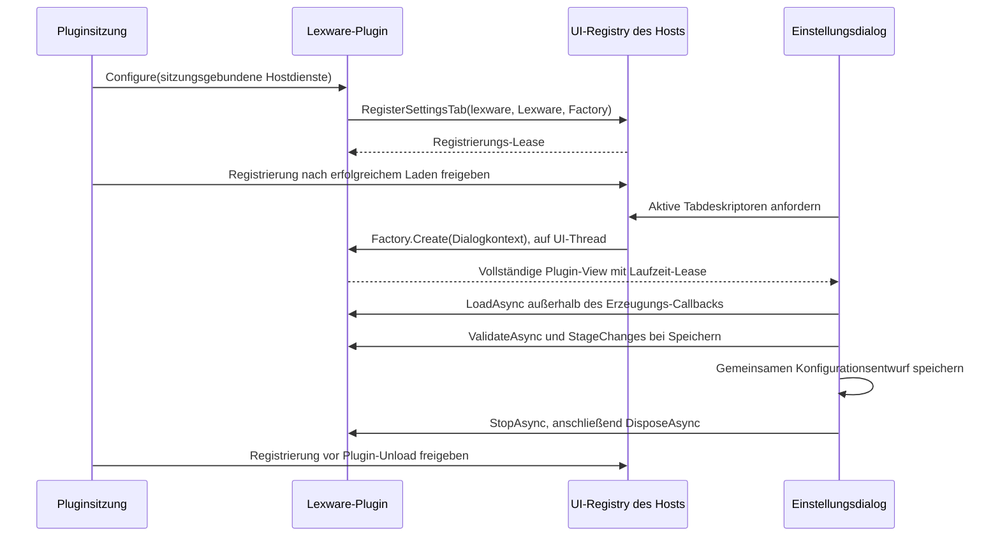

# Plugin-UI-Registrierung und Tab „Lexware“

Stand: 22.11.2026. ✅ Entwurf und Phase 1 geprüft. ✅ Auf ausdrücklichen Zusatzauftrag komplette
Plugin-Views für Mandant/Zugang im Tab „Lexware“ exportiert und bisherigen Dock-Selector entfernt.
Die formale sitzungsgebundene Tabregistrierung aus Phase 2 ist weiterhin offen; die sichtbare
Teilumstellung verwendet den bestehenden optionalen View-/Leasevertrag.

## Ziel und Entscheidung

Das aktive Warenwirtschaftsplugin erhält vom Desktop-Host ein typisiertes UI-Interface und
registriert darüber seinen Einstellungs-Tab. Das Lexware-Plugin liefert eine vollständige,
designerfähige UserControl-View für **Zugang und Mandantenauswahl**. Der sichtbare Tab heißt bei
Pro und FinOffice ausschließlich **„Lexware“**. Die bisherige Mandantenauswahl im Navigationsdock
der Haupt-App entfällt nach erfolgreicher Umstellung.

Der Host stellt den zentralen Einstellungsdialog, Tabcontainer, Darstellung und das gemeinsame
Speichern bereit. Das Plugin bestimmt seine Inhalte und fachlichen Regeln. Die Registrierung
meldet eine View-Factory an; sie erzeugt noch keine Controls und öffnet kein Fenster.

Dies ist ein eigener Umsetzungsschritt. Der begonnene G1-Telefonietest wartet weiterhin auf die
Bestätigung der Audiogeräte und des zweiten Anschlusses. Dieser Entwurf hakt keinen Telefonietest ab.

## Quellenbefund – ✅ geprüft

| Bestehende Stelle | Befund und Konsequenz |
|---|---|
| [IWawiCallHostServices](../WawiCallPro.Interfaces/Hosting/IWawiCallHostServices.cs) | Technikunabhängige Hostdienste für Kontext, Dispatcher und Historie. Kein Zugriff auf die UI-Registrierung vorhanden. |
| [PluginSession](../WawiCallPro.Utilities/Plugins/PluginSession.cs) | Gemeinsamer `WawiCallHostServices`-Adapter; Plugin wird über DI aufgebaut und mit `Configure` an Hostdienste gebunden. Neue UI-Fähigkeit hier sitzungsbezogen anbinden. |
| [PluginSettingsViews](../WawiCallPro.Plugin.Windows/PluginSettingsViews.cs), [PluginViewAccess](../WawiCallPro.Plugin.Windows/PluginViewAccess.cs) | Bisher fragt der Host `IWawiCallPluginSettings` ab und fordert den Zugangseditor an. Ziel ist die ausdrückliche Anmeldung des Tabs durch das Plugin. |
| [SettingsPage.PluginSettings](../WawiCallPro.App/Views/SettingsPage.PluginSettings.cs) | Host bettet bereits eine komplette Plugin-View ein und schützt den gemeinsamen Einstellungsentwurf. Diese Semantik erhalten. |
| [ProConnectionSettingsPage](../WawiCallPro.Plugins.Lexware.Pro/ProConnectionSettingsPage.cs) | Pro besitzt seinen vollständigen Zugangseditor. Mandantenbereich dort als Teil der Plugin-View ergänzen. |
| [FinOffice-Plugin](../WawiCallPro.Plugins.Lexware.FinOffice/LexwarePlugin.cs) | Bietet bisher keinen eigenen Einstellungs-Tab an. Neue View für seine Mandanten-/Quellenfunktionen bereitstellen; bestehende Installationserkennung verwenden. |
| [CompanySelector](../WawiCallPro.App/Views/CompanySelector.cs), [MainForm.Companies](../WawiCallPro.App/MainForm.Companies.cs) | Mandanten-UI und ihre Lade-/Auswahllogik befinden sich noch in der App. Die Datenabfragen selbst liegen bereits hinter dem Plugin-Verzeichnisdienst. |
| [AppAutomationCatalog](../WawiCallPro.App/Hosting/AppAutomationCatalog.cs) | Zugangseditor ist über `settings-wawi` erreichbar. Die öffentliche COM-View-ID erhalten und auf den registrierten Tab abbilden. |

Die Gestaltung des zentralen Dialogs wurde mit
`D:\Application-Development\LxTranslate\LxTranslate.App\Views\FrmSettings.cs` verglichen.
Diese Referenz liefert das Dialogmuster; eine dort vorhandene Plugin-Tabregistrierung wird nicht behauptet.

## Verträge und Zuständigkeiten

Die Windows-Verträge gehören in die bestehende Shared Assembly `WawiCallPro.Plugin.Windows`.
`WawiCallPro.Interfaces` erhält dadurch keine Abhängigkeit auf WinForms, DevExpress oder die App.
Die folgenden Kernverträge sind seit Phase 1 implementiert; Integration und View-Erzeugung folgen:

```csharp
public interface IWindowsPluginHostServices : IWawiCallHostServices
{
    IPluginHostUi Ui { get; }
}

public interface IPluginHostUi
{
    IPluginSettingsRegistration RegisterSettingsTab(
        PluginSettingsTabDescriptor descriptor,
        IPluginSettingsPageFactory factory);
}

public sealed record PluginSettingsTabDescriptor(
    string Id, string Title, int Order);

public interface IPluginSettingsRegistration : IPluginLifetimeResource { }

public interface IPluginSettingsPageFactory
{
    IPluginSettingsPage Create(IPluginSettingsPageContext context);
}

public interface IPluginSettingsPage : IPluginLifetimeResource
{
    Control View { get; }
    bool HasUnsavedChanges { get; }
    Task LoadAsync(CancellationToken cancellationToken);
    Task ValidateAsync(CancellationToken cancellationToken);
    void StageChanges();
    Task StopAsync(CancellationToken cancellationToken);
}
```

`IPluginSettingsPageContext` stellt ausschließlich den aktuellen Dialogentwurf, eng begrenzte
Mandanten-Auswahlbefehle und UI-Hilfen bereit. Für Pro baut er auf dem vorhandenen
`IPluginConnectionEditContext` auf. Kein Zugriff auf `IServiceProvider`, Container, `MainForm`,
`FrmSettings`, `XtraTabControl`, fremde Tabs oder beliebige Konfigurationsdateien.
Der bisherige `ICompanyContext` bleibt ein lesbarer, gemeinsam genutzter Laufzeitkontext.
Eine neue schmale Auswahl-Schnittstelle übernimmt die Veröffentlichung nach dem Speichern.

Das Plugin erhält die UI-Fähigkeit einmalig bei `Configure`:

```csharp
if (hostServices is IWindowsPluginHostServices desktop)
{
    registration = desktop.Ui.RegisterSettingsTab(
        new("lexware", "Lexware", 200), settingsPageFactory);
}
```

Das ist eine optionale Hostfähigkeit am Integrationspunkt. Fachlogik und Views erhalten ihre
benötigten Dienste weiterhin durch Konstruktorinjektion. Ein allgemeiner Service-Locator wird
nicht eingeführt. Die Factory wird dem Plugin über seine DI-Registrierung zugeführt.

| Verantwortlicher | Aufgabe |
|---|---|
| Desktop-Composition-Root | UI-Registry und Dispatcher registrieren; Windows-Hostadapter für die aktive Pluginsitzung erzeugen. |
| Pluginsitzung | Dem Plugin bei Konstruktorinjektion und `Configure` dieselbe Hostadapter-Instanz geben. Vorhandene Identitätsprüfung erhalten. |
| Plugin | Tab anmelden, vollständige View bereitstellen, Zugang/Erkennung/Mandanten fachlich behandeln. |
| UI-Registry | Metadaten validieren, Eigentümer und Sitzung festhalten, Registrierungen bei Fehlschlag zurücknehmen. |
| Einstellungsdialog | Registrierte Factories generisch öffnen, Entwürfe validieren und gemeinsam speichern. |
| Konfigurationsdienst | Versionsmigration, DPAPI-Geheimnisse, atomare Veröffentlichung und Konkurrenzschutz. |

Der Host stellt eine **pro Pluginsitzung gebundene** `IPluginHostUi`-Fassade bereit.
Eigentümer und Sitzungsgeneration stammen vom Host und werden nicht aus frei angegebenen
Pluginparametern übernommen. Pro und FinOffice können denselben lokalen Tabbezeichner `lexware`
verwenden, da zu jedem Zeitpunkt höchstens eine aktive Warenwirtschaftssitzung existiert.

## Ablauf und Lebensdauer



- `Configure` meldet nur Metadaten und die Factory an. Keine Quellabfragen, Controls, Handles oder
  Dialoge erzeugen. Wird die Pluginsitzung nicht erfolgreich aktiv, alle vorgemerkten Anmeldungen verwerfen.
- Erst nach erfolgreicher Aktivierung des Plugins ist der Tab erreichbar. Während `Starting`,
  Pluginwechsel oder Shutdown keine neue View erzeugen.
- Erzeugung und Control-Zugriffe laufen über den UI-Dispatcher. Konstruktor und `InitializeComponent`
  enthalten nur statische Oberfläche. Die asynchronen Ladevorgänge beginnen anschließend.
- Factory-Erzeugung über den vorhandenen Laufzeit-/Ressourcenschutz führen. `LoadAsync` darf nicht
  innerhalb desselben gehaltenen Runtime-Callbacks erneut `UseAsync` aufrufen; diesen Deadlock vermeiden.
- Der Dialog besitzt die geöffnete View-Lease; die Runtime verfolgt sie zusätzlich als Pluginressource.
  Beim Dialogschluss Ladevorgänge abbrechen, ihr Ende abwarten, Ereignisse lösen und Controls auf
  dem UI-Thread freigeben. Danach kann die Anmeldung für das nächste Dialogöffnen bestehen bleiben.
- Beim Pluginwechsel zunächst Entwurfsschutz prüfen. Abbruch erhält Plugin und Tab. Nach bestätigtem
  Wechsel neue Zugriffe sperren, offene Views geordnet stoppen, Registrierungs-Leases freigeben und
  Factoryreferenzen entfernen; erst danach Plugin/DI-Scope entladen. Nicht bei laufenden Aufrufen entladen.
- Freigabe ist idempotent. Verzögerte Ergebnisse einer alten Sitzung dürfen keinen neuen Tab binden.
  Keine UI-Operationen mehr aus einem abschließenden synchronen `Shutdown` heraus starten.

## Inhalt des Tabs „Lexware“

Pro liefert eine vollständige `LexwareSettingsPage` mit den Bereichen **Zugang** und **Mandant**.
Der vorhandene Pro-Zugangseditor kann als designerfähiges untergeordnetes Control weiterverwendet
werden. FinOffice liefert seine eigene `LexwareSettingsPage` mit den für diese Produktlinie
tatsächlich nötigen Quellen-/Mandantenfunktionen. Es erhält keine Pro-API-Felder.
Gemeinsame reine Darstellungshilfen dürfen in `Plugin.Windows` liegen; fachliche Entscheidungen
und Abfragen bleiben im betreffenden Lexware-Plugin.

Die Mandantenauswahl verwendet einen durchsuchbaren DevExpress-`LookUpEdit` mit ausschließlich dem
Mandantennamen. Der vollständige `CompanyKey` bleibt intern erhalten. Kein automatisches Auswählen
der ersten Firma. Laden/Aktualisieren zeigt Ladezustand und einen handlungsfähigen Fehlerhinweis.
Ohne eingerichteten Zugang führt der Hinweis zum Zugangsbereich im selben Tab.

Neue ungespeicherte Zugangsdaten werden nicht für versteckte Anmeldeversuche verwendet.
„Mandanten laden“ prüft die aktuellen Eingaben in einer getrennten Plugin-Sitzung.
Erst erfolgreiches Speichern veröffentlicht den Zugang ohne Neustart.
Ein Mandantenladefehler verändert keine gespeicherten Zugangsdaten oder Cachequellen.

Alle Controls werden in `*.cs`, `*.Designer.cs` und gültiger `*.resx` aufgebaut; ein parameterloser
Designer-Konstruktor bleibt erhalten. Layout über `TableLayoutPanel`, zentrale kompakte
Buttonbemessung und den aktiven Skin. Langsame Lade-/Dialogvorgänge verwenden die vom Host
bereitgestellte `UiWaitCursor`-Scope. Höhere DPI, größere Schrift und kleine Fenster berücksichtigen.

## Speichern, Abbrechen und Mandantenkontext

1. Jede Dialogöffnung erhält einen gemeinsamen Snapshot mit Konkurrenzschutz. Zugang und die
   gewählte Mandantenidentität sind zunächst nur Plugin-Entwurf.
2. „Speichern“ validiert alle Seiten. Ein Fehler verhindert das Speichern des gesamten Entwurfs.
   Die Auswahl muss zum aktuellen Plugin, zur Produktlinie und zum autorisierten Katalog gehören.
3. Das Plugin schreibt ausschließlich seinen Konfigurationsbereich in den Entwurf; der Host speichert
   einmal über den bestehenden Konfigurationsdienst. Kennwörter/Client-Keys bleiben geschützt.
4. Nach erfolgreichem Speichern kann der Host die bestätigte Auswahl über die schmale Auswahl-Schnittstelle
   in den gemeinsamen Laufzeitkontext veröffentlichen. Geänderte Pro-Zugänge werden dabei
   ohne Neustart und nach erneuter Autorisierungsprüfung übernommen. Datei-Speicherung und Laufzeitveröffentlichung sind keine gemeinsame
   Datenbanktransaktion; bei gescheiterter Veröffentlichung „gespeichert, Neustart erforderlich“ melden.
5. „Abbrechen“ und X verwerfen den Entwurf und erhalten die vorherige aktive Auswahl.
   Kein vorzeitiges `CompanyContext.SelectAsync` bei Änderungen im Lookup.

Die gespeicherte Mandantenpräferenz gehört zum jeweiligen Plugin-Konfigurationsbereich und enthält
den vollständigen Schlüssel. Dafür eine reguläre Konfigurationsversion vorsehen und ältere Dateien
weiter laden. Nach einem Quellenwechsel ungültige Präferenzen ausdrücklich als nicht verfügbar behandeln.
Die globale Auswahl ersetzt keine expliziten Mandantenkontexte vorhandener Views, Gespräche oder
COM-Aufträge und ändert keine Telefon-Cachequellen.

## COM, Konsole und Schutzgrenzen

- Der Desktop-COM-Host kann die Windows-UI-Fähigkeit besitzen, ohne ein Fenster anzulegen. Registrierung
  erzeugt ausschließlich Metadaten. Erst `ShowView("settings-wawi", "")` öffnet den registrierten Tab.
- Die bestehende COM-ID `settings-wawi` bleibt erhalten; sichtbarer Titel wird „Lexware“. Kataloge werden
  aus aktiven Registrierungsmetadaten gewonnen. Keine neue COM-Schnittstelle oder TLB-Registrierung nötig.
- Die Konsole stellt `IWindowsPluginHostServices` nicht bereit. Das Plugin lässt die UI-Anmeldung dort
  aus und behält seine Fach-/Konfigurationsdienste. Keine WinForms-Controls zur Erkennung erzeugen.
- Registry akzeptiert begrenzte, gültige IDs/Titel, verhindert doppelte Anmeldungen derselben Sitzung
  und entfernt fremde Anmeldungen nicht. Keine pluginseitig frei durchgereichten Formularaktionen.
- Bestehende Lizenz-, Installations- und Mandantenprüfungen bleiben vor jedem Fachzugriff wirksam.
  Fehlertexte und Logs enthalten keine Zugangsdaten, Tokens oder vollständigen Verbindungswerte.
- Diese Änderung beseitigt keine unabhängig fehlende Fachfunktion oder falsche Zugangskonfiguration.
  Ein registrierter Tab ist noch kein Nachweis erfolgreicher Lexware-Anmeldung oder Mandantenladung.

## Phasenübersicht

| Phase | Ergebnis | Status |
|---|---|---|
| 0 – Bestand und Entwurf | Ist-Pfade gelesen, Host-/Plugin-Verantwortung und gewünschter Tab festgelegt; dieses Dokument geprüft und in der Hauptsolution aufgenommen. | ✅ Entwurf abgeschlossen |
| 1 – Verträge und Registrierungsmodell | Windows-Hostfähigkeit, sitzungsgebundene Fassade, Deskriptoren, Factory-/View-/Registrierungs-Leases. | ✅ Implementiert und geprüft |
| 2 – Host und Pluginsitzung | Desktopadapter, korrekte DI-Identität, vorgemerkte Registrierung, Runtime-Ressourcen und geordnete Freigabe; Konsole ohne UI. | ⬜ Offen |
| 3 – Lexware-Views | ✅ Vollständige Views mit Titel „Lexware“ für Pro/FinOffice exportiert; Quelle und Produktlogik im Plugin. Registrierung über Phase 2 noch offen. | 🟨 Teilweise umgesetzt |
| 4 – Einstellungsdialog und Umstellung | ✅ Vollständige Controls generisch eingebettet; gemeinsames Speichern/Abbrechen, Mandantenpräferenz, COM-ID, geordneter Stop und Dock-Entfernung geprüft. Anbindung an die neue Registry offen. | 🟨 Teilweise umgesetzt |
| 5 – Prüfung und Abnahme | ✅ Gezielt geprüfte Auswahl-/Abbruch-/Freigabe-/Designer-/Layoutpfade und reguläre Builds beider Editionen. Registry-Integration und echte gemeinsame Anmeldung/Mandantenabnahme offen. | 🟨 Teilweise geprüft |

Jede Phase einzeln implementieren, prüfen, im Plan abhaken und separat committen.
Für reine Dokumentation jetzt keine Builds oder GUI-Läufe starten. Bei späteren Codeänderungen
die aktive IDE-Konfiguration/Plattform beibehalten, beide regulären Editionshosts bauen, Pro zuletzt.

### ✅ Phase 1 – Implementierung und Nachweise

Verträge: [PluginUiContracts.cs](../WawiCallPro.Plugin.Windows/PluginUiContracts.cs).
`IWindowsPluginHostServices` erweitert den Basisvertrag nur in der vorhandenen Windows-Shared-Assembly.
Pluginseite sieht ausschließlich `IPluginHostUi.RegisterSettingsTab`; Aktivierung, Eigentümer und
Sitzungsgeneration werden vom Hostmodell verwaltet. Seitenkontext enthält den vorhandenen
Zugangsentwurf, einen reinen Mandanten-Auswahlentwurf und typisierte Darstellungs-/Wartecursorhilfen.
Die getrennte Veröffentlichungsschnittstelle ändert den Laufzeitkontext erst nach erfolgreichem Speichern.
Der Dialogkontext und die UI-Erzeugung sind seit dem Zusatzauftrag vom 22.11. angeschlossen.
Die separate Publisher-/Registry-Anbindung an die tatsächliche Pluginsitzung bleibt Phase 2.

Modell: [PluginSettingsRegistry.cs](../WawiCallPro.Plugin.Windows/PluginSettingsRegistry.cs).
`CreateScope(pluginId)` erzeugt eine hostseitige Sitzung mit eigener und unveränderlicher ID.
`Session.Ui` ist eine separate Fassade. Anmeldungen bleiben bis `Session.Activate()` unsichtbar;
nach Aktivierung ist die Anmeldephase geschlossen. Höchstens eine Sitzung ist aktiv.
`GetSnapshot()` liefert sortierte unveränderliche Metadaten mit Revision, ohne Factoryreferenzen.
`AcquireFactory(key)` hält ausschließlich eine aktuelle Factory; die Registry ruft sie niemals auf.
Der Host muss später UI-Thread, Autorisierung und Ressourcenverfolgung beim tatsächlichen Erzeugen durchsetzen.

Widerruf entfernt den Tab sofort aus dem aktiven Katalog, sperrt neue Erwerbungen und wartet auf
noch gehaltene Factory-Leases. Sitzungs-/Registry-Freigabe wartet auch auf bereits widerrufene,
aber noch verwendete Einträge. Freigabe ist idempotent; alte Schlüssel und Registrierungs-Leases
können die neue Sitzung nicht verändern. Factoryreferenzen werden beim Widerruf entfernt.
Keine Benutzer-/Plugin-Callbacks unter der Registry-Sperre.

Begrenzungen: 32 noch nicht vollständig freigegebene Sitzungen, 32 Einträge pro Sitzung, 1024
gleichzeitig gehaltene Factory-Leases je Eintrag. Tab-ID 1–64 Zeichen (`a-z`, danach zusätzlich
`0-9`, Punkt und Bindestrich), Titel 1–120 UTF-16-Codeeinheiten mit gültigem Unicode ohne Steuer-/
Formatzeichen oder äußere Leerzeichen, Reihenfolge 0–10000. Diagnosen enthalten feste Fehlercodes
ohne übergebene Titel, Schlüssel oder Konfigurationswerte.

Prüfung: [PluginSettingsRegistryTests.cs](../WawiCallPro.App.Tests/PluginSettingsRegistryTests.cs)
enthält **25 neue Prüffälle** für Lazy-Registrierung, Aktivierung, Rollback einer vorgemerkten Sitzung,
doppelte/parallele Anmeldungen, Metadatenvalidierung/Unicode, Mengenbegrenzungen, veraltete Schlüssel,
Widerruf mit mehreren Pins, konkurrierende Freigabe, Registry-/Sitzungsshutdown und tatsächliche
Freigabe der Factoryreferenz trotz erhaltener Metadaten und Registrierungs-Lease.
Je Edition **26 gezielte Tests** einschließlich bestehender Shared-Assembly-Identitätsprüfung und
zusätzlich **9 vorhandene COM-Start-/Identitätstests** bestanden. Beide regulären Solution-Builds
in der bestehenden Konfiguration **Debug / Any CPU**, null Fehler und null Warnungen; Pro zuletzt.
Logs `.plugin-ui-phase1-{build,tests,host}-{fin,pro}.log`. Keine Controls erzeugt, kein GUI-Lauf,
keine echten Quell-/SIP-Zugriffe und keine gespeicherten Einstellungen verändert.

Phase 2 bindet dieses Modell erst an die Composition Roots und die tatsächliche Pluginsitzung an.
Die sichtbare Umstellung wurde mit dem Zusatzauftrag vom 22.11. über den bestehenden Viewvertrag
vorgezogen; die formale Tabregistrierung und vollständige Phasenabnahme bleiben offen. Rücknahme von Phase 1 entfernt
nur die neuen Verträge, das noch nicht verdrahtete Modell und seine Tests.

### ✅ Zusatzauftrag: Mandantenauswahl als exportierte Plugin-View (22.11.2026)

Pro exportiert `LexwareSettingsPage` als vollständiges Control mit seinem bestehenden Zugangseditor
und einer gemeinsamen pluginseitigen Mandantenkomponente. FinOffice exportiert dieselbe reine
Mandantendarstellung mit seinem eigenen Verzeichnisdienst, ohne Pro-Zugangsfelder. Beide Titel sind
„Lexware“. Der Host erstellt keine Einzelcontrols und keine produktspezifischen Abfragen. Der Dock-
Selector wird in `MainForm.Designer` nicht mehr erzeugt. Die generische Wiederherstellung einer bereits
gespeicherten Präferenz ersetzt ihn nicht durch eine andere Mandantenoberfläche im Host.

Der Dialogkontext implementiert den neutralen Auswahlentwurf und die RAII-/Button-Präsentationshilfen.
Neue Auswahl wird erst nach erneuter Katalogfreigabe und erfolgreichem atomarem Speichern publiziert.
Die View-Leases unterstützen Laden/Validieren/Stoppen, wobei Laden außerhalb des Runtime-Erzeugungs-
Callbacks erfolgt. Abrufabbruch, wartende Freigabe, wiederholtes Stop/Dispose und veraltete Auswahl sind
geprüft. Pro-Einrichtungsbedarf startet keine Anmeldung; geänderte Zugangsdaten und eine neue Auswahl
werden erst nach erfolgreichem Speichern in die laufende Konfiguration übernommen.

Nachweise: zuerst Pro auf ausdrücklichen Nutzerwunsch, anschließend FinOffice und zum Schluss erneut
Pro regulär Debug/Any CPU ohne Warnungen/Fehler gebaut. Je Edition 58 gezielte App-/Plugin-/Kontext-/
Registry-/Designerprüfungen und 15 Vertragsprüfungen, außerdem 71 Pro- und 46 FinOffice-Adaptertests
bestanden. Echte Pluginfabriken und gemeinsame UI-Typidentität geprüft; FinOffice-Factory ohne Quellaufruf.
31 Designer-Dateitripel geprüft. Nur geänderte Plugin-/Settings- und Navigationsbereiche im Hintergrund
mit leeren/gefüllten synthetischen Werten, Basic/dunklem Skin, kleiner/größerer Schrift und zusätzlicher
150%-Layoutskalierung gerendert und visuell geprüft. Das ist kein realer Monitor-DPI-Wechsel.
Protokolle: `.artifacts/plugin-company-settings`; Bilder `.artifacts/app-shell/settings-ui/plugin-companies`
und `pro-connection-editor`. Keine echten Mandanten oder Zugangsdaten abgefragt/geändert. Die tatsächliche
Pro-Anmeldung benötigt weiterhin den im aktuellen Standardprofil noch fehlenden gespeicherten Zugang.

Die noch ausstehende Registry-Anbindung wird durch diesen funktionalen Viewexport ausdrücklich nicht
als abgeschlossen markiert. Keine neue COM-Schnittstelle, TLB-/Maschinenregistrierung oder DB-Migration.

### Erforderliche Prüffälle für Phase 5

- ✅ Pro/FinOffice: Titel „Lexware“, vollständiger Plugin-Viewexport und keine Mandantenauswahl im Dock (isoliert geprüft); formale Registrierung noch offen.
- ⬜ Plugin ohne UI-Fähigkeit, Konsole und fensterloser COM-Start erzeugen keine Controls/Handles/Dialogs.
- ⬜ Doppelte/ungültige Registrierung, fehlgeschlagenes `Configure`, mehrfaches Öffnen/Schließen und
  Pluginwechsel hinterlassen keine Factory-/Controlreferenzen oder Anmeldungen der alten Sitzung.
- ⬜ Abbrechen/X, konkurrierendes Speichern, Validierungsfehler und Zugangswechsel erhalten den
  bisherigen Laufzeitkontext; nur erfolgreich bestätigte Auswahl wird veröffentlicht.
- ⬜ Leerer, fehlerhafter, fremder und verspäteter Mandantenkatalog; exakte Mandantenschlüssel,
  unveränderte explizite Gesprächs-/COM-Kontexte und erhaltene Telefon-Cachequellen.
- ⬜ Stoppen während Laden/Speichern, fehlerhafte Freigabe und mehrfaches Dispose ohne Zugriff auf
  entladene Dienste; kein Runtime-Reentry-Deadlock.
- ⬜ Shared-Assembly-Identität und Deployment beider Editionen; `settings-wawi` mit neuem Titel erreichbar,
  Modalität/Entwurfsschutz weiter wirksam, keine Änderungen an HKCU-/TLB-Regeln.
- ⬜ Gezielte Designer-/Rendernachweise für beide Plugin-Views: leere/gefüllte synthetische Daten,
  kleine Fenster, größere Schrift, helle/dunkle Skins und höhere DPI; danach gemeinsame Live-Mandantenprüfung.

Zugehörige Pläne: [Neuaufbau](Neuaufbau-Plan.md),
[COM-Automation](COM-Automation-Studie-und-Phasenplan.md).


### ✅ Ergänzung 22.11.2026 – Pro-Zugangswechsel und Konfigurationsdateien

Technische Installation-/Zeitlimitwerte und die Build-Key-Checkbox entfallen im Plugin-Editor;
Werte werden aus `LexwareApi` der Produkt-appsettings gelesen. Vorschauabfragen besitzen eine eigene
Sitzung, veröffentlichen keine Geheimnisse/Entwürfe und werden beim Schließen abgebrochen/freigegeben.
Erfolgreiches Speichern erhöht die Zugangsrevision; neue Anfragen ersetzen die alte Sitzung und
veraltete Antworten werden verworfen. Die vollständige Plugin-View und die gemeinsame atomare
Auswahlprüfung bleiben erhalten. Isolierte Pro-Adapter-, Konfigurations-, App- und Renderprüfungen
siehe [Neuaufbau](Neuaufbau-Plan.md). Echte Mandantenabnahme und formale Registry-Anbindung bleiben offen.


### ✅ Ergänzung 22.11.2026 – Mehrfachauswahl statt Einzelpräferenz

Der exportierte Lexware-Tab lädt beim Öffnen asynchron und bietet eine native GridView-Checkbox-
Mehrfachauswahl. Der Host persistiert denselben vorhandenen Telefon-/Mail-Quellumfang; konkrete
Datensatz-/Gesprächskontexte bleiben eindeutig. Quellen-/Mandantengrenzen, Abbrechen, veraltete
Auswahl, Wiederöffnen und Abbruch beim Schließen werden isoliert geprüft. Statusmeldungen gehen
über einen engen Enum-Vertrag in Log-Fenster und Datei, die eigene Statuszeile entfällt. Pro nutzt
den gemeinsamen Bibliotheksresolver für die API-Adresse und besitzt dafür kein Eingabefeld.
Die formale Tabregistrierung aus späteren Phasen bleibt separat offen.
