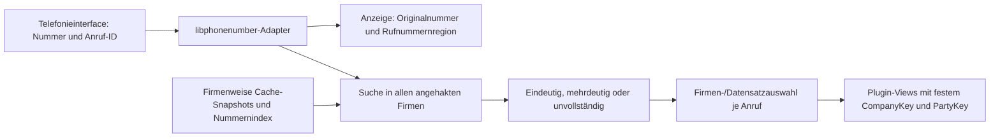

# Telefonnummern: Parsing, Mehrfirmen-Cache und Zuordnung

Stand: 04.11.2026. Verbindliches Zielbild für die vom Nutzer gewünschte firmenübergreifende
Anruferkennung. Offline-Parser und Nummernkontext aus Phase 6/Punkten 1–2 sind implementiert; Mehrfirmen-Cache,
StartWidth-Abgleich, Auswahl und Viewanbindung bleiben noch umzusetzen.

## Grundentscheidung

Wir verwenden [libphonenumber-csharp](https://github.com/twcclegg/libphonenumber-csharp) für Parsing,
Normalisierung, Nummernprüfung und Rufnummern-Metadaten. Die Zuordnung zu Lexware-Firmen, Kunden,
Lieferanten und Kontakten übernimmt unsere eigene Logik anhand des Telefon-Caches.

Die Suchfirmen und die Firma einer Fachansicht sind getrennte Zustände. Ein Anruf wird in allen
angehakten, berechtigten Firmen gesucht. Jede geöffnete Fachansicht erhält anschließend genau einen
vollständigen Firmen- und Geschäftspartnerkontext. Mehrere Treffer werden nicht über Kundennummer,
Anzeigename oder die momentan aktive Firma zusammengeführt.

## Firmenauswahl mit DevExpress

Das Hauptprogramm erhält eine Firmenauswahl mit `CheckedListBoxControl` entsprechend den
DevExpress-Dokumentationen für WinForms. Die Liste zeigt Firmenname, Produktlinie, Installation
und externe Firmen-ID; ergänzend Cachezustand und letzten erfolgreichen Abruf.

- Auswahlwerte sind vollständige `CompanyKey`-Werte: Produktlinie + Installationskennung + externe Firmen-ID.
- Datenbindung über `DataSource`, `ValueMember` für den stabilen Schlüssel, `DisplayMember` für den
  lesbaren Text und `CheckMember` für den Hakenstatus eines eigenen UI-Modells.
- Mehrere Firmen können angehakt werden; `CheckOnClick` erlaubt unmittelbares Umschalten.
- Maßgeblich sind die Haken beziehungsweise `CheckedItems`. Markierte Zeile/SelectedIndex und
  angehakte Firmen sind laut DevExpress unterschiedliche Zustände.
- Kompakte Aktionen: alle berechtigten Firmen markieren, keine markieren, Cache aktualisieren.
- Die Auswahl wird als Menge vollständiger Schlüssel in Benutzer-/Arbeitsplatzeinstellungen
  persistiert. Anzeigenamen, Reihenfolge und die bevorzugte Firma ersetzen diese Menge nicht.
- Nicht mehr vorhandene oder nicht berechtigte Firmen werden kenntlich gemacht. Alte gespeicherte
  Schlüssel werden nicht auf eine gleichnamige andere Firma umgebogen.
- Leere Auswahl bedeutet keine automatische Wawi-Zuordnung; Anrufsteuerung und Protokollierung bleiben möglich.

Das Control gehört mit TableLayoutPanel und DevExpress-Eingaben in Designer/resx. Bindung, Persistenz
und Cacheoperationen laufen über DI-Dienste. Die spätere Oberfläche benötigt die vorgeschriebene
visuelle Prüfung; dieses Dokument erzeugt noch keine Controls.
[DevExpress CheckedListBoxControl](https://docs.devexpress.com/WindowsForms/DevExpress.XtraEditors.CheckedListBoxControl),
[Members](https://docs.devexpress.com/WindowsForms/DevExpress.XtraEditors.CheckedListBoxControl._members)

## Datenfluss bei einem eingehenden Anruf

1. Sofort Nummer/Präsentationszustand und Gesprächsstatus anzeigen. Die Annahme des Gesprächs wartet
   nicht auf Wawi-Zugriffe oder vollständige Cacheaktualisierungen.
2. Telefonnummer parsen und Metadaten anzeigen. Unterdrückte/unbekannte Nummern lösen keinen
   erfundenen Nummernvergleich aus. Interne Nummern und SIP-Adressen erhalten ihren eigenen Kontext.
3. Suchfirmen, Nummernindex und Cacheversionen als unveränderlichen Suchstand erfassen.
4. Alle Treffer innerhalb dieser Suchmenge sammeln und pro vollständigem `PartyKey` zusammenfassen.
   Mehrere passende Rufnummern/Anschriften derselben Partei bleiben als Herkunftshinweise erhalten.
5. Treffer bewerten und Firmen-/Datensatzauswahl bestimmen. Ein vorhandener oder neuer Nutzerentscheid
   wird durch später eintreffende Hintergrundantworten nicht automatisch ersetzt.
6. Stammdaten aus dem Cache anzeigen; aktuelle Detaildaten bei Bedarf asynchron über das passende
   Wawi-Plugin nachladen. Späte Antworten müssen zu Anruf-ID, Firmen-/Datensatzkontext und Revision passen.

## Nummernnormalisierung und Länder-/Regionsanzeige

`IPhoneNumberParser` und der im gemeinsamen Host als Singleton registrierte `LibPhoneNumberParser`
kapseln seit Phase 6/Punkt 1 die Bibliothek 9.0.42. Gemeinsame Verträge verwenden eigene DTOs und reichen keine
`PhoneNumbers.PhoneNumber`-Objekte an Views oder fremde Module weiter.

Erhalten bleiben Originalwert und Quellfeld. Zusätzlich werden E.164, explizite Extension, Parse-/
Prüfstatus, Rufnummerntyp und verfügbare Länder-/Regionshinweise erfasst. Geocoder-Ausgaben sind
lokalisierte Zusatzinformationen. Ihre Verfügbarkeit hängt vom Nummernbereich und den Metadaten ab.

`Parse(originalValue, defaultRegion, source)` erhält Formatierung und optionales `SourceField` unverändert.
`PhoneNumberParseResult` unterscheidet `Empty`, `Unparseable`, `Invalid`, `Possible`, `Valid` und
`UnsupportedLength`. Nur `Valid` liefert E.164, begrenzt auf 15 Ziffern ohne Abschneiden. Auch eine von
den Metadaten akzeptierte längere Nummer ist kein unterstützter E.164-Suchwert. Erwartete Eingabefehler
liefern feste `number.*`-Codes statt Bibliotheksmeldungen. Nationale Nummern benötigen eine explizite
ISO-Region; ohne Region werden internationale Nummern verarbeitet. Ein unbekannter expliziter
Regionscode führt zum Fehler und wird nicht still durch DE ersetzt.

Ergebnisse enthalten außerdem den national signifikanten Nummernteil einschließlich bedeutender
führender Nullen, verfügbaren nationalen Zielpräfix/Anschlussnummer, eigenen Nummerntyp, Ländercode,
Region und gegebenenfalls eine deutsche Offline-
Regionsbeschreibung. Die `ParserVersion` enthält die Paket-/Metadatenversion und unsere Regelversion.
SIP-/SIPS-Adressen werden nicht als öffentliche Telefonnummer normalisiert. Der Parser greift weder
auf Wawi/Datenbank noch Telefonie, Netzwerk oder UI zu und bestimmt keine Firma oder Apparatenummer.
Die Kontextanwendung erfolgt seit Punkt 2 durch `IPhoneNumberInterpreter`. Die Parserversion ist
wegen der zusätzlichen Vorwahl-/Anschlusszerlegung auf `normalization/2` erhöht; die Interpretation
kennzeichnet ihre zusätzlichen Regeln mit `interpretation/1`.

Für Quellstammdaten gelten die jeweiligen Firmenvorgaben für Land/Ortsvorwahl. Für eine eingehende
Nummer ohne Ländercode gilt der explizite Anlagen-/Leitungskontext. Sie wird nicht nacheinander unter
beliebigen Firmenländern interpretiert, um nachträglich irgendeinen Treffer zu erzwingen. Eindeutige
internationale Nummern werden firmenübergreifend gegen die normalisierten Cachewerte verglichen.

Die Bibliothek prüft Nummernpläne; eine mögliche/laut Metadaten gültige Nummer bestätigt weder
Erreichbarkeit noch tatsächlichen Anschlussinhaber. `IsPossibleNumber` allein reicht nicht für eine
bestätigte Zuordnung. Kürzel, unvollständige Nummern und fehlender Kontext bleiben als unklar erkennbar.
[libphonenumber FAQ](https://github.com/google/libphonenumber/blob/master/FAQ.md)

Die Anzeige lautet beispielsweise „Rufnummernregion: Berlin, Deutschland“. Das ist eine
Nummernbereichszuordnung, keine Live-Ortung des Anrufers. Mobilfunk, VoIP, Umleitungen und nichtgeografische
Nummern lassen oft keine belastbare Ortsangabe zu. Die erkannte Nummer ist keine Zugriffsberechtigung.
[Offline-Geocoder](https://github.com/twcclegg/libphonenumber-csharp/blob/main/csharp/PhoneNumbers/PhoneNumberOfflineGeocoder.cs)

### Firmen- und Leitungskontext: umgesetzt in Punkt 2

`InterpretCompanyPhone` erhält ein `PartyPhone` und einen `CompanyPhoneNumberContext` mit vollständigem
CompanyKey. `ICompanyPhoneNumberContextProvider.ForCompany` liest ausschließlich die passenden
persistierten Firmenvorgaben aus dem geladenen Startkonfigurationsstand. Ein fehlender Eintrag ergibt
null, keine Vorgaben einer bevorzugten oder gerade sichtbaren anderen Firma. Quellfeld, deklarierter
Nummerntyp und Originalnummer bleiben erhalten; ein bereits gespeichertes E.164 wird neu geprüft.

`InterpretIncoming` erhält eine `CallAddress` und optional einen ausdrücklichen `PhoneLineContext`
mit Anlagen-ID, Leitungs-ID, Region und Ortsvorwahl. Er übernimmt keine Firmenvorgaben aus Suchtreffern.
Die Schnittstellen und Implementierungen sind in beiden Hosts per DI registriert. Die tatsächliche
SIP-Ereignisanbindung und eine Einstellungsoberfläche für Leitungsvorgaben folgen weiterhin in Phase 7/8.

Für mehrdeutige Eingaben gibt es `Automatic`, `National`, `LocalSubscriber` und `Internal`:

- `Automatic` erhält eine bereits gültig erkannte Nummer. Für noch nicht gültig erkannte lokale
  Eingaben kann eine konfigurierte Ortsvorwahl ergänzt werden. Explizite internationale/nationale
  Wählpräfixe werden nicht durch eine Ortsvorwahlergänzung repariert.
- `National` verwendet den Regionskontext ohne lokale Ergänzung. `LocalSubscriber` fordert die lokale
  Interpretation ausdrücklich an, wenn bloße Ziffern auch schon als vollständige Nummer lesbar wären.
- Eine lokale Ergänzung benötigt eine unterstützte Region und eine passende geografische Ortsvorwahl.
  Die Nummernplandaten behandeln nationale Präfixe und signifikante Nullen; etwa DE/030, AT/01,
  CH/044, IT/02 und US/650 sind geprüft. Format und Quelle des Originalwerts bleiben unverändert.
- `Internal` beziehungsweise das erkannte `**`-Präfix erzeugt nur mit Anlagen-ID eine interne Nummer.
  Führende Nullen und der interne Wählwert bleiben erhalten. Interne Nummern sind nur zusammen mit
  dieser Anlagen-ID vergleichbar, erhalten kein E.164 und werden nicht anhand ihrer Länge erraten.
- Withheld/Unknown haben Vorrang vor allen mitgelieferten Original-/E.164-/Extension-Werten. Diese
  Werte werden entfernt und der Parser wird nicht aufgerufen. SIP-/SIPS-URIs bleiben Adressen ohne E.164.
- Explizite Extensions aus Originalwert und separatem Feld müssen übereinstimmen. Widersprüche,
  ungültige Ortsvorwahlen oder Kontextfehler ergeben feste Codes und keinen öffentlichen Suchwert.

Die Interpretation liefert eine bereinigte `CallAddress`, Parsernachweis, Kontext und angewendete
Ortsvorwahl. Der öffentliche Anschlussnummernteil enthält weiterhin die vollständige Direktdurchwahl.
Ein nationaler Zielpräfix ist nur bei verfügbarer Metadatenzerlegung vorhanden; global nichtgeografische
Nummern (`001`) erhalten keine erfundene Ortsvorwahl. Es wird weiterhin keine Stamm-/Apparatenummer
abgeschnitten und kein Rufnummernblock bestätigt. Dies übernimmt erst der gesonderte StartWidth-/Matcher-Schritt.
Nachweise: `.artifacts/phase6-item2`.

## Stammnummer, öffentliche Durchwahl und Extension

Diese Fälle werden fachlich getrennt behandelt:

| Fall | Behandlung |
|---|---|
| Explizite Extension, etwa `ext. 42` oder `tel:...;ext=42` | Die von der Bibliothek erkannte Extension separat erhalten; E.164 enthält die Basisnummer |
| Öffentliche Direktdurchwahl als Bestandteil der Rufnummer | Die vollständige E.164-Nummer ist der primäre Suchwert |
| Konfigurierter Stammnummernabgleich mit `StartWidth` | Gleiche Länder-/Ortsvorwahl und gleiche erste N Anschlussziffern ergeben einen positiven Geschäftspartnertreffer |
| Vermuteter Firmenrufnummernblock/Stamm | Nur als begründete Regel oder gekennzeichnete Heuristik auswerten |

Die Bibliothek kennt den Nummernplan, aber nicht die individuelle Nebenstellenanlage eines Kunden.
Ein Bindestrich allein beweist keine Nebenstelle; es werden keine beliebigen letzten Ziffern abgeschnitten.
Landes-/Ortsvorwahl ist ebenfalls kein ausreichender Firmenstamm.

### Einstellung StartWidth und positiver Stammnummern-Match

Gemäß Nutzerfestlegung erhält der Telefonnummernbereich eine aktivierbare Einstellung
„Stammnummernabgleich“ mit `StartWidth`. N ist die Anzahl der ersten Ziffern der **Anschlussnummer nach
der Vorwahl**, beispielsweise 4 oder 5. Ländercode und Orts-/Netzvorwahl zählen nicht zu N.
Die Einstellung gilt je ausgewählter Lexware-Firma; dadurch können verschiedene Suchfirmen
unterschiedliche Werte verwenden. Bei aktivierter Regel ist eine positive ganze Zahl erforderlich.

Beide Nummern werden zuerst normalisiert und in Ländercode, Vorwahl und Anschlussziffern zerlegt.
`030` und `+49 30` ergeben im passenden deutschen Kontext denselben Vorwahlvergleich. Nationale
Präfixe werden gemäß Nummernplan behandelt; signifikante führende Nullen bleiben erhalten. Der
Adapter nutzt die Nummernplandaten der Bibliothek für die Vorwahlzerlegung. Ist die Vorwahl nicht
verlässlich bestimmbar, benötigt diese Regel eine explizite Vorwahlkonfiguration; ein leerer oder
geratener Vorwahlwert genügt nicht. Vollständige Nummernvergleiche bleiben davon unabhängig.
[PhoneNumberUtil: Vorwahl-/Anschlusszerlegung](https://github.com/twcclegg/libphonenumber-csharp/blob/main/csharp/PhoneNumbers/PhoneNumberUtil.cs)

Ein **positiver Stammnummern-Match** liegt vor, wenn:

1. Der Stammnummernabgleich für die betreffende Firma aktiviert ist.
2. Eingehende Nummer und registrierte Wawi-Nummer denselben Ländercode und dieselbe Vorwahl haben.
3. Beide Anschlussnummern mindestens N Ziffern enthalten.
4. Die ersten N Anschlussziffern exakt übereinstimmen.

Die restlichen Anschlussziffern der eingehenden Nummer werden gemäß dieser Einstellung als
Apparatenummer interpretiert. Das können beispielsweise 3 oder 4 Ziffern sein; ihre Länge ergibt sich
aus dem Rest nach N, nicht aus einem pauschalen Abschneiden der letzten vier Ziffern. Eine gespeicherte
Zentralnummer mit genau N Anschlussziffern darf ebenfalls passen; ihr eigener Rest ist dann leer.
Ein eigener pro Kunde bestätigter Rufnummernblock ist für diese bewusst aktivierte Regel nicht erforderlich.

| StartWidth | Registrierte Wawi-Nummer | Eingehende Nummer | Ergebnis |
|---|---|---|---|
| 5 | `030 12345-000` | `+49 30 12345-6789` | Positiv: Stamm `12345`, Apparat `6789` |
| 4 | `030 1234-000` | `+49 30 1234-5678` | Positiv: Stamm `1234`, Apparat `5678` |
| 5 | `030 12345` | `+49 30 12345-678` | Positiv: gespeicherte Zentralnummer, Apparat `678` |
| 5 | `030 12345-000` | `+49 30 12346-6789` | Kein Stammnummern-Match: Stamm weicht ab |
| 5 | `030 12345-000` | `+49 40 12345-6789` | Kein Stammnummern-Match: Ortsvorwahl weicht ab |
| 5 | `030 12345-000` | `+31 30 12345-67` | Kein Stammnummern-Match: Ländercode weicht ab |

Die nationalen Wawi-Beispiele verwenden Region DE. Bei weniger als N Anschlussziffern, deaktivierter
Regel oder ungeklärtem Vorwahlkontext gibt es keinen Stammnummern-Match und kein stilles Ausweichen
auf ein kleineres N. Änderungen von `StartWidth` erzeugen eine neue Regelversion und erneuern den
betroffenen Stammnummernindex; frühere Zuordnungen behalten ihre damalige Regel und Apparatenummer.

Der konfigurierte Treffer wird als Trefferart `StemPrefix` mit angewendetem `StartWidth`, Regelversion,
Vorwahl/Stamm, Quellnummer und abgeleiteter Apparatenummer geführt. Er ist ein positiver Treffer des
Geschäftspartners und kein bloßer unbestätigter Vorschlag. Bei genau einem passenden Geschäftspartner
im vollständigen Suchstand dürfen dessen Stammdaten und Fachviews automatisch erscheinen. Bei
mehreren passenden Firmen oder Geschäftspartnern gilt weiterhin die ausdrückliche Trefferauswahl.
Ein vollständiger Nummerntreffer wird vor Stammnummerntreffern einsortiert; weitere positive Treffer
bleiben sichtbar. Die Apparatenummer allein bestätigt keine Kontaktperson. Bei einer passenden
Kontakttelefonnummer wird der Stammnummerntreffer dem bekannten Kunden-/Lieferantenbesitzer
zugeordnet. Mehrere solche Quellkontakte desselben Besitzers ergeben einen Organisationstreffer;
die Quellkontakte bleiben als Herkunftsnachweise erhalten.

Originalnummer und vollständige E.164 bleiben erhalten. Die nach `StartWidth` abgeleitete Apparatenummer
ist getrennt von einer expliziten Extension zu speichern; die Regel überschreibt weder die echte
Rufnummer noch eine vom Parser gelieferte Extension.

### Weitere Rufnummernblockregeln und unbestätigte Vermutungen

Zusätzliche spezifische Rufnummernblockregeln werden je externem Geschäftspartner und Firma geführt: Quelle der
Regel, normalisiertes Präfix, erlaubte Suffixlängen/-bereiche und gegebenenfalls bekannte Durchwahlen.
Ein solches Präfix ist nicht automatisch selbst eine vollständige gültige E.164-Nummer. Explizit bestätigte
Blöcke sind von bloß aus ähnlichen Kontaktnummern vermuteten Blöcken zu unterscheiden.

Innerhalb zulässiger Blockregeln wird das längste passende Präfix bevorzugt; mehrere passende
Geschäftspartner/Firmen bleiben mehrere Kandidaten. Ein unbekanntes Suffix ergibt höchstens eine
Zuordnung zur Organisation beziehungsweise einen Vorschlag, keine erfundene Kontaktperson.
Auch `IsNumberMatch`/SHORT_NSN_MATCH ist nur ein Nummernvergleich und keine Identitätsbestätigung.

Wird nur die Zentralnummer signalisiert, aber der Cache enthält verschiedene explizite Extensions,
ist die angerufene Kontaktperson daraus nicht bestimmbar. Automatisches Nachsenden von DTMF-Ziffern
folgt daraus ebenfalls nicht. Interne Nebenstellen werden nur im zugehörigen Anlagenkontext verglichen.

### Lokaler Bibliotheksversuch

Mit der lokal vorhandenen Version 9.0.42 wurden rein lokale synthetische Parsefälle ausgeführt:

| Eingabe, Standardregion DE | Ergebnis |
|---|---|
| `+49 30 12345-42` | E.164 `+49301234542`, keine Extension |
| `+49 30 12345 ext. 42` | E.164 `+493012345`, Extension `42` |
| `tel:+493012345;ext=42` | E.164 `+493012345`, Extension `42` |
| `0301234542` | E.164 `+49301234542` |
| `1234` | possible=true, valid=false; keine bestätigte öffentliche Nummer |

Bei den vollständigen Berliner Beispielen lieferte der Geocoder „Berlin“. Das bestätigt die
unterschiedliche Verarbeitung von Format-Trennzeichen und expliziten Extensions. Es beweist weder
reale Erreichbarkeit noch eine universelle Stamm-/Durchwahlerkennung. Nachweis:
`.artifacts/phone-cache-analysis`. Das Produkt referenziert inzwischen ebenfalls Version 9.0.42;
die produktiven Adapter-/Vertrags-/DI-Prüfungen stehen unter `.artifacts/phase6-item1`.

## Verbindliche Strategie bei Treffern in mehreren Firmen

Zunächst alle berechtigten angehakten Firmen durchsuchen. Die Ansichtsfirma wird daraus mit folgender
Strategie bestimmt; „eindeutig“ setzt einen vollständigen, ausreichend aktuellen Suchstand voraus.

| Ergebnis | Anzeige und Entscheidung |
|---|---|
| Genau ein belastbarer vollständiger Treffer | Firma und Geschäftspartner für diesen Anruf übernehmen; kontextgebundene Plugin-Views anzeigen |
| Mehrere Parteien, alle in derselben Firma | Firma ist bestimmbar; Kunden-/Kontaktkandidaten anzeigen und Datensatz auswählen lassen |
| Gleiche Nummer in mehreren Firmen | Nach Firma gruppierte Treffer zeigen; Firma/Datensatz mit einem Klick auswählen, keine stille Entscheidung nach aktiver Firma |
| Verlässlich konfigurierte angerufene Leitung passt zu genau einer Trefferfirma | Diese Firma sichtbar bevorzugen; nur deren eindeutigen belastbaren Datensatz automatisch übernehmen. Alternative Firmen bleiben erreichbar |
| Leitungsfirma und Stammdatentreffer widersprechen sich | Beide Informationen anzeigen und entscheiden lassen; keine automatische Umdeutung des Trefferkontexts |
| Positiver StartWidth-Match bei gleicher Länder-/Ortsvorwahl | Geschäftspartner als positiven Stammnummerntreffer anzeigen; bei eindeutiger Organisation automatisch deren Views öffnen, ohne Kontaktperson zu erfinden |
| Nur Stamm-/Kurznummernheuristik | Als mögliche Organisation/Treffer kennzeichnen; keine automatische Personenzuordnung |
| Fehlender, veralteter oder gescheiterter Cache einer Suchfirma | Suchstand als unvollständig kennzeichnen; vorhandene Kandidaten anbieten, keine globale Eindeutigkeit behaupten |
| Kein Treffer | Nummer/Region anzeigen, Gespräch normal bedienen und nachträgliche manuelle Zuordnung erlauben |

Die aktuelle Ansichtsfirma, eine bevorzugte Firma und frühere manuelle Entscheidungen dürfen die
Reihenfolge/Vorauswahl beeinflussen. Sie verdrängen keine gleichwertigen Treffer anderer Firmen.
Es gibt keine automatische Entscheidung nach Umsatz, lexikografischer Reihenfolge oder zufällig zuerst
antwortender Datenquelle. Eine Nummer kann in mehreren Firmen berechtigt vorkommen.

Das Anruferfenster zeigt mindestens Firma/Installation, Rolle, Name, Kundennummer beziehungsweise
Kontaktbesitzer, gefundene Nummer/Durchwahl, Trefferart und Cachestand. Wahl und Anrufannahme bleiben
unabhängig voneinander bedienbar. Die Datenbereiche tragen die aktive Firma dauerhaft sichtbar.

Ein Anruferbereich erhält seinen eigenen View-/Firmenkontext. Ein Anruf aus Firma B wechselt nicht
unbemerkt eine gerade bearbeitete Hauptansicht aus Firma A. Ein ausdrückliches Öffnen/Wechseln beachtet
offene Änderungen; mehrere Gesprächsbereiche erhalten getrennte Kontexte.

## Cache und Datenzugriff

Die eigene Kommunikationsdatenbank hält dauerhafte Firmen-/Geschäftspartner-/Adress-/Nummernsnapshots.
Ein unveränderlicher Speicherindex beschleunigt die Suche: normalisierte Nummer auf eine Menge von
Nummernvorkommen mit `CompanyKey`, `PartyKey`, Extension, Quellfeld und Cacheversion. Die Nummer ist
kein eindeutiger Datenbankschlüssel. Parteien verschiedener Firmen werden nie allein wegen gleicher Nummern verschmolzen.
Für den aktivierten Stammnummernabgleich kommt ein Index nach Ländercode, Vorwahl, `StartWidth` und
Anschlusspräfix hinzu; seine Treffer behalten Firma, Quellgeschäftspartner und Regelversion. Die Suche
wertet vollständige Nummern und die jeweiligen Firmenregeln aus und führt alle positiven Kandidaten zusammen.

Stammdaten wie Name, Rolle, Kunden-/Lieferantennummer, wichtige Kontakt-/Adressdaten und Originalnummern
sind sofort verfügbar. Aufträge, Preise, Projekte, offene Posten und Auswertungen werden je View bei
Bedarf aus dem exakt gewählten Firmenkontext nachgeladen; sie müssen nicht vollständig im Telefon-Cache liegen.

Aktualisierung erfolgt im Hintergrund, paginiert und atomar pro Firma. Ein fehlgeschlagener/abgebrochener
Abruf ersetzt keinen bisherigen vollständigen Snapshot. Änderungen an Region-/Normalisierungsregeln
und Bibliotheksmetadaten erfordern eine versionierte Neuindizierung mit Regressionstests.
An-/Abhaken ändert die Suchmenge, löscht aber keine Historie oder noch anderweitig benötigten Cachebestände.

Ein firmengebundener Wawi-Client darf nicht parallel durch ungeschützte UseCompany-Wechsel umgeschaltet
werden. Es werden nachweislich isolierte Firmenclients verwendet oder Firmenwechsel plus Abfrage über
denselben Client vollständig serialisiert. Kontextprüfung gilt auch nach der Rückkehr von Antworten.

## DI-Verträge, Persistenz und Umsetzung

Parsing/Regionsauflösung, Kontextwahl und Interpretation sind über `IPhoneNumberParser`,
`IPhoneNumberInterpreter` und `ICompanyPhoneNumberContextProvider` implementiert und per DI an
App/Console angebunden. Cachepflege, Mehrfirmensuche und Auswahl benötigen weiterhin eigene Interfaces und
Implementierungen. Das bestehende
`IPartyCacheRepository.FindByE164Async` ist firmengebunden; die Suche benötigt eine übergreifende
Koordination beziehungsweise geeignete neue Mehrfirmenabfragen.

Die Persistenzgrundlage ist seit Phase 3/Punkt 6 implementiert: Migration 6 ergänzt die unabhängige
Firmenidentität historischer Kandidaten, Suchstände und versionierte Firmenregeln. Migrationen 1–5
bleiben unverändert. Die Speicherverträge erlauben firmenübergreifende Kandidaten vor Firmenauswahl.

- Vorhandene Kandidaten erhalten ihre Firma aus der bisherigen Gesprächsfirma. Nicht damals erfasste
  Firmennamen und Matchnachweise bleiben null; neue Kandidaten können diese historischen Werte erfassen.
- Noch nicht zugeordnete Gespräche dürfen firmenübergreifende Kandidaten enthalten. Eine ausgewählte
  Partei muss zur gewählten Gesprächsfirma passen; nicht ausgewählte Alternativen bleiben erhalten.
- Höchstens ein ausgewählter Datensatz pro Gespräch; Änderungen von Cache/Firmenauswahl überschreiben
  weder diese Auswahl noch alte Herkunfts- und Kandidatensnapshots.
- CallerLookupSnapshot/PhoneNumberMatchEvidence erfassen Suchfirmen, vollständigen/fehlenden Cache,
  Parser-/Regel-/Cacheversionen, Trefferart, angewendete Präfixgrenze und Auswahlgrund. PhoneMatchingSettings
  und PhoneNumberBlockRule modellieren firmenbezogene Aktivierung/StartWidth sowie bestätigte/vermutete
  Organisationsblöcke. Der IPhoneMatchingRepository-Vertrag ist vorhanden, seine Implementierung folgt.

Die bereits implementierten Migrationen 1–5 werden dafür nicht rückwirkend verändert. Noch offen sind
SIP-Ereignis-/StartWidth-Anbindung, Mehrfirmenkonfiguration, Hostanbindung der geprüften Cache-/Regel-Repositories,
Index, Auswahloberfläche und Plugin-Kontexte. Tests müssen internationale/nationale Schreibweisen,
explizite versus vermutete Durchwahlen, gleiche Nummern in zwei Firmen, mehrere Kontakte, fehlenden
Cachestand, Firmenwechsel und veraltete Antworten abdecken. Für `StartWidth` zusätzlich N=4/N=5,
unterschiedliche Länder-/Ortsvorwahlen, zu kurze Nummern, Zentralnummer ohne Rest, deaktivierte Regel,
Kollisionen zwischen Stamm und Volltreffer sowie Regelwechsel prüfen. Diese Planung meldet keine fertige Anruferkennung.

Quellen: [libphonenumber-csharp](https://github.com/twcclegg/libphonenumber-csharp),
[PhoneNumberUtil](https://github.com/twcclegg/libphonenumber-csharp/blob/main/csharp/PhoneNumbers/PhoneNumberUtil.cs),
[libphonenumber FAQ](https://github.com/google/libphonenumber/blob/master/FAQ.md),
[DevExpress CheckedListBoxControl](https://docs.devexpress.com/WindowsForms/DevExpress.XtraEditors.CheckedListBoxControl).
